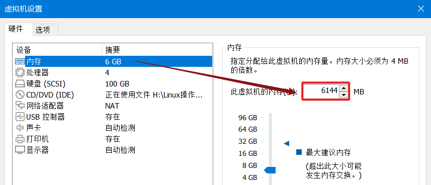
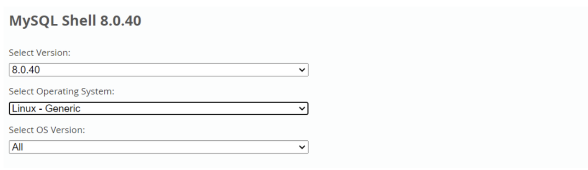
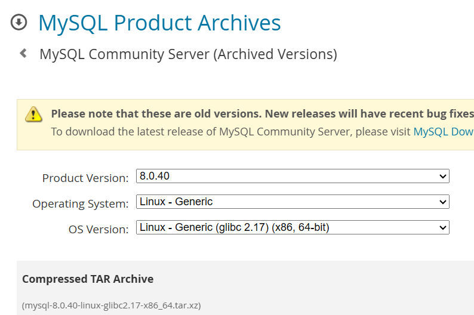
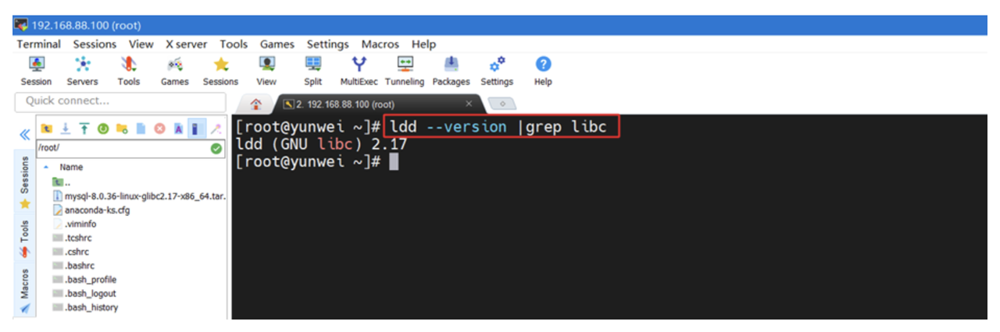
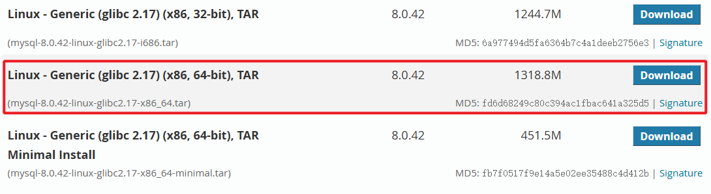
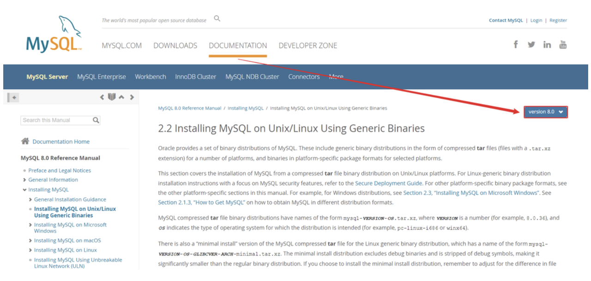
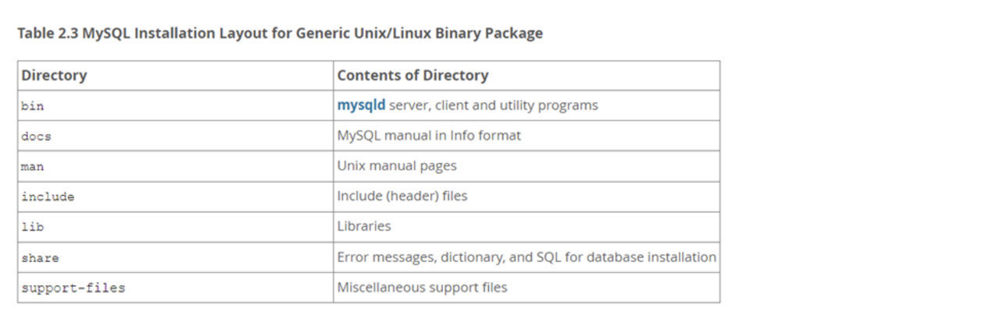
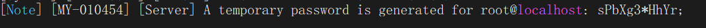
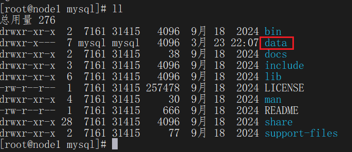

# 任务背景

某互联网初创公司核心业务数据运行在 **MySQL 5.7** 版本的数据库中，已经稳定运行了几年。但随着业务扩展和新功能的上线，现有 **MySQL 5.7** 版本已经无法满足需求，主要问题包括：

* **部分新功能依赖于 MySQL 8.0**（如<span style="color: rgb(216,57,49); background-color: inherit">窗口函数</span>、<span style="color: rgb(216,57,49); background-color: inherit">通用表达式 CTE</span>、<span style="color: rgb(216,57,49); background-color: inherit">JSON 增强</span>、<span style="color: rgb(216,57,49); background-color: inherit">角色管理</span>等）。

* **MySQL 5.7 版本存在已知 Bug**，影响查询性能和数据一致性。

* **官方支持问题**：MySQL 5.7 于 **2023 年 10 月 结束支持（EOL）**，升级到 MySQL 8.0 以获得长期支持和安全更新。

因此，公司决定将 **MySQL 5.7 迁移到 MySQL 8.0**，并确保数据库的可用性和数据完整性，以支持业务持续增长。

# 任务拆解

* 在 <span style="color: rgb(216,57,49); background-color: inherit">CentOS Stream 9 </span>上安装 MySQL 8.0

* 能够把MySQL 8.0软件安装部署封装为一个<span style="color: rgb(216,57,49); background-color: inherit">Shell脚本</span>


# 一、数据库概述

## 1、数据库概述

数据库就是<span style="color: rgb(216,57,49); background-color: inherit">存储数据的仓库</span>，其本质是一个<span style="color: rgb(216,57,49); background-color: inherit">文件系统</span>，按照特定的格式将数据存储起来，用户可以对数据库中的数据进行<span style="color: rgb(216,57,49); background-color: inherit">增加，修改，删除及查询操作（增删改查）。</span>

随着互联网的高速发展，大量的数据在不断的产生，伴随而来的是如何高效安全的存储数据和处理数据，而这一问题成为了信息时代的一个非常大的问题，而使用数据库可以高效的有条理的储存数据。

* 可以<span style="color: rgb(216,57,49); background-color: inherit">结构化（有行有列）存储大量的数据</span>；

* 可以有效的保持<span style="color: rgb(216,57,49); background-color: inherit">数据的一致性、完整性</span>；

* <span style="color: rgb(216,57,49); background-color: inherit">读写效率极高</span>。


## 2、数据库分类

数据库又分为<span style="color: rgb(216,57,49); background-color: inherit">关系型数据库</span>和<span style="color: rgb(216,57,49); background-color: inherit">非关系型数据库</span>

### ☆ 关系型数据库

关系型数据库：指采用了<span style="color: rgb(216,57,49); background-color: inherit">关系模型（二维结构，有行有列）</span>来组织数据的数据库。

关系模型指的就是二维表格模型，而一个关系型数据库就是由二维表及其之间的联系所组成的一个数据组织。

初学阶段，我们可以先简单的讲关系型数据库理解为一个Excel表格：


### ☆ 非关系型数据库NoSQL

非关系型数据库：又被称为<span style="color: rgb(216,57,49); background-color: inherit">NoSQL</span>（Not Only SQL )，意为不仅仅是SQL，对NoSQL 最普遍的定义是“<span style="color: rgb(216,57,49); background-color: inherit">非关联型的</span>”，强调<span style="color: rgb(216,57,49); background-color: inherit"> Key-Value 的方式存储数据</span>。

> 类似Python中字典结构：{"name":"赵飞", "age":25, "gender":"male",...}

> key（键）：value（值），组合在一起key：value键值对！！！

Key-Value结构存储： Key-value数据库是一种以<span style="color: rgb(216,57,49); background-color: inherit">键值对存储数据的一种数据库</span>，类似Java中的map。可以将整个数据库理解为一个大的map，每个键都会对应一个唯一的值。


> key:value键值对型应用，常应用于内存型数据库，如Redis、MongoDB、Elasticsearch、HBase等等。


小结：关系型和非关系型数据库区别？

关系型：通过<span style="color: rgb(216,57,49); background-color: inherit">二维表维持数据关系</span>（有行有列），大部分存储在<span style="color: rgb(216,57,49); background-color: inherit">硬盘</span>，查询速度上<span style="color: rgb(216,57,49); background-color: inherit">关系型要慢一些，相对而言，安全性更高</span>。

非关系型：通过<span style="color: rgb(216,57,49); background-color: inherit">key:value键值对维持数据</span>关系，大部分存储在<span style="color: rgb(216,57,49); background-color: inherit">内存</span>，查询速度上要<span style="color: rgb(216,57,49); background-color: inherit">相对于关系型数据库更快一些，安全系数相对关系型而言不高。</span>

## 3、常见数据库介绍

### ☆ 关系型数据库

| **数据库**        | **介绍**                                        |
| -------------- | --------------------------------------------- |
| **MySQL**      | 开源免费的数据库，中型的数据库.已经被Oracle收购了.MySQL6.x版本也开始收费。 |
| **Oracle**     | 收费的大型数据库，Oracle公司的产品。Oracle收购SUN公司，收购MYSQL。   |
| **DB2**        | IBM公司的数据库产品,收费的。常应用在银行系统中。                    |
| **SQL Server** | MicroSoft 公司收费的中型的数据库。C#、.net等语言常使用。          |
| **SQLite**     | 嵌入式的小型数据库，应用在手机端。                             |

### ☆ 非关系型数据库

| **数据库**     | **介绍**                                 |
| ----------- | -------------------------------------- |
| **Redis**   | 是一个小而美的数据库，主要用在key-value 的内存缓存，读写性能极佳。 |
| HBase       | HBase是列式数据库，目标是高效存储大量数据。               |
| **MongoDB** | MongoDB是文档型数据库，非常接近关系型数据库的。            |

## 4、小结

① 数据库就是（<span style="color: rgb(216,57,49); background-color: inherit">存储数据的仓库</span>），用户可以对数据库中的数据进行（<span style="color: rgb(216,57,49); background-color: inherit">增删改查</span>）操作

② 数据库分为（<span style="color: rgb(216,57,49); background-color: inherit">关系型数据库</span>）和（<span style="color: rgb(216,57,49); background-color: inherit">非关系型数据库</span>）。

③ 常用的关系型数据库有：<span style="color: rgb(216,57,49); background-color: inherit">MySQL、Oracle</span>

④ 常用的非关系型数据库有：<span style="color: rgb(216,57,49); background-color: inherit">Redis、MongoDB</span>

# 二、MySQL数据库

## 1、MySQL概述

MySQL 是一种广泛使用的<span style="color: rgb(216,57,49); background-color: inherit">开源免费的关系型数据库管理系统</span>，以其高性能、可靠性和易用性著称。它基于<span style="color: rgb(216,57,49); background-color: inherit">结构化查询语言（SQL）</span>来管理和查询数据，常用于 Web 应用开发和各类企业级应用。MySQL 支持<span style="color: rgb(216,57,49); background-color: inherit">跨平台</span>运行，能够在<span style="color: rgb(216,57,49); background-color: inherit"> Linux、Windows、macOS</span> 等操作系统上执行。它提供了丰富的功能，如<span style="color: rgb(216,57,49); background-color: inherit">事务处理</span>、<span style="color: rgb(216,57,49); background-color: inherit">主从复制</span>、<span style="color: rgb(216,57,49); background-color: inherit">存储引擎选择</span>（如 InnoDB 和 MyISAM）、<span style="color: rgb(216,57,49); background-color: inherit">高可用性配置</span>等，适合从<span style="color: rgb(216,57,49); background-color: inherit">小型项目到大规模分布式系统</span>的不同需求。

瑞典AB公司（latin1拉丁）=> Sun公司（Java） => Oracle（甲骨文）

MySQL数据库可能涉及两个版本：Oracle MySQL（官方）、MariaDB（MySQL替代版，一直强调开源、免费）

## 2、MySQL的特点

<span style="color: rgb(216,57,49); background-color: inherit">开源、免费</span>

MySQL是开源的，所以你不需要支付额外的费用。

MySQL支持<span style="color: rgb(216,57,49); background-color: inherit">大型的数据库</span>。可以处理拥有<span style="color: rgb(216,57,49); background-color: inherit">上千万条记录的大型数据库</span>。

MySQL使用<span style="color: rgb(216,57,49); background-color: inherit">标准的SQL数据语言</span>形式。 => show databases; create user; grant all;这些都属于SQL语句

MySQL可以安装在<span style="color: rgb(216,57,49); background-color: inherit">不同的操作系统</span>，并且<span style="color: rgb(216,57,49); background-color: inherit">提供多种编程语言的操作接口</span>。这些编程语言包括<span style="color: rgb(216,57,49); background-color: inherit">C、C++、Python、Java、Ruby</span>等等。

## 3、MySQL版本

<span style="color: rgb(216,57,49); background-color: inherit">MySQL Community Server：社区版本，开源免费</span>，但不提供官方技术支持。

MySQL Enterprise Edition：企业版本，需付费，可以试用30天。

MySQL Cluster：集群版，开源免费。可将几个MySQL Server封装成一个Server。

MySQL NDB Cluster CGE：高级集群版，需付费。

MySQL Workbench（GUITOOL）：一款专为MySQL设计的ER/数据库建模工具。它是著名的数据库设计工具DBDesigner4的继任者。MySQL Workbench又分为两个版本，分别是社区版（MySQL Workbench OSS）、商用版（MySQL WorkbenchSE）。

## 4、MySQL数据库服务器

MySQL数据库：全称叫做<span style="color: rgb(216,57,49); background-color: inherit">MySQL数据库管理系统</span>！！！

MySQL数据库管理系统是一个C/S架构的软件，C全称（Client）客户端，S全称（Server）服务器端。

MySQL 数据库服务器是运行 <span style="color: rgb(216,57,49); background-color: inherit">MySQL 数据库管理系统的主机</span>，它负责处理<span style="color: rgb(216,57,49); background-color: inherit">客户端发出的数据库请求，包括数据查询、插入、更新和删除操作。</span>

MySQL 数据库服务器通常由<span style="color: rgb(216,57,49); background-color: inherit">一个或多个 MySQL 实例</span>组成，这些实例<span style="color: rgb(216,57,49); background-color: inherit">管理数据库和处理 SQL 语句，确保数据的存储、读取和安全性</span>。

> MySQL数据库服务器（Linux操作系统） =》  MySQL数据库管理系统（实例）=》 数据库 =》数据表 =》数据

## 5、MySQL官网

MySQL官网：www.mysql.com

## 6、MySQL安装方式

① yum安装（已经使用过）

② 二进制安装（相当于Windows中的绿色软件）

③ 源码包编译安装


三种安装方式的区别：

| 安装方式                                                     | 优点                                                         | 缺点                                                         |
| ------------------------------------------------------------ | ------------------------------------------------------------ | ------------------------------------------------------------ |
| yum安装                                                      | 安装卸载简单                                                 | 可定制性差                                                   |
| <span style="color: rgb(216,57,49); background-color: inherit">二进制安装</span> | <span style="color: rgb(216,57,49); background-color: inherit">可定制性相比rpm包灵活些</span> | <span style="color: rgb(216,57,49); background-color: inherit">安装相比rpm包复杂些，需要手动初始化数据库</span> |
| 源码安装                                                     | 可定制性最强，根据需求和功能定制                             | 安装麻烦，需要手动初始化数据库                               |


# 三、MySQL8数据库安装部署

前置Linux环境准备：

第一步：恢复node1快照到标准配置

第二步：设置内存大小，尽量不低于6G

恢复完成后，设置node1服务器的内存大小为6G（官方建议最小不低于6G），否则会导致后期配置出现异常！！！



第三步：设置IP地址、主机名称（符合FQDN规范）、关闭SELinux、防火墙规则，释放3306端口


## 1. 下载MySQL软件包

下载地址：https://dev.mysql.com/downloads/mysql/



如果当前版本不符合,可以在归档页面查找



查看GLIBC版本，如下图所示,要求Linux系统中glibc版本大于等于mysql的要求版本

```bash
ldd --version
```



下载对应版本的MySQL软件包



## 2. 查看MySQL GLIBC安装文档

官方地址：https://dev.mysql.com/doc/refman/8.0/en/binary-installation.html



## 3. 安装MySQL软件

安装MySQL依赖包：

```bash
# libaio 是 Linux 的异步 I/O (Asynchronous Input/Output) 库，全称是 Linux Asynchronous I/O Library。
yum install libaio -y
```

对MySQL压缩包进行解压缩操作：

```bash
tar -xf mysql-8.0.40-linux-glibc2.17-x86_64.tar.xz

# -xf：可以解压任何tar类型的压缩包，如.tar.gz或.tar.xz格式压缩包
```

目录结构说明：



软件安装路径、数据路径以及端口设置：

| **选项** | **值（自定义也可以采用默认形式）** /usr/local |
| -------- | --------------------------------------------- |
| 安装路径 | /export/server/mysql                          |
| 数据路径 | /export/server/mysql/data                     |
| 端口号   | 3306                                          |

具体安装步骤：

准备工作，提前卸载与mariadb相关软件包,Centos Stream 9 最小安装(mini)时没有默认安装,Linux发行版本中有可能预装了mariadb

```PowerShell
rpm -qa | grep mariadb
```

第一步：创建一个数据库专用账号mysql（其所属组也为mysql） => -r系统账号，-s可以使用shell

```PowerShell
useradd -r -s /sbin/nologin mysql
```

第二步：清空系统中的原有mariadb的配置文件(/etc/my.cnf),因为没有安装,这一步可以跳过

```PowerShell
rm -rf /etc/my.cnf
```

第三步：把mysql解压后的压缩包移动到/export/server目录下，然后更名为mysql

```PowerShell
mkdir -p /export/server
mv mysql-8.0.40-linux-glibc2.17-x86_64 /export/server/mysql
```

第四步：切换到mysql工作目录/export/server/mysql

```PowerShell
cd /export/server/mysql
```

第五步：<span style="color: rgb(216,57,49); background-color: inherit">初始化数据库（可以实现数据库的初始化，而且会产生一个随机密码）</span>

```PowerShell
/export/server/mysql/bin/mysqld --initialize --user=mysql --basedir=/export/server/mysql &> /tmp/mysqld.log

选项说明：
--initialize   初始化（真正开始干活）
--user=mysql   以mysql用户的身份初始化数据库，产生文件都是mysql作为拥有者
--basedir=xxx  mysql其安装目录，非常重要
```

运行完毕后，观察/tmp/mysqld.log最后一行，保存root账号的密码，以备后期使用。



同时可以查看下mysql目录下多了一个data数据目录.



第六步：设置安全加密连接（SSL），数据传输会采用加密形式，适合敏感数据

```bash
/export/server/mysql/bin/mysql_ssl_rsa_setup --datadir=/export/server/mysql/data
```

第七步：创建mysqld.service

```bash
vi /etc/systemd/system/mysqld.service

[Unit]
Description=MySQL Server
After=network.target

[Service]
User=mysql
Group=mysql
Type=forking

# MySQL 执行命令及路径
ExecStart=/export/server/mysql/bin/mysqld --daemonize --pid-file=/export/server/mysql/data/mysqld.pid
ExecStop=/export/server/mysql/bin/mysqladmin --defaults-file=/export/server/mysql/my.cnf shutdown

# Ensure MySQL has sufficient time to start up
TimeoutSec=600

# PID 文件路径
PIDFile=/export/server/mysql/data/mysqld.pid

# Enable these options to auto-restart the service if it crashes
Restart=on-failure
RestartSec=5

[Install]
WantedBy=multi-user.target
```

服务创建完成后，重新加载 systemd 服务

```bash
systemctl daemon-reload
```

第八步：启动MySQL数据库

```bash
systemctl start mysqld
systemctl enable mysqld
systemctl status mysqld
```

## 4. 安装后续配置

第一步：修改MySQL密码

```bash
cd /export/server/mysql
bin/mysqladmin -uroot password '123456' -p
Enter password：输入初始化时获取的临时密码
```

第二步：把MySQL客户端添加到环境变量

```bash
echo 'export PATH=$PATH:/export/server/mysql/bin' >> /etc/profile


mysql -uroot -p
Enter password: 123456
```

首次登录报错：

mysql: error while loading shared libraries: libncurses.so.5: cannot open shared object file: No such file or directory

解决方案：

```PowerShell
ln -s /lib64/libncurses.so.6 /lib64/libncurses.so.5
```

mysql: error while loading shared libraries: libtinfo.so.5: cannot open shared object file: No such file or directory

解决方案：

```PowerShell
ln -s /lib64/libtinfo.so.6 /lib64/libtinfo.so.5
```

第三步：手动定制my.cnf配置文件 

```PowerShell
vi /etc/my.cnf
添加如下内容：
[mysqld]
basedir=/export/server/mysql
datadir=/export/server/mysql/data
socket=/tmp/mysql.sock
character_set_server=utf8mb4
collation-server=utf8mb4_unicode_ci


选项说明：
[mysqld]  代表针对服务器端进行配置
basedir   代表数据库的安装目录
datadir   代表数据目录，以后专门用于存放数据文件的（核心目录）
socket    代表套接字文件，专门为客户端与服务器端连接提供一个桥梁 => mysql 连接（桥梁：mysql.sock） mysqld服务器端
character_set_server  字符集  utf8  utf8mb4 如果你的数据中有表情符号 必须使用utf8mb4
collation-server      排序规则   unicode_ci 基于 Unicode 标准的排序规则，ci 表示不区分大小写
```

第四步：安全配置

```PowerShell
mysql_secure_installation

① 输入密码
② 直接回车，不开启密码插件  no
③ 直接回车，不改变root密码  no
④ Y，移除默认匿名账号（不移除有安全隐患）
⑤ Disallow root login remotely?禁用root远程连接 => 输入Y，禁用远程登录
⑥ Y，移除test数据库
⑦ Y，刷新权限
```

第五步：把MySQL服务器添加到开机启动项

```PowerShell
systemctl restart mysqld
systemctl status mysqld
```

第六步: 添加root@%用户,能够任意主机访问

```bash
CREATE USER 'root'@'%' IDENTIFIED BY '123456';
GRANT ALL PRIVILEGES ON *.* TO 'root'@'%';
flush privileges;
```

第七步: 开放防火墙

```bash
firewall-cmd --add-service=mysql --permanent
firewall-cmd --reload
firewall-cmd --list-all
```


## 5. MySQL脚本程序封装

前置条件

第一步：恢复快照

第二步：重新上传MySQL软件到到/root目录

第三步: 编写shell脚本

vi /root/mysql.sh

```PowerShell
#!/bin/bash
#1.安装依赖软件
echo "正在安装依赖软件..."
yum -y install libaio &> /dev/null
if [ $? -ne 0 ];then
    echo "libaio安装失败"
    exit 1
fi
#2.判断是否有压缩包，如果有，则执行解压缩操作
echo "正在判断是否有压缩包，如果有进行解压缩操作..."
if [ -f mysql-8.0.40-linux-glibc2.17-x86_64.tar.xz ]; then
    tar -xf mysql-8.0.40-linux-glibc2.17-x86_64.tar.xz
fi
#3.判断系统中是否安装过mariadb软件，如果有对其进行卸载操作
echo "正在判断系统中是否安装过mariadb软件，如果有对其进行卸载操作..."
rpm -qa | grep mariadb | xargs -r dnf remove -y
# 如果前面my.cnf文件不存在,后面rm就不执行,就相当于被短路了
[ -f /etc/my.cnf ] && rm -rf /etc/my.cnf
#4.创建mysql系统账号
id mysql &> /dev/null
[ $? -ne 0 ] && useradd -r -s /sbin/nologin mysql
#5.创建/export/server目录，然后移动mysql压缩包解压后的文件到/export/server目录下
rm -rf /export/server
mkdir -p /export/server
mv mysql-8.0.40-linux-glibc2.17-x86_64 /export/server/mysql
#6.进入mysql目录，对其进行初始化操作
echo "正在进入mysql目录，对其进行初始化操作..."
cd /export/server/mysql
bin/mysqld --initialize --user=mysql --basedir=/export/server/mysql --datadir=/export/server/mysql/data 2>&1 | tee /tmp/mysqld.log | grep password | awk '{print $NF}' > /tmp/mysql_temp_password.txt
#7.设置ssl加密传输连接
bin/mysql_ssl_rsa_setup --datadir=/export/server/mysql/data &> /dev/null
#8.设置my.cnf与mysqld.service文件
echo "正在设置my.cnf与mysqld.service文件..."
cat > /etc/my.cnf <<EOF
[mysqld]
port=3306
basedir=/export/server/mysql
datadir=/export/server/mysql/data
socket=/tmp/mysql.sock
character_set_server=utf8
collation-server=utf8_unicode_ci
EOF

cat > /etc/systemd/system/mysqld.service <<EOF
[Unit]
Description=MySQL Server
After=network.target

[Service]
User=mysql
Group=mysql
Type=forking

# MySQL 执行命令及路径
ExecStart=/export/server/mysql/bin/mysqld --daemonize --pid-file=/export/server/mysql/data/mysqld.pid
ExecStop=/export/server/mysql/bin/mysqladmin --defaults-file=/export/server/mysql/my.cnf shutdown

# Ensure MySQL has sufficient time to start up
TimeoutSec=600

# PID 文件路径
PIDFile=/export/server/mysql/data/mysqld.pid

# Enable these options to auto-restart the service if it crashes
Restart=on-failure
RestartSec=5

[Install]
WantedBy=multi-user.target
EOF
#9.刷新后台服务，然后启动mysqld
echo "正在刷新后台服务，然后启动mysqld..."
systemctl daemon-reload
systemctl start mysqld
systemctl enable mysqld
#10.重置mysql管理员密码为123456
echo "正在重置mysql管理员密码..."
cd /export/server/mysql
temp_password=`cat /tmp/mysql_temp_password.txt`
bin/mysqladmin -uroot password '123456' -p$temp_password
#11.把mysql的bin目录添加到环境变量中
echo 'export PATH=$PATH:/export/server/mysql/bin' >> /etc/profile
source /etc/profile
#12.解决mysql客户端首次无法登录问题
[ ! -f /lib64/libncurses.so.5 ] && ln -s /lib64/libncurses.so.6 /lib64/libncurses.so.5
[ ! -f /lib64/libtinfo.so.5 ] && ln -s /lib64/libtinfo.so.6 /lib64/libtinfo.so.5
#13.弹出提示，MySQL安装成功
echo "MySQL安装成功，软件安装路径：/export/server/mysql，数据库初始密码：123456！"
```

xargs：相当于|管道命令的补充符号，并不是所有的命令都支持|管道符号，但是如果一个命令不支持|管道，我们可以使用xargs让其强制支持。

`xargs -r`<span style="color: rgb(216,57,49); background-color: inherit"> 的作用是确保只有在 </span>`grep mariadb`<span style="color: rgb(216,57,49); background-color: inherit"> 查找到匹配的包名时，才会执行 </span>`dnf remove -y`<span style="color: rgb(216,57,49); background-color: inherit"> 命令。如果 </span>`grep`<span style="color: rgb(216,57,49); background-color: inherit"> 没有找到任何匹配项，</span>`xargs -r`<span style="color: rgb(216,57,49); background-color: inherit"> 会防止 </span>`dnf remove`<span style="color: rgb(216,57,49); background-color: inherit"> 命令被执行。</span>


```PowerShell
chmod +x mysql.sh
./mysql.sh
```


## 任务场景：忘记密码解决方案

忘记密码解决方案：

第一步：停止mysqld服务

```PowerShell
systemctl stop mysqld
```

第二步：以无授权模式启动mysqld

无授权模式，就是客户端连接mysql服务器端不进行密码验证。

```PowerShell
mysqld_safe --skip-grant-tables &

mysqld_safe：其实就是mysql进程，systemctl start mysqld相当于授权模式启动mysqld_safe
--skip-grant-tables：跳过密码验证
&：后台运行，不会影响命令行其他命令运行
```

第三步：登录mysql并重置密码（只能把密码置空！！！）

mysql8.0.40版本，不允许在非授权模式直接更改密码，我们只能把密码置空！！！

```PowerShell
mysql -uroot
回车

mysql> UPDATE mysql.user SET authentication_string='' WHERE user='root';
mysql> FLUSH PRIVILEGES;
```

第四步：关闭mysqld服务，正常启动mysqld

```PowerShell
1. 查看后台运行进程,查看当前终端里放到后台的进程
jobs

2. 杀掉 jobs 显示的 编号 1 的后台任务,只能杀本终端放后台的进程
kill %1

3. 重启MySQL
systemctl restart mysqld
```

第五步：重置密码

```PowerShell
mysql -uroot -p
回车

mysql> ALTER USER 'root'@'localhost' IDENTIFIED BY '123456'; 
mysql> flush privileges;
```


