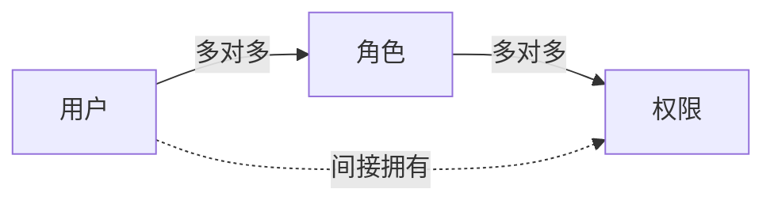
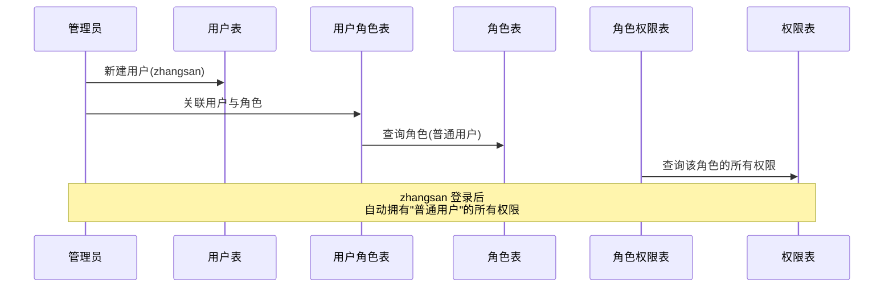
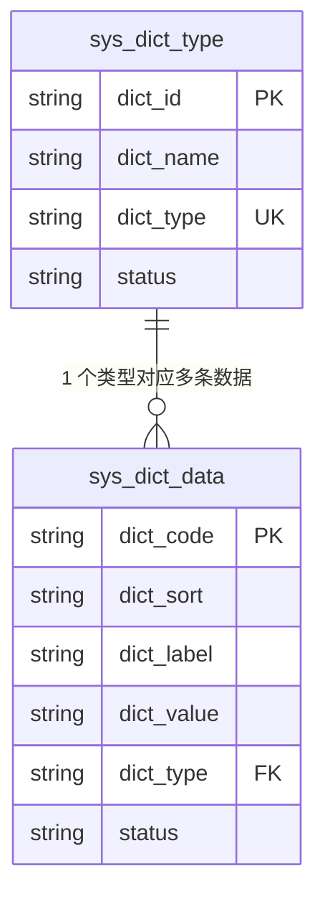

# Day60 若依(RuoYi)框架

> [!info] 本节概览
> 本节系统学习 **若依(RuoYi)** 快速开发平台:从项目搭建、代码生成、到权限管理(RBAC)和字典管理的完整流程。

---

## 一、若依概述

> [!quote] 一句话理解
> 若依 = 一套**开箱即用**的快速开发脚手架,让开发者只专注于**业务**而不是基础设施。

- **快速开发平台**:把企业项目中重复出现的能力(系统管理、权限、代码生成、监控、定时任务等)提前做好。
- **封装好系统管理、权限管理等基础功能**:我们只需要在它的基础上完成**业务开发**,即可快速交付项目。

> [!tip] 若依能帮你解决什么?
> - 用户/角色/菜单/部门等基础模块无需从零搭建
> - 内置代码生成器,一键生成前后端 CRUD 代码
> - 自带权限框架、字典管理、参数管理、监控等模块
> - 前后端分离架构,后端 SpringBoot + 前端 Vue / Element Plus

---

## 二、前后端分离版本搭建

### 2.1 后端启动步骤

> [!example] 后端启动 4 步走
> 1. 使用 IDEA 打开项目,进行配置并下载依赖(Maven 依赖)
> 2. 创建数据库,执行 SQL 脚本(若依自带 `ry_*.sql`)
> 3. 启动本地 Redis(默认端口 6379)
> 4. 启动 SpringBoot 主类(默认端口 8080)

> [!warning] 常见坑
> Redis 没启动 → 验证码 / 登录接口会报错;SQL 脚本字符集不一致 → 中文乱码。

### 2.2 前端启动步骤

> [!example] 前端启动 2 步走
> 1. 在前端项目根目录执行 `npm install` 安装依赖
> 2. 执行 `npm run dev` 启动开发服务器(默认端口 80)

```bash
# 常用命令汇总
npm install      # 安装依赖
npm run dev      # 启动开发环境
npm run build:prod  # 打包生产环境
```

---

## 三、入门案例 — 代码生成器

### 3.1 核心思路

使用 **若依内置的代码生成器** 来生成课程(`tb_course`)的前后端代码,极大减少重复劳动。

### 3.2 代码生成配置说明

代码生成器分为三个配置页签,逐步引导完成配置。

#### ① 基本信息

主要修改 **实体类名** 和 **作者**。

![[基本信息.png]]

| 字段 | 必填 | 说明 |
| :--- | :---: | :--- |
| 表名称 | ✅ | 数据库表名,如 `tb_course` |
| 表描述 | ✅ | 业务含义,如 "课程管理" |
| **实体类名称** | ✅ | 自动生成实体类名,如 `Course` |
| **作者** | ✅ | 用于代码注释 `@author` |
| 备注 | ❌ | 额外说明 |

#### ② 字段信息

根据数据库字段与实体类属性的对应关系进行配置。

![[字段信息.png]]

> [!note] 颜色框说明(对应截图中的彩色边框)
> - **红色框**:数据库字段与实体类属性对应关系
> - **紫色框**:对表格(列表页)进行配置
> - **黄色框**:对查询表单进行配置
> - **绿色框**:对新增和修改表单进行配置
> - **蓝色框**:对新增/修改表单和查询表单进行配置

#### ③ 生成信息

配置生成路径、模块名、业务功能名等。

![[生成信息.png]]

| 字段 | 必填 | 示例值 | 说明 |
| :--- | :---: | :--- | :--- |
| 生成模板 | ✅ | 单表(增删改查) | 选择生成策略 |
| 前端类型 | ✅ | Vue3 Element Plus 模板 | 决定前端技术栈 |
| **生成包路径** | ✅ | `com.ruoyi.product` | 后端包名,通常一个模块下对应多个业务功能 |
| **生成模块名** | ✅ | `product` | 模块名 |
| **生成业务名** | ✅ | `course` | 业务功能名 |
| 生成功能名 | ✅ | 课程管理 | 中文菜单名 |
| 生成代码方式 | ✅ | zip 压缩包 | 也可自定义路径 |
| 上级菜单 | ❌ | 请选择系统菜单 | 生成后挂载到哪个菜单下 |

> [!tip] 命名规范建议
> 包路径(模块名)用**业务域**,业务名用**实体名**:
> - 包路径:`com.ruoyi.product` → 模块 `product`
> - 业务名:`course` → 实体 `Course`
> - 这样生成出来的代码结构清晰、便于维护。

---

## 四、权限管理(RBAC)

### 4.1 什么是 RBAC

> [!abstract] RBAC 定义
> **RBAC(Role-Based Access Control)** —— **基于角色的访问控制模块**。
> 用户 → 角色 → 权限,三者解耦,权限不直接赋给用户,而是先赋给角色,再把角色赋给用户。



### 4.2 RBAC 模型至少需要几张表

> [!example] 至少 5 张表
> 用户和角色之间是**多对多**关系,角色和权限之间是**多对多**关系。

| # | 表名 | 说明 | 关系 |
| :-: | :--- | :--- | :--- |
| 1 | 用户表(`sys_user`) | 存储用户基本信息 | — |
| 2 | 角色表(`sys_role`) | 存储角色信息,如管理员、普通用户 | — |
| 3 | 权限表(`sys_menu` / `sys_permission`) | 存储菜单/按钮/接口权限 | — |
| 4 | **用户角色表**(`sys_user_role`) | 关联用户与角色 | 用户 ⇄ 角色 |
| 5 | **角色权限表**(`sys_role_menu`) | 关联角色与权限 | 角色 ⇄ 权限 |

> [!tip] 记忆口诀
> **3 张主表 + 2 张关系表 = 5 张表**

### 4.3 权限分配流程

> [!note] 标准流程
> 1. **新建用户** → 在用户管理中新增一个用户
> 2. **给用户设置角色** → 在用户详情中分配一个或多个角色
> 3. **用户自动获得角色对应的权限** → 角色已绑定菜单/按钮/接口权限



---

## 五、字典管理

### 5.1 为什么需要字典

> [!quote] 字典的作用
> 字典表用来存储 **状态数据**、**下拉选项数据**。可以在页面**动态修改**,而**不需要修改代码、重启项目**。

> [!example] 典型场景
> - 课程的"适用人群":儿童 / 成人 / 老人 / 全人群
> - 订单的"订单状态":待支付 / 已支付 / 已发货 / 已完成
> - 用户的"性别":男 / 女 / 未知
>
> 这些选项以前都写死在代码里,改一次要发版一次。用字典之后,**运营人员就能在页面上改**。

### 5.2 字典涉及的两张表

> [!info] 1 对多关系
> 字典类型与字典数据是 **1 对多** 关系。

| 表名 | 作用 | 关键字段 |
| :--- | :--- | :--- |
| `sys_dict_type` 字典类型表 | 定义"字典的分类" | `dict_type`(字典类型编码)、`dict_name`(字典名称) |
| `sys_dict_data` 字典数据表 | 存储某个字典类型下的所有选项 | `dict_type`(外键)、`dict_label`(显示文本)、`dict_value`(实际值) |



### 5.3 使用方式

> [!example] 页面上的使用
> - 在"字典管理 → 字典类型"中新增一个分类(如 `course_applicable_people`)
> - 在"字典管理 → 字典数据"中为该类型添加多条数据
> - 前端通过字典类型 `course_applicable_people` 即可拉取所有选项渲染下拉框

> [!success] 带来的好处
> - 改选项不动代码,改完即生效
> - 多处复用同一份数据,避免硬编码
> - 维护成本低,运营可自助维护

---

## 六、知识小结

| 模块 | 关键点 | 记忆关键字 |
| :--- | :--- | :--- |
| 若依概述 | 快速开发平台,封装基础功能 | 开箱即用,专注业务 |
| 前后端分离搭建 | 后端 4 步 / 前端 2 步 | Redis + SQL + SpringBoot + npm |
| 代码生成器 | 基本信息 / 字段信息 / 生成信息 | 三步配置,一键生成 CRUD |
| 权限管理 RBAC | 用户 ⇄ 角色 ⇄ 权限,**3 主表 + 2 关系表** | 5 张表,多对多多对多 |
| 字典管理 | `sys_dict_type` + `sys_dict_data`,1 对多 | 动态选项,改数据不改代码 |

> [!question] 课后思考
> 1. 若依的代码生成器生成出来的代码,如何与现有业务模块做隔离?
> 2. RBAC 模型如果要给"按钮级别"做权限控制,`sys_menu` 表该如何设计?
> 3. 字典管理能否做成"按业务模块"隔离?如何改造?

---

> [!info] 参考资源
> - 若依官方文档:[http://doc.ruoyi.vip](http://doc.ruoyi.vip)
> - Gitee 仓库:[https://gitee.com/y_project/RuoYi-Vue](https://gitee.com/y_project/RuoYi-Vue)
