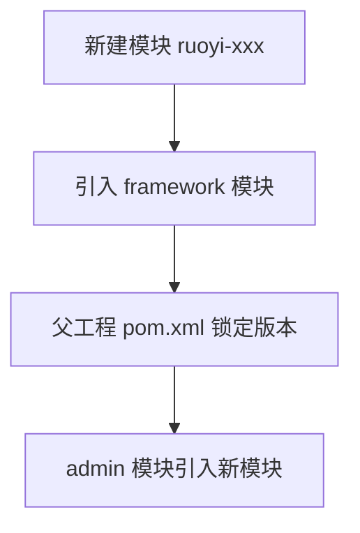
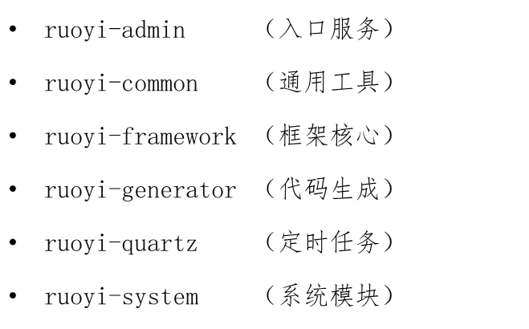

# Day61 定时任务·代码生成·接口测试·新建模块

> [!info] 本节概览
> 本节围绕若依框架展开四大主题:**定时任务**(Spring Task / Quartz)、**代码生成**(三种模板)、**接口测试**(Swagger / Knife4j)、**新建模块**。

---

## 一、定时任务

> [!abstract] 什么是定时任务
> 让系统在**指定的时间点**或**周期性**地自动执行某个业务逻辑,无需人工触发。比如每天凌晨统计报表、定时清理过期数据、定时推送消息等。

若依中提供两种定时任务方案,对比如下:

| 对比项 | Spring Task | Quartz |
| :--- | :--- | :--- |
| 集群支持 | ❌ 不支持集群 | ✅ 支持集群 |
| 规则类型 | 静态规则(代码中写死) | 动态规则(记录在数据库中) |
| 使用门槛 | 开箱即用,极简 | 相对复杂,但若依已集成 |
| 适用场景 | 单机、简单、固定频率任务 | 分布式、需要动态配置的任务 |

### 1.1 Spring Task

> [!note] 特点
> - **不支持集群**:任务只会在单台机器上执行,多实例部署时会重复执行
> - **静态规则**:执行时间写在代码里(`cron` 表达式),改规则需要改代码重新发布

> [!example] 用法(三步)
> 1. **基于 Spring Boot 开箱即用**,无需额外依赖
> 2. **定义任务类和任务方法**(用 `@Component` + `@Scheduled` 注解)
> 3. **在启动类上添加 `@EnableScheduling`** 开启定时任务

```java
// 1. 定义任务类与方法
@Component
public class MyTask {

    // cron 表达式: 秒 分 时 日 月 周
    @Scheduled(cron = "0 0 3 * * ?")  // 每天凌晨 3 点执行
    public void reportTask() {
        System.out.println("执行定时任务...");
    }
}

// 2. 启动类开启定时任务
@SpringBootApplication
@EnableScheduling   // 关键: 开启定时任务
public class RuoYiApplication {
    public static void main(String[] args) {
        SpringApplication.run(RuoYiApplication.class, args);
    }
}
```

![[SpringTask任务类.png]]

### 1.2 Quartz

> [!note] 特点
> - **支持集群**:多实例部署时任务不会重复执行
> - **动态规则**:执行规则记录在**数据库**中,可在页面上动态修改,**无需重启项目**

> [!example] 用法(三步)
> 1. 若依**已经集成好 Quartz,直接使用**
> 2. **定义任务类和任务方法**
> 3. **在前台配置规则**(动态配置调用方法与 cron 表达式)

```java
// Quartz 任务类同样通过 @Component 暴露成 Bean
@Component("courseTask")   // bean 名称用于前台配置时引用
public class CourseTask {

    public void syncCourse() {
        System.out.println("同步课程数据...");
    }
}
```

![[Quartz任务类.png]]

> [!tip] 关键概念:调用方法
> 在前台配置时,调用方法格式为:`bean名称.方法名()`
> - 例如 `courseTask.syncCourse()`
> - **如果有参数,可以进行传递**

![[Quartz前台配置规则.png]]

#### ① 执行策略(任务错过执行时机后的补偿机制)

> [!warning] 什么时候会"错过"?
> 比如任务凌晨 3 点执行,但服务器 2:50~3:10 宕机了,恢复后这 3 点的任务到底还补不补?

| 策略 | 含义 |
| :--- | :--- |
| 放弃执行 | 错过就错过了,不再执行 |
| 执行一次 | 如果错过了多次,只补执行**一次** |
| 立即执行 | 如果错过了多次,**全部**都执行 |

#### ② 是否并发

> [!question] 并发问题
> 任务**没执行完**,但又到了**下一次执行时机**,是否开启**新线程**同时执行?
> - 开启并发 → 允许同一任务多个实例同时跑(注意线程安全问题)
> - 不开启 → 上一次没跑完,这次就跳过/等待

---

## 二、代码生成(三种模板)

若依代码生成器支持三种生成模板,适配不同业务表结构:

| 模板 | 适用场景 | 说明 |
| :--- | :--- | :--- |
| **单表** | 普通的一张表 | 最常见,如 `tb_course`,生成单表 CRUD |
| **树表** | 存在父子层级关系的表 | 如部门、菜单、分类,自带 `parent_id` |
| **主子表** | 一对多关系(主表 + 子表) | 如订单主表 + 订单明细表 |

### 2.1 单表

适合只有一张独立表、无层级、无主从关系的场景(上节课程 `tb_course` 即为此类)。

### 2.2 树表

> [!note] 树表特征
> 表中通常有一个 **`parent_id`(父节点 ID)** 字段,数据之间构成树形层级结构。
> 典型例子:部门表、菜单表、商品分类表。

![[树表模板.png]]

### 2.3 主子表

> [!note] 主子表特征
> **主表 + 子表**构成 **1 对多** 关系,子表通过外键关联主表。
> 典型例子:订单(主) + 订单明细(子)、采购单(主) + 采购明细(子)。

![[主子表模板.png]]

---

## 三、接口测试

### 3.1 Swagger 工具

> [!abstract] Swagger 是什么
> 可以根据代码(控制器类)自动生成**在线接口文档**,方便后端开发进行**接口测试**。

> [!warning] 若依的默认行为
> 若依默认**只保留**添加了 `@ApiOperation` 注解的接口(没有注解的接口不会出现在文档里)。

### 3.2 Knife4j

> [!note] Knife4j 与 Swagger 的关系
> Knife4j 是对 **Swagger UI 的增强方案**,界面更友好、功能更强大。

- 需要引入 Knife4j 对应的**依赖坐标**
- 访问地址:`http://ip:port/doc.html`
- 可以通过**全局参数设置**来统一设置 `token`(解决每个接口都要手动填 token 的麻烦)

```bash
# 访问示例
http://localhost:8080/doc.html
```

### 3.3 Swagger 常用注解

> [!example] 四个注解,加在不同位置

| 注解 | 写法 | 加在哪个位置 |
| :--- | :--- | :--- |
| `@Api` | `@Api(tags = "课程管理")` | 控制器**类**上 |
| `@ApiOperation` | `@ApiOperation("查询课程列表")` | 控制器**方法**上 |
| `@ApiModel` | `@ApiModel("课程实体")` | **Entity / VO / DTO** 类上 |
| `@ApiModelProperty` | `@ApiModelProperty("课程名称")` | 类的**属性**上 |

```java
@RestController
@RequestMapping("/course")
@Api(tags = "课程管理")            // ① 类上
public class CourseController {

    @ApiOperation("查询课程列表")     // ② 方法上
    @GetMapping("/list")
    public AjaxResult list() { ... }
}

@ApiModel("课程实体")                 // ③ 实体类上
public class Course {

    @ApiModelProperty("课程名称")      // ④ 属性上
    private String courseName;
}
```

---

## 四、若依新建模块

> [!info] 为什么要新建模块
> 当业务规模变大时,把不同业务拆成独立模块,便于维护和分工。若依采用 Maven 多模块结构,新建业务模块需要三步。

> [!example] 三步走

1. **新建模块,并引入 `framework` 模块**(获得若依的核心能力)
2. **在父工程 `pom.xml` 中锁定新模块的版本**(统一版本管理)
3. **在 `admin` 模块中引入新模块**(让 admin 能聚合/依赖新模块)



> [!tip] 记忆要点
> 本质就是 Maven 多模块的标准流程:**建模块 → 管版本 → 加依赖**。

### 碎碎念

---
```mermaid
graph TD
    A[新建模块 ruoyi-xxx] --> B[引入 framework 模块]
    B --> C[父工程 pom.]
    C --> D[pageutils调用 TableSupport.buildPageRequest()获取pageDomain对象，获取分页参数]
    D --> E[BaseController调用PageUtilts的startpage()方法]
    E --> F[控制器类调用(从BasetController)startpage()方法]
```
## 五、知识小结

| 模块 | 关键点 | 记忆关键字 |
| :--- | :--- | :--- |
| 定时任务 | Spring Task(单机/静态) vs Quartz(集群/动态) | 集群 + 规则存储位置 |
| Quartz 配置 | 调用方法 `bean名.方法名()`、执行策略、是否并发 | 补偿机制三选一 |
| 代码生成 | 单表 / 树表(`parent_id`)/ 主子表(1 对多) | 三种模板 |
| 接口测试 | Swagger 生成文档,Knife4j 增强,`/doc.html` | 4 个注解 |
| 新建模块 | 建模块 → 锁版本 → admin 引入 | Maven 多模块三步 |

> [!question] 课后思考
> 1. Spring Task 和 Quartz 分别适合什么场景?如果项目单机部署,选哪个更简单?
> 2. Quartz 的"执行策略"和"是否并发"分别解决什么问题?
> 3. 树表和主子表在数据库表结构上各有什么标志性字段?

---

> [!info] 参考资源
> - 若依官方文档:[http://doc.ruoyi.vip](http://doc.ruoyi.vip)
> - Swagger 官网:[https://swagger.io](https://swagger.io)
> - Knife4j 文档:[https://doc.xiaominfo.com](https://doc.xiaominfo.com)
