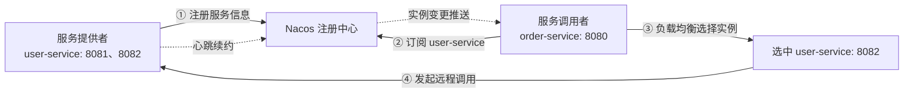

# Day 67 学习笔记：微服务、Nacos 与 OpenFeign

> 本篇整理自 `day67.xmind`，主要涵盖 **架构演变、微服务拆分、远程调用、Nacos 服务注册与发现、OpenFeign** 及其连接池优化与项目实践。

---

## 📚 目录

- [一、架构演变](#一架构演变)
- [二、微服务框架](#二微服务框架)
- [三、服务拆分](#三服务拆分)
- [四、远程调用](#四远程调用)
- [五、注册中心原理](#五注册中心原理)
- [六、Nacos](#六nacos)
- [七、服务注册](#七服务注册)
- [八、服务发现](#八服务发现)
- [九、OpenFeign](#九openfeign)
- [十、知识点速查](#十知识点速查)

---

## 一、架构演变

### 1.1 单体架构

单体架构将所有业务代码写在同一个项目中，最终打成一个软件包，并通常对应一个数据库。

**适用场景：** 中小型项目。

**特点：**

- 项目结构相对简单。
- 开发、测试和部署比较集中。
- 随着业务规模扩大，代码维护、团队协作和高并发处理会变得困难。

### 1.2 微服务架构

微服务架构把大型系统拆分成多个小项目，每个小项目就是一个微服务，通常由服务独立管理自己的数据。

**适用场景：** 大型、复杂或对高并发和扩展性要求较高的项目。

**特点：**

- 每个微服务负责一类相对独立的业务。
- 服务可以独立开发、部署和扩容。
- 服务之间需要通过网络进行远程调用。
- 需要解决服务注册、发现、负载均衡等分布式问题。

### 1.3 架构对比

| 对比项 | 单体架构 | 微服务架构 |
| --- | --- | --- |
| 项目数量 | 一个项目 | 多个小型服务项目 |
| 代码组织 | 所有功能集中在一起 | 按业务拆分 |
| 数据库 | 通常共用一个数据库 | 通常每个服务管理自己的数据 |
| 部署方式 | 整体部署 | 服务可独立部署 |
| 适用规模 | 中小型项目 | 大型项目 |
| 系统复杂度 | 前期较低 | 分布式治理复杂度较高 |

---

## 二、微服务框架

### 2.1 Spring Cloud Alibaba

Spring Cloud Alibaba 是一套微服务解决方案，其中包含多种组件，每类组件用于处理微服务架构中的一类问题。

本节涉及的核心能力：

| 微服务问题 | 对应方案 |
| --- | --- |
| 服务注册与发现 | Nacos |
| 声明式远程调用 | OpenFeign |
| 客户端负载均衡 | Spring Cloud LoadBalancer |

---

## 三、服务拆分

### 3.1 什么时候拆分

可以考虑拆分微服务的情况：

1. 现有单体项目已经无法满足高并发、扩展性或团队协作需求。
2. 项目从立项开始就是大型项目，因此一开始便采用微服务架构。

> ⚠️ 微服务会引入远程调用、网络异常、服务治理和分布式事务等额外复杂度，应根据实际业务规模选择架构。

### 3.2 如何拆分

服务拆分通常遵循 **单一职责原则**：每个微服务只负责一类明确的业务功能。

- **垂直拆分：** 按业务功能拆分，例如用户服务、订单服务、商品服务。
- **水平拆分：** 将多个业务都需要的公共能力单独抽取，例如认证、通知、文件存储等服务。

```text
大型系统
├── 用户服务（垂直拆分）
├── 订单服务（垂直拆分）
├── 商品服务（垂直拆分）
└── 公共能力服务（水平拆分）
```

---

## 四、远程调用

微服务被拆分到不同的进程或服务器后，需要通过网络相互调用。

### 4.1 RestTemplate

`RestTemplate` 可以发送 HTTP 请求并接收响应，从而实现服务之间的远程调用。

基本思路：

```text
服务调用者 → 发送 HTTP 请求 → 服务提供者 → 返回 HTTP 响应
```

直接使用 `RestTemplate` 时，调用方需要自行处理请求地址、参数和响应类型。服务存在多个实例时，还需要配合注册中心和负载均衡机制选择具体实例。

---

## 五、注册中心原理

注册中心负责统一记录服务信息，使调用方不必写死服务提供方的 IP 和端口。

### 5.1 工作流程



### 5.2 核心步骤

1. **服务注册：** 服务提供者将服务名、IP 和端口等信息注册到 Nacos。
2. **服务订阅：** 服务调用者向 Nacos 订阅目标服务的实例信息。
3. **变更推送：** 实例发生上线或下线变化时，注册中心通知调用方。
4. **负载均衡：** 调用方从多个可用实例中选择一个实例。
5. **远程调用：** 调用方根据选中的地址发送 HTTP 请求。
6. **心跳续约：** 服务提供者定期向注册中心报告存活状态。

示例：`user-service` 注册了 `8081`、`8082`、`8083` 三个实例，`order-service` 获取实例列表后，可通过负载均衡选中其中一个实例进行调用。

---

## 六、Nacos

### 6.1 作用

Nacos 在本节中主要作为 **服务注册中心**，用于管理服务实例并支持服务注册与发现。

### 6.2 安装方式

- 可以基于 Docker 安装 Nacos。
- 建议使用 MySQL 作为 Nacos 的持久化方案，以便支持集群部署。

### 6.3 管理控制台

```text
http://<服务器IP>:8848/nacos
```

进入 Web 管理控制台后，可以查看已注册的服务及其具体实例。

---

## 七、服务注册

服务提供方将自己的实例信息注册到 Nacos，因此服务提供方也是一个 Nacos 客户端。

### 7.1 添加依赖

在项目中添加 Nacos 服务发现依赖：

```xml
<dependency>
    <groupId>com.alibaba.cloud</groupId>
    <artifactId>spring-cloud-starter-alibaba-nacos-discovery</artifactId>
</dependency>
```

### 7.2 修改 YAML 配置

```yaml
spring:
  application:
    name: order-service
  cloud:
    nacos:
      server-addr: 192.168.150.102:8848
```

配置含义：

- `spring.application.name`：当前服务注册到 Nacos 时使用的服务名称。
- `spring.cloud.nacos.server-addr`：Nacos 服务端地址。

> 📝 服务名称应根据实际项目设置。服务提供方如果是用户服务，可以配置为 `user-service`。

### 7.3 查看注册结果

启动微服务后，进入 Nacos Web 管理控制台，检查服务是否已经注册。

如果需要模拟同一服务的多个实例，可以使用不同端口分别启动，例如：

```text
user-service: 8081
user-service: 8082
user-service: 8083
```

---

## 八、服务发现

服务调用方从 Nacos 订阅并拉取目标服务的实例信息，因此调用方同样是 Nacos 客户端。

### 8.1 添加依赖和配置

服务调用方也需要：

1. 添加 `spring-cloud-starter-alibaba-nacos-discovery` 依赖。
2. 配置当前服务名和 Nacos 地址。
3. 启动服务并在 Nacos 控制台确认注册状态。

### 8.2 通过 DiscoveryClient 获取实例

获取某个服务的全部实例：

```java
List<ServiceInstance> instances =
        discoveryClient.getInstances("user-service");
```

`getInstances(服务名称)` 返回该服务的实例列表，即 `List<ServiceInstance>`。

获取某个实例的访问地址：

```java
String uri = serviceInstance.getUri().toString();
```

调用方获得服务实例后，可以选择其中一个实例并发起远程调用。

---

## 九、OpenFeign

### 9.1 概述

OpenFeign 是一个 **声明式 HTTP 客户端**，可以让开发者像调用本地 Java 方法一样调用远程服务。

```text
调用 Feign 接口方法 → OpenFeign 生成 HTTP 请求 → 远程服务处理 → 结果转换为 Java 对象
```

### 9.2 引入依赖

```xml
<!-- OpenFeign HTTP 客户端 -->
<dependency>
    <groupId>org.springframework.cloud</groupId>
    <artifactId>spring-cloud-starter-openfeign</artifactId>
</dependency>

<!-- LoadBalancer 负载均衡 -->
<dependency>
    <groupId>org.springframework.cloud</groupId>
    <artifactId>spring-cloud-starter-loadbalancer</artifactId>
</dependency>
```

### 9.3 在启动类开启 OpenFeign

```java
@EnableFeignClients(basePackages = "com.edu.apis.clients")
@SpringBootApplication
public class OrderApplication {
    public static void main(String[] args) {
        SpringApplication.run(OrderApplication.class, args);
    }
}
```

`basePackages` 用于配置 Feign 接口所在的包。如果不指定，则默认扫描当前启动类所在包及其子包。

### 9.4 定义 FeignClient 接口

```java
@FeignClient("user-service")
public interface UserClient {

    @GetMapping("/user/{id}")
    User queryById(@PathVariable("id") Long id);
}
```

重点说明：

- `@FeignClient("user-service")` 中的值是目标服务名称。
- `@GetMapping` 对应远程服务的请求路径。
- 方法参数、返回值应与服务提供方的接口保持一致。
- 调用 `queryById()` 时，OpenFeign 会自动完成 HTTP 请求。

### 9.5 连接池优化

OpenFeign 默认使用 JDK 提供的 `HttpURLConnection`，该方案不支持连接池。可以切换为 OkHttp 客户端，以复用连接并减少频繁建立连接的开销。

#### 第一步：引入 OkHttp 依赖

```xml
<dependency>
    <groupId>io.github.openfeign</groupId>
    <artifactId>feign-okhttp</artifactId>
</dependency>
```

#### 第二步：在 YAML 中开启 OkHttp

```yaml
feign:
  okhttp:
    enabled: true
```

> 📝 不同版本的 Spring Cloud 配置前缀可能存在差异，应以当前项目所使用版本的配置要求为准。

### 9.6 最佳实践

#### 方案一：每个微服务是独立 Project

对每个微服务进行 Maven 多模块拆分：

```text
user-service/
├── user-api/       # Feign 接口
├── user-model/     # 实体类、DTO 等模型
└── user-service/   # 业务实现
```

其他微服务需要调用用户服务时，只引入对应的 API 和 Model 模块，无需依赖整个项目。

#### 方案二：每个微服务是同一 Project 中的 Module

独立抽取公共 API 模块和 Model 模块：

```text
微服务父项目/
├── api/            # 各服务的 Feign 接口
├── model/          # 公共模型
├── user-service/
└── order-service/
```

其他微服务模块需要远程调用时，引入 API 模块即可。

**核心目标：** 避免重复编写 Feign 接口和数据模型，同时降低服务之间不必要的代码耦合。

---

## 十、知识点速查

| 知识点 | 核心内容 |
| --- | --- |
| 单体架构 | 所有业务集中在一个项目，适合中小型项目 |
| 微服务架构 | 按业务拆分为多个独立服务，适合大型项目 |
| 拆分原则 | 垂直拆分、水平拆分、单一职责 |
| RestTemplate | 实现 HTTP 请求与响应 |
| Nacos | 服务注册与发现 |
| 服务注册 | 提供方向 Nacos 上报服务实例信息 |
| 服务发现 | 调用方订阅并获取目标服务实例 |
| DiscoveryClient | 根据服务名获取 `ServiceInstance` 列表 |
| OpenFeign | 以调用本地方法的方式调用远程 HTTP 接口 |
| LoadBalancer | 从多个服务实例中进行负载均衡选择 |
| OkHttp | 为 OpenFeign 提供连接池能力 |
| `@EnableFeignClients` | 开启 Feign 客户端扫描 |
| `@FeignClient` | 声明目标服务和远程调用接口 |

---

> ✅ **本节重点：** 理解从单体架构到微服务架构的演变；掌握 Nacos 的服务注册、订阅、变更推送和心跳机制；能够使用 DiscoveryClient 获取服务实例，并使用 OpenFeign 与 LoadBalancer 简化远程调用，通过 OkHttp 优化连接复用。
