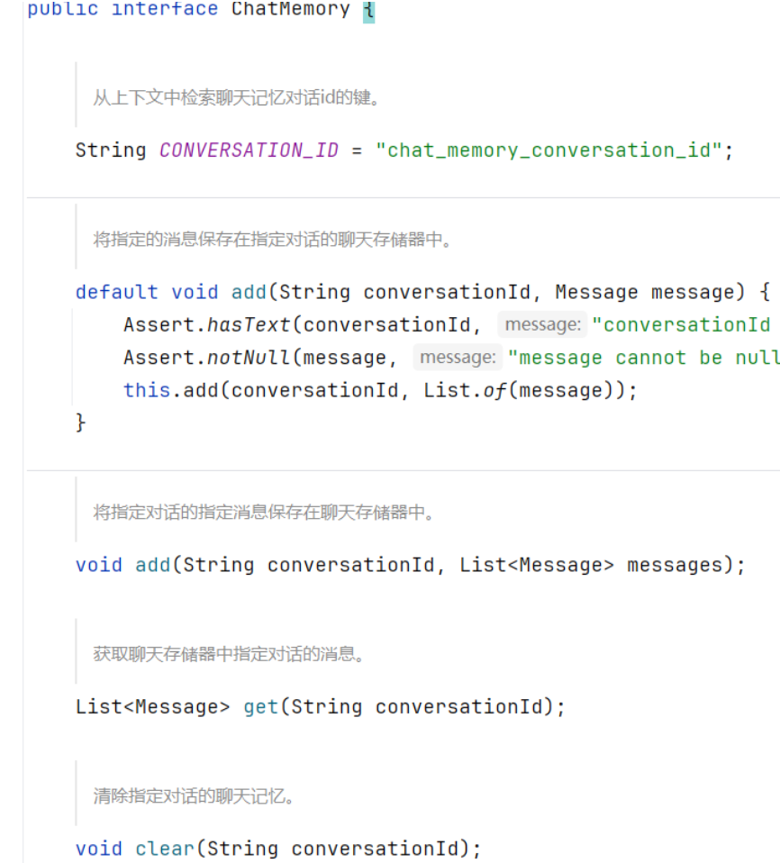
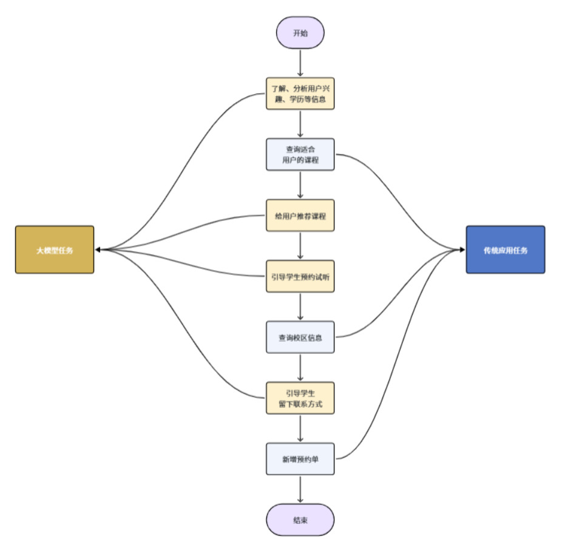
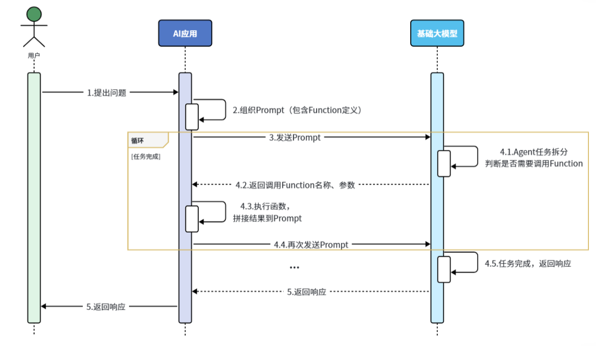
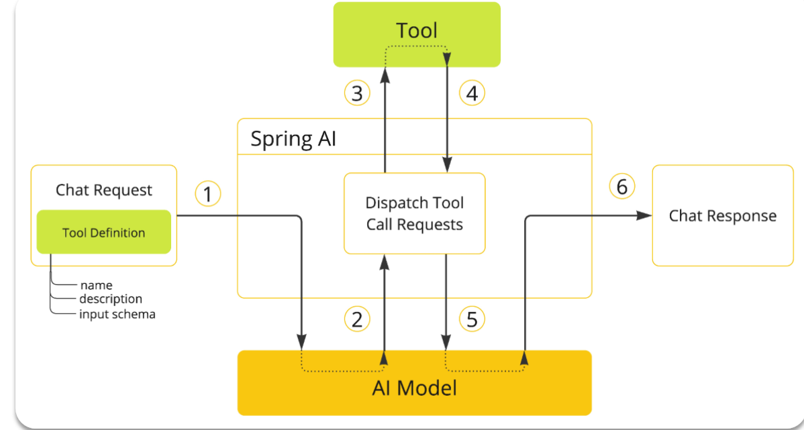

# Day82–83｜Spring AI 会话管理、工具调用与 RAG

> **内容来源：** `day82.xmind`、`day83.xmind`（含导图中的代码与流程图）  
> **学习主线：** 日志与前后端联调 → 会话记忆与历史 → 提示词工程 → 智能客服与工具调用 → RAG 知识库  
> **整理说明：** 合并重复知识点，保留关键代码；标为“理解补充”的内容用于解释边界。代码沿用课程 API 写法，省略部分 import、依赖注入及业务类，需结合课程项目使用。`day83.xmind` 的中心节点仍写作“day82”，本笔记按文件名区分课次。

## 📑 目录

- [一、知识总览](#overview)
- [二、日志增强与跨域配置](#logging-cors)
- [三、会话记忆：让模型理解上下文](#chat-memory)
- [四、会话历史：管理会话列表与消息](#chat-history)
- [五、提示词工程与哄哄模拟器](#prompt-engineering)
- [六、智能客服与 Tool Calling](#tool-calling)
- [七、RAG 知识库](#rag)
- [八、复习速记](#review)

---

<a id="overview"></a>

## 一、知识总览

| 课次 | 核心内容 | 要解决的问题 |
| :--- | :--- | :--- |
| Day82 | 日志增强、跨域 | 查看 AI 调用过程，让前端能够访问后端 |
| Day82 | 会话记忆 | 多轮对话时，把此前的消息作为上下文继续提供给模型 |
| Day82 | 会话历史 | 列出已有会话，并按会话 ID 查询消息 |
| Day82 | 提示词工程、哄哄模拟器 | 明确角色、任务、输出格式与交互规则 |
| Day82 → Day83 | 智能客服、工具调用 | 让模型借助业务系统查询信息、完成操作 |
| Day83 | RAG | 检索外部文档，为模型回答提供参考资料 |

> 💡 **三个概念要分清：** 会话记忆提供“之前聊了什么”；工具调用连接“系统能查询或执行什么”；RAG 补充“文档里有什么”。

<a id="logging-cors"></a>

## 二、日志增强与跨域配置

### 2.1 使用 Advisor 增强日志

导图通过 `Advisor` 扩展 AI 调用过程，日志增强使用 `SimpleLoggerAdvisor`。

**在 ChatClient 中配置：**

```java
ChatClient chatClient = builder
        .defaultAdvisors(new SimpleLoggerAdvisor())
        .build();
```

**在 application.yml 中开启调试日志：**

```yaml
logging:
  level:
    org.springframework.ai: debug
```

配置分为两步：Advisor 负责加入日志处理逻辑，日志级别决定相应日志是否输出。

> **理解补充：** 调试日志可能包含提示词、用户消息或工具结果，实际项目应按需要控制输出与脱敏。

### 2.2 前后端联调：解决跨域

原文通过 Spring MVC 配置类允许前端跨域访问后端。

```java
@Configuration
public class WebMvcConfig implements WebMvcConfigurer {

    @Override
    public void addCorsMappings(CorsRegistry registry) {
        registry.addMapping("/**")
                .allowedOrigins("*")
                .allowedMethods("GET", "POST", "PUT", "DELETE", "OPTIONS")
                .allowedHeaders("*")
                .exposedHeaders("Content-Disposition");
    }
}
```

| 配置 | 作用 |
| :--- | :--- |
| `addMapping("/**")` | 指定允许跨域的接口路径 |
| `allowedOrigins("*")` | 课程联调示例允许任意来源 |
| `allowedMethods(...)` | 指定允许的请求方法，包含预检使用的 OPTIONS |
| `allowedHeaders("*")` | 允许请求携带所需请求头 |
| `exposedHeaders("Content-Disposition")` | 允许前端脚本读取该响应头，常用于获取下载文件名 |

> **理解补充：** 实际部署应按前端地址配置来源；如果需要跨域携带 Cookie，还需单独设计凭证相关配置，不能直接照搬任意来源示例。

<a id="chat-memory"></a>

## 三、会话记忆：让模型理解上下文

### 3.1 为什么需要会话记忆？

导图强调：**普通模型调用不会自动记住应用中的上一轮对话**。如果每次只发送当前用户问题，模型就缺少之前的上下文。

解决方式是在后续请求中附上此前的用户消息与助手消息，让模型能够连续理解对话。

```text
第一轮：用户消息 → 模型 → 助手回复
第二轮：历史消息 + 当前用户消息 → 模型 → 新回复
第三轮：窗口内历史消息 + 当前用户消息 → 模型 → 新回复
```

这里的“记住”是应用重新提供上下文，不是修改模型参数。

### 3.2 各组件的职责

| 组件 | 职责 |
| :--- | :--- |
| `ChatClient` | 组织并发起模型请求 |
| `MessageChatMemoryAdvisor` | 在调用过程中接入消息记忆 |
| `ChatMemory` | 按会话 ID 添加、获取、清除消息 |
| `MessageWindowChatMemory` | 以有限的消息窗口管理上下文，避免历史无限增长 |
| `ChatMemory.CONVERSATION_ID` | 指定本次请求使用哪个会话的记忆 |

> **概念修正：** 滑动窗口策略由 `MessageWindowChatMemory` 管理；Advisor 使用该记忆组件。课程未配置持久化存储，不能把示例理解为重启后仍会保存全部消息。

### 3.3 配置记忆组件与 ChatClient

```java
@Bean
public ChatMemory chatMemory() {
    return MessageWindowChatMemory.builder().build();
}

@Bean
public ChatClient chatClient(ChatClient.Builder builder, ChatMemory chatMemory) {
    return builder
            .defaultAdvisors(
                    new SimpleLoggerAdvisor(),
                    MessageChatMemoryAdvisor.builder(chatMemory).build()
            )
            .build();
}
```

以上把导图中的日志与记忆配置合并展示；模型连接信息等基础配置沿用项目已有设置。

### 3.4 请求时传入会话 ID

```java
@RequestMapping(value = "/chat", produces = "text/html;charset=UTF-8")
public Flux<String> chat(
        @RequestParam(defaultValue = "讲个笑话") String prompt,
        @RequestParam(defaultValue = "1") String chatId) {

    return chatClient
            .prompt()
            .user(prompt)
            .advisors(spec -> spec.param(ChatMemory.CONVERSATION_ID, chatId))
            .stream()
            .content();
}
```

- `user(prompt)`：设置当前用户问题。
- `CONVERSATION_ID`：将当前请求关联到指定会话。
- `stream().content()`：以流式方式返回逐步生成的文本。
- `produces`：保留课程对响应类型和 UTF-8 编码的设置；前端读取方式应与后端响应约定一致。

> **理解补充：** 示例中的默认 `chatId="1"` 适合演示。真实应用需要区分用户和会话，并校验访问权限，避免不同用户共享同一份记忆。

### 3.5 ChatMemory 核心方法

导图截图展示了以下操作：

```java
void add(String conversationId, Message message);
void add(String conversationId, List<Message> messages);
List<Message> get(String conversationId);
void clear(String conversationId);
```

记忆组件负责消息内容；会话 ID 列表需要另外管理，见下一节。

<details>
<summary>查看原图：ChatMemory 接口</summary>



</details>

<a id="chat-history"></a>

## 四、会话历史：管理会话列表与消息

### 4.1 会话记忆不等于会话列表

| 内容 | 保存什么 | 课程中的实现 |
| :--- | :--- | :--- |
| 会话列表 | 业务类型及其对应的 chatId | `ChatHistoryRepository` |
| 会话消息 | 用户、助手等消息内容 | `ChatMemory` |

导图中的业务类型包括 `chat`、`service`、`pdf`，可用于区分普通聊天、客服、文档问答等场景。

### 4.2 定义会话列表仓库

```java
public interface ChatHistoryRepository {

    // 记录某种业务类型下的会话 ID
    void save(String type, String chatId);

    // 查询某种业务类型下的会话 ID 列表
    List<String> getChatIds(String type);
}
```

课程使用内存中的 `Map<String, List<String>>`：key 是 `type`，value 是该类型下的会话 ID 列表。

```java
@Repository
public class InMemoryChatHistoryRepository implements ChatHistoryRepository {

    private final Map<String, List<String>> chatHistory = new HashMap<>();

    @Override
    public void save(String type, String chatId) {
        List<String> chatIds = chatHistory.computeIfAbsent(
                type, key -> new ArrayList<>());
        if (!chatIds.contains(chatId)) {
            chatIds.add(chatId);
        }
    }

    @Override
    public List<String> getChatIds(String type) {
        return chatHistory.getOrDefault(type, List.of());
    }
}
```

**关键点：** `computeIfAbsent` 初始化列表，`contains` 防止相同会话 ID 被重复加入；查询不到时返回空集合。

> **理解补充：** 这是课堂内存示例，重启会丢失；`HashMap + ArrayList` 及“先判断再添加”也不保证并发安全。多用户场景还需要用户维度，长期历史需要另外设计持久化。

### 4.3 聊天时登记会话

在第三节聊天接口发起模型调用之前，加入：

```java
chatHistoryRepository.save("chat", chatId);
```

这样前端可以先取得会话列表，再按 ID 进入具体会话。

### 4.4 查询会话列表与消息

以下是导图中的两个方法，**控制器类级路径前缀未提供**：

```java
@GetMapping("/{type}")
public List<String> getChatIds(@PathVariable("type") String type) {
    return chatHistoryRepository.getChatIds(type);
}

@GetMapping("/{type}/{chatId}")
public List<MessageVO> getChatHistory(
        @PathVariable("type") String type,
        @PathVariable("chatId") String chatId) {

    List<Message> messages = chatMemory.get(chatId);
    return messages.stream().map(MessageVO::new).toList();
}
```

`MessageVO` 是课程业务对象，用于把消息转换成前端展示格式，导图未给出其具体字段。

### 4.5 两个容易混淆的边界

1. **业务类型不自动隔离消息。** 上面的消息查询实际只调用 `chatMemory.get(chatId)`，没有使用 `type`。若不同类型复用同一 ID，需要设计组合键或命名空间。
2. **记忆窗口不等于完整历史。** 有限窗口可能移除较早的消息；如果页面需要永久展示全部聊天记录，应另存完整消息，再按需要选取上下文。

<a id="prompt-engineering"></a>

## 五、提示词工程与哄哄模拟器

### 5.1 什么是提示词工程？

通过设计和优化输入给模型的提示词，让模型更稳定地完成任务；主要调整输入内容与组织方式，不修改模型本身。

### 5.2 六种常用策略

| 策略 | 作用 | 导图中的游戏示例 |
| :--- | :--- | :--- |
| **角色设定** | 明确回答视角与风格 | 设定为模拟游戏中的女友角色 |
| **明确任务** | 说清楚要做什么 | 玩家通过对话提高原谅值，达到 100 通关 |
| **指定输出** | 约定格式、长度、语言和风格 | 固定输出心情、台词、得分和原谅值 |
| **拆分任务** | 把复杂任务拆成可执行步骤 | 开局、每轮评分与回复、更新状态、判断结束 |
| **少样本提示** | 通过示例帮助模型遵守格式 | 提供开局、普通回合、失败及通关模板 |
| **增加约束** | 减少偏离任务和额外发挥 | 限制数值范围，不凭空增加矛盾 |

**通用提示词骨架：**

```text
角色：你负责什么，面向谁回答？
任务：需要完成什么目标？
背景：有哪些必须知道的信息？
步骤：复杂任务按什么顺序执行？
输出：使用什么格式、语言和长度？
约束：哪些规则必须遵守？
样例：给出典型输入与期望输出。
```

### 5.3 哄哄模拟器的核心规则

| 阶段 | 规则 |
| :--- | :--- |
| 开局 | 生成生气理由，原谅值从 20 开始 |
| 每轮 | 读取玩家输入 → 判断得分 → 生成角色台词 → 更新原谅值 |
| 输出 | 明确列出心情、台词、本轮得分、当前原谅值 |
| 数值 | 原谅值控制在 0～100 |
| 失败 | 原谅值达到 0 |
| 通关 | 原谅值达到 100 |

导图还给出了保持角色、不新增额外矛盾、询问规则时固定回复“请继续游戏”等提示词约束。这些是**游戏案例中的规则**。

> **原文整理：** 导图写“必须包含三段”，随后列出四项内容。笔记按四项信息整理，不强行限定为三段。具体每轮分值档位和完整样例未提供，因此不补造评分表。

### 5.4 实现步骤

1. 修改系统提示词，写入角色、目标、输出格式和结束条件。
2. 调整 Controller，使用游戏对应的 ChatClient 或提示词配置。
3. 结合会话记忆，让多轮游戏能够接续上下文。

> **理解补充：** 提示词不能替代确定性的状态校验；如果游戏要求严格计分，可以由后端保存分数并检查状态，模型负责生成台词。

<a id="tool-calling"></a>

## 六、智能客服与 Tool Calling

### 6.1 为什么需要工具调用？

模型擅长理解意图和组织语言，但课程、校区、预约等信息来自业务系统。通过工具调用，模型可以请求应用查询真实数据或执行受控操作，再结合结果回答。

**核心分工：模型决定需要什么，应用执行具体工具。**

### 6.2 课程咨询客服的业务流程

| 步骤 | 任务 | 主要承担方 |
| :--- | :--- | :--- |
| 1 | 了解用户兴趣、学历等信息 | 大模型对话 |
| 2 | 查询适合用户的课程 | 业务工具 |
| 3 | 给用户推荐课程 | 大模型结合查询结果 |
| 4 | 引导用户预约试听 | 大模型对话 |
| 5 | 查询校区信息 | 业务工具 |
| 6 | 引导用户留下联系方式 | 大模型对话 |
| 7 | 新增预约单 | 业务工具 |



### 6.3 工具调用完整过程

```text
用户提问
   ↓
应用组织用户消息、系统提示及工具定义
   ↓
模型判断是否需要工具
   ├─ 不需要 → 直接生成回答
   └─ 需要 → 返回工具名称和参数
                 ↓
          Spring AI 调用本地工具
                 ↓
          将工具结果返回给模型
                 ↓
          模型继续判断或生成最终回答
```

这个过程可能循环多次，例如先查询课程，再查询校区，最后根据已确认信息创建预约。

<details>
<summary>查看原图：应用与模型的工具调用时序</summary>



</details>

### 6.4 Spring AI 与开发人员分别做什么？

| 参与方 | 职责 |
| :--- | :--- |
| **开发人员** | 编写工具方法、描述工具及参数、注册工具，在提示词中说明何时调用 |
| **Spring AI** | 将工具定义发给模型，解析模型的调用请求，执行工具，再回传结果 |
| **大模型** | 理解用户意图，选择工具并组织参数，根据返回结果生成回复 |



### 6.5 定义与注册工具

导图给出的关键 API：

- `@Tool`：标记工具方法。
- `@ToolParam`：描述工具参数，帮助模型理解参数含义。
- `defaultTools(courseTool)`：把工具对象注册到 ChatClient。

**注册片段：**

```java
ChatClient chatClient = builder
        .defaultTools(courseTool)
        .build();
```

会话记忆等 Advisor 可以按客服需求一并配置；工具注册与消息记忆是两项独立能力。

### 6.6 Day83 对 Day82 的关键补充

Day82 写“提示词中定义 function”；Day83 明确补充：

> 配置 `defaultTools` 后，Spring AI 会将工具的相关定义信息发送给模型。系统提示词主要说明**什么场景调用什么工具**，不必再手工重复声明 function 结构。

因此，开发顺序可以概括为：

```text
写业务工具 → 添加 @Tool / @ToolParam → 注册 defaultTools
                                      ↓
                          系统提示词约定调用场景
```

> **理解补充：** 模型提供的工具参数仍需后端校验。创建预约等写操作要落实权限、必要信息确认和防重复处理，不能只依赖提示词。

<a id="rag"></a>

## 七、RAG 知识库

### 7.1 核心概念

**RAG（检索增强生成）**：先检索相关知识片段，再把片段与用户问题一起交给模型，辅助生成回答。

| 概念 | 含义 |
| :--- | :--- |
| **向量** | 一组数值，用来表示多维空间中的坐标；文本向量用于表示语义特征 |
| **向量模型** | 将文本转换为向量的模型，也称 Embedding 模型 |
| **向量数据库** | 保存向量，并支持相似度检索 |
| **切片 Chunk** | 把长文本拆分后得到的较短文本块 |
| **检索增强** | 将相关片段放入上下文，为回答提供依据 |

### 7.2 第一阶段：知识存储

```text
原始文档
   ↓ 文档读取，例如 PagePdfDocumentReader
提取文本
   ↓ 文档切片
文本块 Chunk
   ↓ 向量模型转换
向量 + 原文片段 → 向量存储
```

1. **读取文档：** 从文件中提取文本；导图列举了 `PagePdfDocumentReader`。
2. **切分文本：** 将长文档切成较短片段，便于检索和放入上下文。
3. **生成向量：** 用向量模型转换文本块，再保存到可检索的向量存储中。

**理解补充：** 检索命中后还要取出片段原文，因此不能只保存一串向量而丢掉对应内容。

### 7.3 第二阶段：检索知识

```text
用户问题 → 问题向量 → 相似度检索 → 最相关的知识片段
```

用户提问时，先把问题向量化，再在向量数据库中查找相关片段。

**理解补充：** 文档向量与查询向量需要使用匹配的向量模型和表示空间；“相似”表示语义接近，不等于片段一定包含正确答案。

### 7.4 第三阶段：增强生成

```text
相关知识片段 + 用户问题 + 回答要求
                  ↓
              组织提示词
                  ↓
                大模型
                  ↓
              生成最终回答
```

知识库提供参考材料，大模型负责理解、归纳和表达。**RAG 不等于训练或微调模型**，主要是在推理时补充外部知识。

> **资料范围：** Day83 在这里主要介绍概念与三个阶段，未给出完整 RAG 项目、具体向量数据库、切片参数或模型配置；本笔记不将这些细节写成课程已有实现。

### 7.5 RAG 与工具调用怎么区分？

| 维度 | RAG | 工具调用 |
| :--- | :--- | :--- |
| 主要用途 | 从文档中找参考知识 | 查询业务系统或执行操作 |
| 典型输入 | 用户问题与检索条件 | 工具名称与参数 |
| 典型结果 | 相关文本片段 | 课程、校区等结构化信息或操作结果 |
| 示例 | 根据课程说明文档回答课程内容 | 查询可预约校区、创建试听预约 |

**理解补充：** 两者可以组合：先从文档解释课程，再通过工具查询实时信息或办理预约。

<a id="review"></a>

## 八、复习速记

### 8.1 一页记住关键 API

| 需求 | 关键词 |
| :--- | :--- |
| 查看 AI 调用日志 | `SimpleLoggerAdvisor` + debug 日志级别 |
| 让前端访问后端 | `WebMvcConfigurer#addCorsMappings` |
| 接入会话记忆 | `MessageChatMemoryAdvisor` |
| 用窗口管理上下文 | `MessageWindowChatMemory` |
| 指定会话 | `ChatMemory.CONVERSATION_ID` |
| 查询窗口内消息 | `chatMemory.get(chatId)` |
| 管理会话列表 | 自定义 `ChatHistoryRepository` |
| 标记工具与参数 | `@Tool`、`@ToolParam` |
| 注册工具 | `defaultTools(...)` |
| 从 PDF 提取文本 | `PagePdfDocumentReader` |
| 构建 RAG | 读取 → 切片 → 向量化与存储 → 检索 → 增强生成 |

### 8.2 六个自测问题

1. **为什么多轮对话需要会话记忆？** 每轮请求都要重新提供相关历史上下文。
2. **为什么需要 chatId？** 用于定位当前会话的消息，区分不同对话。
3. **会话列表里有 ID，就一定能读到完整历史吗？** 不一定，消息窗口有限，长期历史要另存。
4. **模型会自己直接执行 Java 方法吗？** 不会，模型返回调用意图和参数，由应用通过工具机制执行。
5. **注册工具后，提示词还要手写 function 定义吗？** 课程使用 defaultTools 自动提供定义，提示词重点说明调用场景。
6. **RAG 与训练模型有什么区别？** RAG 在提问时检索并补充知识，不修改模型参数。

---

**与 Day81 的衔接：** Day81 解决模型接入与基础调用；Day82–83 进一步让应用具备连续对话、业务工具和外部知识支持。
