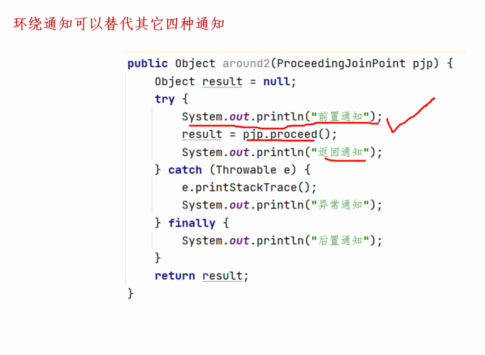

# Spring 核心进阶学习总结（Day 51）

> 核心内容：**Bean 的作用域与生命周期、第三方 Bean 注册、Spring 整合 MyBatis/JUnit，以及 Spring AOP 基础**。

## 目录

- [一、Bean 作用域](#一bean-作用域)
- [二、Bean 生命周期](#二bean-生命周期)
- [三、第三方 Bean 注册与注入](#三第三方-bean-注册与注入)
- [四、Spring 整合 MyBatis](#四spring-整合-mybatis)
- [五、Spring 整合 JUnit 5](#五spring-整合-junit-5)
- [六、AOP 概述与核心概念](#六aop-概述与核心概念)
- [七、AOP 入门实现](#七aop-入门实现)
- [八、切入点表达式](#八切入点表达式)
- [九、通知类型](#九通知类型)
- [十、重点速记](#十重点速记)

---

## 一、Bean 作用域

Spring 通过 `@Scope` 设置 Bean 作用域，最常用的是 `singleton` 和 `prototype`。

### 1. singleton：单例

```java
@Component
@Scope("singleton")
public class UserService {}
```

- 容器中通常只有一个该 Bean 对象。
- 多次获取得到同一个实例。
- 默认作用域，不写 `@Scope` 即为单例。
- 容器负责创建、初始化和销毁。

### 2. prototype：原型

```java
@Component
@Scope("prototype")
public class UserService {}
```

- 每次获取都会创建一个新对象。
- 容器负责创建、依赖注入和初始化。
- Bean 交付调用方后，Spring 通常不再管理其完整销毁过程。

| 对比项  | `singleton` | `prototype` |
| ---- | ----------- | ----------- |
| 实例数量 | 容器中通常一个     | 每次获取创建一个    |
| 是否默认 | 是           | 否           |
| 创建时机 | 通常随容器初始化    | 每次获取时       |
| 销毁管理 | 容器负责        | 通常由使用方负责    |

> 单例 Bean 会被多个调用方共享，不应将单次请求的可变数据保存在实例字段中。

---

## 二、Bean 生命周期

```text
实例化 → 依赖注入 → @PostConstruct → 对外服务 → @PreDestroy
```

### 1. `@PostConstruct`

在对象实例化和依赖注入完成后执行，通常只执行一次：

```java
@PostConstruct
public void init() {
    System.out.println("初始化资源");
}
```

### 2. `@PreDestroy`

在 Bean 被容器销毁前执行，通常只执行一次：

```java
@PreDestroy
public void destroy() {
    System.out.println("释放资源");
}
```

> 原型 Bean 通常不会由容器自动调用销毁回调。

---

## 三、第三方 Bean 注册与注入

第三方类无法添加 `@Component` 时，通过配置类中的 `@Bean` 注册。

### 1. 使用 `@Bean` 注册

```java
@Configuration
public class DataSourceConfig {

    @Bean
    public DataSource dataSource() {
        return new PooledDataSource();
    }
}
```

- `@Bean` 添加在配置方法上。
- 方法返回值会注册到 IoC 容器。
- 默认 Bean 名称为方法名。

### 2. 注入简单类型

```java
@Configuration
@PropertySource("classpath:jdbc.properties")
public class DataSourceConfig {

    @Value("${jdbc.driver}")
    private String driver;

    @Value("${jdbc.url}")
    private String url;

    @Value("${jdbc.username}")
    private String username;

    @Value("${jdbc.password}")
    private String password;

    @Bean
    public DataSource dataSource() {
        PooledDataSource source = new PooledDataSource();
        source.setDriver(driver);
        source.setUrl(url);
        source.setUsername(username);
        source.setPassword(password);
        return source;
    }
}
```

### 3. 注入引用类型

在 `@Bean` 方法中声明形参，Spring 会从容器中自动注入：

```java
@Bean
public SqlSessionFactoryBean sqlSessionFactory(DataSource dataSource) {
    SqlSessionFactoryBean factory = new SqlSessionFactoryBean();
    factory.setDataSource(dataSource);
    return factory;
}
```

---

## 四、Spring 整合 MyBatis

### 1. 整合目的

把 Mapper 代理对象注册到 Spring IoC 容器，Service 可直接注入 Mapper，无需手动创建 `SqlSession`。

主要依赖包括 Spring、MyBatis、MyBatis-Spring、数据库驱动和数据源组件。

### 2. MyBatis 配置类

```java
@Configuration
public class MyBatisConfig {

    @Bean  
public SqlSessionFactoryBean sqlSessionFactoryBean(DataSource dataSource) throws Exception {  
    SqlSessionFactoryBean sqlSessionFactoryBean = new SqlSessionFactoryBean();  
    // 设置数据源,对应xml文件中的environment  
    sqlSessionFactoryBean.setDataSource(dataSource);  
    // 设置类型别名  
    sqlSessionFactoryBean.setTypeAliasesPackage("com.edu.entity");  
    // 设置对应xml文件中的Settings  
    Configuration configuration = new Configuration();  
    configuration.setLogImpl(StdOutImpl.class);  
    configuration.setMapUnderscoreToCamelCase(true);  
    sqlSessionFactoryBean.setConfiguration(configuration);  
    return sqlSessionFactoryBean;  
}

    public MapperScannerConfigurer mapperScannerConfigurer(){  
    //MapperScannerConfigurer 是Mybatis提供的扫描mapper接口的工具类  
    MapperScannerConfigurer mapperScannerConfigurer = new MapperScannerConfigurer();  
    mapperScannerConfigurer.setBasePackage("com.edu.mapper");  
    return mapperScannerConfigurer;  
}
}
```

| 组件 | 作用 |
|---|---|
| `SqlSessionFactoryBean` | 创建并向容器提供 `SqlSessionFactory` |
| `MapperScannerConfigurer` | 扫描 Mapper 接口并注册代理对象 |

### 3. 导入配置

```java
// mybatisconfig
@org.springframework.context.annotation.Configuration  
@Import(JdbcConfig.class)
// jdbcconfig
@Configuration  
@PropertySource("classpath:jdbc.properties")
//spring config
@Configuration  
@ComponentScan("com.edu")
```

### 4. 实现步骤

```java
qlSessionFactoryBean会同时会将getObject方法的返回值也一并放入容器 (SqlSessionFactory放入到容器中)
MapperScannerConfigurer会根据我们设置的包路径，自动扫描所有接口，将接口实现类对象(代理对象)注册到IOC容器中
@Test  
public void test1() throws SQLException {  
    ApplicationContext context = new AnnotationConfigApplicationContext(SpringConfig.class);  
    SqlSessionFactory sqlSessionFactory=context.getBean(SqlSessionFactory.class);  
    System.out.println(sqlSessionFactory);  
    StudentMapper studentMappper =context.getBean(StudentMapper.class);  
    List<Student> students=studentMappper.selectAll();  
    System.out.println(students);  
  
}
```

---

## 五、Spring 整合 JUnit 5

整合后，测试类可以直接注入 Spring 容器中的对象。

主要依赖：Spring、JUnit Jupiter、Spring Test。

```java
@SpringJUnitConfig(SpringConfig.class)
class UserServiceTest {

    @Autowired
    private UserService userService;

    @Test
    void selectAll() {
        List<User> users = userService.selectAll();
        assertNotNull(users);
    }
}
```

`@SpringJUnitConfig` 会指定配置类、创建 Spring 测试上下文，并支持在测试类中注入 Bean。

---

## 六、AOP 概述与核心概念

AOP（Aspect-Oriented Programming，面向切面编程）是对面向对象编程的补充，可在不直接修改目标方法源码的情况下统一增强方法。Spring AOP 主要通过动态代理实现。

常见用途：日志、性能统计、权限校验、事务管理和异常监控。

| 概念 | 英文 | 含义 |
|---|---|---|
| 连接点 | Join Point | 可以被增强的位置，Spring AOP 中主要指方法执行 |
| 切入点 | Pointcut | 实际被规则选中的方法 |
| 通知 | Advice | 在切入点执行的增强逻辑 |
| 切面 | Aspect | 切入点和通知的组合 |
| 目标对象 | Target | 原始业务对象 |
| 代理对象 | Proxy | Spring 创建的、包含增强逻辑的对象 |

```text
切面 = 切入点 + 通知
```

---

## 七、AOP 入门实现

通常需要 `spring-context` 和 `aspectjweaver`；`spring-context` 会传递引入 `spring-aop`。

### 1. 开启 AOP

```java
@Configuration
@ComponentScan("com.edu")
@EnableAspectJAutoProxy
public class SpringConfig {}
```

### 2. 定义切面类

```java
@Component
@Aspect
public class LogAspect {

    @Pointcut("execution(* com.edu.service.*.*(..))")
    public void servicePointcut() {
        // 仅用于承载切入点表达式
    }

    @Before("servicePointcut()")
    public void beforeAdvice() {
        System.out.println("方法执行前记录日志");
    }
}
```

| 注解 | 作用 |
|---|---|
| `@Component` | 将切面类注册为 Bean |
| `@Aspect` | 声明切面类 |
| `@Pointcut` | 定义需要增强的方法集合 |
| `@Before` | 定义前置通知 |
| `@EnableAspectJAutoProxy` | 开启注解 AOP 代理 |

---
## 八、切入点表达式

### 1. execution 语法

```text
execution(访问修饰符 返回值类型 包名.类名或接口名.方法名(参数类型) 异常类型)
```

访问修饰符和异常类型通常可省略。

```java
// service 包中任意类的任意方法
@Pointcut("execution(* com.edu.service.*.*(..))")

// service 包及其子包中的任意方法
@Pointcut("execution(* com.edu.service..*.*(..))")
```

| 通配符 | 含义 |
|---|---|
| `*` | 单个任意内容，如返回值、类名或方法名 |
| `..` | 多个连续任意内容，如任意层级包或任意数量参数 |

书写建议：面向接口或稳定业务包描述，通常省略权限修饰符和异常声明，同时尽量精确，避免增强无关方法。

---

## 九、通知类型

| 通知   | 注解                | 执行时机               |
| ---- | ----------------- | ------------------ |
| 前置通知 | `@Before`         | 目标方法执行前            |
| 后置通知 | `@After`          | 目标方法结束后，无论是否异常     |
| 返回通知 | `@AfterReturning` | 目标方法正常返回后          |
| 异常通知 | `@AfterThrowing`  | 目标方法抛出异常后          |
| 环绕通知 | `@Around`         | 包围目标方法，可决定是否执行目标方法 |

环绕通知示例：

```java
@Around("servicePointcut()")
public Object recordTime(ProceedingJoinPoint joinPoint)
        throws Throwable {
    long start = System.currentTimeMillis();

    try {
        return joinPoint.proceed();
    } finally {
        long elapsed = System.currentTimeMillis() - start;
        System.out.println("耗时：" + elapsed + " ms");
    }
}
```

> `joinPoint.proceed()` 用于执行原始目标方法；遗漏它会导致目标方法不执行。

---

## 十、重点速记

> [!TIP]
> **Bean 由 IoC 容器管理，MyBatis Mapper 可注册为 Bean，AOP 通过代理对象统一增强方法。**

- Bean 默认作用域是 `singleton`。
- `prototype` 每次获取都创建新对象，容器通常不负责销毁。
- `@PostConstruct` 在依赖注入完成后执行初始化。
- `@PreDestroy` 在容器销毁单例 Bean 前执行。
- `@Bean` 将方法返回值注册到容器，默认名称是方法名。
- 简单配置值使用 `@Value`，引用 Bean 可通过方法形参注入。
- `SqlSessionFactoryBean` 创建 `SqlSessionFactory`。
- `MapperScannerConfigurer` 扫描 Mapper 并注册代理对象。
- `@SpringJUnitConfig` 让 JUnit 5 测试使用 Spring 容器。
- AOP 通过动态代理在不修改源码的情况下增强方法。
- 切面等于切入点加通知。
- `@Aspect + @Component` 定义并注册切面类。
- `@EnableAspectJAutoProxy` 开启注解 AOP。
- `*` 表示单个任意内容，`..` 表示多个任意内容。
- `@Around` 中调用 `proceed()` 才会执行目标方法。

---

> 本文根据思维导图 **《day51》** 整理，对 Bean 管理、Spring 与 MyBatis/JUnit 整合及 AOP 入门知识进行了结构化归纳。
