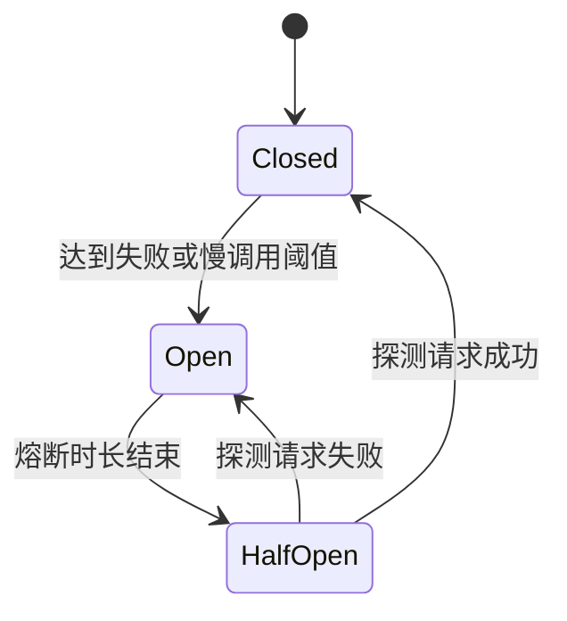
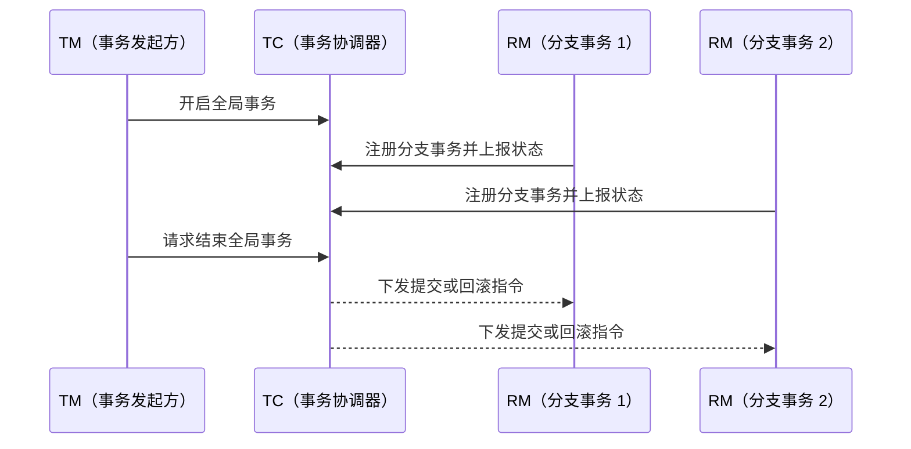

# Day 70｜微服务治理学习总结

> 本篇围绕 **接口鉴权自动化、Sentinel 服务保护、Feign 降级与 Seata 分布式事务** 展开，重点梳理配置思路、验证步骤和核心原理。

---

## 📌 内容总览

| 模块          | 解决的问题            | 核心做法                     |
| ----------- | ---------------- | ------------------------ |
| Apifox 改造   | 多个接口重复维护登录令牌     | 登录后保存 `token`，其他接口统一引用   |
| 线程隔离        | 慢调用耗尽服务线程，拖慢无关接口 | 使用 Sentinel 为热点资源限制并发线程数 |
| Fallback 降级 | 远程调用失败后直接报错      | 为 FeignClient 提供默认返回逻辑   |
| 服务熔断        | 下游持续异常或响应过慢      | 熔断后快速失败，等待后进行半开探测        |
| Seata       | 跨微服务的数据一致性       | 由 TC、TM、RM 协同管理全局事务      |

---

## 1. Apifox 鉴权改造

### 1.1 登录后自动保存 Token

在用户登录接口中添加后置操作：

1. 定义环境变量 `token`。
2. 从登录接口的响应结果中提取 Token。
3. 将提取值保存到 `token` 环境变量中。

### 1.2 其他接口统一携带 Token

在其他需要认证的接口中设置 `Auth` 请求头，并通过模板语法引用环境变量：

```text
{{token}}
```

这样只需执行一次登录，后续接口就能自动使用最新令牌，减少手动复制和令牌失效造成的调试问题。

---

## 2. Sentinel 线程隔离

### 2.1 问题背景

订单微服务中的 `/order/1` 会调用用户微服务。若用户微服务故意休眠 `500 ms`，大量并发请求会长期占用订单服务的 Tomcat 线程。

当线程池接近耗尽时，即使 `/order/prop` 不依赖这个慢调用，也会因无法及时获得线程而变慢。这说明故障影响已经从单个接口扩散到整个服务。

### 2.2 验证步骤

1. 在用户微服务中增加 `500 ms` 休眠，模拟慢调用。
2. 调低订单服务内嵌 Tomcat 的线程数，便于观察线程不足的现象。
3. 使用 JMeter 高并发访问 `/order/1`。
4. 用浏览器访问 `/order/prop`，观察到响应明显变慢。
5. 在 Sentinel 控制台为 `/order/1` 配置线程隔离。
6. 再次使用 JMeter 高并发访问 `/order/1`。
7. 重新访问 `/order/prop`，响应时间恢复正常。

### 2.3 核心结论

> 线程隔离通过限制某个资源可占用的并发线程数，把慢调用的影响控制在局部，避免共享线程被耗尽，从而保护同一服务中的其他接口。

---

## 3. OpenFeign Fallback 降级

Fallback 通常用于给 FeignClient 的远程调用提供兜底逻辑。当调用失败、超时、被限流或被隔离时，不直接把异常暴露给上游，而是返回预设的默认结果。

### 3.1 编写 FallbackFactory

1. 定义类并实现 `FallbackFactory<UserClient>`。
2. 重写工厂方法，返回一个 `UserClient` 实例。
3. 在该实例中为远程接口编写默认实现。
4. 在 OpenFeign 配置类中通过 `@Bean` 注册这个 `FallbackFactory`。
5. 在 `UserClient` 的 `@FeignClient` 注解中，通过 `fallbackFactory` 指定降级实现。

### 3.2 让 Sentinel 识别 Feign 资源

```yaml
# 让 Sentinel 将 Feign 接口识别为资源
feign:
  sentinel:
    enabled: true
```

开启后，可在 Sentinel 中为 FeignClient 接口添加线程隔离规则。再次测试时，请求不会直接报错，而会返回 Fallback 中定义的默认结果。

> **两者职责不同：**线程隔离负责控制故障影响范围，Fallback 负责在请求无法正常完成时给出可接受的兜底响应。

---

## 4. 服务熔断

熔断器用于处理持续的慢调用或异常调用。当失败指标达到阈值后，暂时切断对下游的访问，让请求快速失败或进入降级逻辑，避免无效等待进一步消耗资源。

### 4.1 三种状态



- **Closed（关闭）**：正常放行请求并统计调用结果。
- **Open（打开）**：触发熔断后快速失败，不再访问下游。
- **Half-Open（半开）**：熔断时间结束后放行一次探测请求；成功则关闭熔断器，失败则重新打开。

### 4.2 示例规则

| 配置项 | 示例值 | 含义 |
|---|---:|---|
| 资源名 | `GET:http://user-service/user/{id}` | 被保护的远程调用 |
| 熔断策略 | 慢调用比例 | 按慢请求占比判断 |
| 最大 RT | `200 ms` | 超过该响应时间即记为慢调用 |
| 比例阈值 | `0.5` | 慢调用比例达到 50% 时触发熔断 |
| 最小请求数 | `5` | 统计窗口内至少达到该请求数才判断 |
| 统计时长 | `1000 ms` | 统计最近 1 秒的请求 |
| 熔断时长 | `20 s` | 打开 20 秒后进入半开探测 |

触发逻辑可以概括为：在 `1 s` 统计窗口中请求数不少于 `5`，且响应超过 `200 ms` 的请求占比达到 `50%`，熔断器便从 Closed 进入 Open，后续请求快速失败并执行 Fallback；`20 s` 后尝试放行一次探测请求。

### 4.3 测试现象

- 未熔断时：调用 `/order/1`，需要等待下游超过 `500 ms` 的慢响应。
- 添加熔断规则后：调用 `/order/1`，请求会快速结束并进入降级逻辑。

---

## 5. Seata 分布式事务

Seata 是用于解决微服务场景下分布式事务一致性问题的开源组件。一个全局事务可能横跨多个微服务和数据库，Seata 通过 TC、TM、RM 三类角色协调各个分支事务。

### 5.1 三个核心角色

| 角色 | 全称 | 主要职责 |
|---|---|---|
| **TC** | Transaction Coordinator，事务协调器 | 保存全局事务和分支事务状态；不执行业务代码、不直接操作业务数据库；向各分支下发提交或回滚指令。Docker 部署的 Seata Server 就是 TC。 |
| **TM** | Transaction Manager，事务管理器 | 定义全局事务边界，决定全局事务何时开始、提交或回滚。发起全局事务的微服务充当 TM。 |
| **RM** | Resource Manager，资源管理器 | 管理本地数据库资源，向 TC 注册分支事务、上报分支状态，并根据 TC 指令执行分支提交或回滚。操作自身数据库的微服务充当 RM。 |

### 5.2 协作流程



### 5.3 部署 TC

按照项目配套安装文档部署 Seata Server。部署后，它将作为 TC 维护全局事务与各分支事务的状态。

### 5.4 微服务接入步骤

所有参与分布式事务的微服务都需要完成改造。

#### 第一步：引入依赖

```xml
<!-- Seata -->
<dependency>
    <groupId>com.alibaba.cloud</groupId>
    <artifactId>spring-cloud-starter-alibaba-seata</artifactId>
    <exclusions>
        <exclusion>
            <groupId>io.seata</groupId>
            <artifactId>seata-spring-boot-starter</artifactId>
        </exclusion>
    </exclusions>
</dependency>

<dependency>
    <groupId>io.seata</groupId>
    <artifactId>seata-spring-boot-starter</artifactId>
    <version>2.0.0</version>
</dependency>
```

显式指定 Seata Starter 版本，可让客户端依赖与服务端配置保持一致，并保证注册时能够正确识别 `ResourceId`。

#### 第二步：配置共享参数

将 Seata 的公共配置抽取到 Nacos，避免每个微服务重复维护。

#### 第三步：加载共享配置

修改各微服务的 `bootstrap.yml`，加入 Nacos 中的 Seata 共享配置。

#### 第四步：验证注册

重启相关微服务，在 Seata 容器或服务端日志中确认微服务已经成功注册。

---

## 6. 知识串联

这几部分共同构成了微服务稳定性与一致性治理的一条完整链路：

1. **Apifox 自动保存 Token**，提升接口联调效率。
2. **线程隔离**，防止慢调用耗尽共享线程并扩散故障。
3. **Fallback 降级**，在调用失败时提供可控的默认响应。
4. **服务熔断**，对持续异常的下游快速失败，并通过半开状态自动探测恢复。
5. **Seata 分布式事务**，协调跨服务、跨数据库操作，保障数据一致性。

> **一句话总结：**Sentinel 重点解决“服务还能不能稳定响应”，Seata 重点解决“跨服务数据能不能保持一致”。

---

## ✅ 复习清单

- [ ] 能在 Apifox 中从登录响应提取 Token，并供其他接口引用
- [ ] 能解释慢调用为什么会拖慢同一服务中的无关接口
- [ ] 能使用 Sentinel 配置线程隔离
- [ ] 能为 FeignClient 编写并注册 `FallbackFactory`
- [ ] 能说明 Closed、Open、Half-Open 三种熔断状态的流转
- [ ] 能根据最大 RT、比例阈值、最小请求数和统计窗口判断是否触发熔断
- [ ] 能区分 Seata 中 TC、TM、RM 的职责
- [ ] 能完成 Seata 客户端依赖、Nacos 共享配置和注册验证
