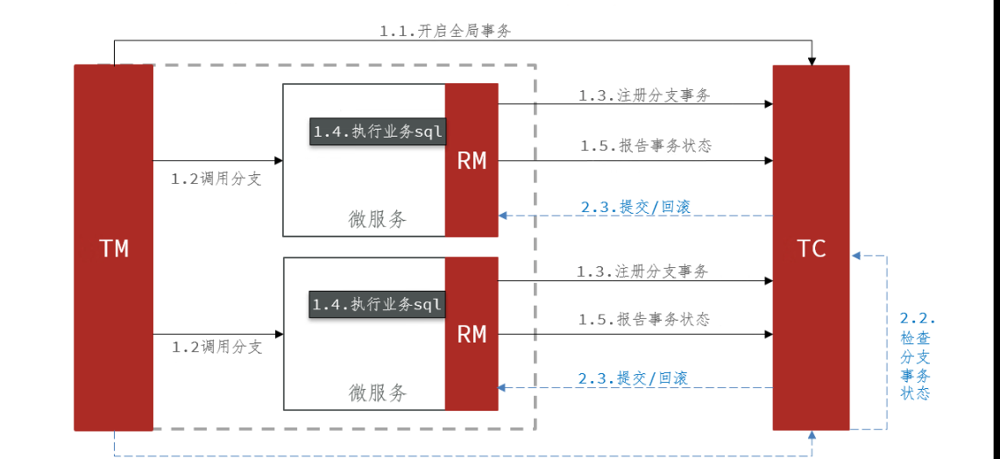
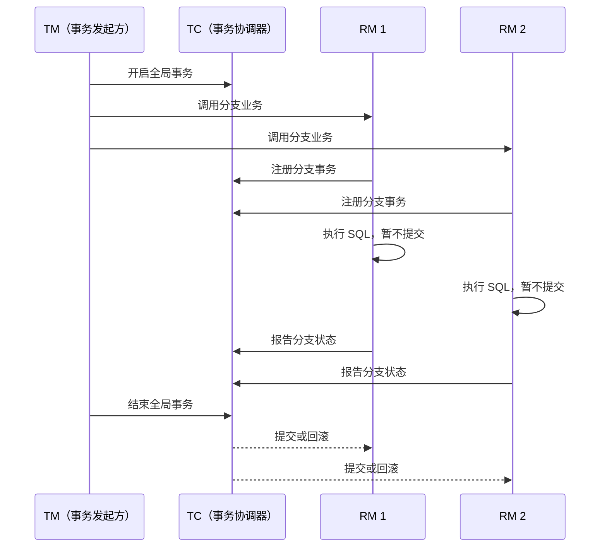
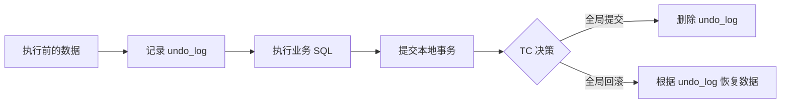
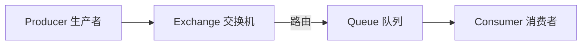
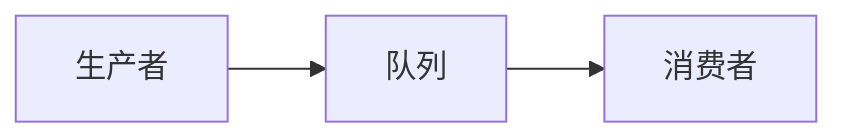
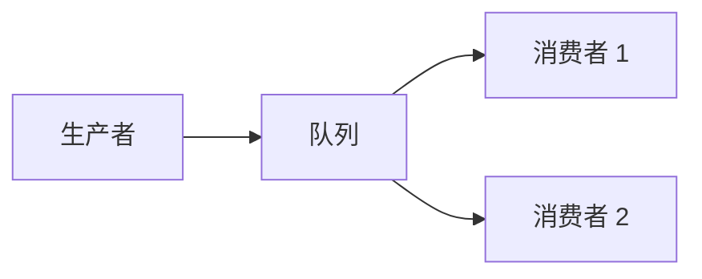
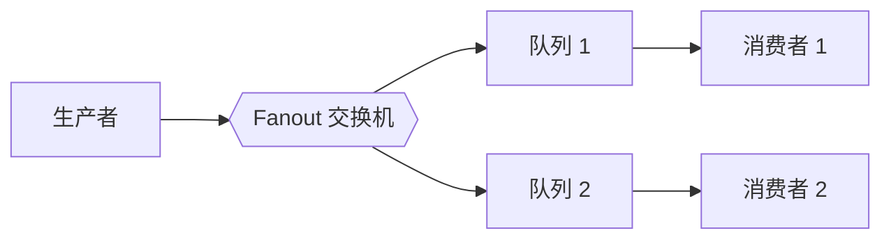
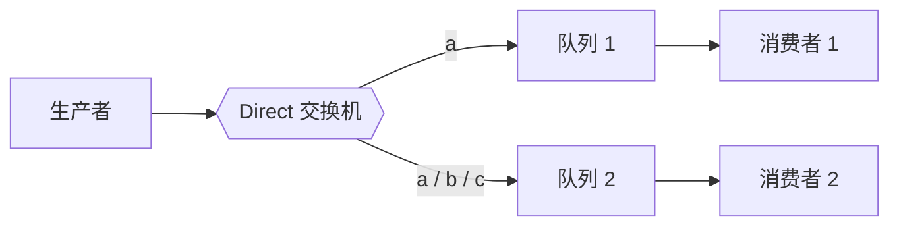

# Day 71｜Seata 事务模式与 RabbitMQ 学习总结

> 本篇聚焦两条主线：一是 Seata 的 **XA、AT 分布式事务模式**，二是基于 RabbitMQ 与 Spring AMQP 实现的 **异步消息通信**。

---

## 📌 内容总览

| 模块 | 核心问题 | 关键结论 |
|---|---|---|
| Seata XA 模式 | 如何保证跨服务事务的强一致性 | 两阶段提交，一阶段不提交事务，资源锁定时间较长 |
| Seata AT 模式 | 如何兼顾事务一致性与性能 | 一阶段直接提交，通过 `undo_log` 支持回滚 |
| 同步与异步调用 | 服务之间应如何通信 | 同步实时但耦合高；异步吞吐高、解耦强 |
| RabbitMQ | 如何可靠地传递异步消息 | 交换机负责路由，队列负责存储，消费者负责处理 |
| MQ 工作模式 | 消息应发送给谁 | 简单队列、工作队列、发布订阅和路由模式各有适用场景 |

---

## 1. Seata XA 模式

XA 是 X/Open 组织定义的分布式事务处理规范，描述了全局事务管理器与各资源管理器之间的接口。主流关系型数据库通常都支持 XA 规范。

### 1.1 执行流程

XA 采用两阶段提交：

#### 第一阶段：准备阶段

1. TM 开启全局事务，并调用各微服务分支。
2. RM 向 TC 注册分支事务。
3. RM 执行业务 SQL，但暂不提交本地事务。
4. RM 将分支事务的执行状态报告给 TC。

#### 第二阶段：提交或回滚

1. TC 检查所有分支事务的执行状态。
2. 如果所有分支都成功，TC 通知各 RM 提交事务。
3. 如果任一分支失败，TC 通知各 RM 回滚事务。
4. RM 接收 TC 指令，完成本地事务的提交或回滚。




### 1.2 优缺点

| 优点 | 缺点 |
|---|---|
| 提供强一致性，事务结果明确 | 第一阶段不提交本地事务，数据库资源和锁无法及时释放 |
| 利用数据库原生 XA 能力 | 并发能力较弱，整体性能偏低 |

### 1.3 微服务配置

设置 Seata 数据源代理模式：

```yaml
seata:
  data-source-proxy-mode: XA
```

在全局事务的业务入口方法上添加注解：

```java
@Override  
@GlobalTransactional  
public void createOrder(Order order) {  
    orderMapper.insert(order);  
    User user=User.builder().username("zs").password("123").address("天津").build();  
    userClient.createUser(user);  
}
```
```java
@Override  
@Transactional  
public void createUser(User user) {  
    int i=10/0;  
    userMapper.insert(user);  
}
```
---

## 2. Seata AT 模式

AT 是 Seata 主推的事务模式，同样采用两阶段提交，但通过数据快照弥补了 XA 模式中资源锁定周期过长的问题。

### 2.1 第一阶段

RM 在第一阶段完成以下工作：

1. 向 TC 注册分支事务。
2. 记录更新前后的数据快照，写入 `undo_log`。
3. 执行业务 SQL，并直接提交本地事务。
4. 向 TC 报告分支事务状态。

由于本地事务已经提交，数据库资源可以及时释放，因此 AT 模式通常比 XA 模式性能更高。

### 2.2 第二阶段

- **全局提交**：RM 删除对应的 `undo_log` 即可。
- **全局回滚**：RM 根据 `undo_log` 中的数据快照，将数据恢复到更新前的状态。



### 2.3 优缺点

| 优点 | 缺点 |
|---|---|
| 第一阶段直接提交并释放资源，性能较高 | 事务执行期间可能短暂出现数据不一致 |
| 对业务代码侵入较小 | 依赖 `undo_log` 完成补偿回滚 |
| 最终可以达到一致状态 | 数据库需要额外维护回滚日志表 |

### 2.4 微服务配置

首先在参与事务的业务数据库中添加 `undo_log` 表，然后设置代理模式：

```yaml
seata:
  data-source-proxy-mode: AT
```

在全局事务入口方法上添加：

```java
@GlobalTransactional(rollbackFor = Exception.class)
public void createOrder(Order order) {
    // 创建订单及其他跨服务业务
}
```

### 2.5 XA 与 AT 对比

| 对比项 | XA | AT |
|---|---|---|
| 一阶段是否提交 | 否 | 是 |
| 回滚依据 | 数据库原生事务 | `undo_log` 数据快照 |
| 一致性特点 | 强一致性 | 短暂不一致，最终一致 |
| 资源锁定时间 | 较长 | 较短 |
| 性能 | 较低 | 较高 |
| 额外表 | 通常不需要 `undo_log` | 需要 `undo_log` |

> **选择思路：**业务更强调强一致性时可考虑 XA；更看重并发性能，并能接受短暂中间状态时可考虑 AT。

---

## 3. 同步调用与异步调用

### 3.1 同步调用

同步调用发出请求后，会一直等待下游返回结果，然后才继续执行后续逻辑。

**优点：**

- 实时性好。
- 能立即获知下游执行结果。
- 适合后续步骤必须使用前一步返回结果的场景。

**缺点：**

- 请求链路越长，整体响应时间越长。
- 服务之间耦合较高，扩展性较弱。
- 下游故障可能沿调用链传播，造成级联失败。

### 3.2 异步调用

异步调用通常由发送方把消息写入 MQ，完成发送后即可继续执行，不必同步等待消费者处理完毕。

**优点：**

- 性能和吞吐量较高。
- 服务解耦，扩展性强。
- 下游短暂故障不会直接阻塞上游，降低级联失败风险。
- 消息可以在队列中缓冲，实现削峰填谷。

**缺点：**

- 实时性相对较差。
- 发送方无法立即感知下游业务执行结果。
- 引入 MQ 后，系统会依赖消息中间件自身的稳定性。

### 3.3 对比总结

| 对比项 | 同步调用 | 异步调用 |
|---|---|---|
| 响应结果 | 立即获得 | 通常无法立即获得 |
| 实时性 | 高 | 相对较低 |
| 服务耦合 | 较高 | 较低 |
| 吞吐能力 | 较低 | 较高 |
| 故障影响 | 容易沿链路传播 | 可通过队列进行隔离 |
| 适用场景 | 后续逻辑依赖调用结果 | 通知、解耦、削峰、无需即时结果 |

---

## 4. RabbitMQ 基础

RabbitMQ 是开源消息中间件，支持 AMQP（Advanced Message Queuing Protocol，高级消息队列协议），使用 Erlang 语言编写。

### 4.1 安装与端口

- 可基于 Docker 部署 RabbitMQ。
- Web 管理控制台常用端口：`15672`。
- AMQP 客户端连接常用端口：`5672`。

### 4.2 核心概念

| 概念 | 作用 |
|---|---|
| **Queue（队列）** | 存储消息。通常需要与交换机绑定后才能接收由交换机路由的消息。 |
| **Exchange（交换机）** | 接收生产者发送的消息并负责路由，本身不存储消息。 |
| **Virtual Host（虚拟主机）** | 隔离队列、交换机等资源，实际项目中常按项目或环境划分。 |



> 交换机决定“消息去哪里”，队列负责“消息存在哪里”，消费者负责“消息如何处理”。

---

## 5. Spring AMQP 集成

Spring AMQP 对 RabbitMQ 的 Java 客户端进行了封装，用于简化消息的发送与接收。

### 5.1 引入依赖

```xml
<dependency>
    <groupId>org.springframework.boot</groupId>
    <artifactId>spring-boot-starter-amqp</artifactId>
</dependency>
```

### 5.2 添加连接配置

```yaml
spring:
  rabbitmq:
    host: 192.168.150.102
    port: 5672
    virtual-host: sysk
    username: sysk
    password: sysk
```

---

## 6. RabbitMQ 工作模式

### 6.1 简单队列（Simple Queue）

一个生产者向一个队列发送消息，由一个消费者接收并处理。



**适用场景：**消息量较小、只需单个消费者处理的基础任务。

### 6.2 工作队列（Work Queue）

一个生产者向队列发送消息，多个消费者共同消费。每条消息只会交给其中一个消费者处理，从而提升总体处理速度。



#### Prefetch 预取数量

`prefetch` 用于限制消费者最多可以获取多少条尚未处理完成的消息。

- 默认值通常为 `250`。
- 假设队列中有 500 条消息、两个消费者，若每个消费者一次预取 250 条，处理速度较快的消费者完成任务后可能空闲，而慢消费者仍持有大量消息。
- 通常可将 `prefetch` 设置为 `1`，让消费者处理完一条后再领取下一条，从而实现“能者多劳”。

```yaml
spring:
  rabbitmq:
    listener:
      simple:
        prefetch: 1
```

### 6.3 发布订阅（Fanout）

生产者把消息发送到 `fanout` 类型交换机，交换机会把同一条消息广播到所有与它绑定的队列，因此不同队列对应的消费者都能收到消息。



- 绑定队列时不需要指定 `routing key`。
- 发送消息时也不需要指定有效的 `routing key`，可使用空字符串 `""`。
- 同一条消息可以被多个消费者分别处理。

### 6.4 路由模式（Direct）

生产者将消息发送到 `direct` 类型交换机，交换机根据精确匹配的 `routing key`，把消息选择性地转发到对应队列。



- 队列绑定到交换机时需要指定 `routing key`。
- 发送消息时也必须携带 `routing key`。
- 只有绑定键与消息路由键匹配的队列才能收到消息。
- 一个队列可以绑定多个键，同一个键也可以绑定多个队列。

### 6.5 模式对比

| 模式 | 消费者关系 | 是否使用交换机 | 路由特点 |
|---|---|---|---|
| 简单队列 | 一个队列、一个消费者 | 不强调 | 点对点处理 |
| 工作队列 | 一个队列、多个竞争消费者 | 不强调 | 一条消息只由一个消费者处理 |
| 发布订阅 | 多个队列、多个消费者 | `fanout` | 广播给所有绑定队列 |
| 路由模式 | 多个队列、多个消费者 | `direct` | 按 `routing key` 精确匹配 |

---

## 7. 知识串联

本次内容体现了微服务架构中的两种重要治理思路：

1. **Seata 处理数据一致性**：当一次业务跨越多个服务和数据库时，通过 XA 或 AT 模式协调全局事务。
2. **RabbitMQ 处理服务通信与解耦**：当业务不要求立即拿到结果时，用异步消息降低耦合、提升吞吐并削峰填谷。
3. **XA 与 AT 是一致性和性能之间的权衡**：XA 更强调强一致性；AT 通过本地提交与补偿回滚缩短资源占用时间。
4. **MQ 模式决定消息分发方式**：工作队列用于竞争消费，Fanout 用于广播，Direct 用于精确路由。

> **一句话总结：**Seata 负责让跨服务的数据“最终做对”，RabbitMQ 负责让服务之间的消息“高效传递”。

---

## ✅ 复习清单

- [ ] 能描述 XA 模式两阶段提交的完整流程
- [ ] 能解释 XA 为什么是强一致性、但性能相对较低
- [ ] 能说明 AT 模式中 `undo_log` 的作用
- [ ] 能完成 XA、AT 代理模式配置和 `@GlobalTransactional` 注解使用
- [ ] 能根据业务是否依赖即时结果选择同步或异步调用
- [ ] 能区分 RabbitMQ 的交换机、队列与虚拟主机
- [ ] 能使用 Spring AMQP 依赖和连接配置接入 RabbitMQ
- [ ] 能解释 `prefetch: 1` 如何实现更合理的任务分配
- [ ] 能区分简单队列、工作队列、Fanout 发布订阅与 Direct 路由模式
