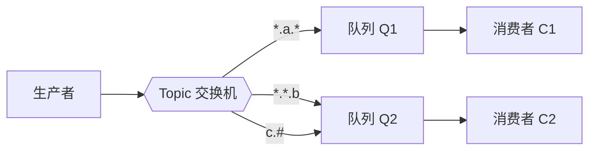
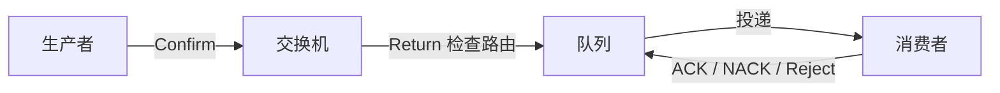

# Day 72｜RabbitMQ 高级路由与消息可靠性学习总结

> 本篇围绕 RabbitMQ 的 **Topic 主题模式、队列与交换机声明、对象消息序列化**，以及生产者、MQ、消费者三个环节的可靠性保障展开。

---

## 📌 内容总览

| 模块 | 解决的问题 | 核心方式 |
|---|---|---|
| Topic 主题模式 | 如何按规则灵活匹配消息 | 使用 `*`、`#` 通配符匹配 `routing key` |
| Java 声明 MQ 组件 | 如何创建队列、交换机和绑定关系 | 配置类或 `@RabbitListener` 注解 |
| 对象消息 | 如何传输 Java 对象 | 使用 JSON 序列化替代 JDK 序列化 |
| 生产者可靠性 | 消息能否成功发到交换机、再路由到队列 | 重试、Confirm、Return 机制 |
| MQ 可靠性 | Broker 重启或消息堆积时如何保护数据 | 队列、交换机、消息持久化与惰性队列 |
| 消费者可靠性 | 消费失败后消息如何处理 | ACK、NACK、Reject 与确认模式 |

---

## 1. Topic 主题模式

Topic 模式基于 `topic` 类型交换机实现。它与 Direct 模式一样使用 `routing key` 路由消息，但支持通配符模糊匹配，因此更加灵活。

### 1.1 通配符规则

- `*`：匹配**一个单词**。
- `#`：匹配**任意数量的单词**。
- 单词之间通常使用英文句点 `.` 分隔。

### 1.2 匹配示例

假设队列绑定键如下：

| 队列 | Binding Key | 可以匹配的示例 |
|---|---|---|
| Q1 | `*.a.*` | `x.a.y` |
| Q2 | `*.*.b` | `x.y.b` |
| Q2 | `c.#` | `c.news`、`c.order.created` |



> **记忆方法：**`*` 只占一个位置，`#` 可以覆盖后续多个位置。

---

## 2. 使用 Java 声明队列、交换机和绑定关系

生产者与消费者都应确保所依赖的队列、交换机和绑定关系已声明。Spring AMQP 主要提供两种声明方式。

### 2.1 方式一：通过配置类声明

这种方式结构清晰，适合在生产者或公共配置模块中集中管理 MQ 组件。

#### 声明队列

```java
@Bean
public Queue fanoutQueue1() {
    return new Queue("fanout.queue1");
}

@Bean
public Queue fanoutQueue2() {
    return QueueBuilder
            .durable("fanout.queue2")
            .build();
}
```

#### 声明交换机

```java
@Bean
public FanoutExchange fanoutExchange() {
    return new FanoutExchange("sysk.fanout");
}
```

也可以使用构建器：

```java
@Bean
public FanoutExchange fanoutExchange() {
    return ExchangeBuilder
            .fanoutExchange("sysk.fanout")
            .build();
}
```

#### 声明绑定关系

```java
@Bean
public Binding fanoutBinding1(
        Queue fanoutQueue1,
        FanoutExchange fanoutExchange) {
    return BindingBuilder
            .bind(fanoutQueue1)
            .to(fanoutExchange);
}
```

对于 Direct 或 Topic 交换机，可以继续调用 `with(...)` 设置 `routing key` 或 binding key。

### 2.2 方式二：通过监听注解声明

这种方式把队列、交换机、绑定关系和消费者监听逻辑放在一起，更适合消费者使用。

```java
@RabbitListener(bindings = @QueueBinding(
        value = @Queue("direct.queue1"),
        exchange = @Exchange(
                name = "sysk.direct",
                type = ExchangeTypes.DIRECT
        ),
        key = {"red", "blue"}
))
public void listen(String message) {
    // 处理消息
}
```

### 2.3 两种方式对比

| 方式 | 特点 | 更适合 |
|---|---|---|
| 配置类 | 组件定义集中、结构清晰、便于复用 | 生产者或公共 MQ 配置 |
| `@RabbitListener` | 声明与监听逻辑靠近，使用方便 | 消费者 |

---

## 3. 收发对象消息

发送 Java 对象时，Spring AMQP 默认可使用 JDK 序列化。此时对象类必须实现 `Serializable` 接口，而且消息可读性和跨语言能力较弱。

更常见的优化方式是使用 JSON 序列化器：

```java
@Bean
public MessageConverter messageConverter() {
    return new Jackson2JsonMessageConverter();
}
```

使用 JSON 的主要收益：

- 消息内容更易阅读和排查。
- 不再依赖 JDK 原生序列化格式。
- 更利于不同语言编写的服务交换数据。

---

## 4. 消息可靠性的整体链路

一条消息从生产者到消费者，需要依次经过多个环节：



因此可靠性需要从三个层面考虑：

1. **生产者可靠性**：确保消息成功到达交换机并被路由到队列。
2. **MQ 可靠性**：确保交换机、队列和消息尽量不因 Broker 重启而丢失。
3. **消费者可靠性**：确保消息处理成功后才被删除，失败时得到正确处置。

---

## 5. 生产者可靠性

### 5.1 生产者重试机制

默认情况下，如果生产者连接或发送失败，不会无限尝试。可以通过配置开启重试：

```yaml
spring:
  rabbitmq:
    connection-timeout: 1s
    template:
      retry:
        enabled: true
        initial-interval: 1000ms
        multiplier: 2
        max-attempts: 5
```

参数说明：

| 参数 | 作用 |
|---|---|
| `connection-timeout` | 设置连接 MQ 的超时时间 |
| `enabled` | 是否开启发送重试 |
| `initial-interval` | 第一次重试前的等待时间 |
| `multiplier` | 后续等待时间的增长倍数 |
| `max-attempts` | 最大尝试次数，包含第一次发送 |

按照以上配置，等待时间会按倍数增长，例如 `1s → 2s → 4s → 8s`。

> 重试过程会阻塞当前发送流程，重试次数和等待时间过大都会影响业务性能，因此需要合理设置。

### 5.2 Confirm 确认机制

Confirm 机制用于确认消息是否成功到达**交换机**：

- 未成功到达交换机：返回 `NACK`。
- 已到达交换机：返回 `ACK`。
- 无论结果是 ACK 还是 NACK，Confirm 回调都会执行。

通过 `RabbitTemplate.convertAndSend(...)` 发送消息时可以设置 `ConfirmCallback`，并使用 `result.isAck()` 判断确认结果。

### 5.3 Return 退回机制

Return 机制用于确认消息到达交换机后，是否成功路由到**队列**：

- 消息已到交换机，但找不到匹配队列：触发 Return 回调并返回异常信息。
- 消息成功路由到队列：不触发 Return 回调。

Return 回调通常在配置类中通过 `RabbitTemplate` 统一设置。

### 5.4 Confirm 与 Return 的区别

| 机制 | 检查范围 | 触发特点 |
|---|---|---|
| Confirm | 生产者 → 交换机 | ACK、NACK 都会执行回调 |
| Return | 交换机 → 队列 | 仅消息无法路由到队列时执行回调 |

> Confirm 解决“有没有到交换机”，Return 解决“到了交换机后有没有进入队列”。

---

## 6. RabbitMQ 服务端可靠性

### 6.1 数据持久化

需要同时关注队列、交换机和消息三个对象。仅持久化其中一部分，仍可能造成消息链路不完整。

#### 队列持久化

配置类写法：

```java
new Queue("fanout.queue1", true);

QueueBuilder
        .durable("fanout.queue2")
        .build();
```

注解写法：

```java
@Queue(value = "direct.queue1", durable = "true")
```

#### 交换机持久化

配置类写法：

```java
new FanoutExchange("sysk.fanout");

ExchangeBuilder
        .fanoutExchange("sysk.fanout")
        .build();
```

注解写法：

```java
@Exchange(
        name = "sysk.direct",
        type = ExchangeTypes.DIRECT,
        durable = "true"
)
```

#### 消息持久化

使用常规发送方法时，消息默认按持久化方式发送：

```java
rabbitTemplate.convertAndSend(
        "simple.queue",
        "simple message"
);
```

### 6.2 使用惰性队列应对消息堆积

大量消息堆积在内存中会导致内存占用升高并影响性能。惰性队列的处理方式是：

1. 消息进入队列后尽量直接写入磁盘，而不是长期保存在内存中。
2. 消费消息时，再从磁盘读取并缓存到内存。

实验时可以重点观察 RabbitMQ 控制台中的两个指标：

- `In Memory`：当前位于内存中的消息量。
- `Publish Message Rate`：消息发布速率。

---

## 7. 消费者可靠性

### 7.1 消费者确认结果

RabbitMQ 会根据消费者返回的状态决定消息如何处理：

| 状态 | 含义 | 消息处理 |
|---|---|---|
| `ACK` | 消费成功 | 从队列中删除消息 |
| `NACK` | 消费异常 | 可重新投递消息 |
| `Reject` | 拒绝消息 | 按当前策略不再重新投递 |

### 7.2 Spring AMQP 确认模式

Spring AMQP 提供两种主要方式：

- **Manual**：开发者手动编写确认代码，根据处理结果返回不同状态。
- **Auto**：Spring AMQP 基于 AOP 和监听方法的执行结果自动完成确认。

配置示例：

```yaml
spring:
  rabbitmq:
    listener:
      simple:
        acknowledge-mode: auto
```

需要手动控制时，可将 `acknowledge-mode` 改为 `manual`。

---

## 8. 可靠性速查表

| 风险位置 | 可能问题 | 对应方案 |
|---|---|---|
| 生产者连接 MQ | 连接或发送暂时失败 | 生产者重试 |
| 生产者 → 交换机 | 消息未到达交换机 | Confirm 回调 |
| 交换机 → 队列 | 路由键不匹配，无队列接收 | Return 回调 |
| RabbitMQ 重启 | 队列、交换机或消息丢失 | 三者持久化 |
| 消息大量堆积 | 内存占用过高 | 惰性队列 |
| 消费过程中异常 | 消息被错误删除或反复投递 | ACK、NACK、Reject 与确认模式 |

---

## 9. 知识串联

1. **Topic 模式解决灵活路由问题**：通过通配符让一组相关消息按规则进入不同队列。
2. **Java 声明确保基础设施可自动创建**：配置类适合集中管理，监听注解适合消费者就近声明。
3. **JSON 序列化提升消息通用性**：对象消息不再局限于 JDK 序列化。
4. **Confirm 与 Return 保障发送链路**：分别确认交换机接收和队列路由。
5. **持久化与惰性队列保障 Broker**：兼顾数据安全与消息堆积时的内存压力。
6. **消费者确认完成可靠性闭环**：只有业务真正处理成功，消息才应该被删除。

> **一句话总结：**可靠消息不是单个配置项，而是生产者发送、交换机路由、队列存储和消费者处理共同组成的完整闭环。

---

## ✅ 复习清单

- [ ] 能区分 Topic 模式中 `*` 与 `#` 的匹配规则
- [ ] 能使用配置类声明队列、交换机和绑定关系
- [ ] 能使用 `@RabbitListener`、`@QueueBinding` 声明消费者及绑定
- [ ] 能为对象消息配置 JSON 序列化器
- [ ] 能合理设置生产者重试次数、初始间隔和增长倍数
- [ ] 能说明 Confirm 与 Return 分别检查哪一段链路
- [ ] 能配置队列、交换机和消息持久化
- [ ] 能解释惰性队列如何缓解大量消息堆积
- [ ] 能说明 ACK、NACK、Reject 对消息的不同处理结果
- [ ] 能区分消费者的 `auto` 与 `manual` 确认模式
