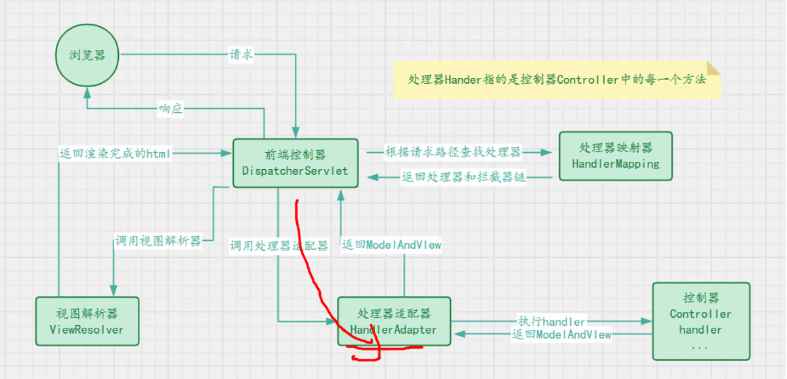

# Spring MVC 进阶与 Spring Boot 入门（Day 54）

> 核心内容：**统一响应、全局异常处理、Spring MVC 工作流程、拦截器、文件上传，以及 Spring Boot 的核心特性与配置读取**。

## 目录

- [一、统一响应结果](统一返回结果，sprigboot介绍入门.md#一统一响应结果)
- [二、统一异常处理](统一返回结果，sprigboot介绍入门.md#二统一异常处理)
- [三、Spring MVC 工作流程](统一返回结果，sprigboot介绍入门.md#三spring-mvc-工作流程)
- [四、拦截器](统一返回结果，sprigboot介绍入门.md#四拦截器)
- [五、多拦截器执行顺序](统一返回结果，sprigboot介绍入门.md#五多拦截器执行顺序)
- [六、文件上传](统一返回结果，sprigboot介绍入门.md#六文件上传)
- [七、Spring Boot 概述](统一返回结果，sprigboot介绍入门.md#七spring-boot-概述)
- [八、Spring Boot 入门程序](统一返回结果，sprigboot介绍入门.md#八spring-boot-入门程序)
- [九、Spring Boot 配置文件](统一返回结果，sprigboot介绍入门.md#九spring-boot-配置文件)
- [十、重点速记](统一返回结果，sprigboot介绍入门.md#十重点速记)

---

## 一、统一响应结果

前后端分离项目中，如果每个接口采用不同的返回结构，前端处理会很复杂。可以定义统一的 `Result<T>`，让所有 Controller 返回相同格式。

### 1. 响应结构

```json
{
  "code": 200,
  "message": "操作成功",
  "data": {}
}
```

| 字段 | 作用 |
|---|---|
| `code` | 业务状态码 |
| `message` | 提示信息 |
| `data` | 返回的数据，可为空 |

> 业务状态码用于描述业务结果，不能完全替代 HTTP 状态码。规范项目应同时合理设置 HTTP 状态码。

### 2. Result 类

```java
package com.edu.common;  
  
import lombok.Data;  
  
import java.io.Serializable;  
  
  
//统一响应结果类  
//Data 注解 可以自动生成getter和setter方法  
@Data  
public class Result<T> implements Serializable {  
    private static final long serialVersionUID = 1L;  
    //状态码比如规定1表示成功,0表示失败 可以自定义  
    private Integer code;  
    //成功或者失败的消息提示  
    private String msg;  
    //数据  
    private T data;  
    //成功响应,没有数据返回,通常用于增删改操作  
    public static <T> Result<T> success() {  
        Result<T> result = new Result<T>();  
        result.code = 1;  
        result.msg = "操作成功";  
        return result;  
    }  
    //成功响应,有数据返回,通常用于查询操作  
    public static <T> Result<T> success(T object) {  
        Result<T> result = new Result<T>();  
        result.data = object;  
        result.code = 1;  
        result.msg = "操作成功";  
        return result;  
    }  
    //失败响应,返回错误原因  
    public static <T> Result<T> error(String msg) {  
        Result result = new Result();  
        result.msg = msg;  
        result.code = 0;  
        return result;  
    }  
}
```

### 3. Controller 使用

```java
@RestController  
@Controller  
@RequestMapping("/book")  
public class BookController {  
    // 注入BookService  
    @Resource  
    private BookService bookService;  
   /* @PostMapping  
       public String saveBook(){        return "book";    }*/    @GetMapping  
    public Result<List<Book>> findAll(){  
       List<Book> books = bookService.selectAll();  
       int i = 1/0;  
       System.out.println(books);  
       return Result.success(books);  
    }  
    //根据id查询图书  
    //id:路径变量，需要用@PathVariable注解来接收  
    @GetMapping("/{id}")  
    public Result<Book> findById(@PathVariable Integer id){  
        Book book = bookService.selectById(id);  
        return Result.success(book);  
    }  
    @PostMapping  
    public Result saveBook(@RequestBody Book book){  
        int rows = bookService.insert(book);  
        return Result.success(rows>0?"success":"fail");  
    }  
    @PutMapping  
    public Result updateBook(@RequestBody Book book){  
        int rows = bookService.update(book);  
        return Result.success(rows>0?"success":"fail");  
    }  
    @DeleteMapping("/{id}")  
    public Result deleteBook(@PathVariable Integer id){  
        int rows = bookService.delete(id);  
        return Result.success(rows>0?"success":"fail");  
    }  
}
```

---

## 二、统一异常处理

异常通常从 Mapper/DAO 抛到 Service，再传到 Controller。若每个 Controller 都写 `try-catch`，会产生大量重复代码。

```text
Mapper / DAO 抛出异常
        ↓
Service 抛出或转换异常
        ↓
Controller 调用过程发生异常
        ↓
全局异常处理器统一转换为 Result
```

### 1. 全局异常处理器

Spring MVC 使用 `@RestControllerAdvice` 和 `@ExceptionHandler` 统一处理异常：

```java
package com.edu.exception;  
import com.edu.common.Result;  
import org.springframework.web.bind.annotation.ExceptionHandler;  
import org.springframework.web.bind.annotation.RestControllerAdvice;  
  
@RestControllerAdvice  
//@RestControllerAdvice可 替代@Controller和@ResponseBody  
public class GlobalExcpetionHandler {  
    @ExceptionHandler(Exception.class)  
    public Result handleException(Exception e){  
        e.printStackTrace();  
        return Result.error("服务器异常"+e.getMessage());  
    }  
}
```

`@RestControllerAdvice` 可以理解为：

```text
@ControllerAdvice + @ResponseBody
```

`@ExceptionHandler(XxxException.class)` 指定该方法处理的异常类型。更具体的异常处理方法通常优先匹配。


---

## 三、Spring MVC 工作流程

### 1. 页面渲染流程


1. 客户端请求进入前端控制器 `DispatcherServlet`。
2. `DispatcherServlet` 请求 `HandlerMapping` 查找处理器。
3. `HandlerMapping` 返回 Handler 和拦截器链。
4. `DispatcherServlet` 调用 `HandlerAdapter`。
5. `HandlerAdapter` 调用 Controller 方法。
6. Controller 返回模型和视图（Module and View）信息。
7. `HandlerAdapter` 将处理结果交回 `DispatcherServlet`。
8. `DispatcherServlet` 调用 `ViewResolver`。
9. 视图解析器根据逻辑视图名定位物理视图。
10. 模型数据与视图渲染为 HTML返回给`DispatcherServlet`。
11. `DispatcherServlet` 将响应返回浏览器。

```text
请求
 ↓
DispatcherServlet
 ↓
HandlerMapping → Handler + Interceptors
 ↓
HandlerAdapter → Controller
 ↓
ModelAndView
 ↓
ViewResolver → 物理视图 → 渲染 HTML
 ↓
响应
```

### 2. 前后端分离流程

使用 `@ResponseBody` 或 `@RestController` 时，返回对象由 `HttpMessageConverter`（如 Jackson 转换器）序列化到响应体，一般不经过视图解析器。

```text
Controller 返回对象
        ↓
HttpMessageConverter
        ↓
JSON 响应
```

---

## 四、拦截器

Spring MVC 拦截器用于在 Controller 方法执行前后进行统一处理。

常见用途：登录校验、权限控制、接口耗时统计和操作日志。

### 1. Interceptor 与 Filter 对比

| 对比项 | Interceptor | Filter |
|---|---|---|
| 所属体系 | Spring MVC | Servlet 规范 |
| 拦截范围 | 进入 `DispatcherServlet` 并匹配 MVC 处理链的请求 | 整个 Web 应用的匹配请求 |
| 能否获取 Handler | 可以 | 通常不直接了解 Controller Handler |
| 依赖 Spring MVC | 是 | 否 |
| 常见用途 | Controller 权限、业务日志 | 编码、跨域、安全包装等 |

### 2. 定义拦截器

```java
@Component
public class LoginInterceptor implements HandlerInterceptor {

    @Override
    public boolean preHandle(
            HttpServletRequest request,
            HttpServletResponse response,
            Object handler
    ) throws Exception {
        // true：放行；false：终止处理链
        return true;
    }

    @Override
    public void postHandle(
            HttpServletRequest request,
            HttpServletResponse response,
            Object handler,
            ModelAndView modelAndView
    ) {
        // Handler 正常执行后、视图渲染前执行
    }

    @Override
    public void afterCompletion(
            HttpServletRequest request,
            HttpServletResponse response,
            Object handler,
            Exception exception
    ) {
        // 请求处理完成后执行，可用于清理资源
    }
}
```

| 方法                  | 执行时机                                         |
| ------------------- | -------------------------------------------- |
| `preHandle()`       | Handler 执行前；返回值决定是否放行                        |
| `postHandle()`      | Handler 正常执行后、视图渲染前，preHandle成功执行返回结果后执行     |
| `afterCompletion()` | 在Dispatcherservlet响应数据之前执行,无论hander是否抛出异常都执行 |

### 3. 注册拦截器

```java
@Configuration  
@ComponentScan("com.edu")  
@EnableWebMvc  
public class SpringMvcConfig implements WebMvcConfigurer {  
    @Autowired  
    private MyInterceptor myInterceptor;  
    @Override  
    //注册拦截器，默认是所有进入springmvc的请求都会执行拦截器  
    public void addInterceptors(InterceptorRegistry registry) {  
        registry.addInterceptor(myInterceptor).addPathPatterns("/book/**")
        //拦截/book路径下的所有请求  
                .excludePathPatterns("/book/add");
        //只排除/book路径下的/add请求,其他请求都会执行拦截器  
    }  
}

```

- `addPathPatterns()`：添加需要拦截的路径。
- `excludePathPatterns()`：排除路径。
- `/**`：匹配任意层级路径。
- `/*`：匹配单层路径。
- `order()`：设置顺序，数值越小优先级越高。

---

## 五、多拦截器执行顺序

若三个拦截器均放行：

```text
pre1 → pre2 → pre3 → Handler
                      ↓
post3 ← post2 ← post1
                      ↓
after3 ← after2 ← after1
```

规律：

- `preHandle()` 按注册顺序执行。
- `postHandle()` 和 `afterCompletion()` 按相反顺序执行。
- 形成类似“先进后出”的调用栈。

### preHandle 返回 false

假设拦截器 2 返回 `false`：

```text
pre1 → pre2(false) → 停止
                     ↓
                after1
```

- 后续拦截器、Handler 和所有 `postHandle()` 不再执行。
- 只有已经成功返回 `true` 的前序拦截器会进入对应 `afterCompletion()`。
- 当前返回 `false` 的拦截器本身通常不会执行其 `afterCompletion()`。

---
## 六、文件上传

### 1. 客户端要求

- 通常使用 POST 请求。
- `Content-Type` 为 `multipart/form-data`。
- HTML 表单需要 `enctype="multipart/form-data"`。
- 文件表单项类型为 `file`。

```html
<form action="/upload"
      method="post"
      enctype="multipart/form-data">
    <input type="file" name="file">
    <button type="submit">上传</button>
</form>
```

Apifox 中选择：`Body → form-data`，并将字段类型设为 `file`。

### 2. MultipartResolver

Spring MVC 通过 `MultipartResolver` 解析上传请求。基于 Servlet 标准时可注册：

```java
@Configuration  
@ComponentScan("com.edu")  
@EnableWebMvc  
public class SpringMvcConfig  {  
    @Bean  
   public StandardServletMultipartResolver multipartResolver(){  
        return new StandardServletMultipartResolver();  
    }  
}
```

> Bean 名称通常应为 `multipartResolver`，以便 `DispatcherServlet` 识别。

### 3. 配置上传限制

在 Web 初始化类中重写 `customizeRegistration()`：

```java
@Override
protected void customizeRegistration(
        ServletRegistration.Dynamic registration
) {
    MultipartConfigElement config = new MultipartConfigElement(
            null,                  // Tomcat 默认临时目录
            10 * 1024 * 1024L,   // 单文件最大 10 MB
            20 * 1024 * 1024L,   // 整个请求最大 20 MB
            512 * 1024           // 超过 512 KB 写入临时磁盘
    );
    registration.setMultipartConfig(config);
}
```

### 4. Controller 接收文件

```java
@RestController  
public class UploadController {  
    @PostMapping("/upload")  
    public String upload(MultipartFile file)throws Exception{  
        //1.获取文件原始名称  
        String orignalFilename=file.getOriginalFilename();  
        System.out.println("文件原始名称："+orignalFilename);  
        //2.获取文件扩展名  
        String suffix=orignalFilename.substring(orignalFilename.lastIndexOf(".")); 
        System.out.println("文件后缀名："+suffix);  
        //3.使用uuid生成全局唯一的文件名称  
        String newFilename= UUID.randomUUID().toString()+suffix;  
        System.out.println("新文件名称："+newFilename);  
        //4.转存  
        file.transferTo(new File("D:\\upload\\"+newFilename));  
        //5.返回成功信息  
        return "success";  
    }  
}
```

常用方法：

| 方法 | 作用 |
|---|---|
| `getOriginalFilename()` | 获取客户端原始文件名 |
| `getSize()` | 获取文件大小 |
| `getContentType()` | 获取客户端声明的媒体类型 |
| `isEmpty()` | 判断文件是否为空 |
| `transferTo()` | 将文件转存到目标位置 |

### 5. 安全注意事项

- 使用 UUID 等生成服务端文件名，防止重名覆盖。
- 限制单文件和请求总大小。
- 校验允许的扩展名、实际文件内容和 MIME 类型。
- 不要直接信任客户端原始文件名或 `Content-Type`。
- 上传目录尽量与可执行代码、公开静态资源目录隔离。
- 防止 `../` 等路径穿越。

---

## 七、Spring Boot 概述

Spring Boot 是 Spring 生态中的项目，用于快速创建可独立运行的 Spring 应用。

### 1. 核心特点

#### 起步依赖（Starter）

一个 Starter 会组合某项功能所需的一组依赖，简化 Maven 配置。

命名惯例：

```text
官方：spring-boot-starter-功能名
第三方：功能名-spring-boot-starter
```

例如：

```text
spring-boot-starter-web
```

#### 自动配置

Spring Boot 根据类路径依赖、已有 Bean 和配置属性等条件，自动注册常用 Bean。自动配置是有条件的，并非无条件加载全部配置。

#### 其他特点

- Web Starter 默认可使用内嵌 Tomcat。
- 应用通常打包成可执行 JAR。
- 支持丰富的外部化配置。
- 提供统一版本管理和约定优于配置的开发体验。

---

## 八、Spring Boot 入门程序

### 1. Maven 配置

```xml
<parent>
    <groupId>org.springframework.boot</groupId>
    <artifactId>spring-boot-starter-parent</artifactId>
    <version>项目指定版本</version>
    <relativePath/>
</parent>

<dependencies>
    <dependency>
        <groupId>org.springframework.boot</groupId>
        <artifactId>spring-boot-starter-web</artifactId>
    </dependency>
</dependencies>

<build>
    <plugins>
        <plugin>
            <groupId>org.springframework.boot</groupId>
            <artifactId>spring-boot-maven-plugin</artifactId>
        </plugin>
    </plugins>
</build>
```

### 2. 启动类

```java
@SpringBootApplication
public class Application {

    public static void main(String[] args) {
        SpringApplication.run(Application.class, args);
    }
}
```

`@SpringBootApplication` 组合了多个核心注解，主要包含配置类、自动配置和组件扫描能力。

启动类建议放在项目根包：

```text
com.edu.Application
com.edu.controller...
com.edu.service...
```

这样默认组件扫描可以覆盖所有业务子包。

### 3. 简单接口

```java
@RestController
@RequestMapping("/hello")
public class HelloController {

    @GetMapping
    public String hello() {
        return "Hello Spring Boot";
    }
}
```

直接运行启动类即可启动内嵌 Web 服务器，无需手动部署 WAR 到外部 Tomcat。

---

## 九、Spring Boot 配置文件

Spring Boot 默认识别名称为 `application` 的配置文件，例如：

```text
application.properties
application.yml
application.yaml
```

### 1. Properties 格式

```properties
server.port=8081
app.name=demo
app.user.username=zhangsan
app.user.age=18
```

### 2. YAML 格式

```yaml
server:
  port: 8081

app:
  name: demo
  user:
    username: zhangsan
    age: 18
```

YAML 规则：

- 使用缩进表示层次。
- 相同层级左侧对齐。
- 冒号后通常必须有空格。
- 不使用 Tab 进行缩进。

### 3. 使用 `@Value` 读取单个值

```java
@Value("${app.name}")
private String appName;
```

适合读取少量、分散配置。

### 4. 使用 `@ConfigurationProperties` 批量绑定

```java
@Component
@ConfigurationProperties(prefix = "app.user")
@Data
public class UserProperties {
    private String username;
    private Integer age;
}
```

- 前缀对应配置层级。
- 类属性与前缀下的键进行绑定。
- 适合结构化、多项配置。
- 正确注解名是 `@ConfigurationProperties`。

也可以在配置类中启用：

```java
@ConfigurationPropertiesScan
@SpringBootApplication
public class Application {
}
```

### 5. 两种读取方式对比

| 对比项 | `@Value` | `@ConfigurationProperties` |
|---|---|---|
| 适用场景 | 少量单值 | 一组结构化配置 |
| 类型安全 | 一般 | 更强 |
| 批量绑定 | 不方便 | 支持 |
| 可维护性 | 配置多时较差 | 配置多时较好 |

---

## 十、重点速记

> [!TIP]
> **统一结果规范接口输出，全局异常处理统一失败响应，拦截器处理 MVC 请求链，Spring Boot 通过 Starter 和自动配置简化开发。**

- 所有 Controller 可统一返回 `Result<T>`。
- 业务状态码与 HTTP 状态码应合理配合。
- `@RestControllerAdvice` 定义 REST 全局增强。
- `@ExceptionHandler` 按异常类型匹配处理方法。
- 前后端分离响应通常经过消息转换器，不需要视图解析器。
- Interceptor 属于 Spring MVC，Filter 属于 Servlet 规范。
- `preHandle()` 返回 `true` 放行，返回 `false` 终止处理链。
- 多拦截器的 `preHandle()` 正序执行，`postHandle()` 和 `afterCompletion()` 逆序执行。
- 上传请求使用 `multipart/form-data`，文件参数使用 `MultipartFile`。
- 上传文件应限制大小、验证类型、生成安全文件名并防止路径穿越。
- Spring Boot Starter 简化依赖配置。
- 自动配置会在满足条件时注册常用 Bean。
- Spring Boot Web 应用通常内嵌 Tomcat并打包为可执行 JAR。
- 启动类使用 `@SpringBootApplication` 和 `SpringApplication.run()`。
- 默认配置文件名为 `application.properties` 或 `application.yml`。
- YAML 使用缩进表示层级，冒号后需要空格。
- 单个配置可用 `@Value`，一组配置优先使用 `@ConfigurationProperties`。

---

> 本文根据思维导图 **《统一返回结果、springboot介绍》（Day 54）** 整理，并将拦截器流程和文件上传配图转换为文字与代码说明。
