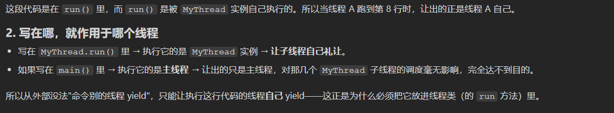

# 📘 Day 36 学习笔记：多线程基础

> 涵盖内容：线程概述、创建线程的三种方式、Thread 类常用方法、线程安全问题、线程同步、死锁、线程通信

---

## 目录

- [一、线程概述](#一线程概述)
- [二、创建线程的方式](#二创建线程的方式)
- [三、Thread 类常用方法](#三thread-类常用方法)
- [四、线程安全问题](#四线程安全问题)
- [五、线程同步](#五线程同步)
- [六、死锁](#六死锁)
- [七、线程通信](#七线程通信)
- [八、知识速查表](#八知识速查表)

---

## 一、线程概述

### 1.1 程序、进程、线程的关系

| 概念 | 定义 | 状态 |
|---|---|---|
| **程序** | 本质上就是磁盘上的文件 | **静态**的 |
| **进程** | 运行中的程序，操作系统**分配资源**的基本单元 | **动态**的 |
| **线程** | 程序中同时运行、相互独立的多个功能，CPU **调度执行**的基本单元 | **动态**的 |

> 💡 一个进程可以对应**多个**线程。

### 1.2 什么是多线程程序

在**一个进程**中，同时运行**多个线程**，各自执行不同的任务。

### 1.3 多线程的好处

```
多线程的三大好处
├── 提高程序工作效率
├── 提高 CPU 的利用率
└── 提高用户的使用体验
```

---

## 二、创建线程的方式

| 方式 | 做法 | 能否获取执行结果 |
|---|---|---|
| **方式一** | 继承 `Thread` 类，重写 `run` 方法 | ❌ 不能 |
| **方式二** | 实现 `Runnable` 接口，重写 `run` 方法，再传递给 `Thread` 类 | ❌ 不能 |
| **方式三** | 实现 `Callable` 接口，重写 `call` 方法 → 传给 `FutureTask` → 再传给 `Thread` | ✅ **能**（通过 `FutureTask.get()` 获取结果） |

> ⭐ **核心区别**：三种方式中，**只有方式三**可以拿到线程执行完毕后的返回结果。

**代码示例对比：**

```java
// 方式一：继承 Thread
class MyThread extends Thread {
    @Override
    public void run() {
        // 线程执行的逻辑
    }
}

// 方式二：实现 Runnable
class MyRunnable implements Runnable {
    @Override
    public void run() {
        // 线程执行的逻辑
    }
}
new Thread(new MyRunnable()).start();

// 方式三：实现 Callable（可获取返回值）
class MyCallable implements Callable<String> {
    @Override
    public String call() throws Exception {
        return "执行结果";
    }
}
FutureTask<String> task = new FutureTask<>(new MyCallable());
new Thread(task).start();
String result = task.get(); // 获取线程执行结果
```

---

## 三、Thread 类常用方法

| 方法 | 作用 | 备注 |
|---|---|---|
| `setName(String)` | 设置线程名称 | 不设置默认是 `Thread-索引` |
| `getName()` | 获取线程名称 | — |
| `currentThread()` | 获取**当前**线程对象 | 静态方法 |
| `sleep(long)` | 让线程休眠指定**毫秒数** | — |
| `setPriority(int)` | 设置线程优先级 | 范围 **1~10**，默认 **5** |
| `getPriority()` | 获取线程优先级 | — |
| `setDaemon(true)` | 设置为**守护线程** | 所有用户线程结束后，守护线程也随之结束 |
| `yield()` | **礼让**，让出 CPU 执行权 | 不保证一定让出 |
| `join()` | 调用该方法的线程**先执行**，当前线程**挂起** | 常用于"等待某线程执行完再继续" |

### 3.1 优先级机制

> Java 中默认采用**抢占式调度**：优先级越高的线程，获得 CPU 执行权的**概率越高**（但不是绝对的）。

### 3.2 守护线程 vs 用户线程

```
线程分类
├── 守护线程（后台线程）→ setDaemon(true)
│   └── 所有用户线程结束，守护线程自动结束
└── 非守护线程（用户线程）→ 默认类型
```

---

## 四、线程安全问题

线程安全问题产生需要**同时满足**以下三个条件：

```
线程安全问题的三要素
├── 1️⃣ 要有多线程的运行环境
├── 2️⃣ 多线程要操作同一个共享资源
└── 3️⃣ 要对该共享资源进行"修改"操作
```

> ⚠️ 三个条件**缺一不可**：如果只是多线程**读取**共享资源而不修改，通常不会引发安全问题。

---

## 五、线程同步

**核心思想**：对操作共享资源的代码进行**加锁**，从而让多个线程**有序**地执行，避免线程安全问题。

| 方式 | 名称 | 说明 |
|---|---|---|
| 方式一 | **同步代码块** | 手动指定锁对象，锁定一段代码 |
| 方式二 | **同步方法** | 在方法上加 `synchronized`，锁住**整个方法体** |
| 方式三 | **Lock 锁** | 使用 `Lock` 接口及其实现类 `ReentrantLock` |

### 5.1 同步代码块

```java
synchronized (对象锁) {
    // 操作共享资源的代码
}
```

> 📌 关键点：**多个线程必须使用同一把锁**，同步才会生效。

### 5.2 同步方法

```java
// 实例方法：锁对象默认是 this
public synchronized void method() {
    // 操作共享资源的代码
}

// 静态方法：锁对象是该类的字节码对象（类名.class）
public static synchronized void staticMethod() {
    // 操作共享资源的代码
}
```

| 方法类型 | 锁对象 |
|---|---|
| 实例方法 | `this` |
| 静态方法 | `类名.class`（字节码对象） |

### 5.3 Lock 锁

```java
Lock lock = new ReentrantLock();

lock.lock();       // 上锁
try {
    // 操作共享资源的代码
} finally {
    lock.unlock();  // 释放锁（必须保证一定会执行到，通常放在 finally 中）
}
```

> ⚠️ **注意**：`unlock()` 是**要求必须执行到**的操作，否则锁将无法释放，容易导致其他线程永久阻塞。

### 5.4 三种同步方式对比

| 对比项 | 同步代码块 | 同步方法 | Lock 锁 |
|---|---|---|---|
| 灵活性 | 较高（可自定义锁范围） | 较低（锁整个方法） | **最高**（可手动控制加锁/解锁时机） |
| 底层实现 | JVM 内置（`monitor`） | JVM 内置（`monitor`） | JDK API（`ReentrantLock`） |
| 释放锁方式 | 自动释放 | 自动释放 | **必须手动 `unlock()`** |

---

## 六、死锁

### 6.1 什么是死锁

> **多个线程之间相互持有对方需要的锁**，导致大家都无法继续向下执行——这是一种**错误现象**，应当尽量避免。

### 6.2 代码体现

死锁通常表现为**锁的嵌套**：

```java
// 线程A：先拿到 lockA，再尝试拿 lockB
synchronized (lockA) {
    synchronized (lockB) {
        // ...
    }
}

// 线程B：先拿到 lockB，再尝试拿 lockA
synchronized (lockB) {
    synchronized (lockA) {
        // ...
    }
}
// 如果两个线程同时持有各自的第一把锁，就会互相等待，形成死锁
```

---

## 七、线程通信

### 7.1 概述

线程之间进行**交互**，使多个线程能够**协作、有序**地执行任务。

### 7.2 生产者-消费者模型

```
生产者-消费者模型
├── 生产者（Producer）→ 负责生产数据
├── 消费者（Consumer）→ 负责消费数据
└── 共享区域          → 生产者和消费者之间传递数据的媒介
```

### 7.3 等待唤醒机制

| 方法 | 作用 |
|---|---|
| `wait()` | 让当前线程**等待**（释放锁并阻塞） |
| `notify()` | **随机唤醒**一个正在等待的线程 |
| `notifyAll()` | **唤醒所有**正在等待的线程 |

---

## 八、知识速查表

| 主题 | 核心内容 | 一句话总结 |
|---|---|---|
| 线程概述 | 程序/进程/线程 | 程序是静态文件，进程是资源分配单位，线程是CPU调度单位 |
| 创建线程 | Thread / Runnable / Callable | 只有 Callable + FutureTask 能拿到返回结果 |
| Thread 常用方法 | sleep/join/yield/setDaemon 等 | 优先级 1-10 默认5，join 让当前线程等待目标线程执行完 |
| 线程安全 | 三要素 | 多线程 + 共享资源 + 修改操作，三者同时满足才有风险 |
| 线程同步 | 代码块/方法/Lock锁 | 本质都是加锁，Lock 更灵活但需手动释放 |
| 死锁 | 锁嵌套 | 多个线程互相持有对方需要的锁，永久等待 |
| 线程通信 | wait/notify/notifyAll | 生产者消费者模型的核心机制 |

---

## 🌳 整体知识树

```
Day36 多线程
├── 线程概述
│   ├── 程序（静态）/ 进程（动态，资源单位）/ 线程（动态，调度单位）
│   └── 多线程好处：效率↑ CPU利用率↑ 体验↑
│
├── 创建线程的三种方式
│   ├── 继承 Thread
│   ├── 实现 Runnable
│   └── 实现 Callable + FutureTask（唯一能拿返回值）
│
├── Thread 类常用方法
│   ├── setName / getName / currentThread
│   ├── sleep / yield / join
│   └── setPriority(1-10,默认5) / setDaemon(守护线程)
│
├── 线程安全问题
│   └── 三要素：多线程环境 + 共享资源 + 修改操作
│
├── 线程同步
│   ├── 同步代码块：synchronized(锁对象){...}
│   ├── 同步方法：synchronized 修饰方法（this / 类名.class）
│   └── Lock锁：lock() + unlock()（必须手动释放）
│
├── 死锁
│   └── 表现：锁的嵌套，线程间互相等待对方的锁
│
└── 线程通信
    ├── 生产者-消费者模型
    └── 等待唤醒：wait() / notify() / notifyAll()
```
