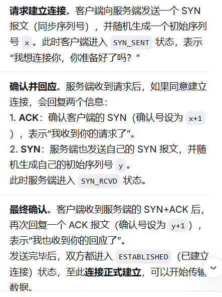
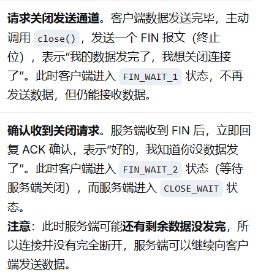
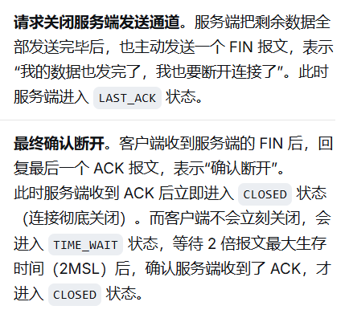

# Day 38 学习笔记

> 本节内容：TCP 编程、反射、注解、动态代理

---

## 一、TCP 编程
### 三次握手

### 四次挥手


### 1. 单发单收

TCP 通信的最基础模型：客户端发一次、服务端收一次。

**客户端流程**

>socket：`套接字`

| 步骤  | 操作                                            |
| --- | --------------------------------------------- |
| 1   | 创建客户端对象：`new Socket(服务器ip, 服务器的端口)`           |
| 2   | 通过 socket 获取字节输出流，使用 `DataOutputStream` 包装原始流 |
| 3   | 写数据：`writeUTF(string)`                        |
| 4   | 释放资源：`socket.close()`                         |
```java
public static void main(String[] args) throws Exception {  
    //1.创建客户端Socket对象,指定服务器端ip和端口  
    Socket socket=new Socket("127.0.0.1",10086);  
    //2.从socket对象中获取字节输出流,用来给服务端发送数据  
    OutputStream os=socket.getOutputStream();  
    DataOutputStream dos=new DataOutputStream(os);  
    //3.写数据  
    dos.writeUTF("hello,服务器");  
    //4.释放资源  
    dos.close();  
}
```
**服务端流程**

| 步骤  | 操作                                           |
| --- | -------------------------------------------- |
| 1   | 创建服务端对象：`new ServerSocket(注册服务器端口)`          |
| 2   | `accept()`：监听客户端连接；若连接成功，返回服务端对应该客户端的 socket |
| 3   | 通过服务端 socket 获取字节输入流，使用 `DataInputStream` 包装 |
| 4   | 读数据：`readUTF()`                              |
| 5   | 释放资源：`close()`                               |
```java
public static void main(String[] args) throws Exception {  
    //1.创建服务端ServerSocket对象,指定监听的端口  
    ServerSocket server =new ServerSocket(10086);  
    //2.通过accept方法来监听客户端的连接 如果有客户端连接上来返回与客户端对应的socket对象,否则一致等待.  
    Socket socker=server.accept();  
    //3.从socket对象中得到字节输入流,用来接受数据  
    InputStream is=socker.getInputStream();  
    DataInputStream dis=new DataInputStream(is);  
    //4.读数据  
    String msg=dis.readUTF();  
    System.out.println(msg);  
    //5.释放资源  
    dis.close();  
}
```
### 2. 多发多收

在"单发单收"的基础上，加上 `while(true)` 循环，实现客户端与服务端之间的持续通信。
```java
//client
public static void main(String[] args) throws Exception {  
    //1.创建客户端Socket对象,指定服务器端ip和端口  
    Socket socket = new Socket("127.0.0.1",10010);  
    //2.从socket对象中获取字节输出流,用来给服务端发送数据  
    OutputStream os = socket.getOutputStream();  
    DataOutputStream dos = new DataOutputStream(os);  
    Scanner sc = new Scanner(System.in);  
    while (true){  
        System.out.println("请输入：");  
        String msg = sc.next();  
        if("exit".equals(msg)){  
            socket.close();  
            break;  
        }  
        dos.writeUTF(msg);  
    }  
}
//server
public static void main(String[] args) throws Exception {  
    //1.创建服务端ServerSocket对象,指定监听的端口  
    ServerSocket ss = new ServerSocket(10010);  
    //2.通过accept方法来监听客户端的连接 如果有客户端连接上来返回与客户端对应的socket对象,否则一致等待.  
    Socket socket = ss.accept();  
    //3.从socket对象中得到字节输入流,用来接受数据  
    InputStream is = socket.getInputStream();  
    DataInputStream dis = new DataInputStream(is);  
    while (true){  
        try {  
            String msg = dis.readUTF();  
            System.out.println(msg);  
        } catch (IOException e) {  
            SocketAddress remoteSocketAddress = socket.getRemoteSocketAddress();  
            System.out.println(remoteSocketAddress+"下线了");  
            break;  
        }  
    }  
}


```
### 3. 多客户端发送

- **默认不生效的原因**：多个客户端同时连接时，只有 main 线程在跑，`accept()` 只执行了一次，无法应对多个连接。
- **解决方案：采用多线程**
  - 主线程：负责监听连接（`accept`）
  - 子线程：负责与具体客户端进行通信
```java
public static void main(String[] args) throws Exception {  
    //1.创建客户端Socket对象,指定服务器端ip和端口  
    Socket socket=new Socket("127.0.0.1",10010);  
    //2.从socket对象中获取字节输出流,用来给服务端发送数据  
    OutputStream os=socket.getOutputStream();  
    DataOutputStream dos=new DataOutputStream(os);  
    Scanner scanner=new Scanner(System.in);  
    while (true) {  
        System.out.println("请输入要发送的消息：");  
        String msg=scanner.next();  
        if("exit".equals(msg)) {  
            socket.close();  
            break;  
        }  
        //3.写数据  
        dos.writeUTF(msg);  
    }

public class MyThread extends Thread{  
    private Socket socket;  
    public MyThread(Socket socket) {  
        this.socket = socket;  
    }  
    @Override  
    public void run() {  
        try {  
            InputStream is = socket.getInputStream();  
            DataInputStream dis = new DataInputStream(is);  
            while (true) {  
                try {  
                    String msg = dis.readUTF();  
                    System.out.println(msg);  
                } catch (IOException e) {  
            SocketAddress remoteSocketAddress = socket.getRemoteSocketAddress();  
                    System.out.println(remoteSocketAddress + "下线了");  
                    break;  
                }  
            }  
        } catch (IOException e) {  
            e.printStackTrace();  
        }  
    }  
}
public class Server {  
    public static void main(String[] args) throws Exception {  
        //1.创建服务端ServerSocket对象,指定监听的端口  
        ServerSocket ss = new ServerSocket(10010);  
        //2.通过accept方法来监听客户端的连接 如果有客户端连接上来返回与客户端对应的socket对象,否则一致等待.  
  
        while (true) {  
            //2.1 通过accept方法来监听客户端的连接 如果有客户端连接上来返回与客户端对应的socket对象,否则一致等待.  
            Socket socket = ss.accept();  
            //2.2 把这个客户端对应的socket通信管道，交给一个独立的线程负责处理。  
            //2.3 使用多线程技术，实现多个客户端同时收发消息。  
            new MyThread(socket).start();  
        }  
        //3.从socket对象中得到字节输入流,用来接受数据  
  
    }  
}
```
### 4. BS 架构通信

HTTP 协议响应报文格式：

```
响应行
响应头
响应空行
响应体
```
```java
public class ServerRunnable implements Runnable {  
    private Socket socket;  
  
    public ServerRunnable(Socket socket) {  
        this.socket = socket;  
    }  
  
    @Override  
    public void run() {  
        try {  
            OutputStream os = socket.getOutputStream();  
            PrintStream ps = new PrintStream(os); 
            //响应行 
            ps.println("HTTP/1.1 200 OK");  
            //响应头
            ps.println("Content-Type:text/html;charset=UTF-8");  
            //响应空行
            ps.println();  
            //响应体
            ps.println("<div style='color:red;font-size:120px;text-align:center'>HelloWorld<div>");  
        } catch (Exception e) {  
            e.printStackTrace();  
        }  
    }

public static void main(String[] args) throws Exception {  
    System.out.println("===服务端启动===");  
    //1.创建ServerSocket的对象，同时为服务端注册端口。  
    ServerSocket serverSocket = new ServerSocket(8080);  
    while (true) {  
        //2.使用serverSocket对象，调用一个accept方法，等待客户端的连接请求  
        Socket socket = serverSocket.accept();  
        //3.把这个客户端对应的socket通信管道，交给一个独立的线程负责处理。  
        new Thread(new ServerRunnable(socket)).start();  
    }  
}
```

### 5. 使用线程池改造

不再每次手动创建新线程，而是使用 `ThreadPoolExecutor` 线程池来管理连接线程，避免频繁创建/销毁线程的开销。
```java
public static void main(String[] args) throws Exception {  
    System.out.println("===服务端启动===");  
    //创建出一个线程池,负责处理通信管道的任务  
    ThreadPoolExecutor threadPoolExecutor=new ThreadPoolExecutor(  
            10,  
            15,  
            0L,  
            TimeUnit.SECONDS,  
            new LinkedBlockingQueue<>());  
    //1.创建ServerSocket的对象，同时为服务端注册端口。  
    ServerSocket serverSocket = new ServerSocket(8080);  
    while (true) {  
        //2.使用serverSocket对象，调用一个accept方法，等待客户端的连接请求  
        Socket socket = serverSocket.accept();  
        //3.把这个客户端对应的socket通信管道，交给一个独立的线程负责处理。  
        threadPoolExecutor.execute(new ServerRunnable(socket));  
    }  
}

public class ServerRunnable implements Runnable {  
    private Socket socket;  
  
    public ServerRunnable(Socket socket) {  
        this.socket = socket;  
    }  
  
    @Override  
    public void run() {  
        try {  
            OutputStream os = socket.getOutputStream();  
            PrintStream ps = new PrintStream(os);  
            // 响应行     "HTTP/1.1 200 OK"            
            ps.println("HTTP/1.1 200 OK");  
            //响应头     "Content-Type:text/html;charset=UTF-8"                                 ps.println("Content-Type:text/html;charset=UTF-8");  
            // 响应空行  
            ps.println();  
            //响应体  
            ps.println("<div style='color:red;font-size:120px;text-align:center'>HelloWorld<div>");  
            //关闭socket  
            socket.close();  
        } catch (Exception e) {  
            e.printStackTrace();  
        }  
    }  
}
```
### 6. 群聊功能实现思路

1. 服务端添加一个集合容器，用来存储所有在线客户端
2. 客户端第一次连接上来时，将其加入集合
3. 客户端下线后，从集合中移除
4. 客户端需要引入多线程来接收服务器转发过来的数据

---

## 二、反射

### 1. 什么是反射？

> 反射就像一面**镜子**：能在程序**运行的过程中**，动态获取类的成员并使用。

反射所抽象出的四个核心对象：
```java
//方式一 类名.class属性  
Class<Cat> c1 = Cat.class;  
//方式二 Class.forName(全类名)  
Class<?> c2 = Class.forName("com.scedu.code.d1_reflect.Cat");  
//方式三 对象名.getClass()  
Cat cat = new Cat();  
Class<? extends Cat> c3 = cat.getClass();  
//验证字节码对象只有一份  
System.out.println(c1==c2);  
System.out.println(c1==c3);
```

| 抽象对象 | 对应类 |
|---|---|
| 类 | `Class` |
| 构造方法 | `Constructor` |
| 成员方法 | `Method` |
| 成员变量 | `Field` |
```java
public void testUseConstructor() throws Exception {  
    Class<Cat> clas=Cat.class;  
    Constructor<?> constructor=clas.getDeclaredConstructor( String.class,int.class);  
    constructor.setAccessible(true);  
    Object obj=constructor.newInstance("Tom",10);  
    System.out.println(obj);  
    System.out.println("-------------------");  
    //获取单个私有构造方法  
    Constructor<?> constructor1=clas.getDeclaredConstructor(String.class,int.class);  
    //私有化构造方法需要暴力反射  
    constructor1.setAccessible(true);  
    Object obj1=constructor1.newInstance("Tom", 1);  
    System.out.println(obj1);  
}

public void testUseField() throws Exception {  
    Class<?> clas=Class.forName("com.scedu.code.d1_reflect.Cat");  
    //获取单个公共成员变量  
    Field field=clas.getField("name");  
    //获取单个私有成员变量  
    Field field1=clas.getDeclaredField("age");  
    //暴力反射  
    field1.setAccessible(true);  
    Cat cat=new Cat();  
    field.set(cat,"tom");  
}
public void testUseMethod() throws Exception {  
    Cat cat=new Cat();  
    Class<?extends Cat> c1 = cat.getClass();  
    Method method = c1.getMethod("eat",String.class);  
  
    method.invoke(cat);  
    method.invoke(cat,"鱼");  
    method.invoke(cat,1);  
}

```
### 2. 反射学什么？

- 如何获取成员
- 如何使用成员

### 3. 如何获取成员——总结

| 场景 | 规律 |
|---|---|
| 获取多个 | 方法名带 `s`（如 `getMethods`） |
| 获取单个 | 方法名不带 `s`（如 `getMethod`） |
| 不带 `declared` 的方法 | 只能获取 `public` 成员 |
| 带 `declared` 的方法 | 获取所有权限的成员（推荐使用） |

> ✅ 推荐：统一使用带 `declared` 的方法，权限覆盖更全面。

### 4. 如何使用成员——总结

**相同点**：使用私有成员都需要**暴力反射**，即调用 `setAccessible(true)`。

**不同点**：

| 成员类型 | 主要用途 | 核心方法 |
|---|---|---|
| 构造方法 Constructor | 创建对象 | `newInstance()` |
| 成员方法 Method | 调用方法 | `invoke()` |
| 成员变量 Field | 赋值 / 取值 | `set()` / `get()` |

---

## 三、注解

### 1. 什么是注解？

一种**标记**，可以写在类中任意位置，并具有一定的作用。

常见内置注解示例：

| 注解 | 作用 |
|---|---|
| `@Override` | 检查方法重写的语法是否正确 |
| `@FunctionalInterface` | 检查接口是否是函数式接口 |
| `@Test` | 让方法变成可运行的测试方法 |

### 2. 自定义注解

**格式**：`属性()`

**属性使用注意事项**：

1. 属性如果没有默认值，必须赋值
2. 如果只有一个属性需要赋值，且属性名为 `value`，可以省略 `value=`
3. 如果属性类型是数组，需加 `{}`；`{}` 中如果只有一个值，可以省略 `{}`
```java
public @interface Myanno {  
    public String name() default "tom";  
    public int value();  
    public String[] names();  
}
@Myanno(name = "tom",  value=10, names = {"aaa", "bbb"})
```
### 3. 元注解（修饰注解的注解）

**`@Target`：规定注解能加的位置**

| 取值 | 作用位置 |
|---|---|
| `TYPE` | 类或接口上 |
| `CONSTRUCTOR` | 构造方法上 |
| `FIELD` | 成员变量上 |
| `METHOD` | 成员方法上 |
| `PARAMETER` | 形参上 |

**`@Retention`：规定注解的生命周期**

| 取值 | 存活范围 |
|---|---|
| `RUNTIME` | 运行时，一直保留（常结合反射使用） |
| `CLASS` | 存在于源文件和字节码文件中 |
| `SOURCE` | 只存在于源文件中 |

**`@Documented`**：表示自定义注解可以体现在 API 文档中。

```java
//ElementType.METHOD 指定注解使用在方法上,ElementType.TYPE 指定注解使用在类上  
@Target({ElementType.METHOD,ElementType.TYPE})//指定注解使用的位置  
@Retention(RetentionPolicy.RUNTIME)//指定注解的存活时间
```

### 4. 注解解析

| 方法 | 作用 |
|---|---|
| `getDeclaredAnnotations()` | 获取所有注解，返回注解数组 |
| `getDeclaredAnnotation(Class...)` | 获取指定类型的单个注解 |
| `isAnnotationPresent(Class)` | 判断指定注解是否存在，存在返回 `true`，否则 `false` |

> 📌 `Class`、`Method`、`Field`、`Constructor` 对象都拥有上述方法。

```java
public class AnnotationTest4 {  
    @MyTest  
    public void test1() {  
        System.out.println("AnnotationTest4.test1");  
    }  
  
    public void test2() {  
        System.out.println("AnnotationTest4.test2");  
    }  
  
    @MyTest  
    public void test3() {  
        System.out.println("AnnotationTest4.test3");  
    }  
  
    public static void main(String[] args) throws Exception{  
        Class<AnnotationTest4> clas=AnnotationTest4.class;  
        Constructor< AnnotationTest4> constructor=clas.getDeclaredConstructor();  
        AnnotationTest4 obj=constructor.newInstance();  
        Method[] methods=clas.getDeclaredMethods();  
        for(Method m:methods){  
            if(m.isAnnotationPresent(MyTest.class)){  
                m.invoke(obj);  
            }  
        }  
  
    }
    
    
    public void parseMethod() throws Exception {  
    Class<BookStore> cls=BookStore.class;  
    //获取BookStore类中的mtehod1方法  
    Method method=cls.getMethod("mtehod1");  
    if(method.isAnnotationPresent(Book.class)){  
        Book book=method.getDeclaredAnnotation(Book.class);  
        System.out.println(book.value());  
        System.out.println(Arrays.toString(book.authors()));  
        System.out.println(book.price());  
    }  
}
```
---

## 四、动态代理

### 1. 什么是动态代理？

在程序运行过程中**动态创建代理对象**的技术，可以在**不修改源代码**的基础上，对原始对象的方法进行**功能增强**。

### 2. 实现方案：JDK 动态代理

**前提条件**：原始类必须实现接口。

**实现方式**：`Proxy.newProxyInstance(...)` 方法，共 3 个参数：

| 参数 | 含义 |
|---|---|
| ① 类加载器 `ClassLoader` | 用来加载代理类 |
| ② 接口的 `Class` 数组 | 原始类实现的所有接口 |
| ③ 回调处理器 `InvocationHandler` | 与代理对象绑定；通过代理对象调用方法时，会执行处理器中的 `invoke` 方法，可在其中编写增强代码 |

`invoke` 方法的参数与返回值：

| 参数/返回值 | 含义 |
|---|---|
| 第一个参数 | 代理对象本身 |
| 第二个参数 | 被调用方法的 `Method` 对象 |
| 第三个参数 | 调用方法时传递的实参 |
| 返回值 | 方法调用完毕后的返回结果 |

> `Proxy.newProxyInstance(...)` 方法最终返回的是**代理对象**。

```java
public class Test {  
    public static void main(String[] args) {  
        //创建原始对象  
        YangMi yangMi=new YangMi();  
        //创建代理对象,参数1:类加载器,参数2:接口,参数3:调用处理器  
        //调用处理器: 通过代理对象调用方法时会对通用处理器的invoke方法进行调用  
        //用Star接口来创建代理对象,因为Star接口中定义了sing和dance方法,所以代理对象也必须实现Star接口(Star)  
        //newProxyInstance方法的返回值是Star接口的子类对象,所以强转为Star接口类型  
        Star proxyObj=(Star) Proxy.newProxyInstance(  
        //类加载器，因为代理对象是通过类加载器加载的，所以这里需要传入原始对象的类加载器  
            Test.class.getClassLoader(),  
        //接口，因为代理对象必须实现Star接口，所以这里需要传入Star接口的Class对象  
            new Class[]{Star.class},  
        //调用处理器，通过代理对象调用方法时会对通用处理器的invoke方法进行调用  
            new InvocationHandler(){  
            @Override  
            public Object invoke(Object proxy, Method method, Object[] args) throws Throwable {  
                //PROXY:代理对象,method:原始对象的方法,args:原始对象的方法的参数  
            System.out.println("准备场地");  
                //调用原始对象的方法  
            //INVOKE:调用原始对象的方法,与上面的invoke方法中的method参数对应,yangMi:原始对象  
             Object result=method.invoke(yangMi,args);  
             System.out.println("收拾场地");  
             return result;  
                    }  
    });  
        //调用代理对象的方法  
        proxyObj.sing();  
        String dan  = proxyObj.dance();  
        System.out.println(dan);  
    }  
}

public class YangMi implements Star{  
    @Override  
    public void sing() {  
        System.out.println("YangMi.sing");  
    }  
    @Override  
    public String dance() {  
        System.out.println("YangMi.dance");  
        return "YangMi.dance";  
    }  
}
```
```
---

## 知识结构总览

```
Day38
├── TCP编程
│   ├── 单发单收（客户端/服务端流程）
│   ├── 多发多收（while true）
│   ├── 多客户端发送（多线程处理）
│   ├── BS架构通信（HTTP响应报文）
│   ├── 线程池改造（ThreadPoolExecutor）
│   └── 群聊功能（集合容器管理在线客户端）
├── 反射
│   ├── 概念：运行时动态获取并使用类成员
│   ├── 四大抽象：Class / Constructor / Method / Field
│   ├── 获取成员：单复数 + declared 权限规律
│   └── 使用成员：newInstance / invoke / set,get
├── 注解
│   ├── 概念：标记 + 作用
│   ├── 自定义注解：格式与属性规则
│   ├── 元注解：@Target / @Retention / @Documented
│   └── 注解解析：反射结合注解的三个方法
└── 动态代理
    ├── 概念：运行时创建代理对象，增强功能而不改源码
    └── JDK动态代理：前提（实现接口）+ Proxy.newProxyInstance 三参数
```
