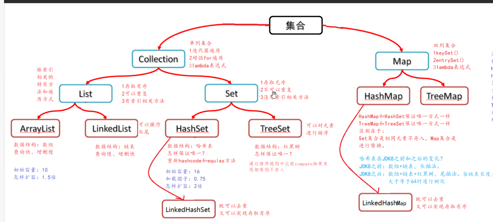

# 📚 Day 30 — Java 学习笔记总结

> 本文涵盖：正则表达式进阶 · 集合体系总览 · Collection 接口 · List 接口 · Set 接口 · 树结构 · 集合技术选型

---

## 一、正则表达式（进阶用法）

### 1.1 校验字符串是否满足规则

`String` 类提供了直接校验的方法：

```java
// 判断字符串是否匹配给定的正则表达式
boolean result = str.matches(regex);
```

---

### 1.2 爬取满足规则的字符串

需要使用 `Pattern` 和 `Matcher` 配合完成，步骤如下：

```java
// 第一步：根据正则表达式创建模式对象
Pattern pattern = Pattern.compile(String regex);

// 第二步：根据模式对象和目标文本创建匹配器对象
Matcher matcher = pattern.matcher(String input);

// 第三步：查找是否有匹配内容（有则返回 true，无则返回 false）
boolean found = matcher.find();

// 第四步：获取匹配内容
String result = matcher.group();        // 返回完整匹配的字符串
String group1 = matcher.group(1);      // 返回第 1 个分组匹配的内容
```

---

### 1.3 String 类正则表达式补充方法

| 方法 | 说明 |
|---|---|
| `replaceAll(String regex, String replacement)` | 将满足正则规则的内容全部替换为指定字符串 |
| `split(String regex)` | 按照正则规则对字符串进行切割，返回 `String[]` |
```java
// 需求1：请把 张三ai8888李四999aa5566王五fbbfsfs42425赵六，中间的非中文字符替换成 “-”String s1 = "张三ai8888李四999aa5566王五fbbfsfs42425赵六";  
System.out.println(s1.replaceAll("\\w+", "-"));  
  
// 2、public String[] split(String regex)：按照正则表达式匹配的内容进行分割字符串，返回一个字符串数组。  
// 需求1：请把 张三ai8888李四999aa5566王五fbbfsfs42425赵六，中的人名获取出来。  
String s3 = "张三ai8888李四999aa5566王五fbbfsfs42425赵六";  
String[] names = s3.split("\\w+");  
System.out.println(Arrays.toString(names));  
  
String str = "张三,23";  
String[] split = str.split(",");  
System.out.println(Arrays.toString(split));
```
---

## 二、集合体系总览


```
集合
├── 单列集合（Collection）
│   ├── List（有序、可重复、有索引）
│   │   ├── ArrayList（数组，查询快）
│   │   └── LinkedList（双向链表，增删快）
│   └── Set（无序/有序、不可重复、无索引）
│       ├── HashSet（哈希表，存取无序）
│       │   └── LinkedHashSet（哈希表+双向链表，存取有序）
│       └── TreeSet（红黑树，按内容有序）
└── 双列集合（Map）
    └── ...（后续章节）
```

---

## 三、单列集合 — Collection 接口

### 3.1 通用方法

| 方法 | 说明 |
|---|---|
| `add(元素)` | 添加元素；List 永远返回 `true`，Set 添加重复元素时返回 `false` |
| `remove(元素)` | 删除元素，底层依赖 `equals` 比较；有重复时只删除第一个匹配项 |
| `contains(元素)` | 判断是否包含某元素，底层依赖 `equals` 比较 |
| `clear()` | 清空集合 |
| `isEmpty()` | 判断集合是否为空 |
| `size()` | 获取集合元素个数 |
| `toArray()` | 将集合转换为 `Object[]` 数组 |
| `toArray(T[] t)` | 将集合转换为指定类型数组，推荐写法：`toArray(new String[0])` |

---

### 3.2 通用遍历方式

#### ① 迭代器（仅适用于单列集合）

```java
Iterator<String> it = list.iterator(); // 获取迭代器，默认指向第一个元素
while (it.hasNext()) {                 // 判断当前位置是否有元素
    String s = it.next();              // 返回当前元素并移动指针到下一位
    System.out.println(s);
}
```

**⚠️ 注意事项：**

- 遍历完成后指针**不会自动复位**，如需再次遍历需重新获取迭代器对象。
- 指针已到末尾时再调用 `next()` 会抛出 `NoSuchElementException`。
- 循环体中建议**只调用一次 `next()`**。
- 迭代器遍历过程中，**不能使用集合的方法增删元素**，否则抛出并发修改异常（`ConcurrentModificationException`）。

---

#### ② 增强 for（foreach）

```java
// 语法格式：可遍历数组和单列集合
for (元素类型 变量名 : 数组名或集合名) {
    // 使用变量
}

// 快捷写法（IDE）
集合名.for   // 自动生成增强 for 模板
```

**底层原理：**

- 单列集合增强 for → 底层采用**迭代器**实现。
- 数组增强 for → 底层采用 **fori**（普通 for 循环）实现。

**⚠️ 注意事项：**

- 增强 for 中的变量是**第三方临时变量**，遍历时依次赋值，修改该变量**不会影响集合/数组本身**。

---

#### ③ forEach 方法

```java
// 底层基于增强 for 实现
// Consumer 是 Java 内置的函数式接口（消费型）
list.forEach(new Consumer<String>() {
    @Override
    public void accept(String s) {  // 形参依次表示集合中每个元素
        System.out.println(s);
    }
});

// 使用 Lambda 简化
list.forEach(s -> System.out.println(s));

// 使用方法引用进一步简化
list.forEach(System.out::println);
```

---

## 四、单列集合 — List 接口

> **特点：** 有序、可重复、有索引

### 4.1 特有方法（带索引的增删改查）

| 方法 | 说明 |
|---|---|
| `add(index, element)` | 在指定索引位置插入元素 |
| `remove(index)` | 删除指定索引位置的元素，返回被删除的元素 |
| `set(index, element)` | 修改指定索引位置的元素，返回被替换的旧元素 |
| `get(index)` | 获取指定索引位置的元素 |

### 4.2 特有遍历方式

- **普通 for 循环（fori）**：利用索引遍历，是 List 独有的遍历方式。

---

### 4.3 ArrayList

**数据结构：** 数组 → **查询快，增删慢**

**底层原理：**

| 时机 | 行为 |
|---|---|
| 无参构造创建集合 | 底层创建长度为 **0** 的空数组 |
| 第一次 `add` 元素时 | 创建长度为 **10** 的新数组 |
| 数组存满时 | 自动扩容为原来的 **1.5 倍**（如第 11 个元素存入时扩容至 15） |
| `addAll` 批量添加时 | 先判断"当前已有 + 批量新增"总数能否被 1.5 倍装下，能则 1.5 倍扩，不能则按实际容量扩容 |

---

### 4.4 LinkedList

**数据结构：** 双向链表 → **查询慢，增删快**

**底层原理：**

- 使用**头指针和尾指针**（非头尾结点）。
- **没有固定容量，无需扩容**。
- 每个节点通过内部类 `Node` 封装，包含三个属性：

```
Node {
    prev  // 前一个结点的地址
    item  // 当前节点存储的数据
    next  // 下一个结点的地址
}
```

**特有方法（操作首尾）：**

| 方法 | 说明 |
|---|---|
| `addFirst(e)` / `push(e)` | 在链表头部添加元素 |
| `addLast(e)` | 在链表尾部添加元素 |
| `getFirst()` | 获取头部元素 |
| `getLast()` | 获取尾部元素 |
| `removeFirst()` / `pop()` | 删除并返回头部元素 |
| `removeLast()` | 删除并返回尾部元素 |

**模拟队列和栈：**

```java
// 模拟队列（先进先出 FIFO）
linkedList.addLast(element);    // 入队（尾部添加）
linkedList.removeFirst();       // 出队（头部移除）

// 模拟栈（先进后出 FILO）
linkedList.push(element);       // 入栈 → 等同于 addFirst
linkedList.pop();               // 出栈 → 等同于 removeFirst
```

---

## 五、单列集合 — Set 接口

> **特点：** 不可重复、无索引（无特有方法，无特有遍历方式）

### 5.1 哈希值

- 哈希值是一个 **`int` 整数**，通过 `hashCode()` 方法计算得出。
- **未重写** `hashCode()` 时：根据**对象地址值**计算。
- **重写后**：通常根据**对象的属性值**计算。

| Java 规定 | 说明 |
|---|---|
| `equals()` 相等 → `hashCode()` 必须相等 | 强制规定 |
| `equals()` 不等，但 `hashCode()` 相等 | 称为**哈希碰撞**（允许存在，但应尽量避免） |

---

### 5.2 HashSet

**特点：** 存取**无序**、元素不重复、无索引

**数据结构：** 哈希表

| JDK 版本 | 底层结构 |
|---|---|
| JDK 8 之前 | 数组 + 链表 |
| JDK 8 及之后 | 数组 + 链表 + **红黑树** |

**底层原理（add 流程）：**

```
1. 创建默认长度为 16、加载因子为 0.75 的数组（table）
2. 根据元素哈希值计算存入位置
3. 若该位置为 null → 直接存入
   若该位置不为 null → 调用 equals 比较：
       相等 → 不存（去重）
       不等 → 存入（挂在链表上）
         ├── JDK 8 之前：新元素放到老元素上面（头插）
         └── JDK 8 开始：新元素放到老元素下面（尾插）—— "七上八下"
4. 数组存储量达到阈值（容量 × 0.75）时，自动扩容为原来的 2 倍
5. 当链表长度 > 8 且数组长度 ≥ 64 时，链表转换为红黑树
```

**为什么存取无序？**
> HashSet 取值时按照数组从左到右、链表/红黑树从上到下的顺序，与存入顺序无关。

**如何实现去重？**
> 通过 `hashCode()` 和 `equals()` 联合判断，因此 **HashSet 存储的自定义对象必须重写这两个方法**，否则无法正确去重。

---

### 5.3 LinkedHashSet

**特点：** 存取**有序**、元素不重复、无索引

> 在 HashSet 的哈希表基础上，**额外维护了一条双向链表**来记录元素的插入顺序，从而实现存取有序。

---

### 5.4 树结构基础知识

#### 树的基本概念

| 概念 | 说明 |
|---|---|
| 节点 | 树中的每一个元素 |
| 根节点 | 整棵树只有一个根节点 |
| 左子节点 / 右子节点 | 当前节点的左/右孩子 |
| 左子树 / 右子树 | 以左/右子节点为根的子树 |
| 树高 | 树的层数 |
| 度 | 每个节点拥有的子节点个数 |

#### 二叉树

- 每个节点的**度 ≤ 2**，即每个节点最多只有两个分叉。

#### 二叉查找树（BST）

- 首先是二叉树。
- 任意节点的**左子树**中所有值 < 该节点值。
- 任意节点的**右子树**中所有值 > 该节点值。

#### 平衡二叉树（AVL 树）

- 首先是二叉查找树。
- 任意节点的**左右子树高度差不超过 1**（高度平衡）。

#### 红黑树

- 首先是二叉查找树。
- **不是高度平衡**的，通过"红黑规则"维持自身的相对平衡。

**红黑规则：**

1. 每个节点要么是**红色**，要么是**黑色**。
2. **根节点**必须是黑色。
3. 所有**叶子节点**（NIL 空节点）是黑色。
4. **两个红色节点不能相连**（红色节点的父节点和子节点必须是黑色）。
5. 从任意节点到其所有后代叶子节点的路径上，**黑色节点的个数相同**。

---

### 5.5 TreeSet

**特点：** 元素内容**有序**（按排序规则）、不重复、无索引

**数据结构：** 红黑树

**排序规则（必须指定其中一种）：**

| 排序方式 | 使用方式 | 说明 |
|---|---|---|
| 自然排序 | **无参构造** | 元素类需实现 `Comparable` 接口 |
| 比较器排序 | **有参构造**（传入 `Comparator`） | 外部指定比较规则，优先级更高 |

**如何去重？**
> 通过比较规则判断，若比较结果为 0（相等）则不存入，**不依赖 `hashCode` 和 `equals`**。

---

## 六、单列集合技术选型

```
需求来了，先问自己 ↓

① 元素是否允许重复？
   ├── 允许重复 → 选 List
   │       ├── 查询操作多 → ArrayList（数组，查询快）
   │       └── 增删操作多 → LinkedList（链表，增删快）
   └── 不允许重复 → 选 Set
           ├── 需要对元素内容排序 → TreeSet
           └── 不需要排序
                   ├── 有存取顺序要求 → LinkedHashSet
                   └── 无顺序要求    → HashSet
```

> 💡 **实际开发中最常用的是 `ArrayList` 和 `HashSet`。**

---

## 📝 本日知识点总览

```
day30
├── 正则表达式（进阶）
│   ├── matches()：校验字符串格式
│   ├── Pattern + Matcher：爬取匹配内容
│   │   ├── Pattern.compile()
│   │   ├── matcher.find()
│   │   └── matcher.group() / group(n)
│   └── String 补充：replaceAll() / split()
├── 集合体系
│   ├── 单列集合 Collection
│   │   ├── 通用方法：add / remove / contains / clear / isEmpty / size / toArray
│   │   └── 通用遍历：迭代器 / 增强for / forEach
│   ├── List 接口（有序可重复有索引）
│   │   ├── 特有方法：带索引的 add/remove/set/get
│   │   ├── ArrayList：数组，查询快，1.5倍扩容
│   │   └── LinkedList：双向链表，增删快，模拟队列/栈
│   └── Set 接口（不重复无索引）
│       ├── 哈希值：hashCode / equals / 哈希碰撞
│       ├── HashSet：哈希表，存取无序，七上八下，链表→红黑树
│       ├── LinkedHashSet：哈希表+双向链表，存取有序
│       ├── 树结构：二叉树→BST→AVL→红黑树（五条红黑规则）
│       └── TreeSet：红黑树，按内容有序，比较规则去重
└── 技术选型
    ├── 可重复 → List（查多ArrayList / 增删多LinkedList）
    └── 不重复 → Set（排序TreeSet / 有序LinkedHashSet / 无序HashSet）
```
