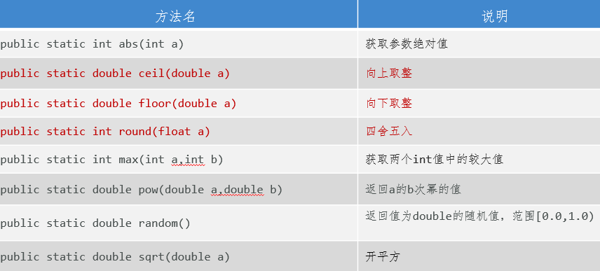
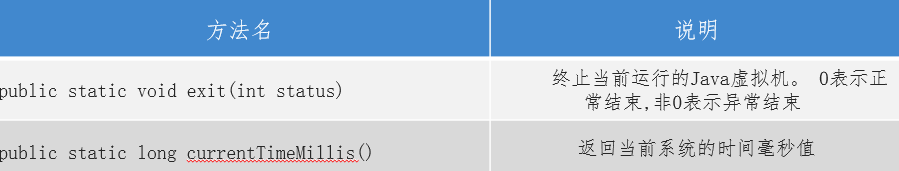
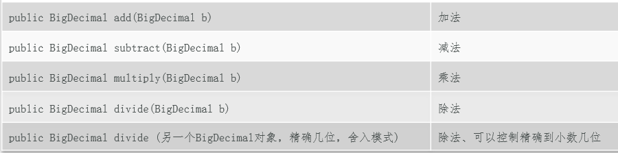

# Day28 Java 知识点总结

> 来源：`day28.xmind`  
> 主题：常用工具类、精确小数计算、日期时间 API、数组工具类

## 一、整体知识结构

本节内容主要围绕 Java 常用工具类和日期时间处理展开，重点包括：

| 模块 | 核心内容 |
| --- | --- |
| `Math` | 数学工具类 |
| `System` | 系统工具类、时间原点 |
| `BigDecimal` | 解决小数精度问题 |
| 时间基础概念 | GMT、UTC、CST、中国标准时间 |
| 旧日期时间 API | `Date`、`SimpleDateFormat`、`Calendar` |
| 新日期时间 API | `LocalDate`、`LocalTime`、`LocalDateTime`、`Instant`、`ZoneId` 等 |
| `Arrays` | 数组内容展示、拷贝、排序 |

---

## 二、Math 数学工具类

### 1. 是什么

`Math` 是 Java 提供的数学工具类，用于完成常见数学运算。

### 2. 常用方法



---

## 三、System 系统工具类

### 1. 是什么

`System` 是 Java 提供的系统工具类。

### 2.常用方法

### 3. 时间原点

计算机中的时间原点为：

```text
1970-1-1 0:0:0
```

该时间点常用于时间戳、毫秒值等时间计算场景。

---

## 四、BigDecimal 精确小数计算

### 1. 是什么

`BigDecimal` 用来解决小数计算中的精度问题。

### 2. 如何创建对象
常见创建方式：

```java
new BigDecimal("0.1");
BigDecimal.valueOf(0.1);
```
重点结论：

> 创建 `BigDecimal` 时，推荐使用字符串格式的构造方法。

也就是：

```java
new BigDecimal("0.1");
```
### 3. 常用方法与舍入模式


`BigDecimal` 涉及计算时经常需要指定舍入模式，常见模式包括：

| 舍入模式 | 含义 |
| --- | --- |
| `RoundingMode.UP` | 进一：无论是否大于 5 都进一位 |
| `RoundingMode.FLOOR` | 去尾：无论是否大于 5 都丢弃 |
| `RoundingMode.HALF_UP` | 四舍五入 |
```
public class Test2 {  
    public static void main(String[] args) {  
        BigDecimal a=new BigDecimal("0.3");  
        BigDecimal b=new BigDecimal("0.4");  
        System.out.println(a.add(b));  
        BigDecimal c=a.subtract(b);  
        System.out.println(c);  
        BigDecimal res=a.multiply(b);  
        System.out.println(res);  
        BigDecimal e=new BigDecimal("10");  
        BigDecimal f=new BigDecimal("3");  
        //进一法  RoundingMode.UP不管是大于等于5还是小于5都进一位  
        BigDecimal res2=e.divide(f,2,RoundingMode.UP);  
        System.out.println(res2);  
        // 去尾法  RoundingMode.FLOOR       直接将后面的小数截取不要了  
        BigDecimal res3=e.divide(f,6, RoundingMode.FLOOR);  
        System.out.println(res3);  
        // 四舍五入 RoundingMode.HALF_UP    四舍五入 判断小数点后第三位数字是否大于等于5 如果是则进一 如果不是则不进一  
        BigDecimal res4=e.divide(f,6, RoundingMode.HALF_UP);  
        System.out.println(res4);  
    }  
}
```
### 4. 重要特点

`BigDecimal` 和 `String` 一样，是不可变类。  
每次计算或修改后，通常会返回一个新的对象。

---
## 五、时间基础概念

### 1. 世界标准时间

常见标准时间概念：

- `GMT` 格林威治
- `UTC` 原子钟
### 2. 中国标准时间

中国标准时间为：

```text
CST = UTC + 8小时
```

原因是中国位于东八区。

---
## 六、旧日期时间 API

## 6.1 Date

### 1. 是什么

`Date` 用于表示时间对象，也可以理解为时间戳或某一个时间点。

### 2. 如何创建对象

```java
new Date();
```

表示当前系统时间。

```java
new Date(long 毫秒值);
new Date(0L);//原点时间
```

表示指定毫秒值对应的时间。

### 3. 常用方法

| 方法 | 作用 |
| --- | --- |
| `getTime()` | 获取时间的毫秒值 |
| `setTime(long 毫秒值)` | 设置时间的毫秒值 |

## 6.2 SimpleDateFormat

### 1. 是什么

`SimpleDateFormat` 用来实现 `Date` 和 `String` 之间的相互转换。

- `Date` 转 `String`：格式化
- `String` 转 `Date`：解析

### 2. 如何创建对象

```java
new SimpleDateFormat(String pattern);
```

常用格式符号：

| 符号 | 含义 |
| --- | --- |
| `y` | 年份 |
| `M` | 月 |
| `d` | 日 |
| `H` | 小时 |
| `m` | 分钟 |
| `s` | 秒 |

### 3. 常用方法

| 方法 | 作用 |
| --- | --- |
| `String format(Date date)` | 格式化，将 `Date` 转为 `String` |
| `Date parse(String text)` | 解析，将 `String` 转为 `Date` |
### 4.示例代码
```java
public class SimpleDateFormatDemo {  
    public static void main(String[] args) throws ParseException {  
        //创建SimpleDateFormat对象  
        SimpleDateFormat sdf=new SimpleDateFormat("yyyy-MM-dd HH:mm:ss");  
        //作用1:将Date对象格式化为String  
        Date d1=new Date();  
        String str=sdf.format(d1);  
        System.out.println(str);  
        //作用2:将时间格式的字符串Date对象  
        String str2="2020-01-01 00:00:00";  
        Date d2=sdf.parse(str2);  
        System.out.println(d2);  
    }  
}
```
## 6.3 Calendar

思维导图中列出了 `Calendar` 的三个学习方向：

- 是什么
- 如何创建对象
- 常用方法

```
1.Calendar日历类是一个抽象类,无法实例化。  
2.如何获取Calendar对象? public static Calendar getInstance() : 获取当前时间的日历对象  
3.常用方法:  
    获取: get(int field)  
    设置: set(int field,int value)  
    计算: add(int field,int amount)  
    转换: Date和Calendar之间转换 Date getTime()  setTime(Date date)
```

---
```java
 public static void main(String[] args) {  
        Calendar c= Calendar.getInstance();  
        System.out.println(c);  
        //2.1查  
        int year=c.get(Calendar.YEAR);  
        int month=c.get(Calendar.MONTH)+1;  
        int day=c.get(Calendar.DAY_OF_MONTH);  
        int hour=c.get(Calendar.HOUR_OF_DAY);  
        int minute=c.get(Calendar.MINUTE);  
        int second=c.get(Calendar.SECOND);  
        System.out.println(year+"-"+month+"-"+day+" "+hour+":"+minute+":"+second);  
        //2.2改  
        c.set(Calendar.YEAR,2020);  
        c.set(Calendar.MONTH,11);  
        c.set(Calendar.DAY_OF_MONTH,1);  
        System.out.println(c.get(Calendar.MONTH));  
        c.set(Calendar.HOUR_OF_DAY,0);  
        c.set(Calendar.MINUTE,0);  
        c.set(Calendar.SECOND,0);  
        System.out.println(c);  
        //2.3增  
        c.add(Calendar.YEAR,1);  
        System.out.println(c);  
        c.add(Calendar.MONTH,1);  
        System.out.println(c);  
        c.add(Calendar.DAY_OF_MONTH,1);  
        System.out.println(c);  
        c.add(Calendar.HOUR_OF_DAY,1);  
        System.out.println(c);  
        c.add(Calendar.MINUTE,1);  
        System.out.println(c);  
        c.add(Calendar.SECOND,1);  
        System.out.println(c);  
        //2.4转换  
        Date d=c.getTime();  
        System.out.println(d);  
        c.setTime(d);  
        System.out.println(c);  
    }  
}
```
## 七、新日期时间 API

## 7.1 LocalDate / LocalTime / LocalDateTime

### 1. 概念

| 类 | 表示内容 |
| --- | --- |
| `LocalDate` | 本地年月日 |
| `LocalTime` | 本地时分秒 |
| `LocalDateTime` | 本地年月日时分秒 |

### 2. 创建对象

| 方法 | 作用 |
| --- | --- |
| `now()` | 创建当前时间对象 |
| `of(xxx)` | 创建指定时间对象 |
```java
//1.获取当前时间的日历对象(包含 年月日)  
LocalDate nowDate = LocalDate.now();  
//System.out.println("今天的日期:" + nowDate);  
//2.获取指定的时间的日历对象  
LocalDate ldDate = LocalDate.of(2023, 1, 1);  
System.out.println("指定日期:" + ldDate);

// 获取本地时间的日历对象(包含 时分秒)  
LocalTime nowTime = LocalTime.now();
//指定时间  
System.out.println(LocalTime.of(8, 20));//时分  
System.out.println(LocalTime.of(8, 20, 30));//时分秒  
System.out.println(LocalTime.of(8, 20, 30, 150));//时分秒纳秒


// 当前时间的的日历对象(包含年月日时分秒)  
LocalDateTime nowDateTime = LocalDateTime.now();
LocalDateTime ldDateTime = LocalDateTime.of(2023, 1, 1, 8, 20, 30);
```
### 3. 常用方法

| 类型 | 方法 |
| --- | --- |
| 查询 | `getXXX` |
| 修改 | `withXXX` |
| 比较 | `isBefore`、`isAfter`、`isEqual` |
| 加减计算 | `minusXXX`、`plusXXX` |
| 解析 | `parse` |
```java
//查询
System.out.println(nowDateTime.getYear());//年  
System.out.println(nowDateTime.getMonthValue());//月  
System.out.println(nowDateTime.getDayOfMonth());//日  
System.out.println(nowDateTime.getHour());//时  
System.out.println(nowDateTime.getMinute());//分  
System.out.println(nowDateTime.getSecond());//秒  
System.out.println(nowDateTime.getNano());//纳秒  
// 日:当年的第几天  
System.out.println("dayofYear:" + nowDateTime.getDayOfYear());
//is开头的方法表示判断  时间上的前后: 前人栽树后人乘凉  
System.out.println(ldDate.isBefore(ldDate));  
System.out.println(ldDate.isAfter(ldDate));  
//with开头的方法表示修改，只能修改年月日  
LocalDate withLocalDate = ldDate.withYear(2000);  
System.out.println(withLocalDate);  
//minus开头的方法表示减少，只能减少年月日  
LocalDate minusLocalDate = ldDate.minusYears(1);  
System.out.println(minusLocalDate);  
//plus开头的方法表示增加，只能增加年月日  
LocalDate plusLocalDate = ldDate.plusDays(1);  
System.out.println(plusLocalDate);
//解析  
DateTimeFormatter dtf = DateTimeFormatter.ofPattern("HH:mm:ss");  
LocalTime localTime = LocalTime.parse("11:11:11", dtf);  
System.out.println(localTime);
```
## 7.2 DateTimeFormatter
### 1.概念
```java
DateTimeFormatter表示时间格式化类  
    static DateTimeFormatter ofPattern(String pattern) 获取指定格式的格式化对象  
    String format(TemporalAccessor temporal)      格式化
    参数 —— `TemporalAccessor` 是 JDK 8 时间体系的**顶层接口**，`LocalDateTime`、`ZonedDateTime`、`LocalDate` 等都实现了它，所以这个方法能接受任何 JDK 8 时间类型
```
### 2. 创建对象

```java
DateTimeFormatter.ofPattern(String pattern);
```
### 3. 格式化

```java
format
```
### 4.示例代码
```java
public static void main(String[] args) {  
    //创建一个时间格式化对象  
    DateTimeFormatter dtf=DateTimeFormatter.ofPattern("yyyy-MM-dd HH:mm:ss");  
    //对时间对象进行格式化  
    String str=dtf.format(ZonedDateTime.now());  
    System.out.println(str);  
    //  将时间格式化的字符串解析为时间对象  
    TemporalAccessor ta=dtf.parse(str);  
    System.out.println(ta);  
}
```
## 7.3 Instant / ZoneId / ZonedDateTime

### Instant

`Instant` 表示时间点或时间戳，不包含时区。

常用创建方法：

- `now()`
- `ofEpochMilli()`
- `ofEpochSecond()`
```
Instant表示不带时区的时间  
  static Instant now() 获取当前时间的Instant对象(标准时间)  
  static Instant ofXxxx(long epochMilli) 根据(秒/毫秒/纳秒)获取Instant对象  
  ZonedDateTime atZone(ZoneIdzone) 指定时区  
  boolean isxxx(Instant otherInstant) 判断系列的方法  
  Instant minusXxx(long millisToSubtract) 减少时间系列的方法  
  Instant plusXxx(long millisToSubtract) 增加时间系列的方法
  
  //1.获取当前时间的Instant对象(标准时间)  
Instant now = Instant.now();  
System.out.println(now);  
  
//2.根据(秒/毫秒/纳秒)获取Instant对象  
Instant instant1 = Instant.ofEpochMilli(0L);  
System.out.println(instant1);//1970-01-01T00:00:00z  
  
Instant instant2 = Instant.ofEpochSecond(1L);  
System.out.println(instant2);//1970-01-01T00:00:01Z  
  
Instant instant3 = Instant.ofEpochSecond(1L, 1000000000L);  
System.out.println(instant3);//1970-01-01T00:00:027  
  
//3. 指定时区  
ZonedDateTime time = Instant.now().atZone(ZoneId.of("Asia/Shanghai"));  
System.out.println(time);
```
### ZoneId

`ZoneId` 表示时区。

常用方法：

- `systemDefault()`
- `of("Asia/Shanghai")`
- `getAvailableZoneIds()`
```java
//获取java支持的所有时区  
Set<String> zoneIds = ZoneId.getAvailableZoneIds();  
System.out.println(zoneIds);   
System.out.println(zoneIds.size());//获取set集合的长度  
//获取系统当前默认时区  
ZoneId zoneId = ZoneId.systemDefault();  
System.out.println(zoneId);  
//根据时区字符串来获取ZoneId  
ZoneId zoneId2 = ZoneId.of("Asia/Shanghai");  
System.out.println(zoneId2);
```
### ZonedDateTime

`ZonedDateTime` 表示带时区的时间。

创建对象：

- `now()`
- `of(xxxx)`

常用方法：
```java
public static void main(String[] args) {  
    //1.获取当前时间对象(带时区)  
    ZonedDateTime now = ZonedDateTime.now();  
    System.out.println(now);  
  
    //2.获取指定的时间对象(带时区)1/年月日时分秒纳秒方式指定  
    ZonedDateTime time1 = ZonedDateTime.of(2023, 10, 1,  
            11, 12, 12, 0, ZoneId.of("Asia/Shanghai"));  
    System.out.println(time1);  
    //通过Instant + 时区的方式指定获取时间对象  
    Instant instant = Instant.ofEpochMilli(0L);  
    ZoneId zoneId = ZoneId.of("Asia/Shanghai");  
    ZonedDateTime time2 = ZonedDateTime.ofInstant(instant, zoneId);  
    System.out.println(time2);  
  
    //3.withXxx 修改时间系列的方法  
    ZonedDateTime time3 = time2.withYear(2000);  
    System.out.println(time3);  
  
    //4. 减少时间  
    ZonedDateTime time4 = time3.minusYears(1);  
    System.out.println(time4);  
  
    //5.增加时间  
    ZonedDateTime time5 = time4.plusYears(1);  
    System.out.println(time5);  
}
```

| 类型 | 方法 |
| --- | --- |
| 查询 | `getXXX` |
| 修改 | `withXXX` |
| 比较 | `isBefore`、`isAfter`、`isEqual` |
| 加减计算 | `minusXXX`、`plusXXX` |

## 7.4 Period / Duration / ChronoUnit

### Period

主要用于计算两个日期之间的差值。

```java
Period.between(start, end);
```

计算逻辑：

```text
end - start
```

特点：相减之后获取年月日，不会累计。

### Duration

主要用于计算两个时间之间的差值。

```java
Duration.between(start, end);
```

计算逻辑：

```text
end - start
```

特点：相减之后获取时分秒，会进行累计。

### ChronoUnit

`ChronoUnit` 既可以计算年月日，也可以计算时分秒之间的间隔。

特点：相减之后获取年月日、时分秒，会进行累计。

---

## 八、Arrays 工具类

## 8.1 返回数组内容

将数组以 `[元素1, 元素2, ...]` 的格式返回：

```java
Arrays.toString(类型[] arr);
```

## 8.2 拷贝数组

### 完全拷贝

```java
Arrays.copyOf(类型[] arr, int newLength);
```

说明：第二个参数是新数组的长度。

### 部分拷贝

```java
Arrays.copyOfRange(类型[] arr, 起始索引, 结束索引);
```

说明：包头不包尾。

## 8.3 数组排序

### 基本类型排序

```java
Arrays.sort(基本类型[] arr);
```

作用：按照从小到大升序排序。

### 引用类型排序

引用类型排序有两种方式：

| 排序方式 | 方法 |
| --- | --- |
| 自然排序接口 `Comparable` | `Arrays.sort(引用类型[] arr)` |
| 比较器排序接口 `Comparator` | `Arrays.sort(T[] a, Comparator<? super T> c)` |
```
  @Override  
    public int compareTo(Student o) {  
        //return this.getAge() - o.getAge(); //按照年龄升序  
        //return o.getAge() - this.getAge(); //按照年龄升序  
        //使用自然排序先按照学生年龄升序排列,如果年龄一样再按照身高降序排序  
        int rs1 = this.getAge() - o.getAge();  
        return rs1 == 0 ? o.getHeight() - this.getHeight() : rs1;  
    }  
}
```
```java
public class Test2 {  
    public static void main(String[] args) {  
        Student[] students = new Student[4];  
        students[0] = new Student("张三", 169, 23);  
        students[1] = new Student("李四", 163, 26);  
        students[2] = new Student("王五", 164, 26);  
        students[3] = new Student("赵六", 167, 24);  
        Arrays.sort(students);  
        //需求1: 使用自然排序按照学生年龄升序排列  
        //需求2: 使用自然排序按照学生年龄降序排列  
        //需求5: 使用自然排序先按照学生年龄升序排列,如果年龄一样再按照身高降序排序  
        //需求3: 使用比较器排序按照学生年龄升序排列  
        //Arrays.sort(students, new Comparator<Student>() {  
        //    @Override        //    public int compare(Student o1, Student o2) {        //        return o1.getAge() - o2.getAge();        //    }        //});        //需求4: 使用比较器排序按照学生年龄降序排列  
        Arrays.sort(students, new Comparator<Student>() {  
            @Override  
           public int compare(Student o1, Student o2) {  
                return o2.getAge() - o1.getAge();  
           }  
        });  
        //需求6: 使用比较器排序 先按照学生年龄升序排列,如果年龄一样再按照身高降序排序  
        //Arrays.sort(students, new Comparator<Student>() {  
        //    @Override        //    public int compare(Student o1, Student o2) {        //        int rs = o1.getAge() - o2.getAge();        //        return rs != 0 ? rs : o2.getHeight() - o1.getHeight();        //    }        //});        System.out.println(Arrays.toString(students));  
    }  
}
```
### 排序规则

| 方法返回值 | 含义 |
| --- | --- |
| 正数 | 当前要插入的元素比被比较元素大，放在被比较元素右边 |
| 负数 | 当前要插入的元素比被比较元素小，放在被比较元素左边 |
| 零 | 当前要插入的元素与被比较元素相等，放在被比较元素右边 |

---

## 九、复习重点

1. `BigDecimal` 用于解决小数计算精度问题，创建时优先使用字符串构造。
2. `Date`、`SimpleDateFormat`、`Calendar` 属于旧日期时间 API。
3. 新日期时间 API 更清晰地拆分了日期、时间、时区和时间戳。
4. `Period` 偏向日期差值，`Duration` 偏向时间差值，`ChronoUnit` 使用范围更广。
5. `Arrays` 工具类重点掌握数组转字符串、数组拷贝和数组排序。

