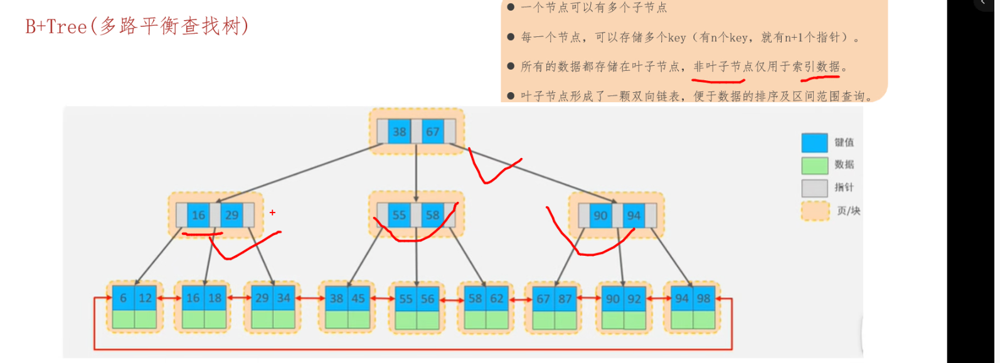

# Day41 学习笔记 —— 子查询、事务与索引

> 本笔记整理自 Day41 思维导图，涵盖多表查询中的子查询、事务的概念与特性、并发事务问题及隔离级别、索引基础四大部分。

---

## 一、多表查询 —— 子查询（嵌套查询）

子查询按照**返回结果的行数和列数**可分为以下四类：

| 分类 | 说明 | 常用运算符 |
|---|---|---|
| **单行单列子查询** | 结果只有一行一列（标量子查询） | `=` `!=` `>` `>=` `<` `<=` |
| **单行多列子查询** | 结果只有一行，多列 | `=` `!=` `in` |
| **多行单列子查询** | 结果有多行，一列 | `in` |
| **多行多列子查询** | 结果有多行多列 | 常作为**临时表**使用 |

---

## 二、事务（Transaction）

### 2.1 什么是事务？

> 事务是一组 SQL 操作的集合，**要么都成功，要么都失败**。

### 2.2 事务的分类

| 类型 | 说明 |
|---|---|
| **自动事务** | MySQL 默认模式。执行 DML 操作前自动开启事务；SQL 执行完毕，无异常则**自动提交**，有异常则**自动回滚** |
| **手动事务** | 可以实现多条 SQL 语句对应一个事务 |

**手动事务实现步骤：**

```sql
-- 1. 开启事务
begin;
-- 或
start transaction;

-- 2. 执行若干 SQL 操作
-- ...

-- 3a. 全部成功 → 提交事务
commit;

-- 3b. 任意一句失败 → 回滚事务
rollback;
```

### 2.3 事务的四大特性（ACID）

| 特性 | 英文 | 说明 |
|---|---|---|
| **A** 原子性 | Atomicity | 一个事务中的多个操作要么都成功，要么都失败 |
| **C** 一致性 | Consistency | 事务前后数据必须保持一致（例如转账前后总金额不变） |
| **I** 隔离性 | Isolation | 并发事务之间相互隔离，互不影响 |
| **D** 持久性 | Durability | 事务提交或回滚后，对数据的修改是永久性的 |

### 2.4 并发事务的三大问题

| 问题 | 描述 |
|---|---|
| **脏读** | 一个事务读到了**其它事务尚未提交**的数据 |
| **不可重复读** | 一个事务前后两次查询，发现数据发生了变化（读到了其它事务的 `update` 操作） |
| **幻读** | 一个事务查询时没有该数据，但插入时却提示数据已存在（读到了其它事务的 `insert` 操作） |

### 2.5 事务隔离级别

| 隔离级别 | 脏读 | 不可重复读 | 幻读 |
|---|:---:|:---:|:---:|
| READ UNCOMMITTED（读未提交） | ✅ 会发生 | ✅ 会发生 | ✅ 会发生 |
| READ COMMITTED（读已提交） | ❌ 不发生 | ✅ 会发生 | ✅ 会发生 |
| REPEATABLE READ（可重复读，**MySQL 默认**） | ❌ 不发生 | ❌ 不发生 | ✅ 会发生 |
| SERIALIZABLE（串行化） | ❌ 不发生 | ❌ 不发生 | ❌ 不发生 |

> 隔离级别越高，数据一致性越好，但并发性能越差。

---

## 三、索引（Index）

### 3.1 什么是索引？

> 索引是一种**数据结构**，底层实现为 **B+ 树**。

### 3.2 索引的优缺点

| 优点 | 缺点 |
|---|---|
| 提高查询效率 | 占用额外存储空间 |
| — | 增删改效率变低（增删改操作需要同步维护索引结构） |

### 3.3 索引的使用习惯

适合建索引的场景：**表中数据量大、查询操作多、增删操作少**。

### 3.4 如何创建索引

```sql
create index 索引名称 on 表名(字段名);
```

---

## 📌 本日重点回顾

1. 子查询按"行数×列数"分四类，选对运算符是关键（尤其区分 `in` 与比较运算符的适用场景）
2. 事务四大特性 **ACID**：原子性、一致性、隔离性、持久性
3. 并发事务的三大问题：脏读、不可重复读、幻读，本质上都是"读到了别的事务不该读到的数据"
4. **REPEATABLE READ 是 MySQL 的默认隔离级别**，能避免脏读和不可重复读，但理论上仍可能出现幻读
5. 索引底层是 **B+ 树**，用空间和写性能换查询效率，适合"数据量大、查多改少"的表
