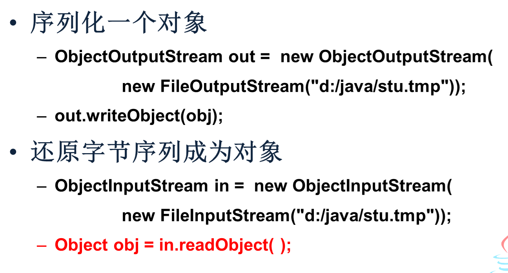

# Java 学习笔记总结

> 涵盖：**IO流与反射（第8章）** · **多线程通信与并发（第9章）**

---

## 第8章 IO流与反射

### 8.1 File 类

`File` 是文件的抽象类，表示相关记录或放在一起的数据的集合，能够实现对文件或目录的管理。

#### 常用方法速查

| 方法 | 说明 |
|------|------|
| `boolean exists()` | 判断文件或目录是否存在 |
| `boolean isFile()` | 判断是否是文件 |
| `boolean isDirectory()` | 判断是否是目录 |
| `String getPath()` | 返回相对路径名 |
| `String getAbsolutePath()` | 返回绝对路径名 |
| `String getName()` | 返回文件或目录名称 |
| `boolean delete()` | 删除指定文件或目录 |
| `boolean createNewFile()` | 创建空文件（不创建文件夹） |
| `long length()` | 返回文件长度（字节），不存在返回 0 |
| `boolean mkdir()` | 创建一级目录 |
| `boolean mkdirs()` | 同时创建多级目录 |
| `String[] list()` | 返回子文件路径字符串数组 |
| `File[] listFiles()` | 返回子文件 File 对象数组 |
| `boolean renameTo(File)` | 重命名文件 |

#### 代码示例

```java
File file = new File("d:\\dic");
if (!file.exists()) {
    file.mkdirs(); // 创建多级目录
}
file = new File(file, "a.txt");
if (!file.exists()) {
    file.createNewFile(); // 创建新文件
}
```

---

### 8.2 IO 流

流是程序与数据源之间的通道，分为**输入流（读）**和**输出流（写）**。

#### 流的分类总览

```
IO 流
├── 字节流
│   ├── 输入：InputStream（抽象）→ FileInputStream / BufferedInputStream
│   └── 输出：OutputStream（抽象）→ FileOutputStream / BufferedOutputStream
└── 字符流
    ├── 输入：Reader（抽象）→ FileReader / BufferedReader
    └── 输出：Writer（抽象）→ FileWriter / BufferedWriter
```

---

#### 8.2.1 输入流（Input）

##### 字节文件流 — FileInputStream / BufferedInputStream

```java
// FileInputStream 基本用法
FileInputStream fis = new FileInputStream("文件路径");
byte[] bytes = new byte[1024];
int num;
while ((num = fis.read(bytes)) != -1) {  // 读到末尾返回 -1
    String str = new String(bytes, 0, num);
}
fis.close(); // ⚠️ 务必关闭资源

// 加缓冲提升性能：BufferedInputStream
FileInputStream fis = new FileInputStream("文件路径");
BufferedInputStream bis = new BufferedInputStream(fis);
// 用法与 FileInputStream 相同，最后需关闭两个流
fis.close();
bis.close();
```

##### 字符文件流 — FileReader / BufferedReader

```java
// FileReader 基本用法
Reader reader = new FileReader("文件路径");
char[] chars = new char[1024];
int num;
while ((num = reader.read(chars)) != -1) {
    String str = new String(chars, 0, num);
}
reader.close();

// BufferedReader 额外支持按行读取
Reader reader = new FileReader("文件路径");
BufferedReader br = new BufferedReader(reader);
String line = br.readLine(); // 读取一行，末尾返回 null
br.close();
reader.close();
```

---

#### 8.2.2 输出流（Output）

##### 字节文件流 — FileOutputStream / BufferedOutputStream

```java
// FileOutputStream 基本用法
FileOutputStream fos = new FileOutputStream("文件路径");
byte[] bytes = "hello,world".getBytes();
fos.write(bytes, 0, bytes.length);
fos.flush();  // 刷新缓冲
fos.close();

// BufferedOutputStream 加缓冲
FileOutputStream fos = new FileOutputStream("文件路径");
BufferedOutputStream bos = new BufferedOutputStream(fos);
bos.write(bytes, 0, bytes.length);
bos.flush();
fos.close();
bos.close();
```

##### 字符文件流 — FileWriter / BufferedWriter

```java
// FileWriter 基本用法
FileWriter fw = new FileWriter("文件路径");
String str = "写出内容";
fw.write(str, 0, str.trim().length());
fw.flush();
fw.close();

// BufferedWriter 加缓冲
FileWriter fw = new FileWriter("文件路径");
BufferedWriter bw = new BufferedWriter(fw);
bw.write(str, 0, str.length());
bw.flush();
fw.close();
bw.close();
```

> **💡 使用原则：**
> - 处理文本 → 优先用**字符流**（Reader / Writer）
> - 处理二进制（图片、音频）→ 用**字节流**（InputStream / OutputStream）
> - 加 Buffered 包装类可显著提升读写性能

---

## 第9章 多线程通信与并发

### 9.0 线程基础

#### 9.0.1 定义线程的三种方式

**① 继承 Thread 类**

```java
public class MyThread extends Thread {
    @Override
    public void run() {
        // 线程任务
    }
}
MyThread t = new MyThread();
t.start(); // 启动线程（区别于直接调用 run()）
```

> `run()` 是任务方法（来自 Runnable），`start()` 才是真正启动线程进入就绪状态。

**② 实现 Runnable 接口**（推荐：支持共享机制）

```java
public class MyRunnable implements Runnable {
    @Override
    public void run() { /* 任务 */ }
}
MyRunnable mr = new MyRunnable();
Thread t1 = new Thread(mr);
Thread t2 = new Thread(mr); // 多个线程共享同一个任务对象
t1.start();
t2.start();
```

**③ 使用线程池**（见 9.6 节）

---

#### 9.0.2 线程生命周期（六种状态）

| 状态 | 触发条件 |
|------|----------|
| `NEW`（新建） | 线程对象已创建，尚未调用 `start()` |
| `Runnable`（可运行） | 调用 `start()`，等待 CPU 时间片 |
| `Blocked`（锁阻塞） | 试图获取对象锁但锁被占用 |
| `Waiting`（无限等待） | 调用 `wait()`，须等待 `notify()`/`notifyAll()` 唤醒 |
| `Timed Waiting`（计时等待） | 调用 `sleep(long)`、`wait(long)` 等 |
| `Terminated`（终止） | `run()` 正常结束或异常退出 |

---

#### 9.0.3 sleep() 睡眠方法

```java
// 让当前线程进入睡眠，到毫秒后自动醒来
Thread.sleep(1000); // 睡 1 秒
```

---

#### 9.0.4 线程通信 — 等待与唤醒

Object 类提供的方法，**必须在 synchronized 块内调用**：

| 方法 | 说明 |
|------|------|
| `wait()` | 让当前线程进入等待状态 |
| `notify()` | 唤醒锁对象上等待的一个线程 |
| `notifyAll()` | 唤醒所有等待线程 |

```java
// 等待
synchronized ("lock") {
    "lock".wait();
}

// 唤醒
synchronized ("lock") {
    "lock".notify();
}
```

---

#### 9.0.5 生产者与消费者模式（经典案例）

核心逻辑：
- 生产者：列表有货 → `wait()`；无货 → 生产后 `notify()`
- 消费者：列表无货 → `wait()`；有货 → 消费后 `notify()`

```java
// 生产者核心逻辑
synchronized (list) {
    if (list.size() > 0) list.wait();      // 有货，等待消费
    list.add("新面包");
    list.notify();                          // 通知消费者
}

// 消费者核心逻辑
synchronized (list) {
    if (list.size() == 0) list.wait();     // 无货，等待生产
    list.remove(0);
    list.notify();                          // 通知生产者
}
```

---

### 9.1 线程安全问题

#### 问题表现

多窗口卖票时，多线程并发访问共享变量会导致：
- **重复票**（同一张票卖多次）
- **负数票**（不存在的票号）
- **遗漏票**（某些票号未出现）

---

### 9.2 synchronized 同步

`synchronized` 是"悲观锁"（重量级锁），保证同一时刻只有一个线程执行同步代码。

#### 9.2.1 同步代码块

```java
synchronized (锁对象) {
    // 需要同步的代码
}
```

> **锁对象规则：**
> 1. 语法上可以是任意类型的对象
> 2. 多个线程必须使用**同一把锁**

#### 9.2.2 同步方法

```java
// 非静态方法：锁对象是 this
public synchronized void method() { }

// 静态方法：锁对象是 类名.class
public static synchronized void method() { }
```

---

### 9.3 Lock 锁

`java.util.concurrent.locks.Lock` 比 `synchronized` 更灵活，支持显式加锁/释放锁。

```java
Lock lock = new ReentrantLock();

// 加锁
lock.lock();
try {
    // 临界区代码
} finally {
    lock.unlock(); // ⚠️ 务必在 finally 中释放锁
}
```

| 对比维度 | `synchronized` | `Lock` |
|----------|---------------|--------|
| 类型 | 关键字 | 接口（ReentrantLock） |
| 锁释放 | 自动释放 | 手动调用 `unlock()` |
| 灵活性 | 低 | 高 |
| 效率 | 较低 | 较高 |

---

### 9.4 多线程安全性的三大问题

#### 9.4.1 可见性问题

**原因：** 每个线程有独立的工作内存，对共享变量的修改不能立即被其他线程看到。

**解决：**
- 加 `synchronized` 锁（进入前清空工作内存，退出后刷新回主内存）
- 使用 `volatile` 关键字

```java
private volatile boolean flag; // 强制每次从主内存读取
```

#### 9.4.2 有序性问题

**原因：** 编译器可能对代码进行"重排"优化，在多线程下产生异常结果。

**解决：** 使用 `volatile` 修饰变量，禁止代码重排。

#### 9.4.3 原子性问题

**原因：** `a++` 实际包含"读-改-写"三步操作，多线程下会产生覆盖效果，最终结果小于预期。

**解决：**
- `synchronized` / `Lock` 同步锁
- 原子类（`AtomicInteger` 等）

---

### 9.5 volatile 关键字

| 能力 | volatile | synchronized |
|------|----------|-------------|
| 修饰目标 | 仅成员变量 | 代码块或方法 |
| 可见性 | ✅ 解决 | ✅ 解决 |
| 有序性 | ✅ 解决 | ✅ 解决 |
| 原子性 | ❌ **不能解决** | ✅ 解决 |
| 性能 | 较高 | 较低 |

```java
// volatile 只能解决可见性和有序性，不能解决原子性！
private volatile static int a = 0; // a++ 仍然线程不安全
```

---

### 9.6 原子类（java.util.concurrent.atomic）

原子类通过 **CAS（Compare and Swap，比较并交换）** 机制保证原子性、可见性和有序性。

#### 常用原子类

| 类名 | 适用类型 |
|------|----------|
| `AtomicInteger` | int |
| `AtomicLong` | long |
| `AtomicBoolean` | boolean |
| `AtomicIntegerArray` | int[] |
| `AtomicLongArray` | long[] |
| `AtomicReferenceArray` | Object[] |

#### AtomicInteger 使用示例

```java
AtomicInteger a = new AtomicInteger(0); // 初始值为 0

a.getAndIncrement(); // 相当于 a++（原子操作）
a.get();             // 获取当前值
```

> **CAS 原理：** 从主内存获取值 → 与期望值比较 → 相同则更新，不同则重试，无需加锁，效率更高。

---

### 9.7 并发包（java.util.concurrent）

#### 9.7.1 CopyOnWriteArrayList（线程安全的 List）

```java
CopyOnWriteArrayList<Integer> list = new CopyOnWriteArrayList<>();
list.add(1); // 写时复制，线程安全
```

> 写操作时复制一份新数组操作，读操作不加锁，适合**读多写少**的场景。

#### 9.7.2 CopyOnWriteArraySet（线程安全的 Set）

```java
CopyOnWriteArraySet<Integer> set = new CopyOnWriteArraySet<>();
```

#### 9.7.3 ConcurrentHashMap（线程安全的 Map）

```java
ConcurrentHashMap<Integer, Integer> map = new ConcurrentHashMap<>();
```

| 对比 | HashMap | Hashtable | ConcurrentHashMap |
|------|---------|-----------|-------------------|
| 线程安全 | ❌ | ✅ | ✅ |
| 效率 | 高 | 低（锁整张表） | **高**（局部锁 + CAS） |

> `ConcurrentHashMap` 高效原因：**CAS + 局部 synchronized 锁**（只锁当前操作的桶，其他桶不受影响）。

---

### 9.8 CountDownLatch（倒计时门栓）

允许一个或多个线程**等待**其他线程完成操作后再继续执行。

```java
CountDownLatch cdl = new CountDownLatch(1); // 计数器初始值为 1

// 等待线程（线程1）
cdl.await();   // 阻塞，直到计数器为 0

// 触发线程（线程2）
cdl.countDown(); // 计数器减 1，触发等待线程继续
```

**使用场景：** 保证执行顺序，例如 A → B → C 顺序打印。

---

### 9.9 CyclicBarrier（循环屏障）

让一组线程到达屏障时**全部阻塞**，等最后一个线程到达后，所有线程同时继续执行。

```java
CyclicBarrier cb = new CyclicBarrier(5, () -> {
    System.out.println("所有人到齐，开始开会！");
});

// 每个线程到达屏障时调用
cb.await(); // 阻塞，等待其余线程
```

**使用场景：** 多线程并行计算，等所有结果就绪后再汇总。

---

### 9.10 Semaphore（信号量）

控制**同时执行**的线程数量（类似于限流）。

```java
Semaphore sp = new Semaphore(3); // 同时允许 3 个线程

sp.acquire(); // 获取许可（线程数超过上限则阻塞）
try {
    // 执行任务
} finally {
    sp.release(); // 释放许可
}
```

**使用场景：** 数据库连接池、限制并发请求数量。

---

### 9.11 Exchanger（线程间数据交换）

用于两个线程之间**互换数据**，两个线程都调用 `exchange()` 后才能完成交换。

```java
Exchanger<String> ex = new Exchanger<>();

// 线程 A
String received = ex.exchange("数据A"); // 发出"数据A"，接收线程B的数据

// 线程 B
String received = ex.exchange("数据B"); // 发出"数据B"，接收线程A的数据
```

**使用场景：** 数据校对（两人录入同一份数据，交换后比对）。

---

### 9.12 线程池（ThreadPool）

#### 为什么使用线程池？

频繁创建/销毁线程开销大。线程池将线程**复用**，避免重复创建。

**好处：**
1. **降低资源消耗** — 线程复用，减少创建销毁次数
2. **提高响应速度** — 任务到达时无需等待线程创建
3. **提高可管理性** — 可控制最大线程数，防止内存耗尽

#### 线程池核心 API

```java
// 创建固定大小的线程池（推荐用 Executors 工厂类）
ExecutorService es = Executors.newFixedThreadPool(3);

// 提交 Runnable 任务
es.submit(runnable);

// 提交 Callable 任务（可获取返回值）
Future<String> future = es.submit(callable);
String result = future.get(); // 阻塞等待结果

// 关闭线程池（开发中一般不做）
es.shutdown();
```

#### 线程池工作原理

```
任务提交
   ↓
是否有空闲线程？
   ├── 有 → 分配线程执行任务
   └── 没有 → 进入任务队列等待
               ↓
         有线程空闲时，取出任务执行（线程复用）
```

---

## 核心知识点总结

### 线程安全问题解决方案对比

| 问题 | 原因 | 解决方案 |
|------|------|----------|
| 可见性 | 线程工作内存与主内存不同步 | `volatile`、`synchronized` |
| 有序性 | 编译器代码重排 | `volatile` |
| 原子性（变量） | 多线程操作产生覆盖 | 原子类、`synchronized`、`Lock` |
| 原子性（代码块） | 执行被其他线程打断 | `synchronized`、`Lock` |

### 并发工具类速查

| 工具类 | 作用 |
|--------|------|
| `synchronized` | 同步代码块/方法，解决三大问题 |
| `volatile` | 解决可见性、有序性（不解决原子性） |
| `AtomicInteger` 等 | CAS 机制，解决原子性 |
| `CopyOnWriteArrayList` | 线程安全的 List |
| `ConcurrentHashMap` | 线程安全的高效 Map |
| `CountDownLatch` | 等待其他线程完成后继续 |
| `CyclicBarrier` | 所有线程到达屏障后同时继续 |
| `Semaphore` | 控制并发线程数量 |
| `Exchanger` | 两线程间互换数据 |
| `ExecutorService` | 线程池，复用线程提升效率 |
