### 动态sql
根据java参数动态拼接sql
```java
<if>标签 非空和null判断
<where>条件成立时自动拼接，自动去除多余AND或OR，条件都不成立不生成where
<set>动态生成更新语句，去除多余逗号
<foreach>用于批量删除
collection 遍历集合参数 ，item 遍历临时变量名
```

## mybatis缓存机制
分为一级缓存和二级缓存，核心目标是减少数据库访问次数，提升查询性能

### 一级缓存
（sqlsession）（同一个 `SqlSession` 中，执行完全相同的查询，第二次可能直接从缓存取结果）
作用域是sqlsession级别，每个sqlsession有独立缓存互不共享
生命周期 与sqlsession相同，关闭和清空后失效
执行 `insert`、`update`、`delete`、`commit`、`rollback` 或 `clearCache()` 后，一级缓存会被清空。
由于 Spring 整合 MyBatis 时默认每次操作后关闭 SqlSession，实际开发中一级缓存几乎无效（每次查询都是新 SqlSession）
### 二级缓存
二级缓存属于 Mapper namespace，可以在多个 `SqlSession` 之间共享。
```java
<mapper namespace="com.example.UserMapper">
    <cache/>

    <select id="selectById"
            resultType="com.example.User"
            useCache="true">
        SELECT * FROM user WHERE id = #{id}
    </select>
</mapper>
```
查询结果通常要等当前 `SqlSession` 提交或关闭后，才会进入二级缓存。
如果这个 namespace 中执行了增删改，默认会清空对应 namespace 的二级缓存：
二级缓存存在一些实际问题：
- 跨 Mapper 修改数据可能造成缓存不一致
- 多实例部署时，本地二级缓存无法天然同步
- 对关联查询和频繁更新的数据不太友好
- 缓存对象通常需要支持序列化

### mysql事务
```java
@Transactional(rollbackFor = Exception.class)
public void transfer(Long fromId, Long toId, BigDecimal amount) {
    accountMapper.decrease(fromId, amount);
    accountMapper.increase(toId, amount);
}
```
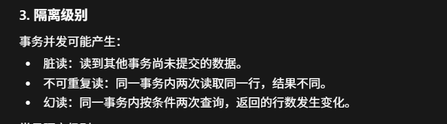
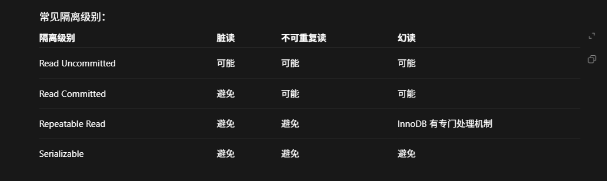

### Redis持久化
Redis 主要有 RDB 和 AOF
RDB
RDB在某个时间节点生成数据快照（手动触发、设置定时触发）
优点：文件紧凑、适合备份、恢复速度快
缺点：两次快照之间数据可能丢失、
 AOF
记录会改变数据的写命令，重启时通过重新执行命令恢复数据。
AOF 文件（日志文件）会不断增长，所以 Redis 会进行 AOF 重写，生成更精简的状态重建命令。
刷盘策略(数据从缓存区写入到磁盘)
always每次写入都刷盘
everysec 每秒刷盘，最多丢失1秒数据
no 由操作系统决定写入时机
生产环境混合使用，不能代替独立备份

### Spring Boot 自动装配原理
它通过（SpringBootAplication里包含）@EnableAutoConfiguration触发，从约定文件中加载候选配置类，再靠条件注解按需生效，最终把符合条件的Bean注册到容器中。

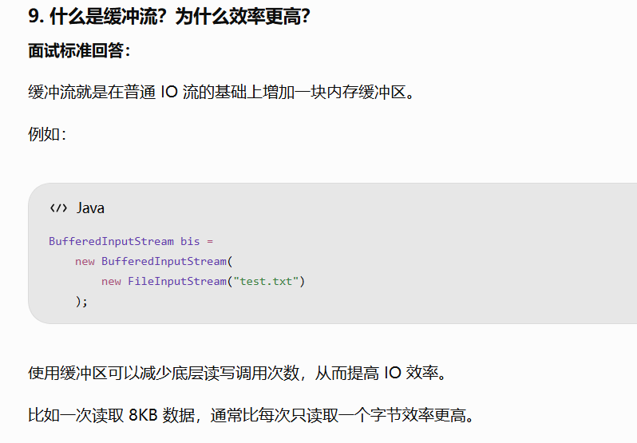

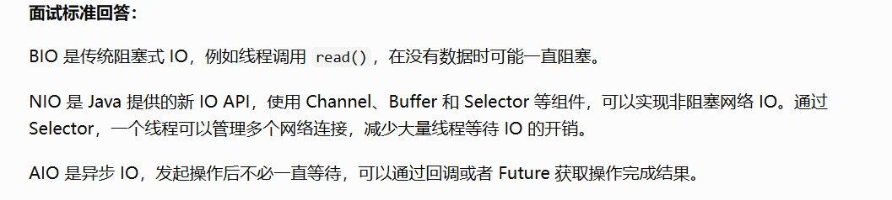

### 接口和抽象类的区别
接口时自上向下的，用来定义行为规范，抽象类是自下向上的，抽取公共代码减少代码复用。
抽象类中可以定义抽象方法和普通方法，接口中可以定义抽象方法、默认方法、静态方法、私有方法
抽象类可以有成员变量、构造方法，接口只能常量无构造方法
### 缓存穿透

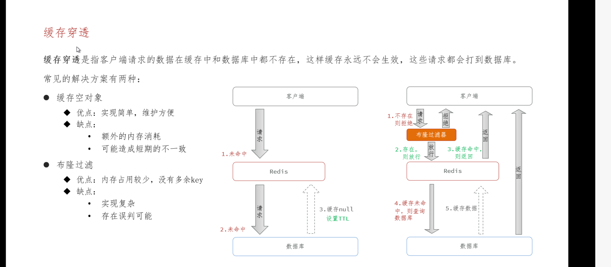

### 缓存雪崩
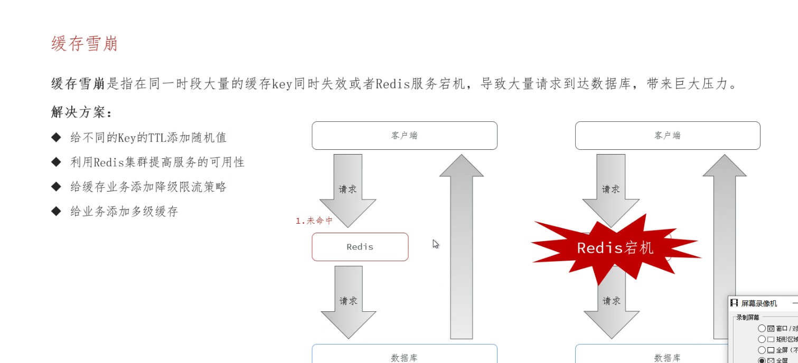

### 缓存击穿
某个热点key过期的瞬间，大量请求同时发现缓存没了，同时涌向数据库
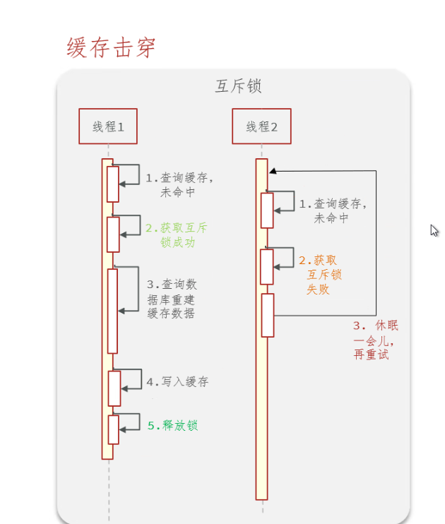
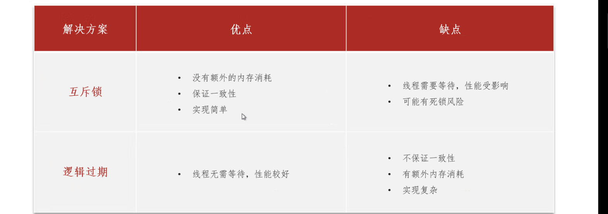
互斥锁可以减轻数据库的压力，但性能低，强一致（要求强一致，用它）
逻辑过期是最终一致
### 3.Mybaitis 中和$的区别
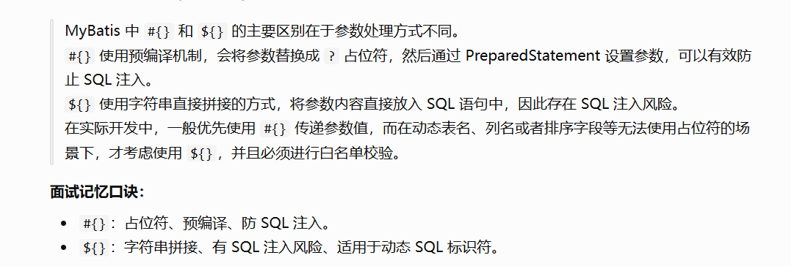

### 字符串
普通字符串使用 `String`，单线程大量字符串拼接使用 `StringBuilder`，需要对同一个可变字符串对象进行同步访问时可以考虑 `StringBuffer`。
### 5. 线程池的两个方法有什么区别？
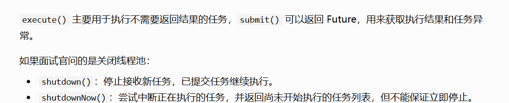

###  sleep和wait
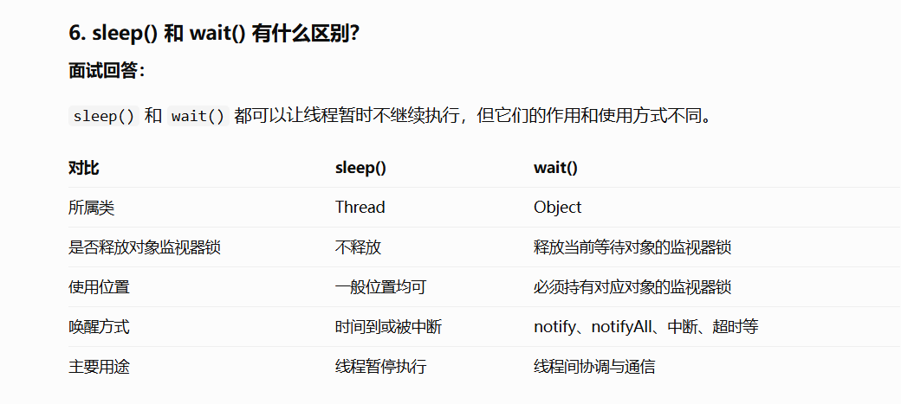

### Java 中事务的传播特性有哪些？
Spring 事务传播行为主要是指，当一个事务方法调用另一个事务方法时，应该如何处理事务之间的关系。
Spring 一共提供了7种事务传播行为。
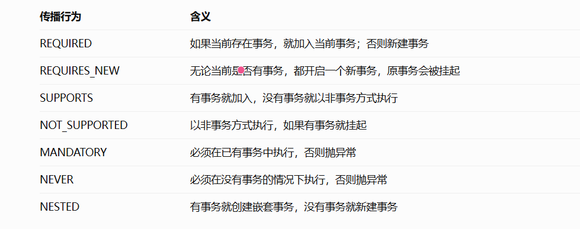

### 设计模式
工厂模式（简单工厂、工厂方法、抽象工厂）是一种创建型设计模式，它主要是将对象的创建进行封装，客户端不需要直接依赖具体实现类，降低代码的耦合度，Spring中的BeanFactry体现了工厂思想

抽象工厂是一个可以创建其他工厂的超级工厂，减少了工厂类的数量

### 原型模式
通过复制已有的对象创建新对象，而不是重新使用new完成整个对象的初始化过程，减少创建对象的成本

### 单例模式
创建型设计模式，保证一个类在一定范围内只有一个实例
饿汉式（在类初始化时创建对象）
懒汉式（在首次使用时创建对象）
双重检查锁

### 适配器模式
将一个类的接口转换为客户端期待的另一个接口
adapter adaptee 
### Spring MVC核心

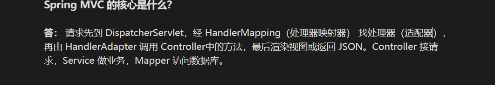
】
### springboot配置Mybatis
在 Spring Boot 项目中，我们通常在 application.yml 或 application.properties 文件中配置 MyBatis。
首先，通过 spring.datasource 配置数据库连接信息。
然后，通过 mybatis.mapper-locations 指定 Mapper XML 文件的位置，通过 type-aliases-package 配置实体类别名，还可以开启驼峰命名映射。
另外，需要在 pom.xml 中引入 MyBatis Starter 依赖，并通过 @MapperScan 或 @Mapper 注解扫描 Mapper 接口。
Spring Boot 会利用自动配置机制创建 SqlSessionFactory、SqlSessionTemplate 等组件，从而完成 MyBatis 与 Spring 的整合。

### spi机制
java提供的一种服务发现机制，接口由一方提供，实现类由另一方提供，程序在运行时动态发现并加载这些实现类。
它的核心思想是将接口的定义和具体实现进行解耦，允许第三方提供接口实现，并在运行时动态发现和加载。

### 索引
MySQL 索引是一种提高查询效率的数据结构，InnoDB 中常用 B+ 树索引。

### spring注解
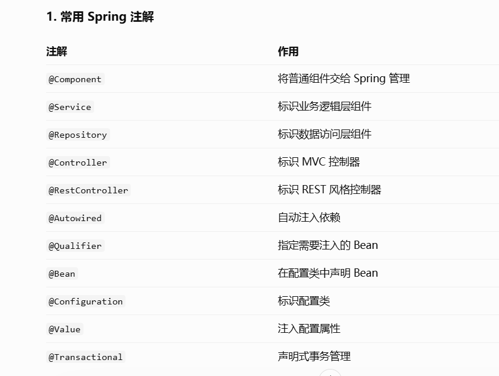

### mybatis如何执行
1.加载配置
2.创建SqlSessionFactory
3.获取sqlsesson
4.获取mapper代理对象
5.执行sql
6封装结果
### Java 线程之间如何传递参数？
创建线程时通过构造方法传递参数
共享变量，多线程共享数据

### springmvc拦截器作用
拦截器（`HandlerInterceptor`）是 Spring MVC 提供的一套**横切逻辑**组件，让你在「请求到达 Controller 之前」「Controller 处理完但还没渲染视图」「整个请求处理完成之后」三个时间点插入自定义代码。核心价值是：**把公共逻辑从业务代码里抽出来，避免每个 Controller 重复写**。
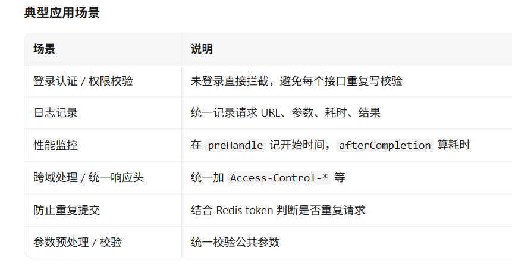

### 服务保护
一般采用fallback降级，提供给FenignClient远程调用的兜底逻辑
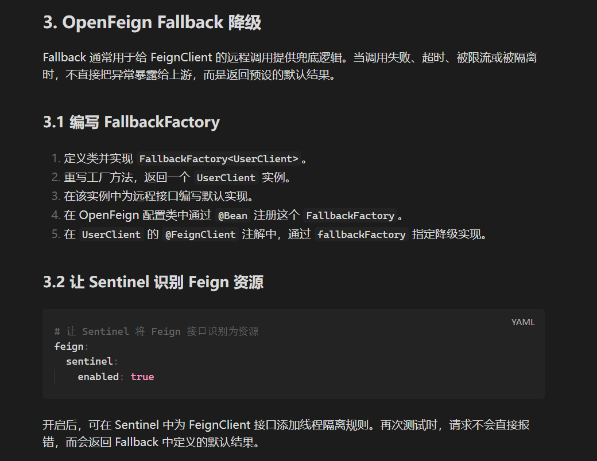
### AT模式
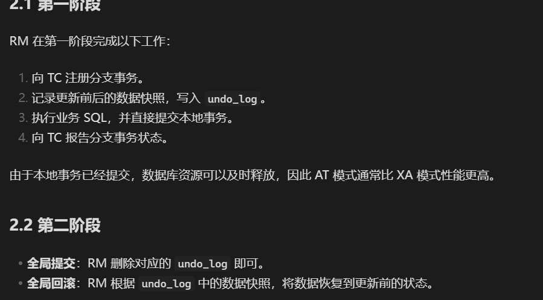