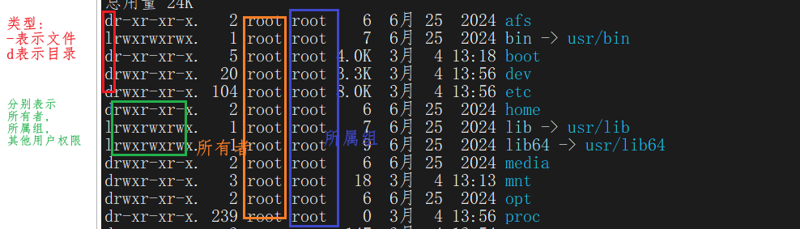

# Linux 核心命令与系统管理

> 来源：`02-系统运维-核心命令.xmind`｜重点：目录文件、用户权限、服务网络、进程与定时任务。


## 本篇目录

- [一、目录结构与路径](#一目录结构与路径)
- [二、目录与文件操作](#二目录与文件操作)
- [三、编辑、查看与压缩](#三编辑查看与压缩)
- [四、用户与用户组](#四用户与用户组)
- [五、权限与所有权](#五权限与所有权)
- [六、软件包管理](#六软件包管理)
- [七、服务与日志](#七服务与日志)
- [八、防火墙与网络配置](#八防火墙与网络配置)
- [九、进程与资源查看](#九进程与资源查看)
- [十、定时任务](#十定时任务)
- [十一、SELinux](#十一selinux)
- [十二、面试速记](#十二面试速记)

---

## 一、目录结构与路径

Linux 采用以 `/` 为根的树形目录结构。绝对路径以 `/` 开头；相对路径相对于当前目录，`.` 表示当前目录，`..` 表示上一级目录。

| 目录 | 主要用途 |
| --- | --- |
| `/root` | root 用户的家目录 |
| `/home` | 普通用户家目录的常见上级目录 |
| `/bin`、`/sbin` | 基础命令、系统管理命令；部分系统链接到 `/usr` 下 |
| `/usr` | 系统提供的大量程序、库与共享资源 |
| `/opt` | 附加应用软件的常见安装位置 |
| `/dev` | 设备文件 |
| `/etc` | 系统配置文件 |
| `/tmp` | 临时文件 |

> **校正：**`cd` 通常是 Shell 内建命令，不宜作为 `/bin` 中二进制程序的例子。

## 二、目录与文件操作

### 1. 目录操作

| 命令 | 用途 / 示例 |
| --- | --- |
| `pwd` | 查看当前目录 |
| `cd`、`cd ~` | 返回家目录 |
| `cd /etc`、`cd ..` | 切换目录、返回上一级 |
| `ls -alh /etc` | 显示隐藏项、详细信息及易读大小 |
| `tree /etc` | 树形查看目录；未安装时可用 `dnf install -y tree` |
| `mkdir -p /data/app/logs` | 递归创建多级目录 |
| `rmdir empty_dir` | 删除空目录 |

`ll` 常被配置成 `ls -l` 的别名，是否可用取决于环境。

### 2. 理解 ls -l

```text
drwxr-xr-x  2 root root 4096 Oct 15 10:00 example
│└─权限──┘  │  │    │    │       │         └─名称
类型      链接数 所有者 所属组 大小 修改时间
```

首字符常见为 `-`（普通文件）、`d`（目录）、`l`（符号链接）；后九位依次对应所有者、所属组、其他用户的权限。原图中的详情示意图保留如下：



### 3. 文件操作

| 命令 | 用途 | 示例 |
| --- | --- | --- |
| `touch` | 新建空文件或更新时间戳 | `touch app.log` |
| `cp` | 复制文件 | `cp app.conf app.conf.bak` |
| `cp -r` | 递归复制目录 | `cp -r conf/ backup/` |
| `mv` | 移动或重命名 | `mv old.txt new.txt` |
| `rm` | 删除文件 | `rm old.txt` |
| `rm -r` | 递归删除目录 | `rm -r old_dir/` |

`rm -f` 表示强制删除并不提示部分错误；`mv` 支持 `-i`、`-n` 等选项，原图中“mv 没有选项”的表述不准确。移动还是改名取决于目标路径类型与命令参数。

### 4. find 查找

```bash
find /data -name '*.log'                 # 按名称；引号避免 Shell 提前展开
find /data -type f                      # f：普通文件，d：目录
find /data -type f -size +10M            # 大于 10 MiB（find 的 M 单位）
find /data -type f -mtime -5             # 修改时间不足 5 个完整的 24 小时周期
find /data -type f -name '*.log' -exec ls -lh {} \;
```

`-size -10M` 表示小于该阈值，`-size 10M` 按向上取整的单位匹配，不能简单理解为字节数恰好等于 10 MiB。`-mtime 5` 匹配 5～不足 6 个 24 小时周期，`-mtime +5` 匹配至少 6 个完整周期。`{}` 代表查找到的路径，`\;` 结束 `-exec` 子命令。

## 三、编辑、查看与压缩

### 1. Vim 三种常用模式

| 模式 | 进入方式 | 常用操作 |
| --- | --- | --- |
| 普通模式 | 打开文件默认进入；其他模式按 `Esc` 返回 | `dd` 删除行、`yy` 复制行、`p` 粘贴、`gg` 到首行、`G` 到末行、`u` 撤销 |
| 插入模式 | 普通模式下按 `i`、`a`、`o`、`O` | 光标前插入、光标后插入、下方新建行、上方新建行 |
| 命令行模式 | 普通模式下按 `:` | `:w` 保存、`:q` 退出、`:q!` 放弃修改、`:wq` 保存退出、`:x` 按需保存退出、`:set nu` 显示行号 |

普通模式按 `/关键词` 搜索。未安装 Vim 时可用 `dnf install -y vim`。

### 2. 查看和过滤

| 命令 | 作用 |
| --- | --- |
| `cat file` | 一次输出文件内容 |
| `more file` | 分页查看；空格向下翻页，`b` 在支持时向上翻页 |
| `head -n 20 file` | 查看前 20 行；默认 10 行 |
| `tail -n 20 file` | 查看后 20 行；默认 10 行 |
| `tail -f app.log` | 持续跟踪文件追加内容 |
| `wc -l file`、`wc -w file` | 统计行数、单词数 |
| `grep 'ERROR' app.log` | 查找匹配内容 |

### 3. 打包与压缩

```bash
tar -czf backup.tar.gz data/             # 打包并使用 gzip 压缩
tar -xzf backup.tar.gz -C /restore       # 解包到已存在的目录
tar -cf backup.tar data/                 # 仅打包
zip -r backup.zip data/
unzip backup.zip -d /restore
```

> **校正：**原图的 `tar -cf xxx.tar.gz` 只创建归档，扩展名不会自动启用 gzip；压缩需添加 `-z`。

## 四、用户与用户组

### 1. 用户组

```bash
groupadd -g 2000 ops                    # 创建并指定 GID
groupmod -n operations ops              # 修改组名
groupmod -g 2001 operations             # 修改 GID
groupdel operations                    # 删除组
cat /etc/group                         # 查看本地组信息
```

### 2. 用户

| 命令 / 选项 | 说明 |
| --- | --- |
| `useradd -u 2000 -g ops -G wheel alice` | 指定 UID、主组、附加组；相关组需先存在 |
| `useradd -r -s /sbin/nologin appuser` | 创建不用于交互登录的系统用户 |
| `usermod -aG ops alice` | 追加附加组；缺少 `-a` 可能覆盖原有附加组 |
| `id alice` | 查看 UID、GID 和组成员关系 |
| `cat /etc/passwd` | 查看本地账户记录，非明文密码 |
| `passwd alice` | 设置或修改密码 |
| `su - alice` | 切换到用户的登录环境并进入其家目录 |
| `userdel alice` | 删除用户 |
| `userdel -r alice` | 同时移除家目录与邮件相关内容 |

`useradd` 未指定主组、Shell 等参数时，行为取决于系统默认配置，不能一概认为始终自动建同名组或使用 Bash。`userdel -f` 属于强制操作，应先确认用户和进程状态。

## 五、权限与所有权

### 1. rwx 的含义

| 权限 | 数值 | 对普通文件 | 对目录 |
| --- | --- | --- | --- |
| `r` | 4 | 读取内容 | 列出目录项名称 |
| `w` | 2 | 修改内容 | 配合 `x` 创建、删除、重命名目录项 |
| `x` | 1 | 直接执行文件，仍需有效格式或解释器 | 遍历目录、访问其中已知名称的条目 |

删除文件主要取决于父目录权限，也可能受到粘滞位、ACL 等限制。`bash script.sh` 由 Bash 读取脚本，通常不要求脚本本身具有执行位；`./script.sh` 需要执行位。

### 2. 修改权限与所有权

```bash
chmod u+x script.sh
chmod g-w app.conf
chmod 640 app.conf                      # 所有者 rw，组 r，其他无权限
chmod 750 scripts/
chown alice app.conf
chgrp ops app.conf
chown alice:ops app.conf
```

`u/g/o` 分别表示所有者、所属组、其他用户；`+/-/=` 表示增加、移除、指定权限。`-R` 会递归影响子目录和文件，使用前确认范围；不宜给所有文件统一增加执行权限。

`umask` 用于屏蔽新建对象权限。常见 `022` 下，普通文件通常为 `644`，目录通常为 `755`；普通文件默认不会自动获得执行位。

## 六、软件包管理

| 类型 | 特点 | 常见操作 |
| --- | --- | --- |
| RPM 二进制包 | 已编译；直接安装 | `rpm -ivh package.rpm` |
| 软件仓库安装 | DNF/YUM 可处理依赖 | `dnf install -y vim` |
| 源码包 | 需按项目说明构建 | 常见流程为配置、`make`、`make install`，并非所有项目都相同 |

```bash
rpm -qa                                # 查询已安装 RPM 包
rpm -qa | grep rsync
rpm -e package_name                    # 按包名卸载
dnf install -y rsync
dnf remove package_name
dnf list --installed
```

`rpm -e --nodeps` 会跳过依赖检查，可能使其他软件不可用；应优先通过包管理器处理依赖。`.tar.gz` 仅说明归档压缩格式，不能据此判断一定是源码包。

## 七、服务与日志

| 目的 | 命令 |
| --- | --- |
| 启动 / 停止 | `systemctl start 服务名` / `systemctl stop 服务名` |
| 重启 / 查看状态 | `systemctl restart 服务名` / `systemctl status 服务名` |
| 开机自启 / 取消 | `systemctl enable 服务名` / `systemctl disable 服务名` |
| 启动并设为自启 | `systemctl enable --now 服务名` |
| 查看服务日志 | `journalctl -u 服务名` |

`start` 影响当前运行状态，`enable` 设置启动关系；二者作用不同。

## 八、防火墙与网络配置

### 1. firewalld

区域是一组规则。默认区域常见为 `public`，实际应通过命令查询。允许哪些流量取决于区域配置及连接跟踪状态，不能简单理解为禁止一切入站流量。

```bash
firewall-cmd --get-default-zone
firewall-cmd --get-active-zones
firewall-cmd --list-all
firewall-cmd --add-service=ssh --permanent
firewall-cmd --add-port=22/tcp --permanent
firewall-cmd --reload
```

删除规则分别使用 `--remove-service=ssh`、`--remove-port=22/tcp`。`--permanent` 修改永久配置；`--reload` 将其加载到运行配置。省略 `--zone` 时操作默认区域，应确认网卡实际所属区域。

### 2. NetworkManager

常见连接配置位于 `/etc/NetworkManager/system-connections/*.nmconnection`，具体路径受发行版和存储格式影响。**设备名与连接名可能不同**，同一设备可有多个连接配置。

```bash
nmcli device status
nmcli connection show
nmcli device connect ens160
nmcli device disconnect ens160
nmcli connection up '连接名'
nmcli connection down '连接名'
nmcli connection delete '连接名'
```

静态 IP 可通过 `nmcli` 或连接配置文件设置。修改文件后通常需重新加载连接配置并重新激活；远程变更网络前应保留控制台恢复途径。

## 九、进程与资源查看

| 命令 | 作用 |
| --- | --- |
| `ps -ef`、`ps aux` | 查看进程快照 |
| `top` | 动态查看进程与资源 |
| `kill PID` | 默认发送 SIGTERM，给程序清理退出的机会 |
| `kill -9 PID` | SIGKILL，强制终止，无法由程序捕获处理 |
| `ss -tunlp` | 查看 TCP/UDP 监听端口；部分进程信息需权限 |
| `nohup command > app.log 2>&1 &` | 忽略挂断信号、重定向输出并后台运行 |
| `df -h` | 查看已挂载文件系统空间 |
| `free -h` | 查看内存使用情况 |
| `hostname` | 查看主机名 |
| `hostnamectl set-hostname node01.example.internal` | 设置主机名 |

## 十、定时任务

```bash
crontab -l                             # 查看当前用户任务
crontab -e                             # 编辑当前用户任务
```

用户 crontab 格式为：`分 时 日 月 周 命令`。系统 `/etc/crontab` 还包含用户名字段。

| 符号 | 含义 | 示例 |
| --- | --- | --- |
| `*` | 该字段所有取值 | 分钟 `*`：每分钟 |
| `-` | 连续范围 | 分钟 `5-10`：第 5～10 分钟 |
| `/` | 步长 | 分钟 `*/10`：0、10、20、30、40、50 分钟 |
| `,` | 多个值 | 分钟 `1,5,10`：第 1、5、10 分钟 |

```cron
*/10 * * * * /bin/bash /opt/scripts/backup.sh >> /var/log/backup.log 2>&1
```

任务中尽量使用绝对路径，并配置必要环境变量；不要依赖交互式 Shell 的环境。

## 十一、SELinux

SELinux 是强制访问控制机制，依据安全策略限制进程访问资源，与网络防火墙关注点不同。

```bash
sestatus
getenforce
```

常见模式为 `Enforcing`（执行策略）、`Permissive`（记录违规但不阻断）、`Disabled`（禁用）。原图通过 `/etc/selinux/config` 设置 `SELINUX=disabled` 并重启，属于实验环境做法；实际排错应优先分析拒绝日志及安全上下文，按需调整策略。

## 十二、面试速记

- **文件权限与目录权限有何区别？**文件权限控制内容和执行；目录权限控制列举、遍历与目录项变更。
- **start 与 enable 区别？**一个控制当前启动，一个控制开机启动关系。
- **端口不通怎么查？**地址和路由 → 监听状态 → 防火墙 → 服务状态及日志。
- **进程异常先 kill -9 吗？**先尝试正常退出或 SIGTERM，必要时再强制终止。
- **crontab 手动成功、自动失败？**检查绝对路径、用户权限、环境变量及输出日志。

---

[返回总目录](README.md)
