# 面试题汇总

> **资料范围：** 桌面“面试题”文件夹及所有子文件夹，共 82 个文件；文件内容去重后 57 份，其中 3 张不同照片另与相同题目合并。
> **整理方式：** 主题索引 → 公司面经 → 完整笔试／实操题 → 软通动力专题题库 → 来源清单。
> **补充答案：** 已为原无答案的公司面经、笔试与实操题添加参考解答；个人问题使用可替换模板，题干不足的明确标注条件。编程实现集中在第六部分。
> **内容说明：** 保留题目、原有答案、代码与附图，删除空白答题区和重复副本。原资料多为 2021 年左右记录，答案按原文保留，未逐条技术校验。模糊、遮挡或被界面截断的文字已注明。
> **附图：** 配套图片放在 `面试题汇总_assets`，与本 Markdown 放在同一目录，便于查看原始题目和图表。

## 目录

- [一、按主题复习索引](#topic-index)
- [二、公司面经与综合面试](#company-interviews)
- [三、完整笔试与实操题](#written-tests)
- [四、软通动力专题题库与原有答案](#pdf-bank)
- [五、来源清单与重复文件说明](#source-manifest)
- [六、补充编程答案与实现说明](#program-answers)
- [版本说明与官方核对依据](#answer-sources)

<a id="topic-index"></a>

## 一、按主题复习索引

同一题目可归入多个主题。点击来源可跳转到完整题目与上下文。

### Java 基础与面向对象

- Java 语言有什么特点？ — [凌志](#source-1)

- 抽象类和接口有什么区别？ — [凌志](#source-1)

- Java 能多继承吗？ — [凌志](#source-1)

- JavaScript 与 jQuery 的关系。 — [泛微](#source-4)

- == 与 equals() 的区别，注意 String 重写了 equals。 — [泛微](#source-4)

- 字符串反转。 — [中海油／炎黄盛海（相同图片）](#source-5)

- String、StringBuffer、StringBuilder 的区别。 — [中海油／炎黄盛海（相同图片）](#source-5)

- == 和 equals 的区别。 — [中海油／炎黄盛海（相同图片）](#source-5)

- 用生活中的例子说明对 Java 继承和接口的理解。 — [众齐软件开发工程师笔试](#source-8)

- Java 基础：数组、前端传参、面向对象、基本类型与包装类、标识符命名、equals 与 ==、static、Exception 与 Error、线程池。 — [北京宏景世纪：实施运维工程师](#source-10)

- 说一下final关键字在Java中的作用以及在什么情况下使用 — [北京星天地信息科技有限公司-Java开发岗面试](#source-12)

- 说一下你知道的Java的设计模式（说完后会具体的问其中的一个，让我细说的是单例模式，单例模式的实现方式及其线程安全问题） — [北京星天地信息科技有限公司-Java开发岗面试](#source-12)

- 如何实现 Spring Boot 接口只接受 GET 请求？ — [北京亚信](#source-13)

- 面向对象的特性。 — [合众唯一](#source-18)

- 重载与重写的区别。 — [合众唯一](#source-18)

- 常用注解配置，@Service 与 @Controller 的区别。 — [嘉嘉康](#source-21)

- 下列说法正确的是：A. LinkedList 继承自 List；B. AbstractSet 继承自 Set；C. HashSet 继承自 AbstractSet；D. WeakMap 继承自 HashMap（选项 D 按原图拼写保留）。 — [联想云：选择题后半与简答题](#source-23)

- 哪个流属于面向字符的输入流：A. BufferedWriter；B. FileInputStream；C. ObjectInputStream；D. InputStreamReader。 — [联想云：选择题后半与简答题](#source-23)

- Java 接口的修饰符可以为：A. private；B. protected；C. final；D. abstract。 — [联想云：选择题后半与简答题](#source-23)

- hashCode 相等，两个对象一定相等吗？equals 呢？反过来呢？（原图写“两个类”） — [联想云：选择题后半与简答题](#source-23)

- Spring 用到了哪些 Java 设计模式？AOP 底层如何实现？ — [联想云：选择题后半与简答题](#source-23)

- 关于 java.lang.Exception 的说法正确的是哪些？A. 继承自 Throwable；B. Serializable；C. RuntimeException；D. IOException（按原图简略选项保留）。 — [联想云：选择题前半](#source-24)

- 在上亿条日志的文本文件中查找有异常的日志，并确定行号；每行一条日志。 — [联想云：编程与 SQL](#source-25)

- JavaScript 长度为 5 的数组，删除中间元素有哪些方法？ — [多家公司面试题汇总](#source-27)

- Java 设计模式。 — [多家公司面试题汇总](#source-27)

- 接口和抽象类 — [面试问题](#source-28)

- 重写重载 — [面试问题](#source-28)

- StringBuild   StringBuffer  String — [面试问题](#source-28)

- Springboot注解的关键字 — [普元一面](#source-30)

- 讲一讲redis中String类型的数据结构 — [企业面试问题](#source-31)

- finally。 — [随行付／宏景](#source-34)

- hashCode 相同，equals 一定相同吗？ — [随行付／宏景](#source-34)

- JavaScript 常用数据类型。 — [随行付／宏景](#source-34)

- 定义字符串：String s1="hello"；对下面程序描述正确的是： — [天津易商互动-面试题](#source-35)

- 与 @Autowired 作用相同或类似的注解有哪些？ — [天深科技：依赖注入与设计模式](#source-37)

- 一个接口有两个实现类时，使用 @Autowired 要注意什么？ — [天深科技：依赖注入与设计模式](#source-37)

- Java 有多少种设计模式？分别是什么？ — [天深科技：依赖注入与设计模式](#source-37)

- 对注解的了解。 — [天深科技：技术与人事面试](#source-38)

- 注解的底层原理。 — [天深科技：技术与人事面试](#source-38)

- 有一串字符串，如何倒序输出 — [易普拉格-java岗位面试题](#source-40)

- 创建对象都有哪些方式（new对象，反射创建等....） — [用友面试](#source-41)

- 在项目中怎么管理的事务？（我说的是配置数据源和DataSourceTransactionManager，开启注解支持） — [用友面试](#source-41)

- 1 设计后端接口实现异步交互和分页 — [泽元软件](#source-42)

- Java 多态，举例说明。 — [华海：Java、JVM 与 Redis](#source-44)

- 面向对象与面向过程的区别。 — [未注明公司：Java 与 Web 综合](#source-45)

- Spring Boot 注解。 — [未注明公司：Java 与 Web 综合](#source-45)

- Java Lambda 表达式的使用。 — [学习资料收藏截图](#source-46)

- 原生 JavaScript Ajax 与 jQuery Ajax 代码示例。 — [学习资料收藏截图](#source-46)

- Java 基本数据类型与包装类型的区别。 — [学习资料收藏截图](#source-46)

- 列表页调用第三方接口，原题举例 Git、CNode 或豆瓣电影接口，展示标题和缩略图；无设计图，保证美观。 — [uni-app 前端实操题](#source-47)

- 多态的理解； — [meta面试题](#source-49)

- Java语言有哪些特点 — [软通动力 / 基础篇](#pdf-page-1)

- 面向对象和面向过程的区别 — [软通动力 / 基础篇](#pdf-page-1)

- 八种基本数据类型的大小，以及他们的封装类 — [软通动力 / 基础篇](#pdf-page-1)

- Java自动装箱与拆箱 — [软通动力 / 基础篇](#pdf-page-3)

- 重载和重写的区别 — [软通动力 / 基础篇](#pdf-page-5)

- equals与==的区别 — [软通动力 / 基础篇](#pdf-page-6)

- Hashcode的作用 — [软通动力 / 基础篇](#pdf-page-6)

- String、StringStringBuffer和StringBuilder的区别是什么? — [软通动力 / 基础篇](#pdf-page-7)

- Java的四种引用，强弱软虚 — [软通动力 / 基础篇](#pdf-page-9)

- 泛型常用特点 — [软通动力 / 基础篇](#pdf-page-10)

- Java创建对象有几种方式？ — [软通动力 / 基础篇](#pdf-page-10)

- 有没有可能两个不相等的对象有相同的hashcode — [软通动力 / 基础篇](#pdf-page-10)

- final有哪些用法? — [软通动力 / 基础篇](#pdf-page-11)

- static都有哪些用法? — [软通动力 / 基础篇](#pdf-page-11)

- trycatchfinally，try里有return，finally还执行么？ — [软通动力 / 基础篇](#pdf-page-12)

- Java序列化中如果有些字段不想进行序列化，怎么办？ — [软通动力 / 基础篇](#pdf-page-15)

- Java中IO流 — [软通动力 / 基础篇](#pdf-page-15)

- JavaIO与NIO的区别（补充） — [软通动力 / 基础篇](#pdf-page-17)

- java反射的作用于原理 — [软通动力 / 基础篇](#pdf-page-17)

- 什么是Java虚拟机？为什么Java被称作是“平台无关的编程语言”？ — [软通动力 / JVM篇](#pdf-page-27)

- Java内存结构 — [软通动力 / JVM篇](#pdf-page-27)

- Java对象创建过程 — [软通动力 / JVM篇](#pdf-page-29)

- 简述Java的对象结构 — [软通动力 / JVM篇](#pdf-page-30)

- Java中实现多线程有几种方法 — [软通动力 / 多线程&并发篇](#pdf-page-32)

- Java中interrupted和isInterruptedd方法的区别？ — [软通动力 / 多线程&并发篇](#pdf-page-34)

- Java中synchronized和ReentrantLock有什么不同？ — [软通动力 / 多线程&并发篇](#pdf-page-35)

- Java线程池中submit()和execute()方法有什么区别？ — [软通动力 / 多线程&并发篇](#pdf-page-37)

- Java程序是如何执行的 — [软通动力 / 多线程&并发篇](#pdf-page-38)

- SpringMVC常用的注解有哪些？ — [软通动力 / Spring篇](#pdf-page-47)

- Mybatis是如何将sql执行结果封装为目标对象并返回的？都有哪些映射形式？ — [软通动力 / MyBatis篇](#pdf-page-51)

- SpringBoot的核心注解是哪个？它主要由哪几个注解组成的？ — [软通动力 / SpringBoot篇](#pdf-page-53)

- 如何使用SpringBoot实现异常处理？ — [软通动力 / SpringBoot篇](#pdf-page-55)

- 有两个篮子，分别为A和B，篮子A里装有鸡蛋，篮子B里装有苹果，请用面向对象的思想实现两个篮子里的物品交换（请用代码实现） — [软通动力 / 数据结构与算法篇](#pdf-page-89)

### 集合与数据结构

- 设有关系R(A,B,C,D)及其上的函数相关性集合F={B→A,BC→D},那么关系R最高是（） — [2021中软实习笔试题目](#source-2)

- HashMap 是有序的吗？ — [泛微](#source-4)

- 图的广度优先搜索类似于树的哪种遍历？A. 先根；B. 中根；C. 后根；D. 层次。 — [8d6f3025cfdbca35dd5c23f3789261e](#source-7)

- 适合动态查找表进行高效查找的组织结构是什么？A. 有序表；B. 分块有序表；C. 二叉排序树；D. 快速排序。 — [8d6f3025cfdbca35dd5c23f3789261e](#source-7)

- 主机与打印机速度不匹配时，设置打印数据缓冲区。主机一次写入数据，打印机依次读取，该缓冲区应使用什么数据结构？递归算法一般需要利用什么实现？ — [众齐软件开发工程师笔试](#source-8)

- 数组相较链表、链表相较数组分别有什么优势？为什么？ — [众齐软件开发工程师笔试](#source-8)

- Java 基础：数组、前端传参、面向对象、基本类型与包装类、标识符命名、equals 与 ==、static、Exception 与 Error、线程池。 — [北京宏景世纪：实施运维工程师](#source-10)

- 说一下HashMap是否是线程安全。 — [北京星天地信息科技有限公司-Java开发岗面试](#source-12)

- 读取文档，将文档中的内容放入 Map 集合，再放入另一个文档，统计出现的次数。（手写原记录中部分连接文字不清晰） — [北京智慧云：手写编程与建模](#source-15)

- Redis 的数据结构。 — [灵创智恒／度盛互动：聊天面经](#source-16)

- 数组。 — [金蝶极云](#source-22)

- 下列说法正确的是：A. LinkedList 继承自 List；B. AbstractSet 继承自 Set；C. HashSet 继承自 AbstractSet；D. WeakMap 继承自 HashMap（选项 D 按原图拼写保留）。 — [联想云：选择题后半与简答题](#source-23)

- ArrayList list = new ArrayList(20); 中 list 扩充几次：A. 0；B. 1；C. 2；D. 3。 — [联想云：选择题后半与简答题](#source-23)

- ArrayList、LinkedList、Vector 的区别。 — [联想云：选择题后半与简答题](#source-23)

- JavaScript 长度为 5 的数组，删除中间元素有哪些方法？ — [多家公司面试题汇总](#source-27)

- 数据结构有哪些？ — [多家公司面试题汇总](#source-27)

- 栈与队列的区别及实际应用。 — [多家公司面试题汇总](#source-27)

- ArrayList 与 LinkedList 的区别。 — [多家公司面试题汇总](#source-27)

- 1 亿条数据的中间（第 5000 万条位置）插入一条数据，哪个集合更快？ — [多家公司面试题汇总](#source-27)

- 两个集合哪个更占空间？ — [多家公司面试题汇总](#source-27)

- 数据结构 — [面试问题](#source-28)

- 集合hash — [面试问题](#source-28)

- 堆和栈的区别 — [面试问题](#source-28)

- 讲一讲redis中String类型的数据结构 — [企业面试问题](#source-31)

- 讲一下集合 — [企业面试问题](#source-31)

- 说一说ArrayList和LinkedList的区别 — [企业面试问题](#source-31)

- 在百万级数据量中，LinkedList和ArrayList特性还存在吗 — [企业面试问题](#source-31)

- 说一下HashMap — [企业面试问题](#source-31)

- 说一下HashMap的底层实现 — [企业面试问题](#source-31)

- 线性表最常见操作为尾部插入、删除首元素，最节省时间的存储方式是什么？A. 单链表；B. 仅有头指针的单…；C. 双链表；D. 仅有尾指针的单…。 — [上海策良](#source-33)

- 在循环链表中求当前节点的后继、前驱，时间复杂度分别是多少？A. O(n)、O(1)；B. O(1)、O(1)；C. O(1)、O(n)；D. O(n)、O(n)。 — [上海策良](#source-33)

- 非空单循环链表头指针为 head，尾指针为 rear，哪个条件成立？可见选项含 `rear->next==head`、`rear->next->next=…`、`head->next==rear`、`head->next->next=…`。 — [上海策良](#source-33)

- 链表不具有的特点是什么？A. 插入、删除不需…；B. 可随机访问任一…；C. 不必事先估计存…；D. 所需空间与线性…。 — [上海策良](#source-33)

- 检查混合嵌套括号是否正确配对，通常选什么辅助结构？A. 栈；B. 线性表；C. 队列；D. 空白。 — [上海策良](#source-33)

- 链式栈相较顺序栈的明显优点是什么？A. 插入操作更加方便；B. 通常不会出现栈…；C. 不会出现栈空的…；D. 删除操作更加方便。 — [上海策良](#source-33)

- 入栈序列 a、b、c、d、e，哪个出栈序列不可能？A. edcba；B. decba；C. dceab；D. abcde。 — [上海策良](#source-33)

- 栈和队列的共同点是什么？A. 都是先进先出；B. 都是先进后出；C. 只允许在端点处…；D. 没有共同点。 — [上海策良](#source-33)

- 100 个节点的完全二叉树，自上而下、自左而右编号，根为 1。编号 49 的节点的左子节点编号是多少？A. 98；B. 89；C. 50；D. 没有子节点。 — [上海策良](#source-33)

- 树最适合表示什么？A. 有序数据元素；其他可见选项含“元素之间具有分…”与“元素之间无联系…”，详见原图。 — [上海策良](#source-33)

- 有 n 个叶节点的哈夫曼树，节点总数是多少？A. 不确定；B. 2n；C. 2n+1；D. 2n-1。 — [上海策良](#source-33)

- List 删除元素。 — [随行付／宏景](#source-34)

- Vue 数组改变能否被检测？ — [随行付／宏景](#source-34)

- 下列二维数组声明正确的是 （多选）： — [天津易商互动-面试题](#source-35)

- 一个栈的输入序列为1 2 3 4 5，则下列序列中不可能是栈得输出序列的是： — [天津易商互动-面试题](#source-35)

- 已知二叉树后序遍历序列是dabec，中序遍历序列是debac，它的前序遍历序列是： — [天津易商互动-面试题](#source-35)

- 在深度为6的满二叉树中，结点的个数为: — [天津易商互动-面试题](#source-35)

- 若有18个元素的有序表存放在一维数组A[19]中，第一个元素放A[1]中，现进行二分查找，则查找A［3］的比较序列的下标依次为: — [天津易商互动-面试题](#source-35)

- 数组倒序遍历 — [易普拉格-java岗位面试题](#source-40)

- 1 给了一个数组，手写排序 — [泽元软件](#source-42)

- 3 常用集合及其数据结构 — [泽元软件](#source-42)

- 4 线程安全的集合，为什么安全 — [泽元软件](#source-42)

- ArrayList 与 LinkedList 的区别，需要区分小数据量和大数据量。 — [华海：Java、JVM 与 Redis](#source-44)

- Set、List、Map 的区别。 — [未注明公司：Java 与 Web 综合](#source-45)

- Set 底层实现。 — [未注明公司：Java 与 Web 综合](#source-45)

- 二叉树，b-tree，二叉平衡树，红黑树； — [meta面试题](#source-49)

- hashmap结构；hash冲突； — [meta面试题](#source-49)

- arraylist和linklist — [新建文本文档](#source-54)

- ArrayList和linkedList的区别 — [软通动力 / 基础篇](#pdf-page-7)

- HashMap和HashTable的区别 — [软通动力 / 基础篇](#pdf-page-8)

- 说说List,Set,Map三者的区别？ — [软通动力 / 基础篇](#pdf-page-18)

- SynchronizedMap和ConcurrentHashMap有什么区别？ — [软通动力 / 多线程&并发篇](#pdf-page-36)

- 如何解决消息队列的延时以及过期失效问题？消息队列满了以后该怎么处理？有几百万消息持续积压几小时，说说怎么解决？ — [软通动力 / MQ篇](#pdf-page-80)

- 常用的数据结构 — [软通动力 / 数据结构与算法篇](#pdf-page-81)

- 数据里有{1,2,3,4,5,6,7,8,9}，请随机打乱顺序，生成一个新的数组（请以代码实现） — [软通动力 / 数据结构与算法篇](#pdf-page-87)

### JVM 与垃圾回收

- 关键字序列 `{35,84,21,47,15,27,68,25,20}` 的排序变化如下，使用了什么排序方法？A. 直接选择排序；B. 希尔排序；C. 快速排序；D. 堆排序。 — [8d6f3025cfdbca35dd5c23f3789261e](#source-7)

- 数据表 A 中每个元素距最终位置不远，为节省排序时间选什么排序？A. 堆；B. 插入；C. 快速；D. 直接选择。 — [8d6f3025cfdbca35dd5c23f3789261e](#source-7)

- 说一下GC垃圾收集机制（JVM） — [北京星天地信息科技有限公司-Java开发岗面试](#source-12)

- 栈与队列的区别及实际应用。 — [多家公司面试题汇总](#source-27)

- JVM 存储区域有哪些？静态变量存在哪里？ — [多家公司面试题汇总](#source-27)

- 内存溢出。 — [多家公司面试题汇总](#source-27)

- 垃圾回收、回收算法、哪些对象可作为 GC Roots？ — [多家公司面试题汇总](#source-27)

- jvm类加载机制 — [面试问题](#source-28)

- 垃圾回收 — [面试问题](#source-28)

- srpingcloud — [面试问题](#source-28)

- 堆和栈的区别 — [面试问题](#source-28)

- SpringCloud微服务分布式 — [普元一面](#source-30)

- 检查混合嵌套括号是否正确配对，通常选什么辅助结构？A. 栈；B. 线性表；C. 队列；D. 空白。 — [上海策良](#source-33)

- 链式栈相较顺序栈的明显优点是什么？A. 插入操作更加方便；B. 通常不会出现栈…；C. 不会出现栈空的…；D. 删除操作更加方便。 — [上海策良](#source-33)

- 入栈序列 a、b、c、d、e，哪个出栈序列不可能？A. edcba；B. decba；C. dceab；D. abcde。 — [上海策良](#source-33)

- 栈和队列的共同点是什么？A. 都是先进先出；B. 都是先进后出；C. 只允许在端点处…；D. 没有共同点。 — [上海策良](#source-33)

- 一个栈的输入序列为1 2 3 4 5，则下列序列中不可能是栈得输出序列的是： — [天津易商互动-面试题](#source-35)

- 创建对象的时候jvm执行了哪些动作 — [用友面试](#source-41)

- 垃圾回收流程。 — [华海：Java、JVM 与 Redis](#source-44)

- 类加载机制、双亲委派机制。 — [华海：Java、JVM 与 Redis](#source-44)

- 如何打破 GC Roots 的垃圾回收？（原题表述保留，含义需核对） — [华海：Java、JVM 与 Redis](#source-44)

- springcloud — [新建文本文档](#source-54)

- 类加载与卸载 — [软通动力 / JVM篇](#pdf-page-20)

- 简述一下JVM的内存模型 — [软通动力 / JVM篇](#pdf-page-23)

- 什么时候会触发FullGC — [软通动力 / JVM篇](#pdf-page-26)

- 描述一下JVM加载class文件的原理机制？ — [软通动力 / JVM篇](#pdf-page-29)

- Java对象创建过程 — [软通动力 / JVM篇](#pdf-page-29)

- JVM的永久代中会发生垃圾回收么？ — [软通动力 / JVM篇](#pdf-page-30)

- 垃圾收集算法 — [软通动力 / JVM篇](#pdf-page-30)

- MinorGC与FullGC分别在什么时候发生？ — [软通动力 / JVM篇](#pdf-page-31)

- 你知道哪些JVM性能调优 — [软通动力 / JVM篇](#pdf-page-31)

- 什么是SpringCloud — [软通动力 / SpringCloud篇](#pdf-page-66)

- SpringCloud有什么优势 — [软通动力 / SpringCloud篇](#pdf-page-67)

- SpringBoot和SpringCloud的区别？ — [软通动力 / SpringCloud篇](#pdf-page-68)

### 并发与线程池

- 线程池的两个方法有什么区别？（原图未指明方法名） — [中海油／炎黄盛海（相同图片）](#source-5)

- sleep 和 wait 的区别。 — [中海油／炎黄盛海（相同图片）](#source-5)

- Java 基础：数组、前端传参、面向对象、基本类型与包装类、标识符命名、equals 与 ==、static、Exception 与 Error、线程池。 — [北京宏景世纪：实施运维工程师](#source-10)

- 说一下线程池以及线程池的好处 — [北京星天地信息科技有限公司-Java开发岗面试](#source-12)

- 线程与进程的区别 — [北京星天地信息科技有限公司-Java开发岗面试](#source-12)

- 说一下你知道的Java的设计模式（说完后会具体的问其中的一个，让我细说的是单例模式，单例模式的实现方式及其线程安全问题） — [北京星天地信息科技有限公司-Java开发岗面试](#source-12)

- 说一下HashMap是否是线程安全。 — [北京星天地信息科技有限公司-Java开发岗面试](#source-12)

- 线程间如何传递参数？ — [北京亚信](#source-13)

- 线程间如何通信？ — [华为海洋／华海：索引与并发](#source-20)

- volatile 如何实现可见性？ — [华为海洋／华海：索引与并发](#source-20)

- notify 和 notifyAll 的区别，为什么必须在同步代码块中调用？ — [华为海洋／华海：索引与并发](#source-20)

- synchronized 与 Lock 的区别；什么时候锁对象，什么时候锁类？ — [联想云：选择题后半与简答题](#source-23)

- 进程、线程的定义及区别。 — [联想云：选择题后半与简答题](#source-23)

- 以下哪些是 Thread 类的方法？A. start()；B. run()；C. exit()；D. getPriority()。 — [联想云：选择题前半](#source-24)

- 编写多线程程序，实现生产者与消费者。 — [联想云：编程与 SQL](#source-25)

- Linux 查看某进程占用的端口。 — [多家公司面试题汇总](#source-27)

- 线程的创建 — [面试问题](#source-28)

- 实现线程的方式 — [普元一面](#source-30)

- 讲一讲Threadlocal，以及底层原理 — [企业面试问题](#source-31)

- 实现多线程的几种方式 — [用友面试](#source-41)

- 线程的状态有哪些 — [用友面试](#source-41)

- 4 线程安全的集合，为什么安全 — [泽元软件](#source-42)

- 简述线程、程序、进程的基本概念。以及他们之间关系是什么? — [软通动力 / 基础篇](#pdf-page-14)

- 线程有哪些基本状态?（补充） — [软通动力 / 基础篇](#pdf-page-15)

- Java中实现多线程有几种方法 — [软通动力 / 多线程&并发篇](#pdf-page-32)

- 如何停止一个正在运行的线程 — [软通动力 / 多线程&并发篇](#pdf-page-32)

- notify()和notifyAll()有什么区别？ — [软通动力 / 多线程&并发篇](#pdf-page-33)

- sleep()和wait()有什么区别？ — [软通动力 / 多线程&并发篇](#pdf-page-33)

- volatile是什么?可以保证有序性吗? — [软通动力 / 多线程&并发篇](#pdf-page-33)

- Thread类中的start()和run()方法有什么区别？ — [软通动力 / 多线程&并发篇](#pdf-page-34)

- 为什么wait,notify和notifyAll这些方法不在thread类里面？ — [软通动力 / 多线程&并发篇](#pdf-page-34)

- 为什么wait和notify方法要在同步块中调用？ — [软通动力 / 多线程&并发篇](#pdf-page-34)

- Java中synchronized和ReentrantLock有什么不同？ — [软通动力 / 多线程&并发篇](#pdf-page-35)

- 有三个线程T1,T2,T3,如何保证顺序执行？ — [软通动力 / 多线程&并发篇](#pdf-page-35)

- SynchronizedMap和ConcurrentHashMap有什么区别？ — [软通动力 / 多线程&并发篇](#pdf-page-36)

- 什么是线程安全 — [软通动力 / 多线程&并发篇](#pdf-page-36)

- Thread类中的yield方法有什么作用？ — [软通动力 / 多线程&并发篇](#pdf-page-37)

- Java线程池中submit()和execute()方法有什么区别？ — [软通动力 / 多线程&并发篇](#pdf-page-37)

- 说一说自己对于synchronized关键字的了解 — [软通动力 / 多线程&并发篇](#pdf-page-37)

- 说说自己是怎么使用synchronized关键字，在项目中用到了吗synchronized关键字最主要的三种使用方式： — [软通动力 / 多线程&并发篇](#pdf-page-37)

- 什么是线程安全？Vector是一个线程安全类吗？ — [软通动力 / 多线程&并发篇](#pdf-page-37)

- volatile关键字的作用？ — [软通动力 / 多线程&并发篇](#pdf-page-38)

- 常用的线程池有哪些？ — [软通动力 / 多线程&并发篇](#pdf-page-38)

- 简述一下你对线程池的理解 — [软通动力 / 多线程&并发篇](#pdf-page-38)

- 并发事务带来哪些问题? — [软通动力 / MySQL篇](#pdf-page-59)

- 单线程的redis为什么这么快 — [软通动力 / Redis篇](#pdf-page-64)

- Redis为什么是单线程的 — [软通动力 / Redis篇](#pdf-page-65)

- 请解释Nginx服务器上的Master和Worker进程分别是什么? — [软通动力 / Nginx篇](#pdf-page-74)

- 怎么查看当前进程？怎么执行退出？怎么查看当前路径？ — [软通动力 / Linux篇](#pdf-page-91)

### Spring 与 Spring Boot

- Spring MVC 的核心是什么？ — [中软](#source-3)

- 说明 Spring 的 IoC 与 AOP。 — [泛微](#source-4)

- AOP 有什么好处？ — [泛微](#source-4)

- SpringMVC的工作流程 — [北京程信云科java面试问题](#source-9)

- Spring 依赖注入有几种方式？ — [北京亚信](#source-13)

- Spring Boot 中在哪里配置 MyBatis？ — [北京亚信](#source-13)

- 如何实现 Spring Boot 接口只接受 GET 请求？ — [北京亚信](#source-13)

- Spring 与 Spring Boot 的区别。 — [灵创智恒／度盛互动：聊天面经](#source-16)

- Spring Cloud 的类型／组件（原图写“几种类型”）。 — [灵创智恒／度盛互动：聊天面经](#source-16)

- Spring Boot 的优点。 — [版本控制与 Spring Boot 综合面试](#source-17)

- Spring Cloud 如何实现注册中心高可用？ — [华为海洋／华海：索引与并发](#source-20)

- 阐述 IoC、DI、AOP。 — [嘉嘉康](#source-21)

- 常用注解配置，@Service 与 @Controller 的区别。 — [嘉嘉康](#source-21)

- Spring MVC。 — [金蝶极云](#source-22)

- Spring 用到了哪些 Java 设计模式？AOP 底层如何实现？ — [联想云：选择题后半与简答题](#source-23)

- Spring Boot 与 SSM 框架的区别。 — [多家公司面试题汇总](#source-27)

- springmvc和spring — [面试问题](#source-28)

- Springboot注解的关键字 — [普元一面](#source-30)

- SpringCloud微服务分布式 — [普元一面](#source-30)

- Spring中Bean的作用域 — [企业面试问题](#source-31)

- 说一下SpringMVC的核心 — [企业面试问题](#source-31)

- SpringMVC的流程 — [企业面试问题](#source-31)

- Spring 是一个功能丰富而易用的集成框架,它的核心是(多选)： — [天津易商互动-面试题](#source-35)

- 下列关于Spring 特性中IoC 描述错误的是: — [天津易商互动-面试题](#source-35)

- 下面关于Spring 中的bean 的作用域􀅹描述错误的是: — [天津易商互动-面试题](#source-35)

- 在Spring 的配置文件中包含如下所示的配置代码则下面说法正确的是（多选）: — [天津易商互动-面试题](#source-35)

- Spring 配置文件中关于事务的配置代码如下： — [天津易商互动-面试题](#source-35)

- 说一下Springtboot的优点 — [天津中科软](#source-36)

- @Autowired 的作用。 — [天深科技：依赖注入与设计模式](#source-37)

- 与 @Autowired 作用相同或类似的注解有哪些？ — [天深科技：依赖注入与设计模式](#source-37)

- 一个接口有两个实现类时，使用 @Autowired 要注意什么？ — [天深科技：依赖注入与设计模式](#source-37)

- 对 Spring 的了解。 — [天深科技：技术与人事面试](#source-38)

- @Controller 是单例还是多例？ — [天深科技：技术与人事面试](#source-38)

- @Service 是单例还是多例？作用是什么？ — [天深科技：技术与人事面试](#source-38)

- 平时如何使用 Service 层？ — [天深科技：技术与人事面试](#source-38)

- 该系统采用Spring MVC开发，请说明出船计划功能的实现思路。（20分） — [信时通](#source-39)

- springMVC的实现原理 — [易普拉格-java岗位面试题](#source-40)

- 说一下IOC — [用友面试](#source-41)

- 你说的那些单例模式里，spring中的单例用的是哪一种（挖坑题，都不是） — [用友面试](#source-41)

- spring创建对象过程中，都用到了哪些设计模式 — [用友面试](#source-41)

- 说一下aop — [用友面试](#source-41)

- 说一下aop中的代理模式 — [用友面试](#source-41)

- 项目中有没有用到aop？ — [用友面试](#source-41)

- 12 顺着上一题，具体怎么使用的事务（在service层方法中加@Transactional） — [用友面试](#source-41)

- Spring MVC 工作原理。 — [未注明公司：Java 与 Web 综合](#source-45)

- Spring Boot 注解。 — [未注明公司：Java 与 Web 综合](#source-45)

- Spring MVC 常见面试题总结。 — [学习资料收藏截图](#source-46)

- Spring MVC 相关知识。 — [天深科技：手写面经](#source-53)

- springmvc的理解 — [新建文本文档](#source-54)

- springcloud — [新建文本文档](#source-54)

- Spring的IOC和AOP机制？ — [软通动力 / Spring篇](#pdf-page-39)

- Spring中Autowired和Resource关键字的区别？ — [软通动力 / Spring篇](#pdf-page-40)

- 依赖注入的方式有几种，各是什么? — [软通动力 / Spring篇](#pdf-page-42)

- 讲一下什么是Spring — [软通动力 / Spring篇](#pdf-page-42)

- SpringMVC流程 — [软通动力 / Spring篇](#pdf-page-43)

- SpringMVC怎么样设定重定向和转发的？ — [软通动力 / Spring篇](#pdf-page-47)

- SpringMVC常用的注解有哪些？ — [软通动力 / Spring篇](#pdf-page-47)

- Spring的AOP理解： — [软通动力 / Spring篇](#pdf-page-47)

- Spring的IOC理解 — [软通动力 / Spring篇](#pdf-page-48)

- 解释一下springbean的生命周期 — [软通动力 / Spring篇](#pdf-page-48)

- 解释Spring支持的几种bean的作用域。 — [软通动力 / Spring篇](#pdf-page-49)

- Spring基于xml注入bean的几种方式： — [软通动力 / Spring篇](#pdf-page-49)

- Spring框架中都用到了哪些设计模式？ — [软通动力 / Spring篇](#pdf-page-49)

- 为什么要用SpringBoot — [软通动力 / SpringBoot篇](#pdf-page-53)

- SpringBoot的核心注解是哪个？它主要由哪几个注解组成的？ — [软通动力 / SpringBoot篇](#pdf-page-53)

- 运行SpringBoot有哪几种方式？ — [软通动力 / SpringBoot篇](#pdf-page-53)

- 如何理解SpringBoot中的Starters？ — [软通动力 / SpringBoot篇](#pdf-page-53)

- 如何在SpringBoot启动的时候运行一些特定的代码？ — [软通动力 / SpringBoot篇](#pdf-page-54)

- SpringBoot需要独立的容器运行吗？ — [软通动力 / SpringBoot篇](#pdf-page-54)

- SpringBoot中的监视器是什么？ — [软通动力 / SpringBoot篇](#pdf-page-55)

- 如何使用SpringBoot实现异常处理？ — [软通动力 / SpringBoot篇](#pdf-page-55)

- 你如何理解SpringBoot中的Starters？ — [软通动力 / SpringBoot篇](#pdf-page-55)

- springboot常用的starter有哪些 — [软通动力 / SpringBoot篇](#pdf-page-55)

- SpringBoot实现热部署有哪几种方式？ — [软通动力 / SpringBoot篇](#pdf-page-55)

- 如何理解SpringBoot配置加载顺序？ — [软通动力 / SpringBoot篇](#pdf-page-55)

- SpringBoot的核心配置文件有哪几个？它们的区别是什么？ — [软通动力 / SpringBoot篇](#pdf-page-56)

- 如何集成SpringBoot和ActiveMQ？ — [软通动力 / SpringBoot篇](#pdf-page-56)

- 什么是SpringCloud — [软通动力 / SpringCloud篇](#pdf-page-66)

- SpringCloud有什么优势 — [软通动力 / SpringCloud篇](#pdf-page-67)

- SpringBoot和SpringCloud的区别？ — [软通动力 / SpringCloud篇](#pdf-page-68)

### MyBatis 与 JDBC

- 写一个用jdbc连接并访问oracle数据的程序代码（5分） — [2021中软实习笔试题目](#source-2)

- 如何加载数据库驱动？ — [中海油／炎黄盛海（相同图片）](#source-5)

- JDBC连接数据库 — [北京程信云科java面试问题](#source-9)

- Preparestatement和statement的区别 — [北京程信云科java面试问题](#source-9)

- Spring Boot 中在哪里配置 MyBatis？ — [北京亚信](#source-13)

- MyBatis 如何执行？（原作者记忆不完整，题意按原记录保留） — [北京亚信](#source-13)

- 如何实现分页？ — [灵创智恒／度盛互动：聊天面经](#source-16)

- MyBatis 中 # 与 $ 的区别。 — [灵创智恒／度盛互动：聊天面经](#source-16)

- jQuery 的 $(document).ready(function) 的作用及使用原因（原图方法名拼写有误）。 — [合众唯一](#source-18)

- MyBatis 的作用是什么？ — [灵创智恒：补充问题](#source-26)

- MyBatis的分页 — [企业面试问题](#source-31)

- Mybaitis中#和$的区别 — [天津中科软](#source-36)

- 什么是逻辑分页和物理分页（也是一个挖坑题） — [用友面试](#source-41)

- 1 设计后端接口实现异步交互和分页 — [泽元软件](#source-42)

- 编写 JDBC 代码。 — [未注明公司：Java 与 Web 综合](#source-45)

- 什么是MyBatis — [软通动力 / MyBatis篇](#pdf-page-49)

- MyBatis的优点和缺点 — [软通动力 / MyBatis篇](#pdf-page-50)

- #{}和${}的区别是什么？ — [软通动力 / MyBatis篇](#pdf-page-50)

- Mybatis是如何进行分页的？分页插件的原理是什么？ — [软通动力 / MyBatis篇](#pdf-page-51)

- Mybatis是如何将sql执行结果封装为目标对象并返回的？都有哪些映射形式？ — [软通动力 / MyBatis篇](#pdf-page-51)

- MyBatis实现一对一有几种方式?具体怎么操作的？ — [软通动力 / MyBatis篇](#pdf-page-52)

- Mybatis是否支持延迟加载？如果支持，它的实现原理是什么？ — [软通动力 / MyBatis篇](#pdf-page-52)

- Mybatis的一级、二级缓存: — [软通动力 / MyBatis篇](#pdf-page-52)

### 数据库、SQL 与建模

- 写一个用jdbc连接并访问oracle数据的程序代码（5分） — [2021中软实习笔试题目](#source-2)

- 求出小于45岁的各个老师所带的大于12岁的学生人数 — [2021中软实习笔试题目](#source-2)

- 显示的字段要有老师name, age 每个老师所带的学生人数 — [2021中软实习笔试题目](#source-2)

- 现有学生表STUDENT、课程表COURSE、得分表SCORE、教师表TEACHER，其建表语句如下： — [2021中软实习笔试题目](#source-2)

- 事务的传播特性。 — [中海油／炎黄盛海（相同图片）](#source-5)

- 如何加载数据库驱动？ — [中海油／炎黄盛海（相同图片）](#source-5)

- 数据库增删改查。 — [中海油／炎黄盛海（相同图片）](#source-5)

- 适合动态查找表进行高效查找的组织结构是什么？A. 有序表；B. 分块有序表；C. 二叉排序树；D. 快速排序。 — [8d6f3025cfdbca35dd5c23f3789261e](#source-7)

- 在有序表 `(12,24,36,48,60,72,84)` 中二分查找 72，需比较几次？A. 1；B. 2；C. 3；D. 4。 — [8d6f3025cfdbca35dd5c23f3789261e](#source-7)

- 数据表 A 中每个元素距最终位置不远，为节省排序时间选什么排序？A. 堆；B. 插入；C. 快速；D. 直接选择。 — [8d6f3025cfdbca35dd5c23f3789261e](#source-7)

- 数组相较链表、链表相较数组分别有什么优势？为什么？ — [众齐软件开发工程师笔试](#source-8)

- 在学校学过哪些课程 — [北京程信云科java面试问题](#source-9)

- JDBC连接数据库 — [北京程信云科java面试问题](#source-9)

- 什么是SQL注入 — [北京程信云科java面试问题](#source-9)

- 数据库的连接查询有哪几种 — [北京程信云科java面试问题](#source-9)

- 大题：四道多表联查 SQL 题，一道算法题。 — [北京宏景世纪：实施运维工程师](#source-10)

- 四对夫妻共八人：刘、王、孙、周、李、吴、张、郑。刘结婚时王来送礼；王和孙在同一排球队；李是孙与周的爱人的表哥；周夫妇与邻居吵架，吴、王、张来助阵；李、吴、王婚前住同一宿舍。判断各人的性别及夫妻配对。 — [北京智慧云：逻辑推理笔试](#source-14)

- 设计数据库：涉及库存管理员、入库员、出库员、员工、商品。 — [北京智慧云：手写编程与建模](#source-15)

- 如何优化 SQL？ — [灵创智恒／度盛互动：聊天面经](#source-16)

- 数据库表的连接方式及适用场景。 — [灵创智恒／度盛互动：聊天面经](#source-16)

- 索引的优点和缺点。 — [灵创智恒／度盛互动：聊天面经](#source-16)

- 聚簇索引与非聚簇索引。 — [华为海洋／华海：索引与并发](#source-20)

- 如何访问其他公司的数据库？ — [华为海洋／华海：索引与并发](#source-20)

- MySQL 索引与内连接、外连接、左连接。 — [嘉嘉康](#source-21)

- 数据库知识。 — [金蝶极云](#source-22)

- MySQL 隔离级别有几种？举例说明。 — [联想云：选择题后半与简答题](#source-23)

- HTTP 响应码有哪些，代表什么含义？ — [联想云：选择题后半与简答题](#source-23)

- 查询“01”课程比“02”课程成绩高的学生信息及课程分数，要求同时有两门课成绩。 — [联想云：编程与 SQL](#source-25)

- 查询学过“张三”老师授课的学生信息。 — [联想云：编程与 SQL](#source-25)

- 查询同时学过编号“01”和“02”课程的学生信息。 — [联想云：编程与 SQL](#source-25)

- 查询有两门及以上不及格课程的学生学号、姓名及平均成绩。 — [联想云：编程与 SQL](#source-25)

- 商城数据没有写入数据库时，先保存在哪里？ — [灵创智恒：补充问题](#source-26)

- 项目介绍与项目数据库建表。 — [多家公司面试题汇总](#source-27)

- MongoDB 与 MySQL 等数据库有什么区别？ — [多家公司面试题汇总](#source-27)

- Linux 查看 MySQL 是否运行。 — [多家公司面试题汇总](#source-27)

- mysql和oracle区别 — [面试问题](#source-28)

- 数据库MySQL（索引） — [面试问题](#source-28)

- mysql索引 — [面试问题](#source-28)

- mysql左连接右连接内连接 — [面试问题](#source-28)

- Oracle 与 MySQL 创建临时表有什么区别？ — [鹏升科技](#source-29)

- 如何对数据库信息去重？ — [鹏升科技](#source-29)

- 如何用 INSERT 语句去重？ — [鹏升科技](#source-29)

- 视图、存储过程、触发器的理解及项目使用。 — [鹏升科技](#source-29)

- 财务模块工资详情与导出，如何实现？ — [鹏升科技](#source-29)

- mysql如何实现去重 — [普元一面](#source-30)

- mysql左连接右连接内连接（代码怎么写） — [普元一面](#source-30)

- MySQL的索引 — [企业面试问题](#source-31)

- 简单说一下如何优化sql语句 — [企业面试问题](#source-31)

- MySQL数据库引擎 — [企业面试问题](#source-31)

- MySQL如何快速查询一条数据 — [企业面试问题](#source-31)

- 如何进行多表联查 — [企业面试问题](#source-31)

- 设 `int x=1, float y=2`，表达式 `x/y` 的值。A. 0；B. 1；C. 2；D. 以上都不是。 — [上海策良](#source-33)

- 线性表最常见操作为尾部插入、删除首元素，最节省时间的存储方式是什么？A. 单链表；B. 仅有头指针的单…；C. 双链表；D. 仅有尾指针的单…。 — [上海策良](#source-33)

- 在循环链表中求当前节点的后继、前驱，时间复杂度分别是多少？A. O(n)、O(1)；B. O(1)、O(1)；C. O(1)、O(n)；D. O(n)、O(n)。 — [上海策良](#source-33)

- 非空单循环链表头指针为 head，尾指针为 rear，哪个条件成立？可见选项含 `rear->next==head`、`rear->next->next=…`、`head->next==rear`、`head->next->next=…`。 — [上海策良](#source-33)

- 长度 n 的顺序表删除第 i 个元素（1<i<n），向前移动多少元素？可见选项 `n-i`、`n-i+1`、`n-i-1`；其他见原图。 — [上海策良](#source-33)

- 有序表 `(13,18,24,35,47,50,62,83,90,115,134)` 中二分查找 90，需比较几次？A. 1；B. 2；C. 3；D. 4。（数字按截图核对，原图局部模糊） — [上海策良](#source-33)

- 链表不具有的特点是什么？A. 插入、删除不需…；B. 可随机访问任一…；C. 不必事先估计存…；D. 所需空间与线性…。 — [上海策良](#source-33)

- 长度 n 的顺序表删除第 i 个元素（1<i<n），元素移动次数是多少？可见选项含 `n-i+1`、`i+1`、`n-i`；其他见原图。 — [上海策良](#source-33)

- 顺序查找长度 n 的顺序表，成功查找的平均查找长度是多少？可见选项含 `n/2`、`(n-1)/2`、`(n+1)/2`；其他见原图。 — [上海策良](#source-33)

- 检查混合嵌套括号是否正确配对，通常选什么辅助结构？A. 栈；B. 线性表；C. 队列；D. 空白。 — [上海策良](#source-33)

- 树最适合表示什么？A. 有序数据元素；其他可见选项含“元素之间具有分…”与“元素之间无联系…”，详见原图。 — [上海策良](#source-33)

- 数据库添加失败，已写入文件系统的图片如何删除？ — [随行付／宏景](#source-34)

- 数据库连接失败怎么办？ — [随行付／宏景](#source-34)

- 对于下列代码:哪些表达式返回值为true： — [天津易商互动-面试题](#source-35)

- 若有18个元素的有序表存放在一维数组A[19]中，第一个元素放A[1]中，现进行二分查找，则查找A［3］的比较序列的下标依次为: — [天津易商互动-面试题](#source-35)

- Spring 配置文件中关于事务的配置代码如下： — [天津易商互动-面试题](#source-35)

- SQL语句中修改表结构的命令是： — [天津易商互动-面试题](#source-35)

- 对数据库事务特性的描述，有误的是: — [天津易商互动-面试题](#source-35)

- 数据库结构如下: — [天津易商互动-面试题](#source-35)

- 某医院数据库的部分关系关系模式为：科室（科室号，科室名，负责人，电话）、病患（病历号，姓名，住址，联系电话）和职工（职工号，职工姓名，科室号，住址，联系电话）。假设每个科室有一位负责人和一部电话，每个科室有若干名职工，一名职工只属于一个科室；一个医生可以为多个病患看病；一个病患可以由多个医生多次诊治。科室与职工的所属联系类型为（1），病患与医生的就诊联系类型为（2），对于就诊联系最合理的设计是（3），就诊关系的关键是（4）。 — [天津易商互动-面试题](#source-35)

- 如何查询表中以ID倒序排列的第11-20条数据？ — [天津易商互动-面试题](#source-35)

- 出船计划业务数据项包括船舶名称、船号、出船时间、返回时间、路线、人数，请设计数据表，数据库为MySQL。（20分） — [信时通](#source-39)

- 请根据设计好的表，写出增删改SQL。（15分） — [信时通](#source-39)

- 出船计划与出船记录存在关联关系，现有计划，出船后再更新记录，如果将出船记录交给你来实现，你如何统筹设计数据表，使用1或2张表满足出船计划与出船记录两个功能的数据存储需要。（20分） — [信时通](#source-39)

- 在项目中怎么管理的事务？（我说的是配置数据源和DataSourceTransactionManager，开启注解支持） — [用友面试](#source-41)

- 12 顺着上一题，具体怎么使用的事务（在service层方法中加@Transactional） — [用友面试](#source-41)

- 2 前端原生ajax  或者jquery ajax表述实现的思想(写代码加分) — [泽元软件](#source-42)

- 数据库： — [泽元软件](#source-42)

- 学生选课创建表 — [泽元软件](#source-42)

- 查选数学课的学生 — [泽元软件](#source-42)

- 什么时候创建索引，索引的好处和坏处 — [泽元软件](#source-42)

- sql优化 — [泽元软件](#source-42)

- 如何打破 GC Roots 的垃圾回收？（原题表述保留，含义需核对） — [华海：Java、JVM 与 Redis](#source-44)

- 是否用过 MySQL 读写分离？ — [华海：Java、JVM 与 Redis](#source-44)

- MySQL 事务隔离如何实现？ — [华海：Java、JVM 与 Redis](#source-44)

- Java Lambda 表达式的使用。 — [学习资料收藏截图](#source-46)

- 首页任选其一：直播首页或阿里巴巴 App 首页，另实现列表页与个人中心。 — [uni-app 前端实操题](#source-47)

- 列表页调用第三方接口，原题举例 Git、CNode 或豆瓣电影接口，展示标题和缩略图；无设计图，保证美观。 — [uni-app 前端实操题](#source-47)

- 线性表； — [meta面试题](#source-49)

- 数据库索引； — [meta面试题](#source-49)

- 大数据情况下进行分库分表。有哪些方法？选择一种详细说明。 — [合众未来：接口安全与分库分表](#source-50)

- 多表联查 — [新建文本文档](#source-54)

- 当实体类中的属性名和表中的字段名不一样 — [软通动力 / MyBatis篇](#pdf-page-50)

- Mybatis是如何将sql执行结果封装为目标对象并返回的？都有哪些映射形式？ — [软通动力 / MyBatis篇](#pdf-page-51)

- 数据库的三范式是什么 — [软通动力 / MySQL篇](#pdf-page-56)

- 数据库引擎有哪些 — [软通动力 / MySQL篇](#pdf-page-56)

- 数据库的事务 — [软通动力 / MySQL篇](#pdf-page-57)

- 索引问题 — [软通动力 / MySQL篇](#pdf-page-57)

- 什么是视图 — [软通动力 / MySQL篇](#pdf-page-58)

- 并发事务带来哪些问题? — [软通动力 / MySQL篇](#pdf-page-59)

- 事务隔离级别有哪些?MySQL的默认隔离级别是? — [软通动力 / MySQL篇](#pdf-page-59)

- 大表如何优化？ — [软通动力 / MySQL篇](#pdf-page-60)

- 分库分表之后,id主键如何处理？ — [软通动力 / MySQL篇](#pdf-page-61)

- Redis事务 — [软通动力 / Redis篇](#pdf-page-66)

- 绝对路径用什么符号表示？当前目录、上层目录用什么表示？主目录用什么表示?切换目录用什么命令？ — [软通动力 / Linux篇](#pdf-page-91)

### Redis 与缓存

- Redis 是什么？ — [灵创智恒／度盛互动：聊天面经](#source-16)

- Redis 的数据结构。 — [灵创智恒／度盛互动：聊天面经](#source-16)

- Redis 的了解：缓存击穿、穿透、雪崩。 — [嘉嘉康](#source-21)

- MongoDB 与 Redis 的区别。 — [多家公司面试题汇总](#source-27)

- 在哪些场景使用 Redis？ — [多家公司面试题汇总](#source-27)

- MongoDB 与 MySQL 等数据库有什么区别？ — [多家公司面试题汇总](#source-27)

- 缓存击穿和缓存穿透 — [面试问题](#source-28)

- 为什么用redis,在哪用到 — [面试问题](#source-28)

- Redis 内存如何设置？ — [鹏升科技](#source-29)

- 如何在 Redis 中存储用户账号密码？（按原题保留） — [鹏升科技](#source-29)

- redis的基本数据类型 — [企业面试问题](#source-31)

- 讲一讲redis中String类型的数据结构 — [企业面试问题](#source-31)

- 说一下redis是干什么的。（因为我跟面试官说我不太会微服务这块儿，只是简单了解，就让我简单说说是干嘛的） — [用友面试](#source-41)

- SDB（原图如此拼写，原作者称为 Redis 底层存储数据的结构，具体术语待核对）。 — [华海：Java、JVM 与 Redis](#source-44)

- Redis 持久化机制，生产中使用哪一种？ — [华海：Java、JVM 与 Redis](#source-44)

- Redis 如何实现高可用？ — [华海：Java、JVM 与 Redis](#source-44)

- redis八种数据类型 — [新建文本文档](#source-54)

- Mybatis的一级、二级缓存: — [软通动力 / MyBatis篇](#pdf-page-52)

- Redis持久化机制 — [软通动力 / Redis篇](#pdf-page-62)

- 缓存雪崩、缓存穿透、缓存预热、缓存更新、缓存降级等问题 — [软通动力 / Redis篇](#pdf-page-62)

- Memcache与Redis的区别都有哪些？ — [软通动力 / Redis篇](#pdf-page-64)

- 单线程的redis为什么这么快 — [软通动力 / Redis篇](#pdf-page-64)

- redis的数据类型，以及每种数据类型的使用场景 — [软通动力 / Redis篇](#pdf-page-64)

- redis的过期策略以及内存淘汰机制 — [软通动力 / Redis篇](#pdf-page-65)

- Redis为什么是单线程的 — [软通动力 / Redis篇](#pdf-page-65)

- Redis常见性能问题和解决方案？ — [软通动力 / Redis篇](#pdf-page-66)

- 为什么Redis的操作是原子性的，怎么保证原子性的？ — [软通动力 / Redis篇](#pdf-page-66)

- Redis事务 — [软通动力 / Redis篇](#pdf-page-66)

### 微服务、消息队列与 Nginx

- 重启 Nginx 的命令是什么？ — [中软](#source-3)

- 有没有用过微服务 — [北京程信云科java面试问题](#source-9)

- 你认为什么是微服务 — [北京程信云科java面试问题](#source-9)

- Spring Cloud 的类型／组件（原图写“几种类型”）。 — [灵创智恒／度盛互动：聊天面经](#source-16)

- Spring Cloud 如何实现注册中心高可用？ — [华为海洋／华海：索引与并发](#source-20)

- Nginx 负载均衡。 — [华为海洋／华海：索引与并发](#source-20)

- 负载均衡算法 — [面试问题](#source-28)

- eureka和zookeeper区别 — [面试问题](#source-28)

- SpringCloud微服务分布式 — [普元一面](#source-30)

- 说一下redis是干什么的。（因为我跟面试官说我不太会微服务这块儿，只是简单了解，就让我简单说说是干嘛的） — [用友面试](#source-41)

- springcloud — [新建文本文档](#source-54)

- 如何集成SpringBoot和ActiveMQ？ — [软通动力 / SpringBoot篇](#pdf-page-56)

- 缓存雪崩、缓存穿透、缓存预热、缓存更新、缓存降级等问题 — [软通动力 / Redis篇](#pdf-page-62)

- 什么是SpringCloud — [软通动力 / SpringCloud篇](#pdf-page-66)

- 什么是微服务 — [软通动力 / SpringCloud篇](#pdf-page-66)

- SpringCloud有什么优势 — [软通动力 / SpringCloud篇](#pdf-page-67)

- 什么是服务熔断？什么是服务降级？ — [软通动力 / SpringCloud篇](#pdf-page-67)

- Eureka和zookeeper都可以提供服务注册与发现的功能，请说说两个的区别？ — [软通动力 / SpringCloud篇](#pdf-page-68)

- SpringBoot和SpringCloud的区别？ — [软通动力 / SpringCloud篇](#pdf-page-68)

- 负载平衡的意义什么？ — [软通动力 / SpringCloud篇](#pdf-page-69)

- 什么是Hystrix？它如何实现容错？ — [软通动力 / SpringCloud篇](#pdf-page-69)

- 什么是Hystrix断路器？我们需要它吗？ — [软通动力 / SpringCloud篇](#pdf-page-70)

- 说说RPC的实现原理 — [软通动力 / SpringCloud篇](#pdf-page-70)

- 简述一下什么是Nginx，它有什么优势和功能？ — [软通动力 / Nginx篇](#pdf-page-71)

- Nginx是如何处理一个HTTP请求的呢？ — [软通动力 / Nginx篇](#pdf-page-72)

- 列举一些Nginx的特性 — [软通动力 / Nginx篇](#pdf-page-72)

- 请列举Nginx和Apache之间的不同点 — [软通动力 / Nginx篇](#pdf-page-72)

- 在Nginx中，如何使用未定义的服务器名称来阻止处理请求？ — [软通动力 / Nginx篇](#pdf-page-73)

- 请解释Nginx服务器上的Master和Worker进程分别是什么? — [软通动力 / Nginx篇](#pdf-page-74)

- 解释Nginx用途 — [软通动力 / Nginx篇](#pdf-page-76)

- 为什么使用MQ — [软通动力 / MQ篇](#pdf-page-76)

- MQ优缺点 — [软通动力 / MQ篇](#pdf-page-76)

- Kafka、ActiveMQ、RabbitMQ、RocketMQ都有什么区别？ — [软通动力 / MQ篇](#pdf-page-76)

- 设计MQ的思路 — [软通动力 / MQ篇](#pdf-page-80)

### Web、前端与网络

- 关于 Vue 组件间的参数传递，下列哪项是不正确的？() — [2021中软实习笔试题目](#source-2)

- Vue 是一个渐进式框架，如何理解渐进式？ — [中软](#source-3)

- 用 jQuery 给 DOM 赋值。 — [泛微](#source-4)

- JavaScript 与 jQuery 的关系。 — [泛微](#source-4)

- Ajax 同步请求与异步请求的区别。 — [泛微](#source-4)

- JSP 九大内置对象及其作用。 — [泛微](#source-4)

- Servlet 生命周期。 — [泛微](#source-4)

- Java 基础：数组、前端传参、面向对象、基本类型与包装类、标识符命名、equals 与 ==、static、Exception 与 Error、线程池。 — [北京宏景世纪：实施运维工程师](#source-10)

- TCP与UDP的区别 — [北京星天地信息科技有限公司-Java开发岗面试](#source-12)

- Cookie和session的区别 — [北京星天地信息科技有限公司-Java开发岗面试](#source-12)

- 如何实现 Spring Boot 接口只接受 GET 请求？ — [北京亚信](#source-13)

- Vue 的生命周期。 — [灵创智恒／度盛互动：聊天面经](#source-16)

- HTTP 协议的构成、请求方式、请求头。 — [合众唯一](#source-18)

- CSS 的优先级。 — [合众唯一](#source-18)

- CSS 的 float。 — [合众唯一](#source-18)

- JSP 内置对象。 — [合众唯一](#source-18)

- Session 与 Cookie 的区别。 — [合众唯一](#source-18)

- jQuery 的 $(document).ready(function) 的作用及使用原因（原图方法名拼写有误）。 — [合众唯一](#source-18)

- 如何部署项目到线上，并解决跨域问题？ — [华为海洋／华海：索引与并发](#source-20)

- Vue。 — [金蝶极云](#source-22)

- 前后端用什么通信？Ajax 是什么？ — [金蝶极云](#source-22)

- 阐述 TCP 通信过程。 — [联想云：选择题后半与简答题](#source-23)

- HTTP 响应码有哪些，代表什么含义？ — [联想云：选择题后半与简答题](#source-23)

- JavaScript 长度为 5 的数组，删除中间元素有哪些方法？ — [多家公司面试题汇总](#source-27)

- vue-router — [面试问题](#source-28)

- vue构造函数 — [面试问题](#source-28)

- 图片上传下载 — [面试问题](#source-28)

- 为什么用Vue — [面试问题](#source-28)

- 前端优化 — [面试问题](#source-28)

- servlet — [面试问题](#source-28)

- socket用的是什么连接 — [面试问题](#source-28)

- TCP和UDP — [面试问题](#source-28)

- 对 Vue 的了解。 — [鹏升科技](#source-29)

- Jsp的九大内置对象 — [企业面试问题](#source-31)

- JQuery三大核心 — [企业面试问题](#source-31)

- 说一下Vue的渐进式 — [企业面试问题](#source-31)

- Session的机制 — [企业面试问题](#source-31)

- 验证码失效如何实现？ — [随行付／宏景](#source-34)

- 短信验证码如何实现？ — [随行付／宏景](#source-34)

- JavaScript 常用数据类型。 — [随行付／宏景](#source-34)

- Vue 数组改变能否被检测？ — [随行付／宏景](#source-34)

- 路由守卫。 — [随行付／宏景](#source-34)

- 出船计划UI，采用HTML5+jQuery的技术，要动态创建Table的行，并写入数据，请写出代码。（15分） — [信时通](#source-39)

- request和session都是什么 — [易普拉格-java岗位面试题](#source-40)

- jQuery的选择器都有哪些 — [易普拉格-java岗位面试题](#source-40)

- 2 前端原生ajax  或者jquery ajax表述实现的思想(写代码加分) — [泽元软件](#source-42)

- 前端传给后台的 JSON 对象用什么接收？ — [未注明公司：Java 与 Web 综合](#source-45)

- 原生 JavaScript Ajax 与 jQuery Ajax 代码示例。 — [学习资料收藏截图](#source-46)

- 使用 uni-app 完成下列功能，最终打包成 APK。 — [uni-app 前端实操题](#source-47)

- 个人中心放两个富文本内容：对 HTTP 的理解；对 ES6 的看法，哪些语法更好用及原因。 — [uni-app 前端实操题](#source-47)

- sign：参数名按 ASCII 从小到大排序，拼接参数后将 appSecret 放到最后，再按题目要求计算 MD5 签名。 — [合众未来：接口请求签名](#source-51)

- Nginx是如何处理一个HTTP请求的呢？ — [软通动力 / Nginx篇](#pdf-page-72)

- 在Nginx中，如何使用未定义的服务器名称来阻止处理请求？ — [软通动力 / Nginx篇](#pdf-page-73)

### 算法与编程实操

- 字符串反转。 — [中海油／炎黄盛海（相同图片）](#source-5)

- 衡量查找算法效率的主要标准是什么？A. 元素个数；B. 所需存储量；C. 平均查找长度；D. 算法难易程度。 — [8d6f3025cfdbca35dd5c23f3789261e](#source-7)

- 适合动态查找表进行高效查找的组织结构是什么？A. 有序表；B. 分块有序表；C. 二叉排序树；D. 快速排序。 — [8d6f3025cfdbca35dd5c23f3789261e](#source-7)

- 关键字序列 `{35,84,21,47,15,27,68,25,20}` 的排序变化如下，使用了什么排序方法？A. 直接选择排序；B. 希尔排序；C. 快速排序；D. 堆排序。 — [8d6f3025cfdbca35dd5c23f3789261e](#source-7)

- 从未排序序列依次取元素，与已排序序列比较并放入正确位置，这是什么排序？A. 希尔；B. 冒泡；C. 插入；D. 选择。 — [8d6f3025cfdbca35dd5c23f3789261e](#source-7)

- 从未排序序列挑选元素，依次插入已排序序列的一端，这是什么排序？A. 希尔；B. 归并；C. 插入；D. 选择。 — [8d6f3025cfdbca35dd5c23f3789261e](#source-7)

- 对 n 个不同排序码进行冒泡排序，元素无序时需比较多少次？A. n+1；B. n；C. n-1；D. n(n-1)/2。 — [8d6f3025cfdbca35dd5c23f3789261e](#source-7)

- 在有序表 `(12,24,36,48,60,72,84)` 中二分查找 72，需比较几次？A. 1；B. 2；C. 3；D. 4。 — [8d6f3025cfdbca35dd5c23f3789261e](#source-7)

- 数据表 A 中每个元素距最终位置不远，为节省排序时间选什么排序？A. 堆；B. 插入；C. 快速；D. 直接选择。 — [8d6f3025cfdbca35dd5c23f3789261e](#source-7)

- 合格率为 85%，合格品被判次品概率 10%，次品被判合格品概率 5%。被判为合格品的产品确实合格的概率是多少？A. 75%；B. 99%；C. 91.5%；D. 85%。 — [8d6f3025cfdbca35dd5c23f3789261e](#source-7)

- 主机与打印机速度不匹配时，设置打印数据缓冲区。主机一次写入数据，打印机依次读取，该缓冲区应使用什么数据结构？递归算法一般需要利用什么实现？ — [众齐软件开发工程师笔试](#source-8)

- 只含质因子 2、3、5 的数称为丑数，1 为第一个特殊丑数。前十个为 1、2、3、4、5、6、8、9、10、12。编程求第 i 个丑数并输出。 — [众齐软件开发工程师笔试](#source-8)

- 100 匹马驮 100 块石头：大马每匹驮 3 块，中马每匹驮 2 块，小马每 2 匹驮 1 块。求三种马各多少匹，并写计算过程。 — [众齐软件开发工程师笔试](#source-8)

- 大题：四道多表联查 SQL 题，一道算法题。 — [北京宏景世纪：实施运维工程师](#source-10)

- 读取文档，将文档中的内容放入 Map 集合，再放入另一个文档，统计出现的次数。（手写原记录中部分连接文字不清晰） — [北京智慧云：手写编程与建模](#source-15)

- 随机生成 100 以内的 10 个数，用冒泡排序排序。 — [合众唯一](#source-18)

- 哪些是对称加密算法：A. DES；B. AES；C. DSA；D. RSA。 — [联想云：选择题后半与简答题](#source-23)

- 在上亿条日志的文本文件中查找有异常的日志，并确定行号；每行一条日志。 — [联想云：编程与 SQL](#source-25)

- 常见排序方法及快速排序原理。 — [多家公司面试题汇总](#source-27)

- 1 亿条数据的中间（第 5000 万条位置）插入一条数据，哪个集合更快？ — [多家公司面试题汇总](#source-27)

- 垃圾回收、回收算法、哪些对象可作为 GC Roots？ — [多家公司面试题汇总](#source-27)

- 大学三年的成绩排名，大三排名及各科成绩。 — [多家公司面试题汇总](#source-27)

- 负载均衡算法 — [面试问题](#source-28)

- 排序算法（快排） — [面试问题](#source-28)

- 对下面的递归算法，计算 `m=fact(n)` 要调用多少次函数？可见选项包括 `n-1`、`n+2`、`n+1`；其他选项见原图。 — [上海策良](#source-33)

- 有序表 `(13,18,24,35,47,50,62,83,90,115,134)` 中二分查找 90，需比较几次？A. 1；B. 2；C. 3；D. 4。（数字按截图核对，原图局部模糊） — [上海策良](#source-33)

- 顺序查找长度 n 的顺序表，成功查找的平均查找长度是多少？可见选项含 `n/2`、`(n-1)/2`、`(n+1)/2`；其他见原图。 — [上海策良](#source-33)

- 一个递归定义也可用非递归过程求解，仅从运行时间看，通常递归过程如何？A. 较快；B. 较慢；C. 相同；D. 不定。 — [上海策良](#source-33)

- 若有18个元素的有序表存放在一维数组A[19]中，第一个元素放A[1]中，现进行二分查找，则查找A［3］的比较序列的下标依次为: — [天津易商互动-面试题](#source-35)

- 用某种排序方法对关键字序列（25，84，21，47，15，27，68，35，20）进行排序时，序列的变化情况如下： — [天津易商互动-面试题](#source-35)

- 如何查询表中以ID倒序排列的第11-20条数据？ — [天津易商互动-面试题](#source-35)

- 有一串字符串，如何倒序输出 — [易普拉格-java岗位面试题](#source-40)

- 数组倒序遍历 — [易普拉格-java岗位面试题](#source-40)

- 1 给了一个数组，手写排序 — [泽元软件](#source-42)

- sign：参数名按 ASCII 从小到大排序，拼接参数后将 appSecret 放到最后，再按题目要求计算 MD5 签名。 — [合众未来：接口请求签名](#source-51)

- 蚁群算法。 — [天深科技：手写面经](#source-53)

- 垃圾收集算法 — [软通动力 / JVM篇](#pdf-page-30)

- 写出代码判断一个整数是不是2的阶次方（请代码实现，谢绝调用API方法） — [软通动力 / 数据结构与算法篇](#pdf-page-88)

- 有两个篮子，分别为A和B，篮子A里装有鸡蛋，篮子B里装有苹果，请用面向对象的思想实现两个篮子里的物品交换（请用代码实现） — [软通动力 / 数据结构与算法篇](#pdf-page-89)

- 更多算法练习 — [软通动力 / 数据结构与算法篇](#pdf-page-91)

### Linux、运维与工程实践

- 重启 Nginx 的命令是什么？ — [中软](#source-3)

- 如果调用远程服务出现问题，怎么排查 — [北京程信云科java面试问题](#source-9)

- 对版本控制的理解。 — [版本控制与 Spring Boot 综合面试](#source-17)

- 如何部署项目到线上，并解决跨域问题？ — [华为海洋／华海：索引与并发](#source-20)

- Linux 常用操作命令。 — [嘉嘉康](#source-21)

- 在上亿条日志的文本文件中查找有异常的日志，并确定行号；每行一条日志。 — [联想云：编程与 SQL](#source-25)

- Linux 常用命令。 — [多家公司面试题汇总](#source-27)

- IDEA 如何 Debug？能看到哪些信息？ — [多家公司面试题汇总](#source-27)

- Linux 查看 MySQL 是否运行。 — [多家公司面试题汇总](#source-27)

- Linux 查看某进程占用的端口。 — [多家公司面试题汇总](#source-27)

- Linux 系统间如何复制文件？ — [多家公司面试题汇总](#source-27)

- 如何写日志 — [普元一面](#source-30)

- Linux的删除、解压、修改权限、修改所属组命令 — [企业面试问题](#source-31)

- SQL语句中修改表结构的命令是： — [天津易商互动-面试题](#source-35)

- 版本控制的理解 — [天津中科软](#source-36)

- Docker 常用命令（底部标题部分可见）。 — [学习资料收藏截图](#source-46)

- Linux 命令。 — [天深科技：手写面经](#source-53)

- 调优命令有哪些？ — [软通动力 / JVM篇](#pdf-page-31)

- SpringBoot实现热部署有哪几种方式？ — [软通动力 / SpringBoot篇](#pdf-page-55)

- 绝对路径用什么符号表示？当前目录、上层目录用什么表示？主目录用什么表示?切换目录用什么命令？ — [软通动力 / Linux篇](#pdf-page-91)

- 查看文件有哪些命令 — [软通动力 / Linux篇](#pdf-page-91)

- 列举几个常用的Linux命令 — [软通动力 / Linux篇](#pdf-page-92)

- 你平时是怎么查看日志的？ — [软通动力 / Linux篇](#pdf-page-92)

### 项目经历与人事面试

- 现有学生表STUDENT、课程表COURSE、得分表SCORE、教师表TEACHER，其建表语句如下： — [2021中软实习笔试题目](#source-2)

- 自我介绍。 — [中海油／炎黄盛海（相同图片）](#source-5)

- 是本地人吗？ — [中海油／炎黄盛海（相同图片）](#source-5)

- 自己的优点和缺点，缺点会影响工作吗？ — [中海油／炎黄盛海（相同图片）](#source-5)

- 介绍学校。 — [中海油／炎黄盛海（相同图片）](#source-5)

- 未来规划。 — [中海油／炎黄盛海（相同图片）](#source-5)

- 项目中最难攻克的技术或功能是什么？如何解决？现在如何理解？ — [众齐软件开发工程师笔试](#source-8)

- 5～10 年后的职业规划更适合专业技术人员还是管理人员？依据是什么？ — [众齐软件开发工程师笔试](#source-8)

- 在学校学过哪些课程 — [北京程信云科java面试问题](#source-9)

- 在学校做过什么项目 — [北京程信云科java面试问题](#source-9)

- 说实习的事 — [北京星天地信息科技有限公司-Java开发岗面试](#source-12)

- 张三、李四、王五来自天津、北京、上海，比赛获一、二、三等奖。条件：张三不是天津选手；李四不是北京选手；天津选手不是一等奖；北京选手得二等奖；李四不是三等奖。判断三人来自哪里，各获几等奖。 — [北京智慧云：逻辑推理笔试](#source-14)

- 索引的优点和缺点。 — [灵创智恒／度盛互动：聊天面经](#source-16)

- Spring Boot 的优点。 — [版本控制与 Spring Boot 综合面试](#source-17)

- 简历中的两个项目是独立完成还是小组完成？ — [版本控制与 Spring Boot 综合面试](#source-17)

- 项目中主要负责哪些功能？ — [版本控制与 Spring Boot 综合面试](#source-17)

- 如何与小组沟通？ — [版本控制与 Spring Boot 综合面试](#source-17)

- 后期是否需要回学校？ — [版本控制与 Spring Boot 综合面试](#source-17)

- 是否接受出差？ — [版本控制与 Spring Boot 综合面试](#source-17)

- 如何部署项目到线上，并解决跨域问题？ — [华为海洋／华海：索引与并发](#source-20)

- 如何访问其他公司的数据库？ — [华为海洋／华海：索引与并发](#source-20)

- 项目中实现了哪些功能？ — [金蝶极云](#source-22)

- 项目实现功能。 — [金蝶极云](#source-22)

- 查询“01”课程比“02”课程成绩高的学生信息及课程分数，要求同时有两门课成绩。 — [联想云：编程与 SQL](#source-25)

- 查询同时学过编号“01”和“02”课程的学生信息。 — [联想云：编程与 SQL](#source-25)

- 查询有两门及以上不及格课程的学生学号、姓名及平均成绩。 — [联想云：编程与 SQL](#source-25)

- 对公司的了解。 — [灵创智恒：补充问题](#source-26)

- 项目介绍与项目数据库建表。 — [多家公司面试题汇总](#source-27)

- 项目中如何实现权限控制？ — [多家公司面试题汇总](#source-27)

- 大学三年的成绩排名，大三排名及各科成绩。 — [多家公司面试题汇总](#source-27)

- 实训项目的业务规划与技术使用。 — [多家公司面试题汇总](#source-27)

- 大学认识的第一个人或印象深刻的人是谁？ — [多家公司面试题汇总](#source-27)

- 大学做过最特殊或最疯狂的事。 — [多家公司面试题汇总](#source-27)

- 视图、存储过程、触发器的理解及项目使用。 — [鹏升科技](#source-29)

- 项目是否使用前后端分离？ — [鹏升科技](#source-29)

- 籍贯。 — [鹏升科技](#source-29)

- 是否打算到北京发展？ — [鹏升科技](#source-29)

- 期望薪资。 — [鹏升科技](#source-29)

- 如何看待企业文化 — [普元一面](#source-30)

- 链式栈相较顺序栈的明显优点是什么？A. 插入操作更加方便；B. 通常不会出现栈…；C. 不会出现栈空的…；D. 删除操作更加方便。 — [上海策良](#source-33)

- 说一下Springtboot的优点 — [天津中科软](#source-36)

- 简历中两个项目是独立完成的，还是小组之间完成的？ — [天津中科软](#source-36)

- 你在项目中主要是完成哪些功能？ — [天津中科软](#source-36)

- 与小组之间有过沟通吗？ — [天津中科软](#source-36)

- 后期还要回学校吗? — [天津中科软](#source-36)

- 可以接受出差吗 — [天津中科软](#source-36)

- 是否想去北京发展？ — [天深科技：技术与人事面试](#source-38)

- 是否考虑回老家发展？ — [天深科技：技术与人事面试](#source-38)

- 如何看待工作压力？ — [天深科技：技术与人事面试](#source-38)

- 项目中的登录如何实现 — [易普拉格-java岗位面试题](#source-40)

- 项目中拦截器如何判断是否登录成功 — [易普拉格-java岗位面试题](#source-40)

- 购物车在不登录的情况下添加后关闭，下次打开项目还存在吗？要是存在，如何实现 — [易普拉格-java岗位面试题](#source-40)

- 学校还有什么事？ — [易普拉格-java岗位面试题](#source-40)

- 你多久可以入职？ — [易普拉格-java岗位面试题](#source-40)

- 自我介绍，介绍项目、项目难点 — [用友面试](#source-41)

- 项目中有没有用到aop？ — [用友面试](#source-41)

- 在项目中怎么管理的事务？（我说的是配置数据源和DataSourceTransactionManager，开启注解支持） — [用友面试](#source-41)

- 最后问了问未来的规划，想往哪些方向发展 — [用友面试](#source-41)

- 了解公司情况。（手写原文为“阿尔法公司怎么样”，具体公司称呼按原图核对） — [天深科技：手写面经](#source-53)

- 说说自己是怎么使用synchronized关键字，在项目中用到了吗synchronized关键字最主要的三种使用方式： — [软通动力 / 多线程&并发篇](#pdf-page-37)

- MyBatis的优点和缺点 — [软通动力 / MyBatis篇](#pdf-page-50)

- MQ优缺点 — [软通动力 / MQ篇](#pdf-page-76)

- 项目经历怎么写 — [软通动力 / 简历篇](#pdf-page-96)

<a id="company-interviews"></a>

## 二、公司面经与综合面试

<a id="source-1"></a>

### 凌志

**来源：** `13dcd7911f1ee08104c45b25e59c862.jpg`、`bba74e3dba5bb27acbdf9835fbd00b9.jpg`

1. Java 语言有什么特点？

2. 抽象类和接口有什么区别？

3. Java 能多继承吗？

#### 补充参考答案（逐项对应）

##### Java 语言有什么特点？

**参考答案：** Java 是面向对象、具有静态类型检查的语言，代码编译成字节码，由目标平台的 JVM 执行；支持垃圾回收、异常处理、多线程和丰富类库。跨平台依赖对应平台的 JVM，并不代表本机代码或所有外部依赖都自动跨平台。基本类型为 byte、short、int、long、float、double、char、boolean；前七种大小依次为 1、2、4、8、4、8、2 字节，boolean 的具体存储布局由 JVM 实现决定。包装类可为 null，可用于泛型；基本类型不能为 null，拆箱 null 会抛 NullPointerException。

##### 抽象类和接口有什么区别？

**参考答案：** 抽象类适合表达“是什么”和共享状态，可有构造器、实例字段、抽象与具体方法；接口适合表达能力契约，一个类可实现多个接口。接口字段隐式为 public static final；Java 8 支持 default／static 方法，Java 9 支持 private 辅助方法。选择依据是是否需要共享状态、统一基类或多个能力组合。

##### Java 能多继承吗？

**参考答案：** 面向过程围绕步骤组织函数；面向对象围绕对象的状态与行为组织程序。封装隐藏实现、保护状态；继承复用并扩展行为；多态允许父类／接口引用指向不同实现，调用被重写的实例方法时按实际对象分派。例：Animal a = new Dog(); a.speak(); 执行 Dog 的实现。Java 类只能继承一个直接父类，但可实现多个接口；接口可继承多个接口。不能笼统认为某一种编程范式必然性能更高。

<details>
<summary>查看原图（含原始选项、手写内容或参考图）</summary>

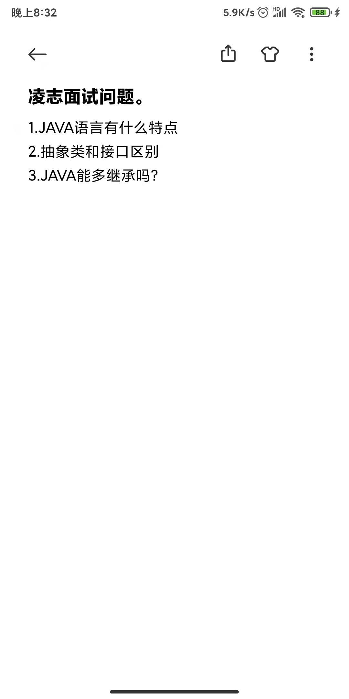

</details>

---

<a id="source-3"></a>

### 中软

**来源：** `3ecc0a4ac4d18501d17cd4d4ed36714.jpg`、`db846e448f149d7ce408de97b92be27.jpg`

面试涉及前后端，主要围绕简历展开。

1. Vue 是一个渐进式框架，如何理解渐进式？

2. Spring MVC 的核心是什么？

3. 重启 Nginx 的命令是什么？

4. 左连接和左外连接有什么区别？

#### 补充参考答案（逐项对应）

##### Vue 是一个渐进式框架，如何理解渐进式？

**参考答案：** Vue 可从一小块页面增强逐步采用组件、路由和状态管理，因此称渐进式；核心是声明式渲染与响应式状态驱动视图。Vue 2 常见生命周期为 beforeCreate、created、beforeMount、mounted、beforeUpdate、updated、beforeDestroy、destroyed；Vue 3 对应卸载钩子为 beforeUnmount／unmounted，组合式 API 用 onMounted 等，setup 是入口。Vue 2 用 new Vue 创建实例；Vue 3 用 createApp。

##### Spring MVC 的核心是什么？

**参考答案：** 核心前端控制器为 DispatcherServlet：接收请求 → HandlerMapping 找处理器 → HandlerAdapter 调用 Controller → 返回结果。视图场景解析 ModelAndView 并渲染；@ResponseBody／@RestController 场景由消息转换器序列化为 JSON 等响应。Controller 负责协议与参数，Service 处理业务和事务，DAO／Mapper 访问数据。仅接收 GET 可用 @GetMapping。JSON 请求体用 @RequestBody DTO 接收并校验。

##### 重启 Nginx 的命令是什么？

**参考答案：** Nginx 可做反向代理、静态资源服务与负载均衡。常见策略为轮询、权重、最少连接、哈希等。检查配置用 nginx -t，平滑重载用 nginx -s reload；systemd 安装可用 systemctl restart nginx，重启有中断风险。部署时配置域名、TLS、健康检查、日志和回滚；跨域可由同源网关代理或配置严格的 CORS，带凭证时不能随意用通配 Origin。

##### 左连接和左外连接有什么区别？

**参考答案：** INNER JOIN 返回匹配行；LEFT JOIN 与 LEFT OUTER JOIN 等价，保留左表所有行；RIGHT JOIN 保留右表。保留未匹配行时，右表过滤通常放 ON，放 WHERE 可能把外连接变成内连接。例：SELECT e.name,d.name FROM employee e LEFT JOIN department d ON e.dept_id=d.id; 三种连接根据是否需要保留未匹配记录选择。

<details>
<summary>查看原图（含原始选项、手写内容或参考图）</summary>


</details>

---

<a id="source-4"></a>

### 泛微

**来源：** `6973178efcd532921f14c30ebbabd37.jpg`、`a6285f1510231220381f5adceff607b.jpg`

#### 前端

1. var、let、const 的区别。

2. 用 jQuery 给 DOM 赋值。

3. JavaScript 与 jQuery 的关系。

4. Ajax 同步请求与异步请求的区别。

#### 后端

1. 说明 Spring 的 IoC 与 AOP。

2. AOP 有什么好处？

3. JSP 九大内置对象及其作用。

4. Servlet 生命周期。

5. == 与 equals() 的区别，注意 String 重写了 equals。

6. HashMap 是有序的吗？

#### 补充参考答案（逐项对应）

##### var、let、const 的区别。

**参考答案：** JS 基本类型为 undefined、null、boolean、number、bigint、string、symbol，引用类型为 object。var 通常函数作用域并允许重复声明；let／const 块作用域、有暂时性死区；const 禁止重新绑定，不禁止修改对象内容。删除数组中间元素可用 splice 改原数组，或 filter／切片返回新数组；delete 留下空槽且长度不变。

##### 用 jQuery 给 DOM 赋值。

**参考答案：** jQuery 是 JavaScript 库，常用能力包括选择／DOM 操作、事件、Ajax；所谓“三大核心”不是正式固定规范。选择器示例 #id、.class、标签与属性选择器。$("#name").val("张三") 改表单值，.text 改文本，.html 解析 HTML；给不可信内容使用 .text。$(function(){...}) 在 DOM 就绪后执行，不必等图片全部加载。Ajax 是异步网络请求与局部更新模式，同步请求会阻塞；可用 fetch／XMLHttpRequest 或 $.ajax。

[相关代码／实现示例](#program-ajax)。

##### JavaScript 与 jQuery 的关系。

**参考答案：** jQuery 是 JavaScript 库，常用能力包括选择／DOM 操作、事件、Ajax；所谓“三大核心”不是正式固定规范。选择器示例 #id、.class、标签与属性选择器。$("#name").val("张三") 改表单值，.text 改文本，.html 解析 HTML；给不可信内容使用 .text。$(function(){...}) 在 DOM 就绪后执行，不必等图片全部加载。Ajax 是异步网络请求与局部更新模式，同步请求会阻塞；可用 fetch／XMLHttpRequest 或 $.ajax。

[相关代码／实现示例](#program-ajax)。

##### Ajax 同步请求与异步请求的区别。

**参考答案：** jQuery 是 JavaScript 库，常用能力包括选择／DOM 操作、事件、Ajax；所谓“三大核心”不是正式固定规范。选择器示例 #id、.class、标签与属性选择器。$("#name").val("张三") 改表单值，.text 改文本，.html 解析 HTML；给不可信内容使用 .text。$(function(){...}) 在 DOM 就绪后执行，不必等图片全部加载。Ajax 是异步网络请求与局部更新模式，同步请求会阻塞；可用 fetch／XMLHttpRequest 或 $.ajax。

[相关代码／实现示例](#program-ajax)。

##### 说明 Spring 的 IoC 与 AOP。

**参考答案：** Spring 提供对象容器、依赖注入、事务及相关基础设施。IoC 把对象创建与组装交给容器；DI 是实现 IoC 的方式，常用构造器、Setter、字段注入，构造器注入便于表达必需依赖。AOP 将日志、事务、权限等横切逻辑从业务中抽出，Spring AOP 常用 JDK 接口代理或类代理；同对象内部自调用可能绕过代理。SSM 是 Spring + Spring MVC + MyBatis 的组合。

##### AOP 有什么好处？

**参考答案：** Spring 提供对象容器、依赖注入、事务及相关基础设施。IoC 把对象创建与组装交给容器；DI 是实现 IoC 的方式，常用构造器、Setter、字段注入，构造器注入便于表达必需依赖。AOP 将日志、事务、权限等横切逻辑从业务中抽出，Spring AOP 常用 JDK 接口代理或类代理；同对象内部自调用可能绕过代理。SSM 是 Spring + Spring MVC + MyBatis 的组合。

##### JSP 九大内置对象及其作用。

**参考答案：** 九大内置对象为 request、response、session、application、pageContext、out、config、page、exception；exception 通常在错误页面可用。getParameter 读取请求参数（主要是字符串），getAttribute 读取服务端在请求等作用域保存的对象。请求范围数据可供同一次转发共享，不等于新一次重定向仍存在。

##### Servlet 生命周期。

**参考答案：** Cookie 是浏览器保存并按规则发送的数据；Session 是服务器维护的会话，常以 Cookie 中的会话 ID 关联，也可有其他传递方式。关闭浏览器是否删除取决于 Cookie 持久期及恢复行为，不能绝对化。JSP 四大作用域 page、request、session、application；request 对应一次请求，application 对应 Web 应用生命周期。Servlet 由 init → 多次 service → destroy；多请求可能并发执行，应避免实例字段存请求状态。

##### == 与 equals() 的区别，注意 String 重写了 equals。

**参考答案：** 基本类型的 == 比较值，引用类型的 == 比较是否同一对象。Object.equals 默认等价于引用相等；String 等类按值重写。equals 为 true 时 hashCode 必须相同，hashCode 相同不能推出 equals 为 true。覆盖 equals 应同时覆盖 hashCode；不要认为默认 hashCode 必然等于内存地址。

##### HashMap 是有序的吗？

**参考答案：** HashMap 不保证遍历顺序，也不是线程安全的。以 Java 8 常见实现为例，它由桶数组、链表及红黑树组织冲突节点；树化涉及链长阈值与数组容量条件，扩容会重新分配桶。哈希相同仍需 equals 区分键。LinkedHashMap 可保持插入／访问顺序，TreeMap 按键排序。并发共享优先 ConcurrentHashMap；它不接受 null 键和值。Hashtable 与 Vector 对主要方法同步，组合操作不因此自动原子。

<details>
<summary>查看原图（含原始选项、手写内容或参考图）</summary>

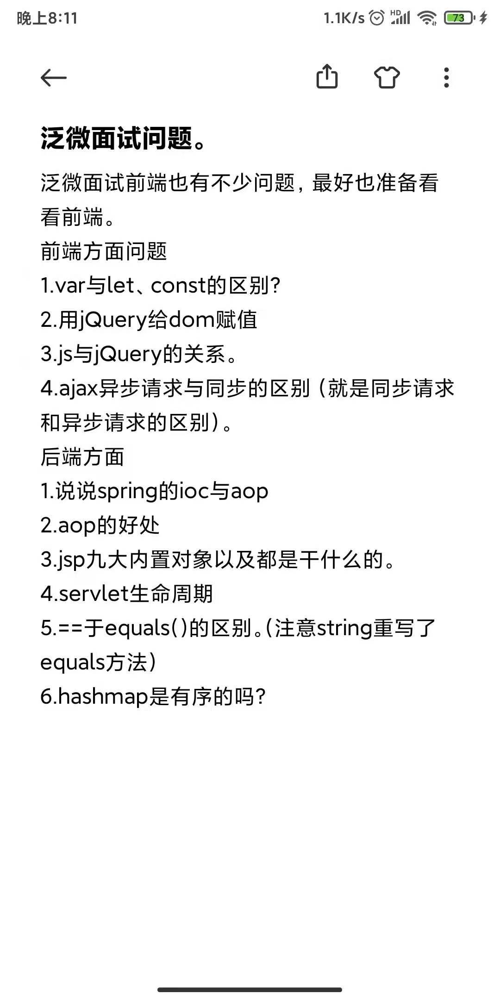

</details>

---

<a id="source-5"></a>

### 中海油／炎黄盛海（相同图片）

**来源：** `6e444753e7635dd2c5715e02672340d.jpg`、`炎黄盛海.jpg`、`中海油.jpg`、`fe0163e1fa368f869f0300550b55c65.jpg`

#### 人事面试

1. 自我介绍。

2. 是本地人吗？

3. 希望怎样的工作环境、团队环境？

4. 自己的优点和缺点，缺点会影响工作吗？

5. 介绍学校。

6. 未来规划。

#### 笔试

1. 事务的传播特性。

2. 字符串反转。

3. String、StringBuffer、StringBuilder 的区别。

4. == 和 equals 的区别。

5. 线程池的两个方法有什么区别？（原图未指明方法名）

6. sleep 和 wait 的区别。

7. 如何加载数据库驱动？

8. 数据库增删改查。

#### 补充参考答案（逐项对应）

##### 自我介绍。

**参考答案／个人回答模板：** 模板：我是［姓名］，就读／毕业于［学校、专业］，主要学习［真实课程］。做过［项目］，负责［具体模块］，用［技术］解决［问题］并通过［测试／结果］验证，希望在［岗位］继续提升。课程、成绩、书籍、C 语言和实习经历均按事实填写，没学过／没读完可坦诚说明；介绍控制在 1～2 分钟。

##### 是本地人吗？

**参考答案／个人回答模板：** 先给真实结论，再说明依据。例：“我近期希望扎实做好 Java 后端开发，能独立交付模块；长期根据能力和兴趣发展，不提前承诺管理岗。”城市、定居、返校、考研、入职日期与出差接受度均用［个人实际情况］替换；有约束直接说明可接受的频率／时间，不能替本人作承诺。

##### 希望怎样的工作环境、团队环境？

**参考答案／个人回答模板：** 用真实事件证明优点；缺点说可改进且有行动的问题，例如估时偏乐观，已用任务拆分与风险缓冲改善。压力下先明确优先级、拆任务、及时沟通依赖和风险，不承诺无条件加班。理想团队可强调清晰目标、代码审查、尊重沟通；企业文化谈自己重视的协作、责任和学习，并结合已了解的事实。

##### 自己的优点和缺点，缺点会影响工作吗？

**参考答案／个人回答模板：** 用真实事件证明优点；缺点说可改进且有行动的问题，例如估时偏乐观，已用任务拆分与风险缓冲改善。压力下先明确优先级、拆任务、及时沟通依赖和风险，不承诺无条件加班。理想团队可强调清晰目标、代码审查、尊重沟通；企业文化谈自己重视的协作、责任和学习，并结合已了解的事实。

##### 介绍学校。

**参考答案／个人回答模板：** 模板：我是［姓名］，就读／毕业于［学校、专业］，主要学习［真实课程］。做过［项目］，负责［具体模块］，用［技术］解决［问题］并通过［测试／结果］验证，希望在［岗位］继续提升。课程、成绩、书籍、C 语言和实习经历均按事实填写，没学过／没读完可坦诚说明；介绍控制在 1～2 分钟。

##### 未来规划。

**参考答案／个人回答模板：** 先给真实结论，再说明依据。例：“我近期希望扎实做好 Java 后端开发，能独立交付模块；长期根据能力和兴趣发展，不提前承诺管理岗。”城市、定居、返校、考研、入职日期与出差接受度均用［个人实际情况］替换；有约束直接说明可接受的频率／时间，不能替本人作承诺。

##### 事务的传播特性。

**参考答案：** Service 的跨多次写入业务通常用 @Transactional。常见传播：REQUIRED 加入现有或新建事务；REQUIRES_NEW 挂起外层并新建；NESTED 通常通过保存点；SUPPORTS 有事务则加入；NOT_SUPPORTED 不在事务执行；MANDATORY 必须已有；NEVER 必须没有。默认一般对 RuntimeException／Error 回滚，受检异常可用 rollbackFor 指定；代理模式下内部自调用可能失效。数据库事务不能自动回滚文件或 HTTP 调用，应有补偿／一致性设计。

##### 字符串反转。

**参考答案：** String 不可变；StringBuilder 可变且不保证线程安全；StringBuffer 的主要方法有同步保护，多步骤组合仍可能需要外部同步。常见反转：new StringBuilder(s).reverse().toString()；处理用户感知字符如组合字符、表情序列时需额外定义反转规则。Lambda 是函数式接口实例的一种写法，例如 list.forEach(x -> System.out.println(x))；捕获的局部变量必须是 final 或 effectively final。

##### String、StringBuffer、StringBuilder 的区别。

**参考答案：** String 不可变；StringBuilder 可变且不保证线程安全；StringBuffer 的主要方法有同步保护，多步骤组合仍可能需要外部同步。常见反转：new StringBuilder(s).reverse().toString()；处理用户感知字符如组合字符、表情序列时需额外定义反转规则。Lambda 是函数式接口实例的一种写法，例如 list.forEach(x -> System.out.println(x))；捕获的局部变量必须是 final 或 effectively final。

##### == 和 equals 的区别。

**参考答案：** 基本类型的 == 比较值，引用类型的 == 比较是否同一对象。Object.equals 默认等价于引用相等；String 等类按值重写。equals 为 true 时 hashCode 必须相同，hashCode 相同不能推出 equals 为 true。覆盖 equals 应同时覆盖 hashCode；不要认为默认 hashCode 必然等于内存地址。

##### 线程池的两个方法有什么区别？（原图未指明方法名）

**参考答案：** 线程池复用线程、限制并发、管理队列和任务生命周期。ThreadPoolExecutor 关注核心／最大线程数、队列、空闲时间、线程工厂、拒绝策略。execute 接收 Runnable、无 Future；submit 可提交 Runnable／Callable，返回 Future，可取结果、取消并通过 get 观察异常。容量应按工作负载压测，不使用无界队列掩盖过载。原题只说“两个方法”时，先确认是否指 submit／execute。

##### sleep 和 wait 的区别。

**参考答案：** sleep 是 Thread 的静态方法，不释放已持有的监视器；wait 是 Object 方法，调用者必须持有该对象监视器，等待时释放它并在返回前重新获取。notify 唤醒一个等待线程，notifyAll 唤醒全部等待线程，但线程仍需竞争锁。使用 synchronized 中的 while 检查条件以应对虚假唤醒。更高层通信可用 BlockingQueue、CountDownLatch、Future；共享状态也必须保证可见性。

##### 如何加载数据库驱动？

**参考答案：** 流程为获取连接 → 创建 PreparedStatement → 参数绑定 → 执行 → 读取结果 → 关闭资源。现代 JDBC 驱动通常通过服务发现自动注册；旧写法用 Class.forName。PreparedStatement 将参数当数据、支持复用，避免把值直接拼成 SQL；Statement 更适合固定无参数 SQL。连接池管理复用连接，不能把连接池与 ORM 当作同一种工具。完整示例见本文件新增编程答案。

[相关代码／实现示例](#program-jdbc)。

##### 数据库增删改查。

**参考答案：** 插入：INSERT INTO student(name,sex) VALUES(?,?); 更新：UPDATE student SET name=? WHERE id=?; 删除：DELETE FROM student WHERE id=?; 查询：SELECT id,name FROM student WHERE id=?。参数使用 JDBC／Mapper 绑定。更新和删除应明确条件、检查影响行数；事务保证同一业务内多条语句的提交或回滚。

<details>
<summary>查看原图（含原始选项、手写内容或参考图）</summary>


</details>

---

<a id="source-9"></a>

### 北京程信云科java面试问题

**来源：** `北京程信云科java面试问题.txt`

1、在学校学过哪些课程

2、在学校做过什么项目

2、有没有学过c，学过的话，学到了哪块

4、看过相关专业的什么书籍

5、JDBC连接数据库

6、SpringMVC的工作流程

7、什么是SQL注入

8、Preparestatement和statement的区别

9、如果调用远程服务出现问题，怎么排查

10、数据库的连接查询有哪几种

11、有没有用过微服务

12、你认为什么是微服务

#### 补充参考答案（逐项对应）

##### 在学校学过哪些课程

**参考答案／个人回答模板：** 模板：我是［姓名］，就读／毕业于［学校、专业］，主要学习［真实课程］。做过［项目］，负责［具体模块］，用［技术］解决［问题］并通过［测试／结果］验证，希望在［岗位］继续提升。课程、成绩、书籍、C 语言和实习经历均按事实填写，没学过／没读完可坦诚说明；介绍控制在 1～2 分钟。

##### 在学校做过什么项目

**参考答案／个人回答模板：** 按背景—目标—职责—行动—结果组织：项目解决［业务问题］，我负责［模块］；困难是［具体故障／约束］，先通过［日志／复现／测量］定位，再采用［方案］，以［测试／指标］验证。明确个人贡献与团队协作，别编造用户量、性能数字或独立完成经历。未做过的技术可回答了解原理及准备如何验证。

##### 有没有学过c，学过的话，学到了哪块

**参考答案／个人回答模板：** 模板：我是［姓名］，就读／毕业于［学校、专业］，主要学习［真实课程］。做过［项目］，负责［具体模块］，用［技术］解决［问题］并通过［测试／结果］验证，希望在［岗位］继续提升。课程、成绩、书籍、C 语言和实习经历均按事实填写，没学过／没读完可坦诚说明；介绍控制在 1～2 分钟。

##### 看过相关专业的什么书籍

**参考答案／个人回答模板：** 模板：我是［姓名］，就读／毕业于［学校、专业］，主要学习［真实课程］。做过［项目］，负责［具体模块］，用［技术］解决［问题］并通过［测试／结果］验证，希望在［岗位］继续提升。课程、成绩、书籍、C 语言和实习经历均按事实填写，没学过／没读完可坦诚说明；介绍控制在 1～2 分钟。

##### JDBC连接数据库

**参考答案：** 流程为获取连接 → 创建 PreparedStatement → 参数绑定 → 执行 → 读取结果 → 关闭资源。现代 JDBC 驱动通常通过服务发现自动注册；旧写法用 Class.forName。PreparedStatement 将参数当数据、支持复用，避免把值直接拼成 SQL；Statement 更适合固定无参数 SQL。连接池管理复用连接，不能把连接池与 ORM 当作同一种工具。完整示例见本文件新增编程答案。

[相关代码／实现示例](#program-jdbc)。

##### SpringMVC的工作流程

**参考答案：** 核心前端控制器为 DispatcherServlet：接收请求 → HandlerMapping 找处理器 → HandlerAdapter 调用 Controller → 返回结果。视图场景解析 ModelAndView 并渲染；@ResponseBody／@RestController 场景由消息转换器序列化为 JSON 等响应。Controller 负责协议与参数，Service 处理业务和事务，DAO／Mapper 访问数据。仅接收 GET 可用 @GetMapping。JSON 请求体用 @RequestBody DTO 接收并校验。

##### 什么是SQL注入

**参考答案：** 把未经处理的输入拼成 SQL，可能改变语句结构，例如登录查询被 OR 条件绕过。参数值使用预编译占位符，动态表名／列名不能用参数占位时使用服务端白名单映射；同时采用最小数据库权限。单纯把输入加引号或只过滤几个关键字并不可靠。

##### Preparestatement和statement的区别

**参考答案：** 流程为获取连接 → 创建 PreparedStatement → 参数绑定 → 执行 → 读取结果 → 关闭资源。现代 JDBC 驱动通常通过服务发现自动注册；旧写法用 Class.forName。PreparedStatement 将参数当数据、支持复用，避免把值直接拼成 SQL；Statement 更适合固定无参数 SQL。连接池管理复用连接，不能把连接池与 ORM 当作同一种工具。完整示例见本文件新增编程答案。

[相关代码／实现示例](#program-jdbc)。

##### 如果调用远程服务出现问题，怎么排查

**参考答案：** 远程失败按请求 ID 检查客户端日志、DNS／网络／TLS、认证、超时、服务状态、接口契约和服务器日志；区分连接超时与读取超时，不盲目无限重试。访问其他公司数据库通常先确认授权、网络白名单／VPN、TLS 与只读账户，优先通过约定 API；不要假设拿到 IP 就能直接连接。

##### 数据库的连接查询有哪几种

**参考答案：** INNER JOIN 返回匹配行；LEFT JOIN 与 LEFT OUTER JOIN 等价，保留左表所有行；RIGHT JOIN 保留右表。保留未匹配行时，右表过滤通常放 ON，放 WHERE 可能把外连接变成内连接。例：SELECT e.name,d.name FROM employee e LEFT JOIN department d ON e.dept_id=d.id; 三种连接根据是否需要保留未匹配记录选择。

##### 有没有用过微服务

**参考答案／个人回答模板：** 按背景—目标—职责—行动—结果组织：项目解决［业务问题］，我负责［模块］；困难是［具体故障／约束］，先通过［日志／复现／测量］定位，再采用［方案］，以［测试／指标］验证。明确个人贡献与团队协作，别编造用户量、性能数字或独立完成经历。未做过的技术可回答了解原理及准备如何验证。

##### 你认为什么是微服务

**参考答案：** 微服务按业务能力拆成可独立部署的服务，通过 API／消息协作；收益是独立演进与扩展，代价是网络故障、分布式一致性、可观测性和运维复杂度。Spring Boot 构建应用，Spring Cloud 提供服务协作相关集成；常见能力为注册发现、配置、网关、声明式调用、负载均衡和容错。组件与版本演进很快，不把早期 Netflix 套件当当前固定清单。


---

<a id="source-10"></a>

### 北京宏景世纪：实施运维工程师

**来源：** `北京宏景世纪.jpg`

笔试包含单选、多选和五道大题。原资料仅记录考点，没有给出具体题干。

- Java 基础：数组、前端传参、面向对象、基本类型与包装类、标识符命名、equals 与 ==、static、Exception 与 Error、线程池。

- 大题：四道多表联查 SQL 题，一道算法题。

#### 补充参考答案：只有考点的宏景笔试记录

该记录没有四条 SQL 与算法的完整题干，不能编造一张“原题答案表”。可明确回答的考点如下：

- 面向对象：封装、继承、多态；Java 类单继承、接口多实现。
- 基本类型／包装类：包装类可 null、可用于泛型，拆箱 null 会空指针；八种基本类型见 Java 基础答案。
- 标识符：Java 标识符的起始与后续字符需满足语言规则，不能是关键字，数字不能开头；并不只限英文，命名建议采用清晰驼峰式。
- static：属于类，不因新建实例而重置；静态方法没有 this。
- equals／==：值语义取决于 equals 实现，引用 == 判断同一对象。
- Error／Exception：都继承 Throwable，Error 通常不是业务恢复路径，受检异常需处理或声明。
- 前端传参：查询参数通常 @RequestParam，路径 @PathVariable，JSON 请求体 @RequestBody DTO，文件 multipart。
- 数组与线程池：分别解释下标访问与容量、复用线程与并发限制，不把数组长度当已存元素数。
- 多表联查与算法：现有材料缺字段／约束，可参照本文件已补齐的 SQL 和编程例题，不能推断实际试卷输出。

<details>
<summary>查看原图（含原始选项、手写内容或参考图）</summary>

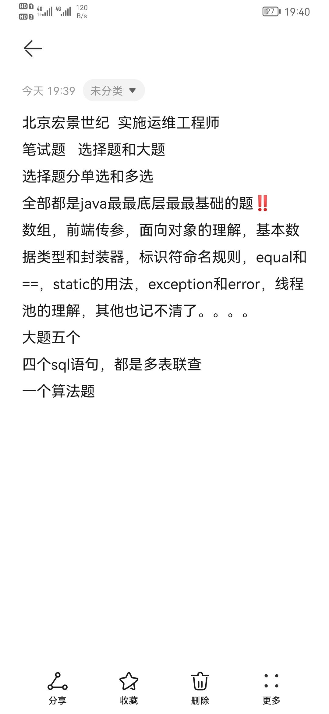

</details>

---

<a id="source-11"></a>

### 北京软通动力测试岗面试题

**来源：** `北京软通动力测试岗面试题.docx`

对测试的了解，

测试流程，

对数据库的了解，

说一条数据库语句

数据库的增删查改

VUE的核心思想

#### 补充参考答案（逐项对应）

##### 对测试的了解，

**参考答案：** 软件测试通过验证需求、发现风险并提供质量信息，不等于保证绝对无缺陷。流程：需求评审 → 测试计划／用例 → 环境与数据准备 → 执行 → 缺陷记录与复现 → 修复验证与回归 → 结果报告。可覆盖单元、集成、系统、验收，以及功能、性能、安全、兼容性等维度；用边界值、等价类等设计用例。

##### 测试流程，

**参考答案：** 软件测试通过验证需求、发现风险并提供质量信息，不等于保证绝对无缺陷。流程：需求评审 → 测试计划／用例 → 环境与数据准备 → 执行 → 缺陷记录与复现 → 修复验证与回归 → 结果报告。可覆盖单元、集成、系统、验收，以及功能、性能、安全、兼容性等维度；用边界值、等价类等设计用例。

##### 对数据库的了解，

**参考答案：** MySQL 和 Oracle 都是关系数据库，但分页、序列／标识列、类型和事务相关语法不同。InnoDB 支持事务、外键、行锁和 MVCC；MyISAM 以表锁为主，不支持事务。Oracle 全局临时表的定义长期存在，数据可按事务／会话清理；MySQL CREATE TEMPORARY TABLE 的表定义与数据属于当前会话，连接关闭后删除。版本不同需核对具体行为。

##### 说一条数据库语句

**参考答案：** 插入：INSERT INTO student(name,sex) VALUES(?,?); 更新：UPDATE student SET name=? WHERE id=?; 删除：DELETE FROM student WHERE id=?; 查询：SELECT id,name FROM student WHERE id=?。参数使用 JDBC／Mapper 绑定。更新和删除应明确条件、检查影响行数；事务保证同一业务内多条语句的提交或回滚。

##### 数据库的增删查改

**参考答案：** 插入：INSERT INTO student(name,sex) VALUES(?,?); 更新：UPDATE student SET name=? WHERE id=?; 删除：DELETE FROM student WHERE id=?; 查询：SELECT id,name FROM student WHERE id=?。参数使用 JDBC／Mapper 绑定。更新和删除应明确条件、检查影响行数；事务保证同一业务内多条语句的提交或回滚。

##### VUE的核心思想

**参考答案：** Vue 可从一小块页面增强逐步采用组件、路由和状态管理，因此称渐进式；核心是声明式渲染与响应式状态驱动视图。Vue 2 常见生命周期为 beforeCreate、created、beforeMount、mounted、beforeUpdate、updated、beforeDestroy、destroyed；Vue 3 对应卸载钩子为 beforeUnmount／unmounted，组合式 API 用 onMounted 等，setup 是入口。Vue 2 用 new Vue 创建实例；Vue 3 用 createApp。


---

<a id="source-12"></a>

### 北京星天地信息科技有限公司-Java开发岗面试

**来源：** `北京星天地信息科技有限公司-Java开发岗面试 (2).txt`、`北京星天地信息科技有限公司-Java开发岗面试.txt`

#### 一面技术面

1、int和Integer的区别，具体在开发中的体现

2、++i与i++的区别

3、说一下final关键字在Java中的作用以及在什么情况下使用

4、说一下线程池以及线程池的好处

5、线程与进程的区别

6、说一下里氏转换

7、TCP与UDP的区别

8、说一下GC垃圾收集机制（JVM）

9、Cookie和session的区别

10、说一下你知道的Java的设计模式（说完后会具体的问其中的一个，让我细说的是单例模式，单例模式的实现方式及其线程安全问题）

11、说一下HashMap是否是线程安全。

#### 二面HR面

说实习的事

#### 补充参考答案（逐项对应）

##### int和Integer的区别，具体在开发中的体现

**参考答案：** Java 是面向对象、具有静态类型检查的语言，代码编译成字节码，由目标平台的 JVM 执行；支持垃圾回收、异常处理、多线程和丰富类库。跨平台依赖对应平台的 JVM，并不代表本机代码或所有外部依赖都自动跨平台。基本类型为 byte、short、int、long、float、double、char、boolean；前七种大小依次为 1、2、4、8、4、8、2 字节，boolean 的具体存储布局由 JVM 实现决定。包装类可为 null，可用于泛型；基本类型不能为 null，拆箱 null 会抛 NullPointerException。

##### ++i与i++的区别

**参考答案：** 作为独立语句时都会加 1；在表达式中，i++ 先产生旧值再递增，++i 先递增再产生新值。例如 i=1：x=i++ 后 x=1、i=2；x=++i 后 x=2、i=2。它们都不是对共享变量的原子复合操作。

##### 说一下final关键字在Java中的作用以及在什么情况下使用

**参考答案：** final 修饰类则不能被继承，修饰方法则不能被重写，修饰变量则只能赋值一次；final 引用不代表对象内部不可变。static 成员属于类，实例共享同一静态字段，静态方法无 this，不能直接访问实例字段。构造器初始化对象、没有返回类型，可以重载；Java 没有 C++ 式确定性析构函数，文件／连接应通过 AutoCloseable 与 try-with-resources 关闭，不依赖 finalize。

##### 说一下线程池以及线程池的好处

**参考答案：** 线程池复用线程、限制并发、管理队列和任务生命周期。ThreadPoolExecutor 关注核心／最大线程数、队列、空闲时间、线程工厂、拒绝策略。execute 接收 Runnable、无 Future；submit 可提交 Runnable／Callable，返回 Future，可取结果、取消并通过 get 观察异常。容量应按工作负载压测，不使用无界队列掩盖过载。原题只说“两个方法”时，先确认是否指 submit／execute。

##### 线程与进程的区别

**参考答案：** 进程是资源与地址空间的隔离单位，线程是执行与调度单位；同进程线程共享堆等资源，但有自己的栈和程序计数器。常见创建方式：继承 Thread、实现 Runnable、Callable 配合 FutureTask／线程池；优先把任务与执行器分开。start 启动线程，直接调用 run 是普通方法调用。任务执行完或响应中断退出，不使用已废弃 stop。

##### 说一下里氏转换

**参考答案：** 重载是同名方法的参数列表不同，编译期选择；不能仅靠返回类型重载。重写是子类覆盖可继承的实例方法，签名一致、返回类型可协变、访问权限不能更严格，不能扩大受检异常范围。里氏替换原则要求子类型可替代父类型而不破坏约定；向上转型通常安全，向下转型要确认实际对象类型，可用 instanceof 检查。

##### TCP与UDP的区别

**参考答案：** HTTP 请求包括请求行／方法、头和可选消息体，响应包括状态、头和体。GET 用于读取，POST 常用于创建／动作，PUT 完整替换，PATCH 部分修改，DELETE 删除。TCP 提供有序可靠字节流，连接经三次握手，正常关闭通常经 FIN/ACK；UDP 是数据报，不保证交付与顺序。Socket 是网络编程接口，TCP 或 UDP 都能用，不能说所有 Socket 必然是 TCP。

##### 说一下GC垃圾收集机制（JVM）

**参考答案：** GC 根据从 GC Roots 出发的可达性判断存活；常见 Roots 有线程栈中引用、活跃类的静态引用、JNI 引用等。解除引用可使对象不可达，不能靠“打破 GC Roots 算法”安全回收仍在使用的对象。常见算法包括标记清除、复制、标记整理；收集器实现和分代策略应按版本说明。类加载经历加载、链接（验证、准备、解析）和初始化；双亲委派先委托父加载器，父加载器无法加载时再由当前加载器尝试。

##### Cookie和session的区别

**参考答案：** Cookie 是浏览器保存并按规则发送的数据；Session 是服务器维护的会话，常以 Cookie 中的会话 ID 关联，也可有其他传递方式。关闭浏览器是否删除取决于 Cookie 持久期及恢复行为，不能绝对化。JSP 四大作用域 page、request、session、application；request 对应一次请求，application 对应 Web 应用生命周期。Servlet 由 init → 多次 service → destroy；多请求可能并发执行，应避免实例字段存请求状态。

##### 说一下你知道的Java的设计模式（说完后会具体的问其中的一个，让我细说的是单例模式，单例模式的实现方式及其线程安全问题）

**参考答案：** 常见 GoF 23 种：创建型单例、工厂方法、抽象工厂、建造者、原型；结构型适配器、桥接、组合、装饰、外观、享元、代理；行为型责任链、命令、解释器、迭代器、中介者、备忘录、观察者、状态、策略、模板方法、访问者。模式不是 Java 专属或必须凑数；Spring 可见工厂、代理、模板、观察者、策略等。Spring 的 singleton 由容器缓存对象保证，不直接等同某个手写单例套路。

[相关代码／实现示例](#program-singleton)。

##### 说一下HashMap是否是线程安全。

**参考答案：** HashMap 不保证遍历顺序，也不是线程安全的。以 Java 8 常见实现为例，它由桶数组、链表及红黑树组织冲突节点；树化涉及链长阈值与数组容量条件，扩容会重新分配桶。哈希相同仍需 equals 区分键。LinkedHashMap 可保持插入／访问顺序，TreeMap 按键排序。并发共享优先 ConcurrentHashMap；它不接受 null 键和值。Hashtable 与 Vector 对主要方法同步，组合操作不因此自动原子。

##### 说实习的事

**参考答案／个人回答模板：** 按背景—目标—职责—行动—结果组织：项目解决［业务问题］，我负责［模块］；困难是［具体故障／约束］，先通过［日志／复现／测量］定位，再采用［方案］，以［测试／指标］验证。明确个人贡献与团队协作，别编造用户量、性能数字或独立完成经历。未做过的技术可回答了解原理及准备如何验证。


---

<a id="source-13"></a>

### 北京亚信

**来源：** `北京亚信.jpg`、`亚信面试题.jpg`

主要围绕项目提问。

1. Spring 依赖注入有几种方式？

2. Spring Boot 中在哪里配置 MyBatis？

3. MyBatis 如何执行？（原作者记忆不完整，题意按原记录保留）

4. 线程间如何传递参数？

5. 如何实现 Spring Boot 接口只接受 GET 请求？

#### 补充参考答案（逐项对应）

##### Spring 依赖注入有几种方式？

**参考答案：** Spring 提供对象容器、依赖注入、事务及相关基础设施。IoC 把对象创建与组装交给容器；DI 是实现 IoC 的方式，常用构造器、Setter、字段注入，构造器注入便于表达必需依赖。AOP 将日志、事务、权限等横切逻辑从业务中抽出，Spring AOP 常用 JDK 接口代理或类代理；同对象内部自调用可能绕过代理。SSM 是 Spring + Spring MVC + MyBatis 的组合。

##### Spring Boot 中在哪里配置 MyBatis？

**参考答案：** Spring Boot 基于 Spring，提供约定配置、自动配置、Starter 依赖组合、嵌入式服务及运维支持，减少项目装配工作；它不是替代 Spring。@SpringBootApplication 主要组合 @SpringBootConfiguration、@EnableAutoConfiguration、@ComponentScan。常用 @RestController、@RequestMapping、@GetMapping、@RequestBody、@Configuration、@Bean、@Service、@Repository。MyBatis 配置一般在 application.yml／properties 的 mybatis.* 项和 @MapperScan，SQL 映射在 Mapper XML／注解。

##### MyBatis 如何执行？（原作者记忆不完整，题意按原记录保留）

**参考答案：** MyBatis 将 SQL 与 Java 映射并封装 JDBC 执行：获取 SqlSession／Mapper 代理 → 定位映射语句 → 绑定参数 → JDBC 执行 → 映射结果。#{x} 形成预编译参数，${x} 是文本替换，不能直接接收不可信输入。列名不同可用别名、resultMap 或开启下划线转驼峰。Mapper XML 可有 resultMap、sql、include、cache、cache-ref、selectKey 和 if／choose／foreach／where／set 等动态元素。

##### 线程间如何传递参数？

**参考答案：** sleep 是 Thread 的静态方法，不释放已持有的监视器；wait 是 Object 方法，调用者必须持有该对象监视器，等待时释放它并在返回前重新获取。notify 唤醒一个等待线程，notifyAll 唤醒全部等待线程，但线程仍需竞争锁。使用 synchronized 中的 while 检查条件以应对虚假唤醒。更高层通信可用 BlockingQueue、CountDownLatch、Future；共享状态也必须保证可见性。

##### 如何实现 Spring Boot 接口只接受 GET 请求？

**参考答案：** 核心前端控制器为 DispatcherServlet：接收请求 → HandlerMapping 找处理器 → HandlerAdapter 调用 Controller → 返回结果。视图场景解析 ModelAndView 并渲染；@ResponseBody／@RestController 场景由消息转换器序列化为 JSON 等响应。Controller 负责协议与参数，Service 处理业务和事务，DAO／Mapper 访问数据。仅接收 GET 可用 @GetMapping。JSON 请求体用 @RequestBody DTO 接收并校验。

<details>
<summary>查看原图（含原始选项、手写内容或参考图）</summary>

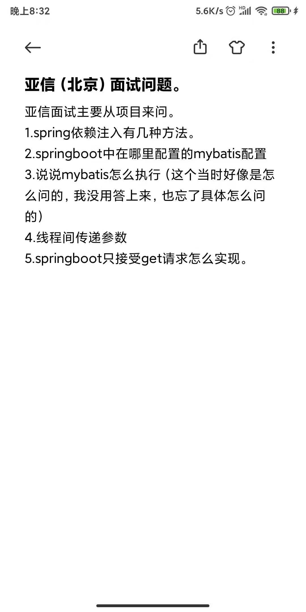

</details>

---

<a id="source-16"></a>

### 灵创智恒／度盛互动：聊天面经

**来源：** `度胜互动.jpg`、`灵创智恒.jpg`、`度盛互动\b699a800ce1d7e00404a436bc0e84cb.jpg`、`灵创智恒\b699a800ce1d7e00404a436bc0e84cb.jpg`

#### 灵创智恒

1. 如何理解 SSM 框架？

2. 如何优化 SQL？

3. Redis 是什么？

4. 数据库表的连接方式及适用场景。

5. 如何实现分页？

#### 度盛互动

1. Redis 的数据结构。

2. Vue 的生命周期。

3. Spring 与 Spring Boot 的区别。

4. Spring Cloud 的类型／组件（原图写“几种类型”）。

5. MyBatis 中 # 与 $ 的区别。

6. 索引的优点和缺点。

#### 补充参考答案（逐项对应）

##### 如何理解 SSM 框架？

**参考答案：** Spring 提供对象容器、依赖注入、事务及相关基础设施。IoC 把对象创建与组装交给容器；DI 是实现 IoC 的方式，常用构造器、Setter、字段注入，构造器注入便于表达必需依赖。AOP 将日志、事务、权限等横切逻辑从业务中抽出，Spring AOP 常用 JDK 接口代理或类代理；同对象内部自调用可能绕过代理。SSM 是 Spring + Spring MVC + MyBatis 的组合。

##### 如何优化 SQL？

**参考答案：** 索引用空间与写入维护成本换取查询效率，常用于高选择性过滤、关联和排序字段。InnoDB 聚簇索引叶子存行，二级索引叶子通常存主键，必要时回表。组合索引关注左前缀、范围与排序条件；函数、隐式类型转换、前置通配符、选择性过低等可能使优化器不选该索引，但不能绝对说某个 SQL 写法必然“失效”。用 EXPLAIN／实际耗时定位，减少无用列、批量处理、避免 N+1。

##### Redis 是什么？

**参考答案：** Redis 是内存数据结构服务，常用于缓存、计数、限流、会话等。常见基础类型：String、Hash、List、Set、ZSet；还可谈 Bitmap、HyperLogLog、Geo、Stream 等能力，不能说固定只有“八种”。String 可用整数编码或动态字符串表示；小集合与大集合可能使用不同编码。ZSet 常见大规模表示为字典加跳表，小数据可能用紧凑结构。具体底层编码与阈值需按版本说明。

##### 数据库表的连接方式及适用场景。

**参考答案：** INNER JOIN 返回匹配行；LEFT JOIN 与 LEFT OUTER JOIN 等价，保留左表所有行；RIGHT JOIN 保留右表。保留未匹配行时，右表过滤通常放 ON，放 WHERE 可能把外连接变成内连接。例：SELECT e.name,d.name FROM employee e LEFT JOIN department d ON e.dept_id=d.id; 三种连接根据是否需要保留未匹配记录选择。

##### 如何实现分页？

**参考答案：** 物理分页由数据库只返回目标页，例如 LIMIT 20 OFFSET 40；逻辑分页先拿较大结果，再在应用中截取，浪费内存和传输。MyBatis 可直接写分页 SQL 或用拦截器改写；需校验页码、限制页大小并稳定 ORDER BY。深分页可用游标：WHERE id > :lastId ORDER BY id LIMIT :size。前端 Ajax 请求分页参数，后端返回 items、total、page、size，不等于后端一定启动新线程。

[相关代码／实现示例](#program-ajax)。

##### Redis 的数据结构。

**参考答案：** Redis 是内存数据结构服务，常用于缓存、计数、限流、会话等。常见基础类型：String、Hash、List、Set、ZSet；还可谈 Bitmap、HyperLogLog、Geo、Stream 等能力，不能说固定只有“八种”。String 可用整数编码或动态字符串表示；小集合与大集合可能使用不同编码。ZSet 常见大规模表示为字典加跳表，小数据可能用紧凑结构。具体底层编码与阈值需按版本说明。

##### Vue 的生命周期。

**参考答案：** Vue 可从一小块页面增强逐步采用组件、路由和状态管理，因此称渐进式；核心是声明式渲染与响应式状态驱动视图。Vue 2 常见生命周期为 beforeCreate、created、beforeMount、mounted、beforeUpdate、updated、beforeDestroy、destroyed；Vue 3 对应卸载钩子为 beforeUnmount／unmounted，组合式 API 用 onMounted 等，setup 是入口。Vue 2 用 new Vue 创建实例；Vue 3 用 createApp。

##### Spring 与 Spring Boot 的区别。

**参考答案：** Spring Boot 基于 Spring，提供约定配置、自动配置、Starter 依赖组合、嵌入式服务及运维支持，减少项目装配工作；它不是替代 Spring。@SpringBootApplication 主要组合 @SpringBootConfiguration、@EnableAutoConfiguration、@ComponentScan。常用 @RestController、@RequestMapping、@GetMapping、@RequestBody、@Configuration、@Bean、@Service、@Repository。MyBatis 配置一般在 application.yml／properties 的 mybatis.* 项和 @MapperScan，SQL 映射在 Mapper XML／注解。

##### Spring Cloud 的类型／组件（原图写“几种类型”）。

**参考答案：** 微服务按业务能力拆成可独立部署的服务，通过 API／消息协作；收益是独立演进与扩展，代价是网络故障、分布式一致性、可观测性和运维复杂度。Spring Boot 构建应用，Spring Cloud 提供服务协作相关集成；常见能力为注册发现、配置、网关、声明式调用、负载均衡和容错。组件与版本演进很快，不把早期 Netflix 套件当当前固定清单。

##### MyBatis 中 # 与 $ 的区别。

**参考答案：** MyBatis 将 SQL 与 Java 映射并封装 JDBC 执行：获取 SqlSession／Mapper 代理 → 定位映射语句 → 绑定参数 → JDBC 执行 → 映射结果。#{x} 形成预编译参数，${x} 是文本替换，不能直接接收不可信输入。列名不同可用别名、resultMap 或开启下划线转驼峰。Mapper XML 可有 resultMap、sql、include、cache、cache-ref、selectKey 和 if／choose／foreach／where／set 等动态元素。

##### 索引的优点和缺点。

**参考答案：** 索引用空间与写入维护成本换取查询效率，常用于高选择性过滤、关联和排序字段。InnoDB 聚簇索引叶子存行，二级索引叶子通常存主键，必要时回表。组合索引关注左前缀、范围与排序条件；函数、隐式类型转换、前置通配符、选择性过低等可能使优化器不选该索引，但不能绝对说某个 SQL 写法必然“失效”。用 EXPLAIN／实际耗时定位，减少无用列、批量处理、避免 N+1。

<details>
<summary>查看原图（含原始选项、手写内容或参考图）</summary>

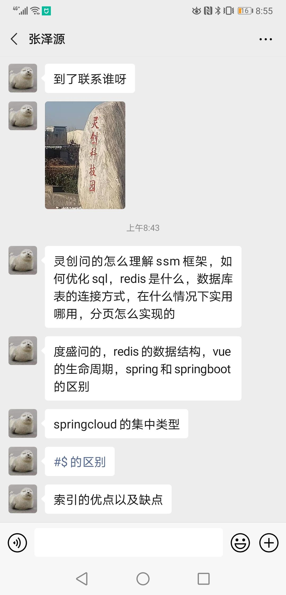

</details>

---

<a id="source-17"></a>

### 版本控制与 Spring Boot 综合面试

**来源：** `度胜互动2.png`、`中科软面试题.png`、`QQ图片20210311101759.png`

1. 对版本控制的理解。

2. Spring Boot 的优点。

3. MyBatis 中 # 与 $ 的区别。

4. 简历中的两个项目是独立完成还是小组完成？

5. 项目中主要负责哪些功能？

6. 如何与小组沟通？

7. 后期是否需要回学校？

8. 是否接受出差？

#### 补充参考答案（逐项对应）

##### 对版本控制的理解。

**参考答案：** 版本控制记录变化、分支、合并和历史追踪。Git 常用 add、commit、branch／switch、merge／rebase、log、diff；团队通过约定分支、PR 审查、冲突沟通和可重复构建协作。回答协作经历时说明自己承担的功能、接口契约、问题及验证，不只说“都做过”。

##### Spring Boot 的优点。

**参考答案：** Spring Boot 基于 Spring，提供约定配置、自动配置、Starter 依赖组合、嵌入式服务及运维支持，减少项目装配工作；它不是替代 Spring。@SpringBootApplication 主要组合 @SpringBootConfiguration、@EnableAutoConfiguration、@ComponentScan。常用 @RestController、@RequestMapping、@GetMapping、@RequestBody、@Configuration、@Bean、@Service、@Repository。MyBatis 配置一般在 application.yml／properties 的 mybatis.* 项和 @MapperScan，SQL 映射在 Mapper XML／注解。

##### MyBatis 中 # 与 $ 的区别。

**参考答案：** MyBatis 将 SQL 与 Java 映射并封装 JDBC 执行：获取 SqlSession／Mapper 代理 → 定位映射语句 → 绑定参数 → JDBC 执行 → 映射结果。#{x} 形成预编译参数，${x} 是文本替换，不能直接接收不可信输入。列名不同可用别名、resultMap 或开启下划线转驼峰。Mapper XML 可有 resultMap、sql、include、cache、cache-ref、selectKey 和 if／choose／foreach／where／set 等动态元素。

##### 简历中的两个项目是独立完成还是小组完成？

**参考答案／个人回答模板：** 按背景—目标—职责—行动—结果组织：项目解决［业务问题］，我负责［模块］；困难是［具体故障／约束］，先通过［日志／复现／测量］定位，再采用［方案］，以［测试／指标］验证。明确个人贡献与团队协作，别编造用户量、性能数字或独立完成经历。未做过的技术可回答了解原理及准备如何验证。

##### 项目中主要负责哪些功能？

**参考答案／个人回答模板：** 按背景—目标—职责—行动—结果组织：项目解决［业务问题］，我负责［模块］；困难是［具体故障／约束］，先通过［日志／复现／测量］定位，再采用［方案］，以［测试／指标］验证。明确个人贡献与团队协作，别编造用户量、性能数字或独立完成经历。未做过的技术可回答了解原理及准备如何验证。

##### 如何与小组沟通？

**参考答案：** 版本控制记录变化、分支、合并和历史追踪。Git 常用 add、commit、branch／switch、merge／rebase、log、diff；团队通过约定分支、PR 审查、冲突沟通和可重复构建协作。回答协作经历时说明自己承担的功能、接口契约、问题及验证，不只说“都做过”。

##### 后期是否需要回学校？

**参考答案／个人回答模板：** 先给真实结论，再说明依据。例：“我近期希望扎实做好 Java 后端开发，能独立交付模块；长期根据能力和兴趣发展，不提前承诺管理岗。”城市、定居、返校、考研、入职日期与出差接受度均用［个人实际情况］替换；有约束直接说明可接受的频率／时间，不能替本人作承诺。

##### 是否接受出差？

**参考答案／个人回答模板：** 先给真实结论，再说明依据。例：“我近期希望扎实做好 Java 后端开发，能独立交付模块；长期根据能力和兴趣发展，不提前承诺管理岗。”城市、定居、返校、考研、入职日期与出差接受度均用［个人实际情况］替换；有约束直接说明可接受的频率／时间，不能替本人作承诺。

<details>
<summary>查看原图（含原始选项、手写内容或参考图）</summary>

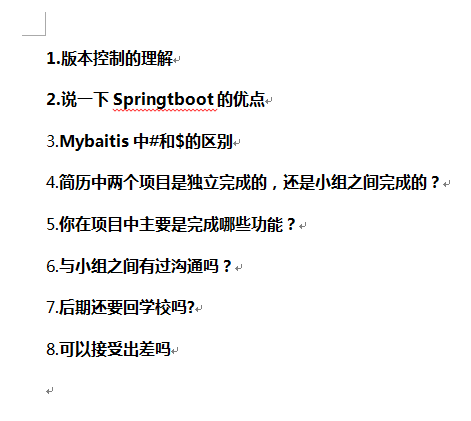

</details>

---

<a id="source-18"></a>

### 合众唯一

**来源：** `合众唯一.jpg`

1. 面向对象的特性。

2. HTTP 协议的构成、请求方式、请求头。

3. CSS 的优先级。

4. CSS 的 float。

5. JSP 内置对象。

6. Session 与 Cookie 的区别。

7. jQuery 的 $(document).ready(function) 的作用及使用原因（原图方法名拼写有误）。

8. 重载与重写的区别。

9. 随机生成 100 以内的 10 个数，用冒泡排序排序。

10. 线程与进程的区别。

#### 补充参考答案（逐项对应）

##### 面向对象的特性。

**参考答案：** 面向过程围绕步骤组织函数；面向对象围绕对象的状态与行为组织程序。封装隐藏实现、保护状态；继承复用并扩展行为；多态允许父类／接口引用指向不同实现，调用被重写的实例方法时按实际对象分派。例：Animal a = new Dog(); a.speak(); 执行 Dog 的实现。Java 类只能继承一个直接父类，但可实现多个接口；接口可继承多个接口。不能笼统认为某一种编程范式必然性能更高。

##### HTTP 协议的构成、请求方式、请求头。

**参考答案：** HTTP 请求包括请求行／方法、头和可选消息体，响应包括状态、头和体。GET 用于读取，POST 常用于创建／动作，PUT 完整替换，PATCH 部分修改，DELETE 删除。TCP 提供有序可靠字节流，连接经三次握手，正常关闭通常经 FIN/ACK；UDP 是数据报，不保证交付与顺序。Socket 是网络编程接口，TCP 或 UDP 都能用，不能说所有 Socket 必然是 TCP。

##### CSS 的优先级。

**参考答案：** 同一来源／层级等条件下，先比较 !important 与普通声明，再比较选择器权重、作用域接近程度与声明顺序；常见权重为 ID 高于类／属性／伪类，高于标签／伪元素，行内样式另考虑。不能只说“越长的选择器越优先”。float 使元素浮动并让文本环绕，可能引起父容器高度塌陷；可用 flow-root 等建立新的块格式化上下文。布局通常优先 Flex／Grid。

##### CSS 的 float。

**参考答案：** 同一来源／层级等条件下，先比较 !important 与普通声明，再比较选择器权重、作用域接近程度与声明顺序；常见权重为 ID 高于类／属性／伪类，高于标签／伪元素，行内样式另考虑。不能只说“越长的选择器越优先”。float 使元素浮动并让文本环绕，可能引起父容器高度塌陷；可用 flow-root 等建立新的块格式化上下文。布局通常优先 Flex／Grid。

##### JSP 内置对象。

**参考答案：** 九大内置对象为 request、response、session、application、pageContext、out、config、page、exception；exception 通常在错误页面可用。getParameter 读取请求参数（主要是字符串），getAttribute 读取服务端在请求等作用域保存的对象。请求范围数据可供同一次转发共享，不等于新一次重定向仍存在。

##### Session 与 Cookie 的区别。

**参考答案：** Cookie 是浏览器保存并按规则发送的数据；Session 是服务器维护的会话，常以 Cookie 中的会话 ID 关联，也可有其他传递方式。关闭浏览器是否删除取决于 Cookie 持久期及恢复行为，不能绝对化。JSP 四大作用域 page、request、session、application；request 对应一次请求，application 对应 Web 应用生命周期。Servlet 由 init → 多次 service → destroy；多请求可能并发执行，应避免实例字段存请求状态。

##### jQuery 的 $(document).ready(function) 的作用及使用原因（原图方法名拼写有误）。

**参考答案：** jQuery 是 JavaScript 库，常用能力包括选择／DOM 操作、事件、Ajax；所谓“三大核心”不是正式固定规范。选择器示例 #id、.class、标签与属性选择器。$("#name").val("张三") 改表单值，.text 改文本，.html 解析 HTML；给不可信内容使用 .text。$(function(){...}) 在 DOM 就绪后执行，不必等图片全部加载。Ajax 是异步网络请求与局部更新模式，同步请求会阻塞；可用 fetch／XMLHttpRequest 或 $.ajax。

[相关代码／实现示例](#program-ajax)。

##### 重载与重写的区别。

**参考答案：** 重载是同名方法的参数列表不同，编译期选择；不能仅靠返回类型重载。重写是子类覆盖可继承的实例方法，签名一致、返回类型可协变、访问权限不能更严格，不能扩大受检异常范围。里氏替换原则要求子类型可替代父类型而不破坏约定；向上转型通常安全，向下转型要确认实际对象类型，可用 instanceof 检查。

##### 随机生成 100 以内的 10 个数，用冒泡排序排序。

**参考答案：** 冒泡反复比较相邻元素并交换，O(n²)，可用是否交换标记提前结束；插入排序对近乎有序数据常有效；快排选枢轴分区再递归，平均 O(n log n)，退化可至 O(n²)，随机化／三路划分可缓解。稳定性、额外空间与数据规模也要比较。手写代码见编程参考答案。

[相关代码／实现示例](#program-algorithms)。

##### 线程与进程的区别。

**参考答案：** 进程是资源与地址空间的隔离单位，线程是执行与调度单位；同进程线程共享堆等资源，但有自己的栈和程序计数器。常见创建方式：继承 Thread、实现 Runnable、Callable 配合 FutureTask／线程池；优先把任务与执行器分开。start 启动线程，直接调用 run 是普通方法调用。任务执行完或响应中断退出，不使用已废弃 stop。

<details>
<summary>查看原图（含原始选项、手写内容或参考图）</summary>

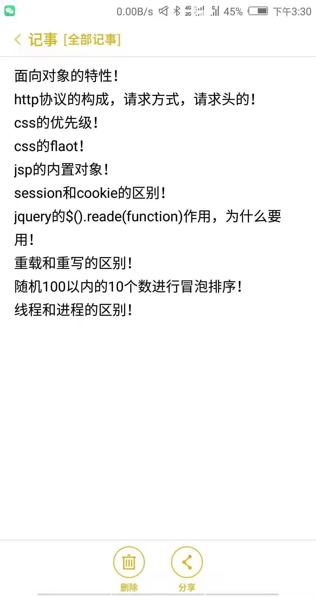

</details>

---

<a id="source-19"></a>

### 华海面试_2021-8-31

**来源：** `华海面试_2021-8-31.docx`

数据量足够大的情况下java集合的特性(例如:千万级数据情况下数组和链表的插入效率)

Redis 数据类型和底层数据结构(例如:zset的底层数据结构)

Mysql索引相关(例如:索引失效的情况)

两个Linux系统之间通信(scp指令)

两个列表组合成一个列表(算法题)

Linux查看mysql的是否运行

Linux查看某个进程占用的端口

Linux系统中一个文件复制到另一个Linux系统怎么操作（命令）

ArrayList和linkedlist的区别

对1亿条数据中间（5000万条）插入一条数据，ArrayList和linkedlist哪个更快

ArrayList和linkedlist哪个占用的空间更大

垃圾回收

垃圾回收算法

哪些可以做GC Root

#### 补充参考答案（逐项对应）

##### 数据量足够大的情况下java集合的特性(例如:千万级数据情况下数组和链表的插入效率)

**参考答案：** ArrayList 随机访问 O(1)，中间插入／删除需要移动后续引用 O(n)，尾部追加均摊 O(1)；LinkedList 定位第 i 个节点 O(n)，已持有节点／迭代器位置后的插入删除 O(1)。从索引定位再在 5000 万位置插入时，两者都可能 O(n)，不能直接断言链表更快；数组局部性通常更好。链表每元素还保存节点及前后引用，通常更占内存；数组也有闲置容量。数据规模改变常数、缓存和 GC 成本，不改变这些渐近复杂度。

##### Redis 数据类型和底层数据结构(例如:zset的底层数据结构)

**参考答案：** Redis 是内存数据结构服务，常用于缓存、计数、限流、会话等。常见基础类型：String、Hash、List、Set、ZSet；还可谈 Bitmap、HyperLogLog、Geo、Stream 等能力，不能说固定只有“八种”。String 可用整数编码或动态字符串表示；小集合与大集合可能使用不同编码。ZSet 常见大规模表示为字典加跳表，小数据可能用紧凑结构。具体底层编码与阈值需按版本说明。

##### Mysql索引相关(例如:索引失效的情况)

**参考答案：** 索引用空间与写入维护成本换取查询效率，常用于高选择性过滤、关联和排序字段。InnoDB 聚簇索引叶子存行，二级索引叶子通常存主键，必要时回表。组合索引关注左前缀、范围与排序条件；函数、隐式类型转换、前置通配符、选择性过低等可能使优化器不选该索引，但不能绝对说某个 SQL 写法必然“失效”。用 EXPLAIN／实际耗时定位，减少无用列、批量处理、避免 N+1。

##### 两个Linux系统之间通信(scp指令)

**参考答案：** pwd 看目录，ls 列文件，cd 切换，cp／mv 复制移动，mkdir 建目录，rm 删除，chmod 改权限，chown／chgrp 改所属。tar -xzf a.tar.gz 解压，ps aux 看进程，ss -lntp 看监听端口，systemctl status mysql／mysqld 看服务（名称依安装），tail -f app.log 跟踪日志。跨机器复制用 scp file user@host:/path/，更大数据可用 rsync；操作前核对路径与权限。

##### 两个列表组合成一个列表(算法题)

**参考答案：** List 表示有序可重复序列；Set 表示不重复元素集合；Map 表示键值映射，不是 Collection 子接口。ArrayList 是动态数组，LinkedList 是双向链表，HashSet 通常基于 HashMap，TreeSet 基于有序树，ArrayDeque 可实现栈或队列。Collections 是工具类；Stream 是数据处理流水线，不是存储容器。

具体代码：`List<T> result = new ArrayList<T>(a); result.addAll(b);`，保留原列表；若要求合并已排序列表，则使用双指针而不是只拼接。另见 [6.3](#program-algorithms)。

##### Linux查看mysql的是否运行

**参考答案：** pwd 看目录，ls 列文件，cd 切换，cp／mv 复制移动，mkdir 建目录，rm 删除，chmod 改权限，chown／chgrp 改所属。tar -xzf a.tar.gz 解压，ps aux 看进程，ss -lntp 看监听端口，systemctl status mysql／mysqld 看服务（名称依安装），tail -f app.log 跟踪日志。跨机器复制用 scp file user@host:/path/，更大数据可用 rsync；操作前核对路径与权限。

##### Linux查看某个进程占用的端口

**参考答案：** pwd 看目录，ls 列文件，cd 切换，cp／mv 复制移动，mkdir 建目录，rm 删除，chmod 改权限，chown／chgrp 改所属。tar -xzf a.tar.gz 解压，ps aux 看进程，ss -lntp 看监听端口，systemctl status mysql／mysqld 看服务（名称依安装），tail -f app.log 跟踪日志。跨机器复制用 scp file user@host:/path/，更大数据可用 rsync；操作前核对路径与权限。

##### Linux系统中一个文件复制到另一个Linux系统怎么操作（命令）

**参考答案：** pwd 看目录，ls 列文件，cd 切换，cp／mv 复制移动，mkdir 建目录，rm 删除，chmod 改权限，chown／chgrp 改所属。tar -xzf a.tar.gz 解压，ps aux 看进程，ss -lntp 看监听端口，systemctl status mysql／mysqld 看服务（名称依安装），tail -f app.log 跟踪日志。跨机器复制用 scp file user@host:/path/，更大数据可用 rsync；操作前核对路径与权限。

##### ArrayList和linkedlist的区别

**参考答案：** ArrayList 随机访问 O(1)，中间插入／删除需要移动后续引用 O(n)，尾部追加均摊 O(1)；LinkedList 定位第 i 个节点 O(n)，已持有节点／迭代器位置后的插入删除 O(1)。从索引定位再在 5000 万位置插入时，两者都可能 O(n)，不能直接断言链表更快；数组局部性通常更好。链表每元素还保存节点及前后引用，通常更占内存；数组也有闲置容量。数据规模改变常数、缓存和 GC 成本，不改变这些渐近复杂度。

##### 对1亿条数据中间（5000万条）插入一条数据，ArrayList和linkedlist哪个更快

**参考答案：** ArrayList 随机访问 O(1)，中间插入／删除需要移动后续引用 O(n)，尾部追加均摊 O(1)；LinkedList 定位第 i 个节点 O(n)，已持有节点／迭代器位置后的插入删除 O(1)。从索引定位再在 5000 万位置插入时，两者都可能 O(n)，不能直接断言链表更快；数组局部性通常更好。链表每元素还保存节点及前后引用，通常更占内存；数组也有闲置容量。数据规模改变常数、缓存和 GC 成本，不改变这些渐近复杂度。

##### ArrayList和linkedlist哪个占用的空间更大

**参考答案：** ArrayList 随机访问 O(1)，中间插入／删除需要移动后续引用 O(n)，尾部追加均摊 O(1)；LinkedList 定位第 i 个节点 O(n)，已持有节点／迭代器位置后的插入删除 O(1)。从索引定位再在 5000 万位置插入时，两者都可能 O(n)，不能直接断言链表更快；数组局部性通常更好。链表每元素还保存节点及前后引用，通常更占内存；数组也有闲置容量。数据规模改变常数、缓存和 GC 成本，不改变这些渐近复杂度。

##### 垃圾回收

**参考答案：** GC 根据从 GC Roots 出发的可达性判断存活；常见 Roots 有线程栈中引用、活跃类的静态引用、JNI 引用等。解除引用可使对象不可达，不能靠“打破 GC Roots 算法”安全回收仍在使用的对象。常见算法包括标记清除、复制、标记整理；收集器实现和分代策略应按版本说明。类加载经历加载、链接（验证、准备、解析）和初始化；双亲委派先委托父加载器，父加载器无法加载时再由当前加载器尝试。

##### 垃圾回收算法

**参考答案：** GC 根据从 GC Roots 出发的可达性判断存活；常见 Roots 有线程栈中引用、活跃类的静态引用、JNI 引用等。解除引用可使对象不可达，不能靠“打破 GC Roots 算法”安全回收仍在使用的对象。常见算法包括标记清除、复制、标记整理；收集器实现和分代策略应按版本说明。类加载经历加载、链接（验证、准备、解析）和初始化；双亲委派先委托父加载器，父加载器无法加载时再由当前加载器尝试。

##### 哪些可以做GC Root

**参考答案：** GC 根据从 GC Roots 出发的可达性判断存活；常见 Roots 有线程栈中引用、活跃类的静态引用、JNI 引用等。解除引用可使对象不可达，不能靠“打破 GC Roots 算法”安全回收仍在使用的对象。常见算法包括标记清除、复制、标记整理；收集器实现和分代策略应按版本说明。类加载经历加载、链接（验证、准备、解析）和初始化；双亲委派先委托父加载器，父加载器无法加载时再由当前加载器尝试。


---

<a id="source-20"></a>

### 华为海洋／华海：索引与并发

**来源：** `华海面试题.jpg`

1. 聚簇索引与非聚簇索引。

2. 线程间如何通信？

3. 如何部署项目到线上，并解决跨域问题？

4. Spring Cloud 如何实现注册中心高可用？

5. Nginx 负载均衡。

6. 如何访问其他公司的数据库？

7. volatile 如何实现可见性？

8. notify 和 notifyAll 的区别，为什么必须在同步代码块中调用？

#### 补充参考答案（逐项对应）

##### 聚簇索引与非聚簇索引。

**参考答案：** 索引用空间与写入维护成本换取查询效率，常用于高选择性过滤、关联和排序字段。InnoDB 聚簇索引叶子存行，二级索引叶子通常存主键，必要时回表。组合索引关注左前缀、范围与排序条件；函数、隐式类型转换、前置通配符、选择性过低等可能使优化器不选该索引，但不能绝对说某个 SQL 写法必然“失效”。用 EXPLAIN／实际耗时定位，减少无用列、批量处理、避免 N+1。

##### 线程间如何通信？

**参考答案：** sleep 是 Thread 的静态方法，不释放已持有的监视器；wait 是 Object 方法，调用者必须持有该对象监视器，等待时释放它并在返回前重新获取。notify 唤醒一个等待线程，notifyAll 唤醒全部等待线程，但线程仍需竞争锁。使用 synchronized 中的 while 检查条件以应对虚假唤醒。更高层通信可用 BlockingQueue、CountDownLatch、Future；共享状态也必须保证可见性。

##### 如何部署项目到线上，并解决跨域问题？

**参考答案：** Nginx 可做反向代理、静态资源服务与负载均衡。常见策略为轮询、权重、最少连接、哈希等。检查配置用 nginx -t，平滑重载用 nginx -s reload；systemd 安装可用 systemctl restart nginx，重启有中断风险。部署时配置域名、TLS、健康检查、日志和回滚；跨域可由同源网关代理或配置严格的 CORS，带凭证时不能随意用通配 Origin。

##### Spring Cloud 如何实现注册中心高可用？

**参考答案：** 注册中心通过多实例部署、复制／共识、客户端重试和本地缓存提高可用性；具体机制取决于实现。传统面试常用 Eureka 偏向可用性、ZooKeeper 使用一致性协议作对比，但 CAP 讨论必须指明分区场景，不能代替实现分析。熔断在失败率过高时暂时拒绝下游调用；降级提供备用响应；重试要设上限并考虑幂等。

##### Nginx 负载均衡。

**参考答案：** Nginx 可做反向代理、静态资源服务与负载均衡。常见策略为轮询、权重、最少连接、哈希等。检查配置用 nginx -t，平滑重载用 nginx -s reload；systemd 安装可用 systemctl restart nginx，重启有中断风险。部署时配置域名、TLS、健康检查、日志和回滚；跨域可由同源网关代理或配置严格的 CORS，带凭证时不能随意用通配 Origin。

##### 如何访问其他公司的数据库？

**参考答案：** 远程失败按请求 ID 检查客户端日志、DNS／网络／TLS、认证、超时、服务状态、接口契约和服务器日志；区分连接超时与读取超时，不盲目无限重试。访问其他公司数据库通常先确认授权、网络白名单／VPN、TLS 与只读账户，优先通过约定 API；不要假设拿到 IP 就能直接连接。

##### volatile 如何实现可见性？

**参考答案：** synchronized 自动加解锁；实例方法／synchronized(this) 锁实例，static synchronized／synchronized(X.class) 锁 Class 对象；不存在锁住整个 JVM 的“全局锁”。ReentrantLock 支持 tryLock、可中断获取、公平模式与多个 Condition，需 finally unlock。volatile 通过内存语义保证可见性和相关有序性，但不使 i++ 原子；读取某次 volatile 写入后的读可看到该写入前的相关更新。

##### notify 和 notifyAll 的区别，为什么必须在同步代码块中调用？

**参考答案：** sleep 是 Thread 的静态方法，不释放已持有的监视器；wait 是 Object 方法，调用者必须持有该对象监视器，等待时释放它并在返回前重新获取。notify 唤醒一个等待线程，notifyAll 唤醒全部等待线程，但线程仍需竞争锁。使用 synchronized 中的 while 检查条件以应对虚假唤醒。更高层通信可用 BlockingQueue、CountDownLatch、Future；共享状态也必须保证可见性。

<details>
<summary>查看原图（含原始选项、手写内容或参考图）</summary>

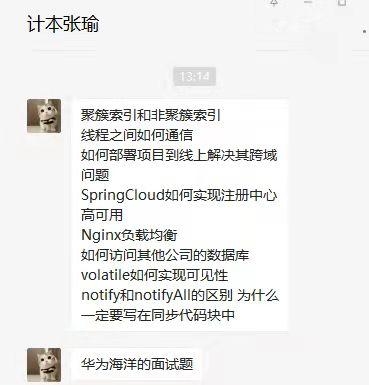

</details>

---

<a id="source-21"></a>

### 嘉嘉康

**来源：** `嘉嘉康 (2).jpg`、`嘉嘉康.jpg`

1. Redis 的了解：缓存击穿、穿透、雪崩。

2. MySQL 索引与内连接、外连接、左连接。

3. 设计模式；单例模式有哪些实现？

4. 阐述 IoC、DI、AOP。

5. Linux 常用操作命令。

6. 常用注解配置，@Service 与 @Controller 的区别。

#### 补充参考答案（逐项对应）

##### Redis 的了解：缓存击穿、穿透、雪崩。

**参考答案：** 穿透是查询不存在数据，使用参数校验、短 TTL 空值缓存、布隆过滤器；击穿是热点失效后并发回源，可用互斥重建、逻辑过期并异步刷新；雪崩是大量过期或服务不可用，可用随机 TTL、高可用、多级缓存、限流降级。布隆过滤器存在误判；互斥重建本身不保证数据库与缓存的强一致。

##### MySQL 索引与内连接、外连接、左连接。

**参考答案：** 索引用空间与写入维护成本换取查询效率，常用于高选择性过滤、关联和排序字段。InnoDB 聚簇索引叶子存行，二级索引叶子通常存主键，必要时回表。组合索引关注左前缀、范围与排序条件；函数、隐式类型转换、前置通配符、选择性过低等可能使优化器不选该索引，但不能绝对说某个 SQL 写法必然“失效”。用 EXPLAIN／实际耗时定位，减少无用列、批量处理、避免 N+1。

##### 设计模式；单例模式有哪些实现？

**参考答案：** 常见 GoF 23 种：创建型单例、工厂方法、抽象工厂、建造者、原型；结构型适配器、桥接、组合、装饰、外观、享元、代理；行为型责任链、命令、解释器、迭代器、中介者、备忘录、观察者、状态、策略、模板方法、访问者。模式不是 Java 专属或必须凑数；Spring 可见工厂、代理、模板、观察者、策略等。Spring 的 singleton 由容器缓存对象保证，不直接等同某个手写单例套路。

[相关代码／实现示例](#program-singleton)。

##### 阐述 IoC、DI、AOP。

**参考答案：** Spring 提供对象容器、依赖注入、事务及相关基础设施。IoC 把对象创建与组装交给容器；DI 是实现 IoC 的方式，常用构造器、Setter、字段注入，构造器注入便于表达必需依赖。AOP 将日志、事务、权限等横切逻辑从业务中抽出，Spring AOP 常用 JDK 接口代理或类代理；同对象内部自调用可能绕过代理。SSM 是 Spring + Spring MVC + MyBatis 的组合。

##### Linux 常用操作命令。

**参考答案：** pwd 看目录，ls 列文件，cd 切换，cp／mv 复制移动，mkdir 建目录，rm 删除，chmod 改权限，chown／chgrp 改所属。tar -xzf a.tar.gz 解压，ps aux 看进程，ss -lntp 看监听端口，systemctl status mysql／mysqld 看服务（名称依安装），tail -f app.log 跟踪日志。跨机器复制用 scp file user@host:/path/，更大数据可用 rsync；操作前核对路径与权限。

##### 常用注解配置，@Service 与 @Controller 的区别。

**参考答案：** Spring singleton 是每个容器、每个 Bean 定义一个实例，由容器保存与复用，不等于 GoF 单例必须私有构造器。默认 @Controller、@Service 等是 singleton；还有 prototype、Web request、session、application、websocket 等作用域。singleton 不代表线程安全，避免保存请求特有的可变字段。@Controller 表示 Web 层，@Service 表示业务层，@Repository 表示持久层。

<details>
<summary>查看原图（含原始选项、手写内容或参考图）</summary>

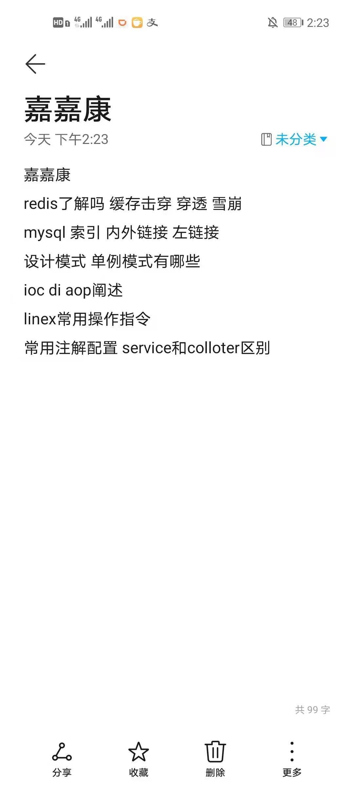

</details>

---

<a id="source-22"></a>

### 金蝶极云

**来源：** `金蝶极云.png`

1. 项目中实现了哪些功能？

2. 数据库知识。

3. Vue。

4. 前后端用什么通信？Ajax 是什么？

5. DB 工具是做什么的？

6. C3P0。

7. 两者的区别（原图未明确指代对象）。

8. 项目实现功能。

9. 数组。

10. 屏幕共享，现场编写代码。

11. Spring MVC。

#### 补充参考答案（逐项对应）

##### 项目中实现了哪些功能？

**参考答案／个人回答模板：** 按背景—目标—职责—行动—结果组织：项目解决［业务问题］，我负责［模块］；困难是［具体故障／约束］，先通过［日志／复现／测量］定位，再采用［方案］，以［测试／指标］验证。明确个人贡献与团队协作，别编造用户量、性能数字或独立完成经历。未做过的技术可回答了解原理及准备如何验证。

##### 数据库知识。

**参考答案：** MySQL 和 Oracle 都是关系数据库，但分页、序列／标识列、类型和事务相关语法不同。InnoDB 支持事务、外键、行锁和 MVCC；MyISAM 以表锁为主，不支持事务。Oracle 全局临时表的定义长期存在，数据可按事务／会话清理；MySQL CREATE TEMPORARY TABLE 的表定义与数据属于当前会话，连接关闭后删除。版本不同需核对具体行为。

##### Vue。

**参考答案：** Vue 可从一小块页面增强逐步采用组件、路由和状态管理，因此称渐进式；核心是声明式渲染与响应式状态驱动视图。Vue 2 常见生命周期为 beforeCreate、created、beforeMount、mounted、beforeUpdate、updated、beforeDestroy、destroyed；Vue 3 对应卸载钩子为 beforeUnmount／unmounted，组合式 API 用 onMounted 等，setup 是入口。Vue 2 用 new Vue 创建实例；Vue 3 用 createApp。

##### 前后端用什么通信？Ajax 是什么？

**参考答案：** jQuery 是 JavaScript 库，常用能力包括选择／DOM 操作、事件、Ajax；所谓“三大核心”不是正式固定规范。选择器示例 #id、.class、标签与属性选择器。$("#name").val("张三") 改表单值，.text 改文本，.html 解析 HTML；给不可信内容使用 .text。$(function(){...}) 在 DOM 就绪后执行，不必等图片全部加载。Ajax 是异步网络请求与局部更新模式，同步请求会阻塞；可用 fetch／XMLHttpRequest 或 $.ajax。

[相关代码／实现示例](#program-ajax)。

##### DB 工具是做什么的？

**参考答案：** Maven 本地仓库存下载的依赖和 install 的构件；远程仓库包含中央仓库及公司私服等，按配置解析依赖并缓存到本地。仓库不是源代码 Git 仓库。C3P0 是 JDBC 连接池，DBUtils 常指简化 JDBC 的工具；它们分别解决连接管理与执行封装，若原题“两个”所指不明，应先确认。

##### C3P0。

**参考答案：** Maven 本地仓库存下载的依赖和 install 的构件；远程仓库包含中央仓库及公司私服等，按配置解析依赖并缓存到本地。仓库不是源代码 Git 仓库。C3P0 是 JDBC 连接池，DBUtils 常指简化 JDBC 的工具；它们分别解决连接管理与执行封装，若原题“两个”所指不明，应先确认。

##### 两者的区别（原图未明确指代对象）。

**参考答案：** 现有记录没有足够条件，不能确定唯一答案或具体实现。面试时先澄清对象、输入、输出、规模与约束，再给条件化方案；本节会列出可回答的知识点，缺失的文字不凭空补成事实。

##### 项目实现功能。

**参考答案／个人回答模板：** 按背景—目标—职责—行动—结果组织：项目解决［业务问题］，我负责［模块］；困难是［具体故障／约束］，先通过［日志／复现／测量］定位，再采用［方案］，以［测试／指标］验证。明确个人贡献与团队协作，别编造用户量、性能数字或独立完成经历。未做过的技术可回答了解原理及准备如何验证。

##### 数组。

**参考答案：** 线性表是一对一的逻辑序列，可用顺序表或链表存储。栈后进先出，用于调用、括号匹配、撤销；队列先进先出，用于缓冲、任务调度、BFS。二叉树每节点最多两个孩子；BST 有键序；AVL 约束高度平衡；红黑树用颜色约束保持近似平衡；B-tree 是多路平衡搜索树，B+tree 的数据记录在叶层、叶子相连，适合磁盘索引与范围扫描。哈希冲突可用链地址或开放寻址处理。

##### 屏幕共享，现场编写代码。

**参考答案／个人回答模板：** 按背景—目标—职责—行动—结果组织：项目解决［业务问题］，我负责［模块］；困难是［具体故障／约束］，先通过［日志／复现／测量］定位，再采用［方案］，以［测试／指标］验证。明确个人贡献与团队协作，别编造用户量、性能数字或独立完成经历。未做过的技术可回答了解原理及准备如何验证。

##### Spring MVC。

**参考答案：** 核心前端控制器为 DispatcherServlet：接收请求 → HandlerMapping 找处理器 → HandlerAdapter 调用 Controller → 返回结果。视图场景解析 ModelAndView 并渲染；@ResponseBody／@RestController 场景由消息转换器序列化为 JSON 等响应。Controller 负责协议与参数，Service 处理业务和事务，DAO／Mapper 访问数据。仅接收 GET 可用 @GetMapping。JSON 请求体用 @RequestBody DTO 接收并校验。

<details>
<summary>查看原图（含原始选项、手写内容或参考图）</summary>

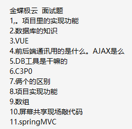

</details>

---

<a id="source-26"></a>

### 灵创智恒：补充问题

**来源：** `灵创智恒2.png`、`灵创智恒\捕获.PNG`

1. 商城数据没有写入数据库时，先保存在哪里？

2. MyBatis 的作用是什么？

3. 对公司的了解。

#### 补充参考答案（逐项对应）

##### 商城数据没有写入数据库时，先保存在哪里？

**参考答案：** 数据可能先在浏览器表单／localStorage、请求 DTO、服务端内存、临时文件、Redis 或消息队列中，取决于流程，不能说一定在某一层。关键是说明何时验证、何时持久化、失败如何恢复。大批量任务应分批／流式处理，控制事务与内存大小，设置幂等键、检查点、失败重试及进度，不一次加载全部记录。

[相关代码／实现示例](#program-batch)。

##### MyBatis 的作用是什么？

**参考答案：** MyBatis 将 SQL 与 Java 映射并封装 JDBC 执行：获取 SqlSession／Mapper 代理 → 定位映射语句 → 绑定参数 → JDBC 执行 → 映射结果。#{x} 形成预编译参数，${x} 是文本替换，不能直接接收不可信输入。列名不同可用别名、resultMap 或开启下划线转驼峰。Mapper XML 可有 resultMap、sql、include、cache、cache-ref、selectKey 和 if／choose／foreach／where／set 等动态元素。

##### 对公司的了解。

**参考答案／个人回答模板：** 公司了解使用已经核实的业务、产品、岗位职责，不按照片中的名字臆造事实。薪资表达“期望［税前区间］，结合职责、城市及总包沟通”，金额由本人确定。反问可问团队职责、试用期目标、技术栈、培养／反馈和后续流程。籍贯、校园人物、地点、遗憾和特殊经历用本人真实故事，不提供虚构标准答案。

<details>
<summary>查看原图（含原始选项、手写内容或参考图）</summary>

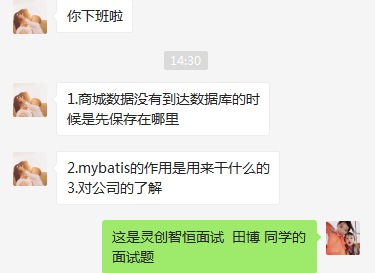

</details>

---

<a id="source-27"></a>

### 多家公司面试题汇总

**来源：** `面试题汇总.jpg`

#### 泛微

1. JavaScript 长度为 5 的数组，删除中间元素有哪些方法？

2. Java 设计模式。

3. MongoDB 与 Redis 的区别。

#### 中软

1. 项目介绍与项目数据库建表。

2. Spring Boot 与 SSM 框架的区别。

#### 亚信

1. 项目中如何实现权限控制？

2. Linux 常用命令。

3. 在哪些场景使用 Redis？

4. MongoDB 与 MySQL 等数据库有什么区别？

#### 公司未注明

1. 数据结构有哪些？

2. 栈与队列的区别及实际应用。

3. IDEA 如何 Debug？能看到哪些信息？

4. JVM 存储区域有哪些？静态变量存在哪里？

5. 内存溢出。

6. 常见排序方法及快速排序原理。

#### 华为海洋

1. Linux 查看 MySQL 是否运行。

2. Linux 查看某进程占用的端口。

3. Linux 系统间如何复制文件？

4. ArrayList 与 LinkedList 的区别。

5. 1 亿条数据的中间（第 5000 万条位置）插入一条数据，哪个集合更快？

6. 两个集合哪个更占空间？

7. 垃圾回收、回收算法、哪些对象可作为 GC Roots？

#### 软通动力

1. 大学三年的成绩排名，大三排名及各科成绩。

2. 实训项目的业务规划与技术使用。

3. 自己的特点或特长。

4. 大学认识的第一个人或印象深刻的人是谁？

5. 最先熟悉的校园地点。

6. 大学做过最特殊或最疯狂的事。

7. 若能重来，哪件事会采取不同做法？会如何做？

8. 对 IT 行业的理解、行业信息来源及下一年计划，是否考研或考公务员。

#### 补充参考答案（逐项对应）

##### JavaScript 长度为 5 的数组，删除中间元素有哪些方法？

**参考答案：** JS 基本类型为 undefined、null、boolean、number、bigint、string、symbol，引用类型为 object。var 通常函数作用域并允许重复声明；let／const 块作用域、有暂时性死区；const 禁止重新绑定，不禁止修改对象内容。删除数组中间元素可用 splice 改原数组，或 filter／切片返回新数组；delete 留下空槽且长度不变。

##### Java 设计模式。

**参考答案：** 常见 GoF 23 种：创建型单例、工厂方法、抽象工厂、建造者、原型；结构型适配器、桥接、组合、装饰、外观、享元、代理；行为型责任链、命令、解释器、迭代器、中介者、备忘录、观察者、状态、策略、模板方法、访问者。模式不是 Java 专属或必须凑数；Spring 可见工厂、代理、模板、观察者、策略等。Spring 的 singleton 由容器缓存对象保证，不直接等同某个手写单例套路。

[相关代码／实现示例](#program-singleton)。

##### MongoDB 与 Redis 的区别。

**参考答案：** MongoDB 以文档为主要数据模型，适合层次化文档与灵活结构查询；MySQL 用关系表、约束和 SQL，适合关系明确的数据；Redis 以内存数据结构与低延迟访问见长。三者在持久化、查询方式与事务边界上不同；不能简单概括为 MongoDB 没有事务或 Redis 只能缓存。选择由业务模型、查询和一致性需求决定。

##### 项目介绍与项目数据库建表。

**参考答案／个人回答模板：** 按背景—目标—职责—行动—结果组织：项目解决［业务问题］，我负责［模块］；困难是［具体故障／约束］，先通过［日志／复现／测量］定位，再采用［方案］，以［测试／指标］验证。明确个人贡献与团队协作，别编造用户量、性能数字或独立完成经历。未做过的技术可回答了解原理及准备如何验证。

##### Spring Boot 与 SSM 框架的区别。

**参考答案：** Spring Boot 基于 Spring，提供约定配置、自动配置、Starter 依赖组合、嵌入式服务及运维支持，减少项目装配工作；它不是替代 Spring。@SpringBootApplication 主要组合 @SpringBootConfiguration、@EnableAutoConfiguration、@ComponentScan。常用 @RestController、@RequestMapping、@GetMapping、@RequestBody、@Configuration、@Bean、@Service、@Repository。MyBatis 配置一般在 application.yml／properties 的 mybatis.* 项和 @MapperScan，SQL 映射在 Mapper XML／注解。

##### 项目中如何实现权限控制？

**参考答案：** 登录时校验密码哈希，创建会话或令牌；拦截器检查认证状态，Service 再校验资源与操作权限。RBAC 将用户关联角色、角色关联权限，前端可据权限显示菜单，但后端仍必须鉴权。未登录购物车可用 localStorage 或匿名标识对应服务端存储，登录后合并；只存在内存里的购物车不能保证重开浏览器后保留。

##### Linux 常用命令。

**参考答案：** pwd 看目录，ls 列文件，cd 切换，cp／mv 复制移动，mkdir 建目录，rm 删除，chmod 改权限，chown／chgrp 改所属。tar -xzf a.tar.gz 解压，ps aux 看进程，ss -lntp 看监听端口，systemctl status mysql／mysqld 看服务（名称依安装），tail -f app.log 跟踪日志。跨机器复制用 scp file user@host:/path/，更大数据可用 rsync；操作前核对路径与权限。

##### 在哪些场景使用 Redis？

**参考答案：** Redis 是内存数据结构服务，常用于缓存、计数、限流、会话等。常见基础类型：String、Hash、List、Set、ZSet；还可谈 Bitmap、HyperLogLog、Geo、Stream 等能力，不能说固定只有“八种”。String 可用整数编码或动态字符串表示；小集合与大集合可能使用不同编码。ZSet 常见大规模表示为字典加跳表，小数据可能用紧凑结构。具体底层编码与阈值需按版本说明。

##### MongoDB 与 MySQL 等数据库有什么区别？

**参考答案：** MongoDB 以文档为主要数据模型，适合层次化文档与灵活结构查询；MySQL 用关系表、约束和 SQL，适合关系明确的数据；Redis 以内存数据结构与低延迟访问见长。三者在持久化、查询方式与事务边界上不同；不能简单概括为 MongoDB 没有事务或 Redis 只能缓存。选择由业务模型、查询和一致性需求决定。

##### 数据结构有哪些？

**参考答案：** 线性表是一对一的逻辑序列，可用顺序表或链表存储。栈后进先出，用于调用、括号匹配、撤销；队列先进先出，用于缓冲、任务调度、BFS。二叉树每节点最多两个孩子；BST 有键序；AVL 约束高度平衡；红黑树用颜色约束保持近似平衡；B-tree 是多路平衡搜索树，B+tree 的数据记录在叶层、叶子相连，适合磁盘索引与范围扫描。哈希冲突可用链地址或开放寻址处理。

##### 栈与队列的区别及实际应用。

**参考答案：** 线性表是一对一的逻辑序列，可用顺序表或链表存储。栈后进先出，用于调用、括号匹配、撤销；队列先进先出，用于缓冲、任务调度、BFS。二叉树每节点最多两个孩子；BST 有键序；AVL 约束高度平衡；红黑树用颜色约束保持近似平衡；B-tree 是多路平衡搜索树，B+tree 的数据记录在叶层、叶子相连，适合磁盘索引与范围扫描。哈希冲突可用链地址或开放寻址处理。

##### IDEA 如何 Debug？能看到哪些信息？

**参考答案：** 先看异常类型、日志和复现场景，区分 Java heap space、Metaspace、无法创建原生线程、StackOverflowError 等。堆泄漏可用堆转储和 GC Roots 引用链定位；频繁 Full GC 检查存活量及分配速率。IDEA Debug 可设置条件断点，查看变量、调用栈和表达式；线上注意暂停线程的影响。定位问题靠证据与验证，不只扩大堆。

##### JVM 存储区域有哪些？静态变量存在哪里？

**参考答案：** 运行时区域包括堆、虚拟机栈、本地方法栈、程序计数器和方法区。HotSpot Java 8 起常用元空间实现方法区；类的静态字段引用与 Class 镜像等具体位置属于实现细节，不应笼统说所有静态变量都在方法区。new 通常先确保类已初始化，再分配对象空间、零值初始化、设置对象头、执行构造器。对象自身通常在堆，局部引用通常在栈帧中。

##### 内存溢出。

**参考答案：** 先看异常类型、日志和复现场景，区分 Java heap space、Metaspace、无法创建原生线程、StackOverflowError 等。堆泄漏可用堆转储和 GC Roots 引用链定位；频繁 Full GC 检查存活量及分配速率。IDEA Debug 可设置条件断点，查看变量、调用栈和表达式；线上注意暂停线程的影响。定位问题靠证据与验证，不只扩大堆。

##### 常见排序方法及快速排序原理。

**参考答案：** 冒泡反复比较相邻元素并交换，O(n²)，可用是否交换标记提前结束；插入排序对近乎有序数据常有效；快排选枢轴分区再递归，平均 O(n log n)，退化可至 O(n²)，随机化／三路划分可缓解。稳定性、额外空间与数据规模也要比较。手写代码见编程参考答案。

[相关代码／实现示例](#program-algorithms)。

##### Linux 查看 MySQL 是否运行。

**参考答案：** pwd 看目录，ls 列文件，cd 切换，cp／mv 复制移动，mkdir 建目录，rm 删除，chmod 改权限，chown／chgrp 改所属。tar -xzf a.tar.gz 解压，ps aux 看进程，ss -lntp 看监听端口，systemctl status mysql／mysqld 看服务（名称依安装），tail -f app.log 跟踪日志。跨机器复制用 scp file user@host:/path/，更大数据可用 rsync；操作前核对路径与权限。

##### Linux 查看某进程占用的端口。

**参考答案：** pwd 看目录，ls 列文件，cd 切换，cp／mv 复制移动，mkdir 建目录，rm 删除，chmod 改权限，chown／chgrp 改所属。tar -xzf a.tar.gz 解压，ps aux 看进程，ss -lntp 看监听端口，systemctl status mysql／mysqld 看服务（名称依安装），tail -f app.log 跟踪日志。跨机器复制用 scp file user@host:/path/，更大数据可用 rsync；操作前核对路径与权限。

##### Linux 系统间如何复制文件？

**参考答案：** pwd 看目录，ls 列文件，cd 切换，cp／mv 复制移动，mkdir 建目录，rm 删除，chmod 改权限，chown／chgrp 改所属。tar -xzf a.tar.gz 解压，ps aux 看进程，ss -lntp 看监听端口，systemctl status mysql／mysqld 看服务（名称依安装），tail -f app.log 跟踪日志。跨机器复制用 scp file user@host:/path/，更大数据可用 rsync；操作前核对路径与权限。

##### ArrayList 与 LinkedList 的区别。

**参考答案：** ArrayList 随机访问 O(1)，中间插入／删除需要移动后续引用 O(n)，尾部追加均摊 O(1)；LinkedList 定位第 i 个节点 O(n)，已持有节点／迭代器位置后的插入删除 O(1)。从索引定位再在 5000 万位置插入时，两者都可能 O(n)，不能直接断言链表更快；数组局部性通常更好。链表每元素还保存节点及前后引用，通常更占内存；数组也有闲置容量。数据规模改变常数、缓存和 GC 成本，不改变这些渐近复杂度。

##### 1 亿条数据的中间（第 5000 万条位置）插入一条数据，哪个集合更快？

**参考答案：** ArrayList 随机访问 O(1)，中间插入／删除需要移动后续引用 O(n)，尾部追加均摊 O(1)；LinkedList 定位第 i 个节点 O(n)，已持有节点／迭代器位置后的插入删除 O(1)。从索引定位再在 5000 万位置插入时，两者都可能 O(n)，不能直接断言链表更快；数组局部性通常更好。链表每元素还保存节点及前后引用，通常更占内存；数组也有闲置容量。数据规模改变常数、缓存和 GC 成本，不改变这些渐近复杂度。

##### 两个集合哪个更占空间？

**参考答案：** ArrayList 随机访问 O(1)，中间插入／删除需要移动后续引用 O(n)，尾部追加均摊 O(1)；LinkedList 定位第 i 个节点 O(n)，已持有节点／迭代器位置后的插入删除 O(1)。从索引定位再在 5000 万位置插入时，两者都可能 O(n)，不能直接断言链表更快；数组局部性通常更好。链表每元素还保存节点及前后引用，通常更占内存；数组也有闲置容量。数据规模改变常数、缓存和 GC 成本，不改变这些渐近复杂度。

##### 垃圾回收、回收算法、哪些对象可作为 GC Roots？

**参考答案：** GC 根据从 GC Roots 出发的可达性判断存活；常见 Roots 有线程栈中引用、活跃类的静态引用、JNI 引用等。解除引用可使对象不可达，不能靠“打破 GC Roots 算法”安全回收仍在使用的对象。常见算法包括标记清除、复制、标记整理；收集器实现和分代策略应按版本说明。类加载经历加载、链接（验证、准备、解析）和初始化；双亲委派先委托父加载器，父加载器无法加载时再由当前加载器尝试。

##### 大学三年的成绩排名，大三排名及各科成绩。

**参考答案／个人回答模板：** 模板：我是［姓名］，就读／毕业于［学校、专业］，主要学习［真实课程］。做过［项目］，负责［具体模块］，用［技术］解决［问题］并通过［测试／结果］验证，希望在［岗位］继续提升。课程、成绩、书籍、C 语言和实习经历均按事实填写，没学过／没读完可坦诚说明；介绍控制在 1～2 分钟。

##### 实训项目的业务规划与技术使用。

**参考答案／个人回答模板：** 按背景—目标—职责—行动—结果组织：项目解决［业务问题］，我负责［模块］；困难是［具体故障／约束］，先通过［日志／复现／测量］定位，再采用［方案］，以［测试／指标］验证。明确个人贡献与团队协作，别编造用户量、性能数字或独立完成经历。未做过的技术可回答了解原理及准备如何验证。

##### 自己的特点或特长。

**参考答案／个人回答模板：** 用真实事件证明优点；缺点说可改进且有行动的问题，例如估时偏乐观，已用任务拆分与风险缓冲改善。压力下先明确优先级、拆任务、及时沟通依赖和风险，不承诺无条件加班。理想团队可强调清晰目标、代码审查、尊重沟通；企业文化谈自己重视的协作、责任和学习，并结合已了解的事实。

##### 大学认识的第一个人或印象深刻的人是谁？

**参考答案／个人回答模板：** 公司了解使用已经核实的业务、产品、岗位职责，不按照片中的名字臆造事实。薪资表达“期望［税前区间］，结合职责、城市及总包沟通”，金额由本人确定。反问可问团队职责、试用期目标、技术栈、培养／反馈和后续流程。籍贯、校园人物、地点、遗憾和特殊经历用本人真实故事，不提供虚构标准答案。

##### 最先熟悉的校园地点。

**参考答案／个人回答模板：** 公司了解使用已经核实的业务、产品、岗位职责，不按照片中的名字臆造事实。薪资表达“期望［税前区间］，结合职责、城市及总包沟通”，金额由本人确定。反问可问团队职责、试用期目标、技术栈、培养／反馈和后续流程。籍贯、校园人物、地点、遗憾和特殊经历用本人真实故事，不提供虚构标准答案。

##### 大学做过最特殊或最疯狂的事。

**参考答案／个人回答模板：** 公司了解使用已经核实的业务、产品、岗位职责，不按照片中的名字臆造事实。薪资表达“期望［税前区间］，结合职责、城市及总包沟通”，金额由本人确定。反问可问团队职责、试用期目标、技术栈、培养／反馈和后续流程。籍贯、校园人物、地点、遗憾和特殊经历用本人真实故事，不提供虚构标准答案。

##### 若能重来，哪件事会采取不同做法？会如何做？

**参考答案／个人回答模板：** 公司了解使用已经核实的业务、产品、岗位职责，不按照片中的名字臆造事实。薪资表达“期望［税前区间］，结合职责、城市及总包沟通”，金额由本人确定。反问可问团队职责、试用期目标、技术栈、培养／反馈和后续流程。籍贯、校园人物、地点、遗憾和特殊经历用本人真实故事，不提供虚构标准答案。

##### 对 IT 行业的理解、行业信息来源及下一年计划，是否考研或考公务员。

**参考答案／个人回答模板：** 先给真实结论，再说明依据。例：“我近期希望扎实做好 Java 后端开发，能独立交付模块；长期根据能力和兴趣发展，不提前承诺管理岗。”城市、定居、返校、考研、入职日期与出差接受度均用［个人实际情况］替换；有约束直接说明可接受的频率／时间，不能替本人作承诺。

<details>
<summary>查看原图（含原始选项、手写内容或参考图）</summary>

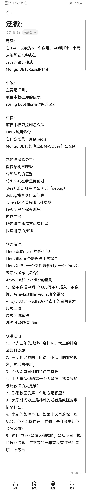

</details>

---

<a id="source-28"></a>

### 面试问题

**来源：** `面试问题.txt`

#### 模拟面试

1.数据结构

2.vue-router

3.mysql和oracle区别

4.springmvc和spring

5.hash

6.servlet生命周期

7.vue构造函数

#### 拓尔思

1.框架的应用

2.线程的创建

3.集合

4.stream

5.接口和抽象类

6.重写重载

7.异常

8.数据库MySQL（索引）

#### 泛微

1.图片上传下载

2.file的api

3.集合hash

4.jvm类加载机制

5.垃圾回收

6.mysql索引

7.StringBuild   StringBuffer  String

8.mysql左连接右连接内连接

9.接口和抽象类

#### 中软审计

1.为什么用Vue

2.前端优化

3.servlet

4.负载均衡算法

5.srpingcloud

6.eureka和zookeeper区别

7.缓存击穿和缓存穿透

8.为什么用redis,在哪用到

#### 华海

1.socket用的是什么连接

2.TCP和UDP

3.堆和栈的区别

4.i++和++i

5.构造函数和析构函数

6.排序算法（快排）

#### 补充参考答案（逐项对应）

##### 数据结构

**参考答案：** 线性表是一对一的逻辑序列，可用顺序表或链表存储。栈后进先出，用于调用、括号匹配、撤销；队列先进先出，用于缓冲、任务调度、BFS。二叉树每节点最多两个孩子；BST 有键序；AVL 约束高度平衡；红黑树用颜色约束保持近似平衡；B-tree 是多路平衡搜索树，B+tree 的数据记录在叶层、叶子相连，适合磁盘索引与范围扫描。哈希冲突可用链地址或开放寻址处理。

##### vue-router

**参考答案：** Vue 可从一小块页面增强逐步采用组件、路由和状态管理，因此称渐进式；核心是声明式渲染与响应式状态驱动视图。Vue 2 常见生命周期为 beforeCreate、created、beforeMount、mounted、beforeUpdate、updated、beforeDestroy、destroyed；Vue 3 对应卸载钩子为 beforeUnmount／unmounted，组合式 API 用 onMounted 等，setup 是入口。Vue 2 用 new Vue 创建实例；Vue 3 用 createApp。

##### mysql和oracle区别

**参考答案：** MySQL 和 Oracle 都是关系数据库，但分页、序列／标识列、类型和事务相关语法不同。InnoDB 支持事务、外键、行锁和 MVCC；MyISAM 以表锁为主，不支持事务。Oracle 全局临时表的定义长期存在，数据可按事务／会话清理；MySQL CREATE TEMPORARY TABLE 的表定义与数据属于当前会话，连接关闭后删除。版本不同需核对具体行为。

##### springmvc和spring

**参考答案：** 核心前端控制器为 DispatcherServlet：接收请求 → HandlerMapping 找处理器 → HandlerAdapter 调用 Controller → 返回结果。视图场景解析 ModelAndView 并渲染；@ResponseBody／@RestController 场景由消息转换器序列化为 JSON 等响应。Controller 负责协议与参数，Service 处理业务和事务，DAO／Mapper 访问数据。仅接收 GET 可用 @GetMapping。JSON 请求体用 @RequestBody DTO 接收并校验。

##### hash

**参考答案：** HashMap 不保证遍历顺序，也不是线程安全的。以 Java 8 常见实现为例，它由桶数组、链表及红黑树组织冲突节点；树化涉及链长阈值与数组容量条件，扩容会重新分配桶。哈希相同仍需 equals 区分键。LinkedHashMap 可保持插入／访问顺序，TreeMap 按键排序。并发共享优先 ConcurrentHashMap；它不接受 null 键和值。Hashtable 与 Vector 对主要方法同步，组合操作不因此自动原子。

##### servlet生命周期

**参考答案：** Cookie 是浏览器保存并按规则发送的数据；Session 是服务器维护的会话，常以 Cookie 中的会话 ID 关联，也可有其他传递方式。关闭浏览器是否删除取决于 Cookie 持久期及恢复行为，不能绝对化。JSP 四大作用域 page、request、session、application；request 对应一次请求，application 对应 Web 应用生命周期。Servlet 由 init → 多次 service → destroy；多请求可能并发执行，应避免实例字段存请求状态。

##### vue构造函数

**参考答案：** Vue 可从一小块页面增强逐步采用组件、路由和状态管理，因此称渐进式；核心是声明式渲染与响应式状态驱动视图。Vue 2 常见生命周期为 beforeCreate、created、beforeMount、mounted、beforeUpdate、updated、beforeDestroy、destroyed；Vue 3 对应卸载钩子为 beforeUnmount／unmounted，组合式 API 用 onMounted 等，setup 是入口。Vue 2 用 new Vue 创建实例；Vue 3 用 createApp。

##### 框架的应用

**参考答案：** Spring 提供对象容器、依赖注入、事务及相关基础设施。IoC 把对象创建与组装交给容器；DI 是实现 IoC 的方式，常用构造器、Setter、字段注入，构造器注入便于表达必需依赖。AOP 将日志、事务、权限等横切逻辑从业务中抽出，Spring AOP 常用 JDK 接口代理或类代理；同对象内部自调用可能绕过代理。SSM 是 Spring + Spring MVC + MyBatis 的组合。

##### 线程的创建

**参考答案：** 进程是资源与地址空间的隔离单位，线程是执行与调度单位；同进程线程共享堆等资源，但有自己的栈和程序计数器。常见创建方式：继承 Thread、实现 Runnable、Callable 配合 FutureTask／线程池；优先把任务与执行器分开。start 启动线程，直接调用 run 是普通方法调用。任务执行完或响应中断退出，不使用已废弃 stop。

##### 集合

**参考答案：** List 表示有序可重复序列；Set 表示不重复元素集合；Map 表示键值映射，不是 Collection 子接口。ArrayList 是动态数组，LinkedList 是双向链表，HashSet 通常基于 HashMap，TreeSet 基于有序树，ArrayDeque 可实现栈或队列。Collections 是工具类；Stream 是数据处理流水线，不是存储容器。

##### stream

**参考答案：** 先确认是 JVM 字节码调用、JNI 还是操作系统调用。JVM 常见 invoke 指令：invokestatic 调静态，invokevirtual 调一般实例，invokeinterface 调接口，invokespecial 用于构造器／特定调用，invokedynamic 用于动态链接等。Stream 用 map／filter 等中间操作构建惰性流水线，再用 collect／reduce／forEach 等终止操作执行；一个 Stream 通常只能消费一次。

##### 接口和抽象类

**参考答案：** 抽象类适合表达“是什么”和共享状态，可有构造器、实例字段、抽象与具体方法；接口适合表达能力契约，一个类可实现多个接口。接口字段隐式为 public static final；Java 8 支持 default／static 方法，Java 9 支持 private 辅助方法。选择依据是是否需要共享状态、统一基类或多个能力组合。

##### 重写重载

**参考答案：** 重载是同名方法的参数列表不同，编译期选择；不能仅靠返回类型重载。重写是子类覆盖可继承的实例方法，签名一致、返回类型可协变、访问权限不能更严格，不能扩大受检异常范围。里氏替换原则要求子类型可替代父类型而不破坏约定；向上转型通常安全，向下转型要确认实际对象类型，可用 instanceof 检查。

##### 异常

**参考答案：** Throwable 分为 Error 和 Exception；受检异常需捕获或声明，RuntimeException 通常表示运行时错误。finally 通常会执行，包括 try 中 return；但 JVM 终止、进程被杀等情况下不能保证。finally 中 return 会覆盖之前的返回值或异常，应避免。资源管理优先 try-with-resources。

##### 数据库MySQL（索引）

**参考答案：** 索引用空间与写入维护成本换取查询效率，常用于高选择性过滤、关联和排序字段。InnoDB 聚簇索引叶子存行，二级索引叶子通常存主键，必要时回表。组合索引关注左前缀、范围与排序条件；函数、隐式类型转换、前置通配符、选择性过低等可能使优化器不选该索引，但不能绝对说某个 SQL 写法必然“失效”。用 EXPLAIN／实际耗时定位，减少无用列、批量处理、避免 N+1。

##### 图片上传下载

**参考答案：** 前端优化包括按需加载与代码分包、图片尺寸／格式压缩、缓存、减少请求、避免昂贵重复渲染，使用性能测量定位。上传使用 multipart/form-data，服务端限制大小与类型、生成存储键并鉴权；下载流式发送且校验权限。Java File 主要描述路径，Files／Path 可进行文件读写。批量工资导出避免全量进内存，可分页读取、流式写出；工资与金额用 BigDecimal／DECIMAL。

[相关代码／实现示例](#program-ajax)。

##### file的api

**参考答案：** 前端优化包括按需加载与代码分包、图片尺寸／格式压缩、缓存、减少请求、避免昂贵重复渲染，使用性能测量定位。上传使用 multipart/form-data，服务端限制大小与类型、生成存储键并鉴权；下载流式发送且校验权限。Java File 主要描述路径，Files／Path 可进行文件读写。批量工资导出避免全量进内存，可分页读取、流式写出；工资与金额用 BigDecimal／DECIMAL。

[相关代码／实现示例](#program-ajax)。

##### 集合hash

**参考答案：** HashMap 不保证遍历顺序，也不是线程安全的。以 Java 8 常见实现为例，它由桶数组、链表及红黑树组织冲突节点；树化涉及链长阈值与数组容量条件，扩容会重新分配桶。哈希相同仍需 equals 区分键。LinkedHashMap 可保持插入／访问顺序，TreeMap 按键排序。并发共享优先 ConcurrentHashMap；它不接受 null 键和值。Hashtable 与 Vector 对主要方法同步，组合操作不因此自动原子。

##### jvm类加载机制

**参考答案：** GC 根据从 GC Roots 出发的可达性判断存活；常见 Roots 有线程栈中引用、活跃类的静态引用、JNI 引用等。解除引用可使对象不可达，不能靠“打破 GC Roots 算法”安全回收仍在使用的对象。常见算法包括标记清除、复制、标记整理；收集器实现和分代策略应按版本说明。类加载经历加载、链接（验证、准备、解析）和初始化；双亲委派先委托父加载器，父加载器无法加载时再由当前加载器尝试。

##### 垃圾回收

**参考答案：** GC 根据从 GC Roots 出发的可达性判断存活；常见 Roots 有线程栈中引用、活跃类的静态引用、JNI 引用等。解除引用可使对象不可达，不能靠“打破 GC Roots 算法”安全回收仍在使用的对象。常见算法包括标记清除、复制、标记整理；收集器实现和分代策略应按版本说明。类加载经历加载、链接（验证、准备、解析）和初始化；双亲委派先委托父加载器，父加载器无法加载时再由当前加载器尝试。

##### mysql索引

**参考答案：** 索引用空间与写入维护成本换取查询效率，常用于高选择性过滤、关联和排序字段。InnoDB 聚簇索引叶子存行，二级索引叶子通常存主键，必要时回表。组合索引关注左前缀、范围与排序条件；函数、隐式类型转换、前置通配符、选择性过低等可能使优化器不选该索引，但不能绝对说某个 SQL 写法必然“失效”。用 EXPLAIN／实际耗时定位，减少无用列、批量处理、避免 N+1。

##### StringBuild   StringBuffer  String

**参考答案：** String 不可变；StringBuilder 可变且不保证线程安全；StringBuffer 的主要方法有同步保护，多步骤组合仍可能需要外部同步。常见反转：new StringBuilder(s).reverse().toString()；处理用户感知字符如组合字符、表情序列时需额外定义反转规则。Lambda 是函数式接口实例的一种写法，例如 list.forEach(x -> System.out.println(x))；捕获的局部变量必须是 final 或 effectively final。

##### mysql左连接右连接内连接

**参考答案：** INNER JOIN 返回匹配行；LEFT JOIN 与 LEFT OUTER JOIN 等价，保留左表所有行；RIGHT JOIN 保留右表。保留未匹配行时，右表过滤通常放 ON，放 WHERE 可能把外连接变成内连接。例：SELECT e.name,d.name FROM employee e LEFT JOIN department d ON e.dept_id=d.id; 三种连接根据是否需要保留未匹配记录选择。

##### 接口和抽象类

**参考答案：** 抽象类适合表达“是什么”和共享状态，可有构造器、实例字段、抽象与具体方法；接口适合表达能力契约，一个类可实现多个接口。接口字段隐式为 public static final；Java 8 支持 default／static 方法，Java 9 支持 private 辅助方法。选择依据是是否需要共享状态、统一基类或多个能力组合。

##### 为什么用Vue

**参考答案：** Vue 可从一小块页面增强逐步采用组件、路由和状态管理，因此称渐进式；核心是声明式渲染与响应式状态驱动视图。Vue 2 常见生命周期为 beforeCreate、created、beforeMount、mounted、beforeUpdate、updated、beforeDestroy、destroyed；Vue 3 对应卸载钩子为 beforeUnmount／unmounted，组合式 API 用 onMounted 等，setup 是入口。Vue 2 用 new Vue 创建实例；Vue 3 用 createApp。

##### 前端优化

**参考答案：** 前端优化包括按需加载与代码分包、图片尺寸／格式压缩、缓存、减少请求、避免昂贵重复渲染，使用性能测量定位。上传使用 multipart/form-data，服务端限制大小与类型、生成存储键并鉴权；下载流式发送且校验权限。Java File 主要描述路径，Files／Path 可进行文件读写。批量工资导出避免全量进内存，可分页读取、流式写出；工资与金额用 BigDecimal／DECIMAL。

[相关代码／实现示例](#program-ajax)。

##### servlet

**参考答案：** Cookie 是浏览器保存并按规则发送的数据；Session 是服务器维护的会话，常以 Cookie 中的会话 ID 关联，也可有其他传递方式。关闭浏览器是否删除取决于 Cookie 持久期及恢复行为，不能绝对化。JSP 四大作用域 page、request、session、application；request 对应一次请求，application 对应 Web 应用生命周期。Servlet 由 init → 多次 service → destroy；多请求可能并发执行，应避免实例字段存请求状态。

##### 负载均衡算法

**参考答案：** Nginx 可做反向代理、静态资源服务与负载均衡。常见策略为轮询、权重、最少连接、哈希等。检查配置用 nginx -t，平滑重载用 nginx -s reload；systemd 安装可用 systemctl restart nginx，重启有中断风险。部署时配置域名、TLS、健康检查、日志和回滚；跨域可由同源网关代理或配置严格的 CORS，带凭证时不能随意用通配 Origin。

##### srpingcloud

**参考答案：** 微服务按业务能力拆成可独立部署的服务，通过 API／消息协作；收益是独立演进与扩展，代价是网络故障、分布式一致性、可观测性和运维复杂度。Spring Boot 构建应用，Spring Cloud 提供服务协作相关集成；常见能力为注册发现、配置、网关、声明式调用、负载均衡和容错。组件与版本演进很快，不把早期 Netflix 套件当当前固定清单。

##### eureka和zookeeper区别

**参考答案：** 注册中心通过多实例部署、复制／共识、客户端重试和本地缓存提高可用性；具体机制取决于实现。传统面试常用 Eureka 偏向可用性、ZooKeeper 使用一致性协议作对比，但 CAP 讨论必须指明分区场景，不能代替实现分析。熔断在失败率过高时暂时拒绝下游调用；降级提供备用响应；重试要设上限并考虑幂等。

##### 缓存击穿和缓存穿透

**参考答案：** 穿透是查询不存在数据，使用参数校验、短 TTL 空值缓存、布隆过滤器；击穿是热点失效后并发回源，可用互斥重建、逻辑过期并异步刷新；雪崩是大量过期或服务不可用，可用随机 TTL、高可用、多级缓存、限流降级。布隆过滤器存在误判；互斥重建本身不保证数据库与缓存的强一致。

##### 为什么用redis,在哪用到

**参考答案：** Redis 是内存数据结构服务，常用于缓存、计数、限流、会话等。常见基础类型：String、Hash、List、Set、ZSet；还可谈 Bitmap、HyperLogLog、Geo、Stream 等能力，不能说固定只有“八种”。String 可用整数编码或动态字符串表示；小集合与大集合可能使用不同编码。ZSet 常见大规模表示为字典加跳表，小数据可能用紧凑结构。具体底层编码与阈值需按版本说明。

##### socket用的是什么连接

**参考答案：** HTTP 请求包括请求行／方法、头和可选消息体，响应包括状态、头和体。GET 用于读取，POST 常用于创建／动作，PUT 完整替换，PATCH 部分修改，DELETE 删除。TCP 提供有序可靠字节流，连接经三次握手，正常关闭通常经 FIN/ACK；UDP 是数据报，不保证交付与顺序。Socket 是网络编程接口，TCP 或 UDP 都能用，不能说所有 Socket 必然是 TCP。

##### TCP和UDP

**参考答案：** HTTP 请求包括请求行／方法、头和可选消息体，响应包括状态、头和体。GET 用于读取，POST 常用于创建／动作，PUT 完整替换，PATCH 部分修改，DELETE 删除。TCP 提供有序可靠字节流，连接经三次握手，正常关闭通常经 FIN/ACK；UDP 是数据报，不保证交付与顺序。Socket 是网络编程接口，TCP 或 UDP 都能用，不能说所有 Socket 必然是 TCP。

##### 堆和栈的区别

**参考答案：** 运行时区域包括堆、虚拟机栈、本地方法栈、程序计数器和方法区。HotSpot Java 8 起常用元空间实现方法区；类的静态字段引用与 Class 镜像等具体位置属于实现细节，不应笼统说所有静态变量都在方法区。new 通常先确保类已初始化，再分配对象空间、零值初始化、设置对象头、执行构造器。对象自身通常在堆，局部引用通常在栈帧中。

##### i++和++i

**参考答案：** 作为独立语句时都会加 1；在表达式中，i++ 先产生旧值再递增，++i 先递增再产生新值。例如 i=1：x=i++ 后 x=1、i=2；x=++i 后 x=2、i=2。它们都不是对共享变量的原子复合操作。

##### 构造函数和析构函数

**参考答案：** final 修饰类则不能被继承，修饰方法则不能被重写，修饰变量则只能赋值一次；final 引用不代表对象内部不可变。static 成员属于类，实例共享同一静态字段，静态方法无 this，不能直接访问实例字段。构造器初始化对象、没有返回类型，可以重载；Java 没有 C++ 式确定性析构函数，文件／连接应通过 AutoCloseable 与 try-with-resources 关闭，不依赖 finalize。

##### 排序算法（快排）

**参考答案：** 冒泡反复比较相邻元素并交换，O(n²)，可用是否交换标记提前结束；插入排序对近乎有序数据常有效；快排选枢轴分区再递归，平均 O(n log n)，退化可至 O(n²)，随机化／三路划分可缓解。稳定性、额外空间与数据规模也要比较。手写代码见编程参考答案。

[相关代码／实现示例](#program-algorithms)。


---

<a id="source-29"></a>

### 鹏升科技

**来源：** `鹏升科技面试题.jpg`

#### 技术

1. Oracle 与 MySQL 创建临时表有什么区别？

2. 如何对数据库信息去重？

3. 如何用 INSERT 语句去重？

4. 视图、存储过程、触发器的理解及项目使用。

5. Redis 内存如何设置？

6. 如何在 Redis 中存储用户账号密码？（按原题保留）

7. 对 Vue 的了解。

8. 项目是否使用前后端分离？

9. 如何处理大批量数据？

10. 根据用户权限显示不同界面，如何实现？

11. 财务模块工资详情与导出，如何实现？

#### 人事

1. 自我介绍。

2. 籍贯。

3. 是否打算到北京发展？

4. 期望薪资。

5. 自己的特点。

#### 补充参考答案（逐项对应）

##### Oracle 与 MySQL 创建临时表有什么区别？

**参考答案：** MySQL 和 Oracle 都是关系数据库，但分页、序列／标识列、类型和事务相关语法不同。InnoDB 支持事务、外键、行锁和 MVCC；MyISAM 以表锁为主，不支持事务。Oracle 全局临时表的定义长期存在，数据可按事务／会话清理；MySQL CREATE TEMPORARY TABLE 的表定义与数据属于当前会话，连接关闭后删除。版本不同需核对具体行为。

##### 如何对数据库信息去重？

**参考答案：** 查询去重用 DISTINCT 或 GROUP BY；清理历史重复需先确定唯一业务键与保留规则。防止并发重复插入依靠 UNIQUE 约束，而非仅先查后插。MySQL 可根据语义使用 INSERT ... ON DUPLICATE KEY UPDATE；INSERT IGNORE 可能抑制其他错误，需谨慎。视图封装查询；存储过程封装数据库执行逻辑；触发器自动响应事件，隐式副作用较多。

##### 如何用 INSERT 语句去重？

**参考答案：** 查询去重用 DISTINCT 或 GROUP BY；清理历史重复需先确定唯一业务键与保留规则。防止并发重复插入依靠 UNIQUE 约束，而非仅先查后插。MySQL 可根据语义使用 INSERT ... ON DUPLICATE KEY UPDATE；INSERT IGNORE 可能抑制其他错误，需谨慎。视图封装查询；存储过程封装数据库执行逻辑；触发器自动响应事件，隐式副作用较多。

##### 视图、存储过程、触发器的理解及项目使用。

**参考答案：** 查询去重用 DISTINCT 或 GROUP BY；清理历史重复需先确定唯一业务键与保留规则。防止并发重复插入依靠 UNIQUE 约束，而非仅先查后插。MySQL 可根据语义使用 INSERT ... ON DUPLICATE KEY UPDATE；INSERT IGNORE 可能抑制其他错误，需谨慎。视图封装查询；存储过程封装数据库执行逻辑；触发器自动响应事件，隐式副作用较多。

##### Redis 内存如何设置？

**参考答案：** 用 maxmemory 限制内存，并根据业务配置淘汰策略；过期删除与达到容量时的淘汰是两件事。RDB 保存时间点快照，AOF 记录写命令；两者可组合，取舍由恢复时间、磁盘和可接受丢失窗口决定。主从复制提供冗余，Sentinel 监控并自动切主，Cluster 分片并支持故障转移。复制通常异步，故障切换仍可能丢失已确认写入。

##### 如何在 Redis 中存储用户账号密码？（按原题保留）

**参考答案：** 持久账户信息应保存在受控数据库，密码存放带盐的自适应密码哈希（如 bcrypt、Argon2），不要存明文或可逆密码。Redis 更适合存会话 ID、短期令牌状态、验证码与限流计数，并设置 TTL。若题目要求缓存账号记录，缓存必要非敏感字段，避免把登录密码直接作为 Redis 值。

##### 对 Vue 的了解。

**参考答案：** Vue 可从一小块页面增强逐步采用组件、路由和状态管理，因此称渐进式；核心是声明式渲染与响应式状态驱动视图。Vue 2 常见生命周期为 beforeCreate、created、beforeMount、mounted、beforeUpdate、updated、beforeDestroy、destroyed；Vue 3 对应卸载钩子为 beforeUnmount／unmounted，组合式 API 用 onMounted 等，setup 是入口。Vue 2 用 new Vue 创建实例；Vue 3 用 createApp。

##### 项目是否使用前后端分离？

**参考答案／个人回答模板：** 按背景—目标—职责—行动—结果组织：项目解决［业务问题］，我负责［模块］；困难是［具体故障／约束］，先通过［日志／复现／测量］定位，再采用［方案］，以［测试／指标］验证。明确个人贡献与团队协作，别编造用户量、性能数字或独立完成经历。未做过的技术可回答了解原理及准备如何验证。

##### 如何处理大批量数据？

**参考答案：** 数据可能先在浏览器表单／localStorage、请求 DTO、服务端内存、临时文件、Redis 或消息队列中，取决于流程，不能说一定在某一层。关键是说明何时验证、何时持久化、失败如何恢复。大批量任务应分批／流式处理，控制事务与内存大小，设置幂等键、检查点、失败重试及进度，不一次加载全部记录。

[相关代码／实现示例](#program-batch)。

##### 根据用户权限显示不同界面，如何实现？

**参考答案：** 登录时校验密码哈希，创建会话或令牌；拦截器检查认证状态，Service 再校验资源与操作权限。RBAC 将用户关联角色、角色关联权限，前端可据权限显示菜单，但后端仍必须鉴权。未登录购物车可用 localStorage 或匿名标识对应服务端存储，登录后合并；只存在内存里的购物车不能保证重开浏览器后保留。

##### 财务模块工资详情与导出，如何实现？

**参考答案：** 前端优化包括按需加载与代码分包、图片尺寸／格式压缩、缓存、减少请求、避免昂贵重复渲染，使用性能测量定位。上传使用 multipart/form-data，服务端限制大小与类型、生成存储键并鉴权；下载流式发送且校验权限。Java File 主要描述路径，Files／Path 可进行文件读写。批量工资导出避免全量进内存，可分页读取、流式写出；工资与金额用 BigDecimal／DECIMAL。

[相关代码／实现示例](#program-ajax)。

##### 自我介绍。

**参考答案／个人回答模板：** 模板：我是［姓名］，就读／毕业于［学校、专业］，主要学习［真实课程］。做过［项目］，负责［具体模块］，用［技术］解决［问题］并通过［测试／结果］验证，希望在［岗位］继续提升。课程、成绩、书籍、C 语言和实习经历均按事实填写，没学过／没读完可坦诚说明；介绍控制在 1～2 分钟。

##### 籍贯。

**参考答案／个人回答模板：** 公司了解使用已经核实的业务、产品、岗位职责，不按照片中的名字臆造事实。薪资表达“期望［税前区间］，结合职责、城市及总包沟通”，金额由本人确定。反问可问团队职责、试用期目标、技术栈、培养／反馈和后续流程。籍贯、校园人物、地点、遗憾和特殊经历用本人真实故事，不提供虚构标准答案。

##### 是否打算到北京发展？

**参考答案／个人回答模板：** 先给真实结论，再说明依据。例：“我近期希望扎实做好 Java 后端开发，能独立交付模块；长期根据能力和兴趣发展，不提前承诺管理岗。”城市、定居、返校、考研、入职日期与出差接受度均用［个人实际情况］替换；有约束直接说明可接受的频率／时间，不能替本人作承诺。

##### 期望薪资。

**参考答案／个人回答模板：** 公司了解使用已经核实的业务、产品、岗位职责，不按照片中的名字臆造事实。薪资表达“期望［税前区间］，结合职责、城市及总包沟通”，金额由本人确定。反问可问团队职责、试用期目标、技术栈、培养／反馈和后续流程。籍贯、校园人物、地点、遗憾和特殊经历用本人真实故事，不提供虚构标准答案。

##### 自己的特点。

**参考答案／个人回答模板：** 用真实事件证明优点；缺点说可改进且有行动的问题，例如估时偏乐观，已用任务拆分与风险缓冲改善。压力下先明确优先级、拆任务、及时沟通依赖和风险，不承诺无条件加班。理想团队可强调清晰目标、代码审查、尊重沟通；企业文化谈自己重视的协作、责任和学习，并结合已了解的事实。

<details>
<summary>查看原图（含原始选项、手写内容或参考图）</summary>

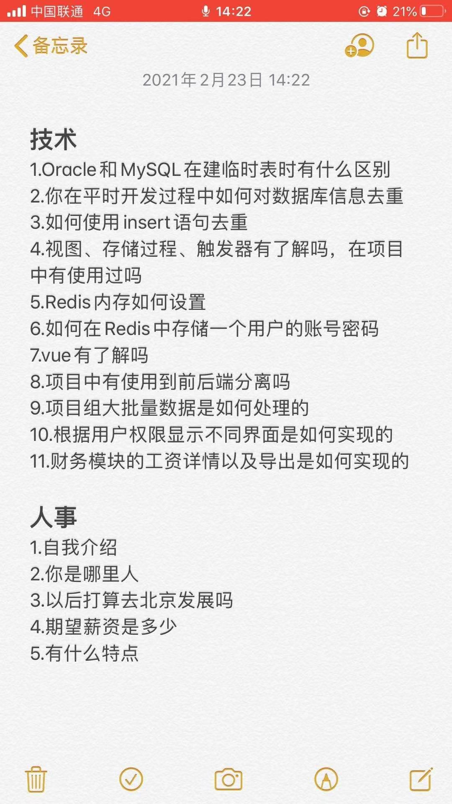

</details>

---

<a id="source-30"></a>

### 普元一面

**来源：** `普元一面.txt`

1、自我介绍

2、mysql如何实现去重

3、单例模式，说出一种实现的代码（完整代码）

4、mysql左连接右连接内连接（代码怎么写）

5、实现线程的方式

6、如何写日志

7、Springboot注解的关键字

8、SpringCloud微服务分布式

9、使用到的中间件

10、如何看待企业文化

#### 补充参考答案（逐项对应）

##### 自我介绍

**参考答案／个人回答模板：** 模板：我是［姓名］，就读／毕业于［学校、专业］，主要学习［真实课程］。做过［项目］，负责［具体模块］，用［技术］解决［问题］并通过［测试／结果］验证，希望在［岗位］继续提升。课程、成绩、书籍、C 语言和实习经历均按事实填写，没学过／没读完可坦诚说明；介绍控制在 1～2 分钟。

##### mysql如何实现去重

**参考答案：** 查询去重用 DISTINCT 或 GROUP BY；清理历史重复需先确定唯一业务键与保留规则。防止并发重复插入依靠 UNIQUE 约束，而非仅先查后插。MySQL 可根据语义使用 INSERT ... ON DUPLICATE KEY UPDATE；INSERT IGNORE 可能抑制其他错误，需谨慎。视图封装查询；存储过程封装数据库执行逻辑；触发器自动响应事件，隐式副作用较多。

##### 单例模式，说出一种实现的代码（完整代码）

**参考答案：** 常见 GoF 23 种：创建型单例、工厂方法、抽象工厂、建造者、原型；结构型适配器、桥接、组合、装饰、外观、享元、代理；行为型责任链、命令、解释器、迭代器、中介者、备忘录、观察者、状态、策略、模板方法、访问者。模式不是 Java 专属或必须凑数；Spring 可见工厂、代理、模板、观察者、策略等。Spring 的 singleton 由容器缓存对象保证，不直接等同某个手写单例套路。

[相关代码／实现示例](#program-singleton)。

##### mysql左连接右连接内连接（代码怎么写）

**参考答案：** INNER JOIN 返回匹配行；LEFT JOIN 与 LEFT OUTER JOIN 等价，保留左表所有行；RIGHT JOIN 保留右表。保留未匹配行时，右表过滤通常放 ON，放 WHERE 可能把外连接变成内连接。例：SELECT e.name,d.name FROM employee e LEFT JOIN department d ON e.dept_id=d.id; 三种连接根据是否需要保留未匹配记录选择。

##### 实现线程的方式

**参考答案：** 进程是资源与地址空间的隔离单位，线程是执行与调度单位；同进程线程共享堆等资源，但有自己的栈和程序计数器。常见创建方式：继承 Thread、实现 Runnable、Callable 配合 FutureTask／线程池；优先把任务与执行器分开。start 启动线程，直接调用 run 是普通方法调用。任务执行完或响应中断退出，不使用已废弃 stop。

##### 如何写日志

**参考答案：** 版本控制记录变化、分支、合并和历史追踪。Git 常用 add、commit、branch／switch、merge／rebase、log、diff；团队通过约定分支、PR 审查、冲突沟通和可重复构建协作。回答协作经历时说明自己承担的功能、接口契约、问题及验证，不只说“都做过”。

##### Springboot注解的关键字

**参考答案：** Spring Boot 基于 Spring，提供约定配置、自动配置、Starter 依赖组合、嵌入式服务及运维支持，减少项目装配工作；它不是替代 Spring。@SpringBootApplication 主要组合 @SpringBootConfiguration、@EnableAutoConfiguration、@ComponentScan。常用 @RestController、@RequestMapping、@GetMapping、@RequestBody、@Configuration、@Bean、@Service、@Repository。MyBatis 配置一般在 application.yml／properties 的 mybatis.* 项和 @MapperScan，SQL 映射在 Mapper XML／注解。

##### SpringCloud微服务分布式

**参考答案：** 微服务按业务能力拆成可独立部署的服务，通过 API／消息协作；收益是独立演进与扩展，代价是网络故障、分布式一致性、可观测性和运维复杂度。Spring Boot 构建应用，Spring Cloud 提供服务协作相关集成；常见能力为注册发现、配置、网关、声明式调用、负载均衡和容错。组件与版本演进很快，不把早期 Netflix 套件当当前固定清单。

##### 使用到的中间件

**参考答案：** 中间件示例：Redis 缓存、MQ 消息、数据库连接池、注册中心、网关。MQ 常用于解耦、异步和削峰；可靠性需生产确认、持久化、消费者处理成功后确认，失败重试与死信处理。全局严格顺序成本高，通常按业务键分区并在分区内串行；消费者应幂等以处理重复消息。按自己真实使用经历说明，未用过的不能冒充实战。

##### 如何看待企业文化

**参考答案／个人回答模板：** 用真实事件证明优点；缺点说可改进且有行动的问题，例如估时偏乐观，已用任务拆分与风险缓冲改善。压力下先明确优先级、拆任务、及时沟通依赖和风险，不承诺无条件加班。理想团队可强调清晰目标、代码审查、尊重沟通；企业文化谈自己重视的协作、责任和学习，并结合已了解的事实。


---

<a id="source-31"></a>

### 企业面试问题

**来源：** `企业面试问题.txt`

#### 华海

1、redis的基本数据类型

2、讲一讲redis中String类型的数据结构

3、讲一讲Threadlocal，以及底层原理

4、讲一下集合

5、说一说ArrayList和LinkedList的区别

6、在百万级数据量中，LinkedList和ArrayList特性还存在吗

7、MySQL的索引

8、简单说一下如何优化sql语句

9、Spring中Bean的作用域

10、说一下HashMap

#### 泛微

1、Jsp的九大内置对象

2、说一下HashMap的底层实现

3、MySQL数据库引擎

4、MySQL索引

5、MyBatis的分页

6、MySQL如何快速查询一条数据

7、如何进行多表联查

8、Linux的删除、解压、修改权限、修改所属组命令

#### 中软

1、JQuery三大核心

2、说一下Vue的渐进式

3、说一下SpringMVC的核心

#### 恒银金融

1、Session的机制

2、SpringMVC的流程

#### 补充参考答案（逐项对应）

##### redis的基本数据类型

**参考答案：** Redis 是内存数据结构服务，常用于缓存、计数、限流、会话等。常见基础类型：String、Hash、List、Set、ZSet；还可谈 Bitmap、HyperLogLog、Geo、Stream 等能力，不能说固定只有“八种”。String 可用整数编码或动态字符串表示；小集合与大集合可能使用不同编码。ZSet 常见大规模表示为字典加跳表，小数据可能用紧凑结构。具体底层编码与阈值需按版本说明。

##### 讲一讲redis中String类型的数据结构

**参考答案：** Redis 是内存数据结构服务，常用于缓存、计数、限流、会话等。常见基础类型：String、Hash、List、Set、ZSet；还可谈 Bitmap、HyperLogLog、Geo、Stream 等能力，不能说固定只有“八种”。String 可用整数编码或动态字符串表示；小集合与大集合可能使用不同编码。ZSet 常见大规模表示为字典加跳表，小数据可能用紧凑结构。具体底层编码与阈值需按版本说明。

##### 讲一讲Threadlocal，以及底层原理

**参考答案：** Java 线程状态为 NEW、RUNNABLE、BLOCKED、WAITING、TIMED_WAITING、TERMINATED；RUNNABLE 包含 JVM 定义下的运行／就绪。ThreadLocal 为每个线程保存独立值，通常在 Thread 的 ThreadLocalMap 中以 ThreadLocal 弱引用为键，值不是弱引用；线程池复用时应 finally 调用 remove，防止上下文串用或保留对象。跨线程传递优先显式参数或消息。

##### 讲一下集合

**参考答案：** List 表示有序可重复序列；Set 表示不重复元素集合；Map 表示键值映射，不是 Collection 子接口。ArrayList 是动态数组，LinkedList 是双向链表，HashSet 通常基于 HashMap，TreeSet 基于有序树，ArrayDeque 可实现栈或队列。Collections 是工具类；Stream 是数据处理流水线，不是存储容器。

##### 说一说ArrayList和LinkedList的区别

**参考答案：** ArrayList 随机访问 O(1)，中间插入／删除需要移动后续引用 O(n)，尾部追加均摊 O(1)；LinkedList 定位第 i 个节点 O(n)，已持有节点／迭代器位置后的插入删除 O(1)。从索引定位再在 5000 万位置插入时，两者都可能 O(n)，不能直接断言链表更快；数组局部性通常更好。链表每元素还保存节点及前后引用，通常更占内存；数组也有闲置容量。数据规模改变常数、缓存和 GC 成本，不改变这些渐近复杂度。

##### 在百万级数据量中，LinkedList和ArrayList特性还存在吗

**参考答案：** ArrayList 随机访问 O(1)，中间插入／删除需要移动后续引用 O(n)，尾部追加均摊 O(1)；LinkedList 定位第 i 个节点 O(n)，已持有节点／迭代器位置后的插入删除 O(1)。从索引定位再在 5000 万位置插入时，两者都可能 O(n)，不能直接断言链表更快；数组局部性通常更好。链表每元素还保存节点及前后引用，通常更占内存；数组也有闲置容量。数据规模改变常数、缓存和 GC 成本，不改变这些渐近复杂度。

##### MySQL的索引

**参考答案：** 索引用空间与写入维护成本换取查询效率，常用于高选择性过滤、关联和排序字段。InnoDB 聚簇索引叶子存行，二级索引叶子通常存主键，必要时回表。组合索引关注左前缀、范围与排序条件；函数、隐式类型转换、前置通配符、选择性过低等可能使优化器不选该索引，但不能绝对说某个 SQL 写法必然“失效”。用 EXPLAIN／实际耗时定位，减少无用列、批量处理、避免 N+1。

##### 简单说一下如何优化sql语句

**参考答案：** 索引用空间与写入维护成本换取查询效率，常用于高选择性过滤、关联和排序字段。InnoDB 聚簇索引叶子存行，二级索引叶子通常存主键，必要时回表。组合索引关注左前缀、范围与排序条件；函数、隐式类型转换、前置通配符、选择性过低等可能使优化器不选该索引，但不能绝对说某个 SQL 写法必然“失效”。用 EXPLAIN／实际耗时定位，减少无用列、批量处理、避免 N+1。

##### Spring中Bean的作用域

**参考答案：** Spring singleton 是每个容器、每个 Bean 定义一个实例，由容器保存与复用，不等于 GoF 单例必须私有构造器。默认 @Controller、@Service 等是 singleton；还有 prototype、Web request、session、application、websocket 等作用域。singleton 不代表线程安全，避免保存请求特有的可变字段。@Controller 表示 Web 层，@Service 表示业务层，@Repository 表示持久层。

##### 说一下HashMap

**参考答案：** HashMap 不保证遍历顺序，也不是线程安全的。以 Java 8 常见实现为例，它由桶数组、链表及红黑树组织冲突节点；树化涉及链长阈值与数组容量条件，扩容会重新分配桶。哈希相同仍需 equals 区分键。LinkedHashMap 可保持插入／访问顺序，TreeMap 按键排序。并发共享优先 ConcurrentHashMap；它不接受 null 键和值。Hashtable 与 Vector 对主要方法同步，组合操作不因此自动原子。

##### Jsp的九大内置对象

**参考答案：** 九大内置对象为 request、response、session、application、pageContext、out、config、page、exception；exception 通常在错误页面可用。getParameter 读取请求参数（主要是字符串），getAttribute 读取服务端在请求等作用域保存的对象。请求范围数据可供同一次转发共享，不等于新一次重定向仍存在。

##### 说一下HashMap的底层实现

**参考答案：** HashMap 不保证遍历顺序，也不是线程安全的。以 Java 8 常见实现为例，它由桶数组、链表及红黑树组织冲突节点；树化涉及链长阈值与数组容量条件，扩容会重新分配桶。哈希相同仍需 equals 区分键。LinkedHashMap 可保持插入／访问顺序，TreeMap 按键排序。并发共享优先 ConcurrentHashMap；它不接受 null 键和值。Hashtable 与 Vector 对主要方法同步，组合操作不因此自动原子。

##### MySQL数据库引擎

**参考答案：** MySQL 和 Oracle 都是关系数据库，但分页、序列／标识列、类型和事务相关语法不同。InnoDB 支持事务、外键、行锁和 MVCC；MyISAM 以表锁为主，不支持事务。Oracle 全局临时表的定义长期存在，数据可按事务／会话清理；MySQL CREATE TEMPORARY TABLE 的表定义与数据属于当前会话，连接关闭后删除。版本不同需核对具体行为。

##### MySQL索引

**参考答案：** 索引用空间与写入维护成本换取查询效率，常用于高选择性过滤、关联和排序字段。InnoDB 聚簇索引叶子存行，二级索引叶子通常存主键，必要时回表。组合索引关注左前缀、范围与排序条件；函数、隐式类型转换、前置通配符、选择性过低等可能使优化器不选该索引，但不能绝对说某个 SQL 写法必然“失效”。用 EXPLAIN／实际耗时定位，减少无用列、批量处理、避免 N+1。

##### MyBatis的分页

**参考答案：** 物理分页由数据库只返回目标页，例如 LIMIT 20 OFFSET 40；逻辑分页先拿较大结果，再在应用中截取，浪费内存和传输。MyBatis 可直接写分页 SQL 或用拦截器改写；需校验页码、限制页大小并稳定 ORDER BY。深分页可用游标：WHERE id > :lastId ORDER BY id LIMIT :size。前端 Ajax 请求分页参数，后端返回 items、total、page、size，不等于后端一定启动新线程。

[相关代码／实现示例](#program-ajax)。

##### MySQL如何快速查询一条数据

**参考答案：** 索引用空间与写入维护成本换取查询效率，常用于高选择性过滤、关联和排序字段。InnoDB 聚簇索引叶子存行，二级索引叶子通常存主键，必要时回表。组合索引关注左前缀、范围与排序条件；函数、隐式类型转换、前置通配符、选择性过低等可能使优化器不选该索引，但不能绝对说某个 SQL 写法必然“失效”。用 EXPLAIN／实际耗时定位，减少无用列、批量处理、避免 N+1。

##### 如何进行多表联查

**参考答案：** INNER JOIN 返回匹配行；LEFT JOIN 与 LEFT OUTER JOIN 等价，保留左表所有行；RIGHT JOIN 保留右表。保留未匹配行时，右表过滤通常放 ON，放 WHERE 可能把外连接变成内连接。例：SELECT e.name,d.name FROM employee e LEFT JOIN department d ON e.dept_id=d.id; 三种连接根据是否需要保留未匹配记录选择。

##### Linux的删除、解压、修改权限、修改所属组命令

**参考答案：** pwd 看目录，ls 列文件，cd 切换，cp／mv 复制移动，mkdir 建目录，rm 删除，chmod 改权限，chown／chgrp 改所属。tar -xzf a.tar.gz 解压，ps aux 看进程，ss -lntp 看监听端口，systemctl status mysql／mysqld 看服务（名称依安装），tail -f app.log 跟踪日志。跨机器复制用 scp file user@host:/path/，更大数据可用 rsync；操作前核对路径与权限。

##### JQuery三大核心

**参考答案：** jQuery 是 JavaScript 库，常用能力包括选择／DOM 操作、事件、Ajax；所谓“三大核心”不是正式固定规范。选择器示例 #id、.class、标签与属性选择器。$("#name").val("张三") 改表单值，.text 改文本，.html 解析 HTML；给不可信内容使用 .text。$(function(){...}) 在 DOM 就绪后执行，不必等图片全部加载。Ajax 是异步网络请求与局部更新模式，同步请求会阻塞；可用 fetch／XMLHttpRequest 或 $.ajax。

[相关代码／实现示例](#program-ajax)。

##### 说一下Vue的渐进式

**参考答案：** Vue 可从一小块页面增强逐步采用组件、路由和状态管理，因此称渐进式；核心是声明式渲染与响应式状态驱动视图。Vue 2 常见生命周期为 beforeCreate、created、beforeMount、mounted、beforeUpdate、updated、beforeDestroy、destroyed；Vue 3 对应卸载钩子为 beforeUnmount／unmounted，组合式 API 用 onMounted 等，setup 是入口。Vue 2 用 new Vue 创建实例；Vue 3 用 createApp。

##### 说一下SpringMVC的核心

**参考答案：** 核心前端控制器为 DispatcherServlet：接收请求 → HandlerMapping 找处理器 → HandlerAdapter 调用 Controller → 返回结果。视图场景解析 ModelAndView 并渲染；@ResponseBody／@RestController 场景由消息转换器序列化为 JSON 等响应。Controller 负责协议与参数，Service 处理业务和事务，DAO／Mapper 访问数据。仅接收 GET 可用 @GetMapping。JSON 请求体用 @RequestBody DTO 接收并校验。

##### Session的机制

**参考答案：** Cookie 是浏览器保存并按规则发送的数据；Session 是服务器维护的会话，常以 Cookie 中的会话 ID 关联，也可有其他传递方式。关闭浏览器是否删除取决于 Cookie 持久期及恢复行为，不能绝对化。JSP 四大作用域 page、request、session、application；request 对应一次请求，application 对应 Web 应用生命周期。Servlet 由 init → 多次 service → destroy；多请求可能并发执行，应避免实例字段存请求状态。

##### SpringMVC的流程

**参考答案：** 核心前端控制器为 DispatcherServlet：接收请求 → HandlerMapping 找处理器 → HandlerAdapter 调用 Controller → 返回结果。视图场景解析 ModelAndView 并渲染；@ResponseBody／@RestController 场景由消息转换器序列化为 JSON 等响应。Controller 负责协议与参数，Service 处理业务和事务，DAO／Mapper 访问数据。仅接收 GET 可用 @GetMapping。JSON 请求体用 @RequestBody DTO 接收并校验。


---

<a id="source-34"></a>

### 随行付／宏景

**来源：** `随行付面试题.png`

#### 随行付

1. 验证码失效如何实现？

2. 数据库添加失败，已写入文件系统的图片如何删除？

3. 数据库连接失败怎么办？

4. 短信验证码如何实现？

#### 宏景

1. finally。

2. List 删除元素。

3. hashCode 相同，equals 一定相同吗？

4. JavaScript 常用数据类型。

5. Vue 数组改变能否被检测？

6. 路由守卫。

7. 钩子函数。

#### 补充参考答案（逐项对应）

##### 验证码失效如何实现？

**参考答案：** 验证码按用户／用途保存短期状态，TTL 到期失效，校验成功后原子删除；设置发送间隔、尝试上限和限流。数据库连接失败检查配置、网络、账户、服务、连接池及超时，错误反馈要可追踪。数据库写入失败不能自动回滚已上传文件：可先暂存，事务提交后确认；失败删除临时文件并设置重试／过期清理，避免遗漏。

##### 数据库添加失败，已写入文件系统的图片如何删除？

**参考答案：** 验证码按用户／用途保存短期状态，TTL 到期失效，校验成功后原子删除；设置发送间隔、尝试上限和限流。数据库连接失败检查配置、网络、账户、服务、连接池及超时，错误反馈要可追踪。数据库写入失败不能自动回滚已上传文件：可先暂存，事务提交后确认；失败删除临时文件并设置重试／过期清理，避免遗漏。

##### 数据库连接失败怎么办？

**参考答案：** 验证码按用户／用途保存短期状态，TTL 到期失效，校验成功后原子删除；设置发送间隔、尝试上限和限流。数据库连接失败检查配置、网络、账户、服务、连接池及超时，错误反馈要可追踪。数据库写入失败不能自动回滚已上传文件：可先暂存，事务提交后确认；失败删除临时文件并设置重试／过期清理，避免遗漏。

##### 短信验证码如何实现？

**参考答案：** 验证码按用户／用途保存短期状态，TTL 到期失效，校验成功后原子删除；设置发送间隔、尝试上限和限流。数据库连接失败检查配置、网络、账户、服务、连接池及超时，错误反馈要可追踪。数据库写入失败不能自动回滚已上传文件：可先暂存，事务提交后确认；失败删除临时文件并设置重试／过期清理，避免遗漏。

##### finally。

**参考答案：** Throwable 分为 Error 和 Exception；受检异常需捕获或声明，RuntimeException 通常表示运行时错误。finally 通常会执行，包括 try 中 return；但 JVM 终止、进程被杀等情况下不能保证。finally 中 return 会覆盖之前的返回值或异常，应避免。资源管理优先 try-with-resources。

##### List 删除元素。

**参考答案：** 普通 for-each 中直接 list.remove 可能触发 ConcurrentModificationException。可用 Iterator.remove、Java 8 removeIf 或从尾部按下标删除。List<Integer> 中 remove(1) 是按下标删除，remove(Integer.valueOf(1)) 是按值删除。线程安全集合的删除仍要遵守其迭代语义。

##### hashCode 相同，equals 一定相同吗？

**参考答案：** 基本类型的 == 比较值，引用类型的 == 比较是否同一对象。Object.equals 默认等价于引用相等；String 等类按值重写。equals 为 true 时 hashCode 必须相同，hashCode 相同不能推出 equals 为 true。覆盖 equals 应同时覆盖 hashCode；不要认为默认 hashCode 必然等于内存地址。

##### JavaScript 常用数据类型。

**参考答案：** JS 基本类型为 undefined、null、boolean、number、bigint、string、symbol，引用类型为 object。var 通常函数作用域并允许重复声明；let／const 块作用域、有暂时性死区；const 禁止重新绑定，不禁止修改对象内容。删除数组中间元素可用 splice 改原数组，或 filter／切片返回新数组；delete 留下空槽且长度不变。

##### Vue 数组改变能否被检测？

**参考答案：** Vue 2 不能可靠侦测直接下标赋值或修改 length，可用 Vue.set／splice；Vue 3 基于 Proxy 可侦测这些变化。组件通常父到子用 props、子到父用 emit，跨层级用 provide／inject；它不是任意方向自动同步。Vue Router 全局守卫有 beforeEach、beforeResolve、afterEach，另有路由独享和组件内守卫。当前常用返回值控制跳转；旧版 next 必须正确调用，避免重复。

##### 路由守卫。

**参考答案：** Vue 2 不能可靠侦测直接下标赋值或修改 length，可用 Vue.set／splice；Vue 3 基于 Proxy 可侦测这些变化。组件通常父到子用 props、子到父用 emit，跨层级用 provide／inject；它不是任意方向自动同步。Vue Router 全局守卫有 beforeEach、beforeResolve、afterEach，另有路由独享和组件内守卫。当前常用返回值控制跳转；旧版 next 必须正确调用，避免重复。

##### 钩子函数。

**参考答案：** Vue 可从一小块页面增强逐步采用组件、路由和状态管理，因此称渐进式；核心是声明式渲染与响应式状态驱动视图。Vue 2 常见生命周期为 beforeCreate、created、beforeMount、mounted、beforeUpdate、updated、beforeDestroy、destroyed；Vue 3 对应卸载钩子为 beforeUnmount／unmounted，组合式 API 用 onMounted 等，setup 是入口。Vue 2 用 new Vue 创建实例；Vue 3 用 createApp。

<details>
<summary>查看原图（含原始选项、手写内容或参考图）</summary>

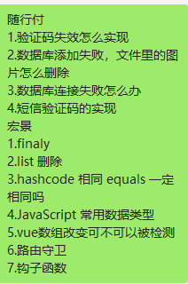

</details>

---

<a id="source-36"></a>

### 天津中科软

**来源：** `天津中科软.docx`

1.版本控制的理解

2.说一下Springtboot的优点

3.Mybaitis中#和$的区别

4.简历中两个项目是独立完成的，还是小组之间完成的？

5.你在项目中主要是完成哪些功能？

6.与小组之间有过沟通吗？

7.后期还要回学校吗?

8.可以接受出差吗

#### 补充参考答案（逐项对应）

##### 版本控制的理解

**参考答案：** 版本控制记录变化、分支、合并和历史追踪。Git 常用 add、commit、branch／switch、merge／rebase、log、diff；团队通过约定分支、PR 审查、冲突沟通和可重复构建协作。回答协作经历时说明自己承担的功能、接口契约、问题及验证，不只说“都做过”。

##### 说一下Springtboot的优点

**参考答案：** Spring Boot 基于 Spring，提供约定配置、自动配置、Starter 依赖组合、嵌入式服务及运维支持，减少项目装配工作；它不是替代 Spring。@SpringBootApplication 主要组合 @SpringBootConfiguration、@EnableAutoConfiguration、@ComponentScan。常用 @RestController、@RequestMapping、@GetMapping、@RequestBody、@Configuration、@Bean、@Service、@Repository。MyBatis 配置一般在 application.yml／properties 的 mybatis.* 项和 @MapperScan，SQL 映射在 Mapper XML／注解。

##### Mybaitis中#和$的区别

**参考答案：** MyBatis 将 SQL 与 Java 映射并封装 JDBC 执行：获取 SqlSession／Mapper 代理 → 定位映射语句 → 绑定参数 → JDBC 执行 → 映射结果。#{x} 形成预编译参数，${x} 是文本替换，不能直接接收不可信输入。列名不同可用别名、resultMap 或开启下划线转驼峰。Mapper XML 可有 resultMap、sql、include、cache、cache-ref、selectKey 和 if／choose／foreach／where／set 等动态元素。

##### 简历中两个项目是独立完成的，还是小组之间完成的？

**参考答案／个人回答模板：** 按背景—目标—职责—行动—结果组织：项目解决［业务问题］，我负责［模块］；困难是［具体故障／约束］，先通过［日志／复现／测量］定位，再采用［方案］，以［测试／指标］验证。明确个人贡献与团队协作，别编造用户量、性能数字或独立完成经历。未做过的技术可回答了解原理及准备如何验证。

##### 你在项目中主要是完成哪些功能？

**参考答案／个人回答模板：** 按背景—目标—职责—行动—结果组织：项目解决［业务问题］，我负责［模块］；困难是［具体故障／约束］，先通过［日志／复现／测量］定位，再采用［方案］，以［测试／指标］验证。明确个人贡献与团队协作，别编造用户量、性能数字或独立完成经历。未做过的技术可回答了解原理及准备如何验证。

##### 与小组之间有过沟通吗？

**参考答案：** 版本控制记录变化、分支、合并和历史追踪。Git 常用 add、commit、branch／switch、merge／rebase、log、diff；团队通过约定分支、PR 审查、冲突沟通和可重复构建协作。回答协作经历时说明自己承担的功能、接口契约、问题及验证，不只说“都做过”。

##### 后期还要回学校吗?

**参考答案／个人回答模板：** 先给真实结论，再说明依据。例：“我近期希望扎实做好 Java 后端开发，能独立交付模块；长期根据能力和兴趣发展，不提前承诺管理岗。”城市、定居、返校、考研、入职日期与出差接受度均用［个人实际情况］替换；有约束直接说明可接受的频率／时间，不能替本人作承诺。

##### 可以接受出差吗

**参考答案／个人回答模板：** 先给真实结论，再说明依据。例：“我近期希望扎实做好 Java 后端开发，能独立交付模块；长期根据能力和兴趣发展，不提前承诺管理岗。”城市、定居、返校、考研、入职日期与出差接受度均用［个人实际情况］替换；有约束直接说明可接受的频率／时间，不能替本人作承诺。


---

<a id="source-37"></a>

### 天深科技：依赖注入与设计模式

**来源：** `天深科技.png`

1. @Autowired 的作用。

2. 与 @Autowired 作用相同或类似的注解有哪些？

3. 一个接口有两个实现类时，使用 @Autowired 要注意什么？

4. Java 有多少种设计模式？分别是什么？

5. 未来规划。

#### 补充参考答案（逐项对应）

##### @Autowired 的作用。

**参考答案：** @Autowired 主要按类型解析，多个候选可配 @Qualifier 或 @Primary，也支持集合注入。@Resource 可按指定名称解析；未指定名称时有默认名称／类型回退规则，不能简单概括为始终只按名称。类似标准注解有 @Inject。只有一个构造器时 Spring 可直接使用它。注解本身是元数据，是否生效取决于保留策略及编译器／框架的处理；运行时注解可通过反射读取，Spring 的后处理器进行注入等工作。

##### 与 @Autowired 作用相同或类似的注解有哪些？

**参考答案：** @Autowired 主要按类型解析，多个候选可配 @Qualifier 或 @Primary，也支持集合注入。@Resource 可按指定名称解析；未指定名称时有默认名称／类型回退规则，不能简单概括为始终只按名称。类似标准注解有 @Inject。只有一个构造器时 Spring 可直接使用它。注解本身是元数据，是否生效取决于保留策略及编译器／框架的处理；运行时注解可通过反射读取，Spring 的后处理器进行注入等工作。

##### 一个接口有两个实现类时，使用 @Autowired 要注意什么？

**参考答案：** @Autowired 主要按类型解析，多个候选可配 @Qualifier 或 @Primary，也支持集合注入。@Resource 可按指定名称解析；未指定名称时有默认名称／类型回退规则，不能简单概括为始终只按名称。类似标准注解有 @Inject。只有一个构造器时 Spring 可直接使用它。注解本身是元数据，是否生效取决于保留策略及编译器／框架的处理；运行时注解可通过反射读取，Spring 的后处理器进行注入等工作。

##### Java 有多少种设计模式？分别是什么？

**参考答案：** 常见 GoF 23 种：创建型单例、工厂方法、抽象工厂、建造者、原型；结构型适配器、桥接、组合、装饰、外观、享元、代理；行为型责任链、命令、解释器、迭代器、中介者、备忘录、观察者、状态、策略、模板方法、访问者。模式不是 Java 专属或必须凑数；Spring 可见工厂、代理、模板、观察者、策略等。Spring 的 singleton 由容器缓存对象保证，不直接等同某个手写单例套路。

[相关代码／实现示例](#program-singleton)。

##### 未来规划。

**参考答案／个人回答模板：** 先给真实结论，再说明依据。例：“我近期希望扎实做好 Java 后端开发，能独立交付模块；长期根据能力和兴趣发展，不提前承诺管理岗。”城市、定居、返校、考研、入职日期与出差接受度均用［个人实际情况］替换；有约束直接说明可接受的频率／时间，不能替本人作承诺。

<details>
<summary>查看原图（含原始选项、手写内容或参考图）</summary>

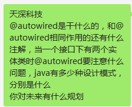

</details>

---

<a id="source-38"></a>

### 天深科技：技术与人事面试

**来源：** `天深科技面试题.jpg`、`c1424fb8ba3f189e4be440082c078b1.jpg`

#### 技术

1. 对 Spring 的了解。

2. 对注解的了解。

3. 注解的底层原理。

4. @Controller 是单例还是多例？

5. @Service 是单例还是多例？作用是什么？

6. 平时如何使用 Service 层？

7. 是否研究过底层代码，研究过哪些？

#### 人事

1. 是否想去北京发展？

2. 是否考虑回老家发展？

3. 如何看待工作压力？

4. 期望薪资。

#### 补充参考答案（逐项对应）

##### 对 Spring 的了解。

**参考答案：** Spring 提供对象容器、依赖注入、事务及相关基础设施。IoC 把对象创建与组装交给容器；DI 是实现 IoC 的方式，常用构造器、Setter、字段注入，构造器注入便于表达必需依赖。AOP 将日志、事务、权限等横切逻辑从业务中抽出，Spring AOP 常用 JDK 接口代理或类代理；同对象内部自调用可能绕过代理。SSM 是 Spring + Spring MVC + MyBatis 的组合。

##### 对注解的了解。

**参考答案：** @Autowired 主要按类型解析，多个候选可配 @Qualifier 或 @Primary，也支持集合注入。@Resource 可按指定名称解析；未指定名称时有默认名称／类型回退规则，不能简单概括为始终只按名称。类似标准注解有 @Inject。只有一个构造器时 Spring 可直接使用它。注解本身是元数据，是否生效取决于保留策略及编译器／框架的处理；运行时注解可通过反射读取，Spring 的后处理器进行注入等工作。

##### 注解的底层原理。

**参考答案：** @Autowired 主要按类型解析，多个候选可配 @Qualifier 或 @Primary，也支持集合注入。@Resource 可按指定名称解析；未指定名称时有默认名称／类型回退规则，不能简单概括为始终只按名称。类似标准注解有 @Inject。只有一个构造器时 Spring 可直接使用它。注解本身是元数据，是否生效取决于保留策略及编译器／框架的处理；运行时注解可通过反射读取，Spring 的后处理器进行注入等工作。

##### @Controller 是单例还是多例？

**参考答案：** Spring singleton 是每个容器、每个 Bean 定义一个实例，由容器保存与复用，不等于 GoF 单例必须私有构造器。默认 @Controller、@Service 等是 singleton；还有 prototype、Web request、session、application、websocket 等作用域。singleton 不代表线程安全，避免保存请求特有的可变字段。@Controller 表示 Web 层，@Service 表示业务层，@Repository 表示持久层。

##### @Service 是单例还是多例？作用是什么？

**参考答案：** Spring singleton 是每个容器、每个 Bean 定义一个实例，由容器保存与复用，不等于 GoF 单例必须私有构造器。默认 @Controller、@Service 等是 singleton；还有 prototype、Web request、session、application、websocket 等作用域。singleton 不代表线程安全，避免保存请求特有的可变字段。@Controller 表示 Web 层，@Service 表示业务层，@Repository 表示持久层。

##### 平时如何使用 Service 层？

**参考答案：** 核心前端控制器为 DispatcherServlet：接收请求 → HandlerMapping 找处理器 → HandlerAdapter 调用 Controller → 返回结果。视图场景解析 ModelAndView 并渲染；@ResponseBody／@RestController 场景由消息转换器序列化为 JSON 等响应。Controller 负责协议与参数，Service 处理业务和事务，DAO／Mapper 访问数据。仅接收 GET 可用 @GetMapping。JSON 请求体用 @RequestBody DTO 接收并校验。

##### 是否研究过底层代码，研究过哪些？

**参考答案：** 通常通过 new、反射构造器、clone（有相关契约）或反序列化取得对象；不同方式是否运行构造器不同。反射读取运行时类型元数据并调用成员，框架据此装配对象，需考虑访问限制与性能。泛型提供编译期类型约束和复用，通常经类型擦除；List<Integer> 不是 List<Number> 的子类，读取协变常用 ? extends，写入逆变常用 ? super。宏定义属于 C/C++ 等预处理能力，Java 没有同类文本宏。

##### 是否想去北京发展？

**参考答案／个人回答模板：** 先给真实结论，再说明依据。例：“我近期希望扎实做好 Java 后端开发，能独立交付模块；长期根据能力和兴趣发展，不提前承诺管理岗。”城市、定居、返校、考研、入职日期与出差接受度均用［个人实际情况］替换；有约束直接说明可接受的频率／时间，不能替本人作承诺。

##### 是否考虑回老家发展？

**参考答案／个人回答模板：** 先给真实结论，再说明依据。例：“我近期希望扎实做好 Java 后端开发，能独立交付模块；长期根据能力和兴趣发展，不提前承诺管理岗。”城市、定居、返校、考研、入职日期与出差接受度均用［个人实际情况］替换；有约束直接说明可接受的频率／时间，不能替本人作承诺。

##### 如何看待工作压力？

**参考答案／个人回答模板：** 用真实事件证明优点；缺点说可改进且有行动的问题，例如估时偏乐观，已用任务拆分与风险缓冲改善。压力下先明确优先级、拆任务、及时沟通依赖和风险，不承诺无条件加班。理想团队可强调清晰目标、代码审查、尊重沟通；企业文化谈自己重视的协作、责任和学习，并结合已了解的事实。

##### 期望薪资。

**参考答案／个人回答模板：** 公司了解使用已经核实的业务、产品、岗位职责，不按照片中的名字臆造事实。薪资表达“期望［税前区间］，结合职责、城市及总包沟通”，金额由本人确定。反问可问团队职责、试用期目标、技术栈、培养／反馈和后续流程。籍贯、校园人物、地点、遗憾和特殊经历用本人真实故事，不提供虚构标准答案。

<details>
<summary>查看原图（含原始选项、手写内容或参考图）</summary>

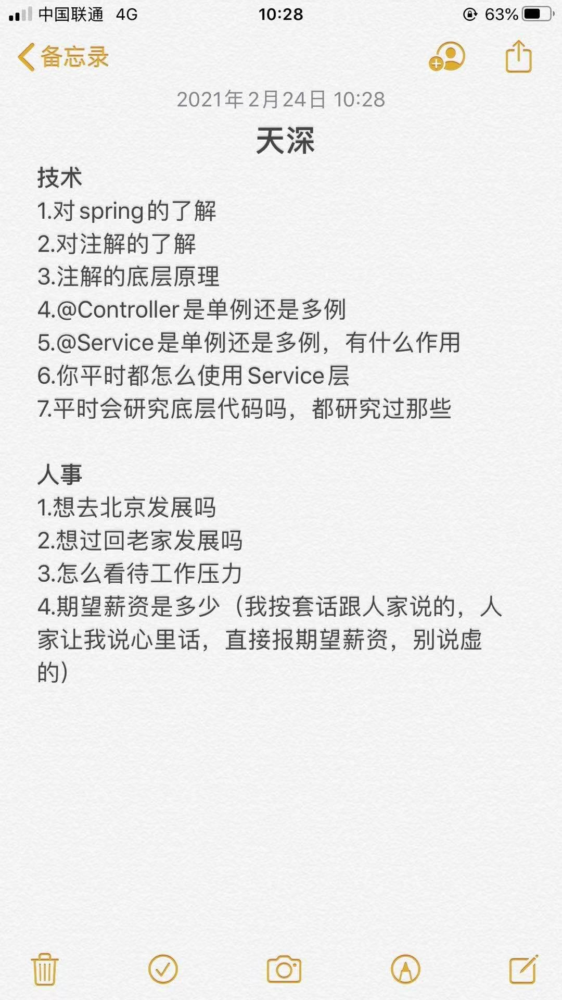

</details>

---

<a id="source-40"></a>

### 易普拉格-java岗位面试题

**来源：** `易普拉格-java岗位面试题.txt`

#### 技术

四大作用域及范围

ArrayList与linkedlist的区别

getattribute和getparameter

request和session都是什么

项目中的登录如何实现

项目中拦截器如何判断是否登录成功

购物车在不登录的情况下添加后关闭，下次打开项目还存在吗？要是存在，如何实现

springMVC的实现原理

jQuery的选择器都有哪些

ID选择器类选择器的用法

不用id选择器和类选择器时应该如何修改指定标签样式

有一串字符串，如何倒序输出

数组倒序遍历

#### 人事

自我介绍？

你是哪里人？

为什么来天津？

有定居的想法吗？

学校还有什么事？

你多久可以入职？

你还有要问我的吗？

#### 补充参考答案（逐项对应）

##### 四大作用域及范围

**参考答案：** Cookie 是浏览器保存并按规则发送的数据；Session 是服务器维护的会话，常以 Cookie 中的会话 ID 关联，也可有其他传递方式。关闭浏览器是否删除取决于 Cookie 持久期及恢复行为，不能绝对化。JSP 四大作用域 page、request、session、application；request 对应一次请求，application 对应 Web 应用生命周期。Servlet 由 init → 多次 service → destroy；多请求可能并发执行，应避免实例字段存请求状态。

##### ArrayList与linkedlist的区别

**参考答案：** ArrayList 随机访问 O(1)，中间插入／删除需要移动后续引用 O(n)，尾部追加均摊 O(1)；LinkedList 定位第 i 个节点 O(n)，已持有节点／迭代器位置后的插入删除 O(1)。从索引定位再在 5000 万位置插入时，两者都可能 O(n)，不能直接断言链表更快；数组局部性通常更好。链表每元素还保存节点及前后引用，通常更占内存；数组也有闲置容量。数据规模改变常数、缓存和 GC 成本，不改变这些渐近复杂度。

##### getattribute和getparameter

**参考答案：** 九大内置对象为 request、response、session、application、pageContext、out、config、page、exception；exception 通常在错误页面可用。getParameter 读取请求参数（主要是字符串），getAttribute 读取服务端在请求等作用域保存的对象。请求范围数据可供同一次转发共享，不等于新一次重定向仍存在。

##### request和session都是什么

**参考答案：** Cookie 是浏览器保存并按规则发送的数据；Session 是服务器维护的会话，常以 Cookie 中的会话 ID 关联，也可有其他传递方式。关闭浏览器是否删除取决于 Cookie 持久期及恢复行为，不能绝对化。JSP 四大作用域 page、request、session、application；request 对应一次请求，application 对应 Web 应用生命周期。Servlet 由 init → 多次 service → destroy；多请求可能并发执行，应避免实例字段存请求状态。

##### 项目中的登录如何实现

**参考答案：** 登录时校验密码哈希，创建会话或令牌；拦截器检查认证状态，Service 再校验资源与操作权限。RBAC 将用户关联角色、角色关联权限，前端可据权限显示菜单，但后端仍必须鉴权。未登录购物车可用 localStorage 或匿名标识对应服务端存储，登录后合并；只存在内存里的购物车不能保证重开浏览器后保留。

##### 项目中拦截器如何判断是否登录成功

**参考答案：** 登录时校验密码哈希，创建会话或令牌；拦截器检查认证状态，Service 再校验资源与操作权限。RBAC 将用户关联角色、角色关联权限，前端可据权限显示菜单，但后端仍必须鉴权。未登录购物车可用 localStorage 或匿名标识对应服务端存储，登录后合并；只存在内存里的购物车不能保证重开浏览器后保留。

##### 购物车在不登录的情况下添加后关闭，下次打开项目还存在吗？要是存在，如何实现

**参考答案：** 登录时校验密码哈希，创建会话或令牌；拦截器检查认证状态，Service 再校验资源与操作权限。RBAC 将用户关联角色、角色关联权限，前端可据权限显示菜单，但后端仍必须鉴权。未登录购物车可用 localStorage 或匿名标识对应服务端存储，登录后合并；只存在内存里的购物车不能保证重开浏览器后保留。

##### springMVC的实现原理

**参考答案：** 核心前端控制器为 DispatcherServlet：接收请求 → HandlerMapping 找处理器 → HandlerAdapter 调用 Controller → 返回结果。视图场景解析 ModelAndView 并渲染；@ResponseBody／@RestController 场景由消息转换器序列化为 JSON 等响应。Controller 负责协议与参数，Service 处理业务和事务，DAO／Mapper 访问数据。仅接收 GET 可用 @GetMapping。JSON 请求体用 @RequestBody DTO 接收并校验。

##### jQuery的选择器都有哪些

**参考答案：** jQuery 是 JavaScript 库，常用能力包括选择／DOM 操作、事件、Ajax；所谓“三大核心”不是正式固定规范。选择器示例 #id、.class、标签与属性选择器。$("#name").val("张三") 改表单值，.text 改文本，.html 解析 HTML；给不可信内容使用 .text。$(function(){...}) 在 DOM 就绪后执行，不必等图片全部加载。Ajax 是异步网络请求与局部更新模式，同步请求会阻塞；可用 fetch／XMLHttpRequest 或 $.ajax。

[相关代码／实现示例](#program-ajax)。

##### ID选择器类选择器的用法

**参考答案：** jQuery 是 JavaScript 库，常用能力包括选择／DOM 操作、事件、Ajax；所谓“三大核心”不是正式固定规范。选择器示例 #id、.class、标签与属性选择器。$("#name").val("张三") 改表单值，.text 改文本，.html 解析 HTML；给不可信内容使用 .text。$(function(){...}) 在 DOM 就绪后执行，不必等图片全部加载。Ajax 是异步网络请求与局部更新模式，同步请求会阻塞；可用 fetch／XMLHttpRequest 或 $.ajax。

[相关代码／实现示例](#program-ajax)。

##### 不用id选择器和类选择器时应该如何修改指定标签样式

**参考答案：** jQuery 是 JavaScript 库，常用能力包括选择／DOM 操作、事件、Ajax；所谓“三大核心”不是正式固定规范。选择器示例 #id、.class、标签与属性选择器。$("#name").val("张三") 改表单值，.text 改文本，.html 解析 HTML；给不可信内容使用 .text。$(function(){...}) 在 DOM 就绪后执行，不必等图片全部加载。Ajax 是异步网络请求与局部更新模式，同步请求会阻塞；可用 fetch／XMLHttpRequest 或 $.ajax。

[相关代码／实现示例](#program-ajax)。

##### 有一串字符串，如何倒序输出

**参考答案：** String 不可变；StringBuilder 可变且不保证线程安全；StringBuffer 的主要方法有同步保护，多步骤组合仍可能需要外部同步。常见反转：new StringBuilder(s).reverse().toString()；处理用户感知字符如组合字符、表情序列时需额外定义反转规则。Lambda 是函数式接口实例的一种写法，例如 list.forEach(x -> System.out.println(x))；捕获的局部变量必须是 final 或 effectively final。

##### 数组倒序遍历

**参考答案：** List 表示有序可重复序列；Set 表示不重复元素集合；Map 表示键值映射，不是 Collection 子接口。ArrayList 是动态数组，LinkedList 是双向链表，HashSet 通常基于 HashMap，TreeSet 基于有序树，ArrayDeque 可实现栈或队列。Collections 是工具类；Stream 是数据处理流水线，不是存储容器。

数组倒序可从 `for(int i=a.length-1;i>=0;i--)` 遍历，或返回新的逆序数组，见 [6.3 的 reverse](#program-algorithms)。

##### 自我介绍？

**参考答案／个人回答模板：** 模板：我是［姓名］，就读／毕业于［学校、专业］，主要学习［真实课程］。做过［项目］，负责［具体模块］，用［技术］解决［问题］并通过［测试／结果］验证，希望在［岗位］继续提升。课程、成绩、书籍、C 语言和实习经历均按事实填写，没学过／没读完可坦诚说明；介绍控制在 1～2 分钟。

##### 你是哪里人？

**参考答案／个人回答模板：** 公司了解使用已经核实的业务、产品、岗位职责，不按照片中的名字臆造事实。薪资表达“期望［税前区间］，结合职责、城市及总包沟通”，金额由本人确定。反问可问团队职责、试用期目标、技术栈、培养／反馈和后续流程。籍贯、校园人物、地点、遗憾和特殊经历用本人真实故事，不提供虚构标准答案。

##### 为什么来天津？

**参考答案／个人回答模板：** 先给真实结论，再说明依据。例：“我近期希望扎实做好 Java 后端开发，能独立交付模块；长期根据能力和兴趣发展，不提前承诺管理岗。”城市、定居、返校、考研、入职日期与出差接受度均用［个人实际情况］替换；有约束直接说明可接受的频率／时间，不能替本人作承诺。

##### 有定居的想法吗？

**参考答案／个人回答模板：** 先给真实结论，再说明依据。例：“我近期希望扎实做好 Java 后端开发，能独立交付模块；长期根据能力和兴趣发展，不提前承诺管理岗。”城市、定居、返校、考研、入职日期与出差接受度均用［个人实际情况］替换；有约束直接说明可接受的频率／时间，不能替本人作承诺。

##### 学校还有什么事？

**参考答案／个人回答模板：** 先给真实结论，再说明依据。例：“我近期希望扎实做好 Java 后端开发，能独立交付模块；长期根据能力和兴趣发展，不提前承诺管理岗。”城市、定居、返校、考研、入职日期与出差接受度均用［个人实际情况］替换；有约束直接说明可接受的频率／时间，不能替本人作承诺。

##### 你多久可以入职？

**参考答案／个人回答模板：** 先给真实结论，再说明依据。例：“我近期希望扎实做好 Java 后端开发，能独立交付模块；长期根据能力和兴趣发展，不提前承诺管理岗。”城市、定居、返校、考研、入职日期与出差接受度均用［个人实际情况］替换；有约束直接说明可接受的频率／时间，不能替本人作承诺。

##### 你还有要问我的吗？

**参考答案／个人回答模板：** 公司了解使用已经核实的业务、产品、岗位职责，不按照片中的名字臆造事实。薪资表达“期望［税前区间］，结合职责、城市及总包沟通”，金额由本人确定。反问可问团队职责、试用期目标、技术栈、培养／反馈和后续流程。籍贯、校园人物、地点、遗憾和特殊经历用本人真实故事，不提供虚构标准答案。


---

<a id="source-41"></a>

### 用友面试

**来源：** `用友面试.txt`、`用友面试(2).txt`

1.自我介绍，介绍项目、项目难点

2.平时在写程序中都怎么调bug

3.说一下IOC

4.说一下单例模式

5.你说的那些单例模式里，spring中的单例用的是哪一种（挖坑题，都不是）

6.创建对象都有哪些方式（new对象，反射创建等....）

7.spring创建对象过程中，都用到了哪些设计模式

8.说一下aop

9.说一下aop中的代理模式

10.项目中有没有用到aop？

11.在项目中怎么管理的事务？（我说的是配置数据源和DataSourceTransactionManager，开启注解支持）

12 顺着上一题，具体怎么使用的事务（在service层方法中加@Transactional）

13.什么是逻辑分页和物理分页（也是一个挖坑题）

14.创建对象的时候jvm执行了哪些动作

15.说一下redis是干什么的。（因为我跟面试官说我不太会微服务这块儿，只是简单了解，就让我简单说说是干嘛的）

16.实现多线程的几种方式

17.线程的状态有哪些

最后问了问未来的规划，想往哪些方向发展

#### 补充参考答案（逐项对应）

##### 自我介绍，介绍项目、项目难点

**参考答案／个人回答模板：** 按背景—目标—职责—行动—结果组织：项目解决［业务问题］，我负责［模块］；困难是［具体故障／约束］，先通过［日志／复现／测量］定位，再采用［方案］，以［测试／指标］验证。明确个人贡献与团队协作，别编造用户量、性能数字或独立完成经历。未做过的技术可回答了解原理及准备如何验证。

##### 平时在写程序中都怎么调bug

**参考答案：** 先看异常类型、日志和复现场景，区分 Java heap space、Metaspace、无法创建原生线程、StackOverflowError 等。堆泄漏可用堆转储和 GC Roots 引用链定位；频繁 Full GC 检查存活量及分配速率。IDEA Debug 可设置条件断点，查看变量、调用栈和表达式；线上注意暂停线程的影响。定位问题靠证据与验证，不只扩大堆。

##### 说一下IOC

**参考答案：** Spring 提供对象容器、依赖注入、事务及相关基础设施。IoC 把对象创建与组装交给容器；DI 是实现 IoC 的方式，常用构造器、Setter、字段注入，构造器注入便于表达必需依赖。AOP 将日志、事务、权限等横切逻辑从业务中抽出，Spring AOP 常用 JDK 接口代理或类代理；同对象内部自调用可能绕过代理。SSM 是 Spring + Spring MVC + MyBatis 的组合。

##### 说一下单例模式

**参考答案：** 常见 GoF 23 种：创建型单例、工厂方法、抽象工厂、建造者、原型；结构型适配器、桥接、组合、装饰、外观、享元、代理；行为型责任链、命令、解释器、迭代器、中介者、备忘录、观察者、状态、策略、模板方法、访问者。模式不是 Java 专属或必须凑数；Spring 可见工厂、代理、模板、观察者、策略等。Spring 的 singleton 由容器缓存对象保证，不直接等同某个手写单例套路。

[相关代码／实现示例](#program-singleton)。

##### 你说的那些单例模式里，spring中的单例用的是哪一种（挖坑题，都不是）

**参考答案：** 常见 GoF 23 种：创建型单例、工厂方法、抽象工厂、建造者、原型；结构型适配器、桥接、组合、装饰、外观、享元、代理；行为型责任链、命令、解释器、迭代器、中介者、备忘录、观察者、状态、策略、模板方法、访问者。模式不是 Java 专属或必须凑数；Spring 可见工厂、代理、模板、观察者、策略等。Spring 的 singleton 由容器缓存对象保证，不直接等同某个手写单例套路。

[相关代码／实现示例](#program-singleton)。

##### 创建对象都有哪些方式（new对象，反射创建等....）

**参考答案：** 通常通过 new、反射构造器、clone（有相关契约）或反序列化取得对象；不同方式是否运行构造器不同。反射读取运行时类型元数据并调用成员，框架据此装配对象，需考虑访问限制与性能。泛型提供编译期类型约束和复用，通常经类型擦除；List<Integer> 不是 List<Number> 的子类，读取协变常用 ? extends，写入逆变常用 ? super。宏定义属于 C/C++ 等预处理能力，Java 没有同类文本宏。

##### spring创建对象过程中，都用到了哪些设计模式

**参考答案：** 常见 GoF 23 种：创建型单例、工厂方法、抽象工厂、建造者、原型；结构型适配器、桥接、组合、装饰、外观、享元、代理；行为型责任链、命令、解释器、迭代器、中介者、备忘录、观察者、状态、策略、模板方法、访问者。模式不是 Java 专属或必须凑数；Spring 可见工厂、代理、模板、观察者、策略等。Spring 的 singleton 由容器缓存对象保证，不直接等同某个手写单例套路。

[相关代码／实现示例](#program-singleton)。

##### 说一下aop

**参考答案：** Spring 提供对象容器、依赖注入、事务及相关基础设施。IoC 把对象创建与组装交给容器；DI 是实现 IoC 的方式，常用构造器、Setter、字段注入，构造器注入便于表达必需依赖。AOP 将日志、事务、权限等横切逻辑从业务中抽出，Spring AOP 常用 JDK 接口代理或类代理；同对象内部自调用可能绕过代理。SSM 是 Spring + Spring MVC + MyBatis 的组合。

##### 说一下aop中的代理模式

**参考答案：** Spring 提供对象容器、依赖注入、事务及相关基础设施。IoC 把对象创建与组装交给容器；DI 是实现 IoC 的方式，常用构造器、Setter、字段注入，构造器注入便于表达必需依赖。AOP 将日志、事务、权限等横切逻辑从业务中抽出，Spring AOP 常用 JDK 接口代理或类代理；同对象内部自调用可能绕过代理。SSM 是 Spring + Spring MVC + MyBatis 的组合。

##### 项目中有没有用到aop？

**参考答案／个人回答模板：** 按背景—目标—职责—行动—结果组织：项目解决［业务问题］，我负责［模块］；困难是［具体故障／约束］，先通过［日志／复现／测量］定位，再采用［方案］，以［测试／指标］验证。明确个人贡献与团队协作，别编造用户量、性能数字或独立完成经历。未做过的技术可回答了解原理及准备如何验证。

##### 在项目中怎么管理的事务？（我说的是配置数据源和DataSourceTransactionManager，开启注解支持）

**参考答案：** Service 的跨多次写入业务通常用 @Transactional。常见传播：REQUIRED 加入现有或新建事务；REQUIRES_NEW 挂起外层并新建；NESTED 通常通过保存点；SUPPORTS 有事务则加入；NOT_SUPPORTED 不在事务执行；MANDATORY 必须已有；NEVER 必须没有。默认一般对 RuntimeException／Error 回滚，受检异常可用 rollbackFor 指定；代理模式下内部自调用可能失效。数据库事务不能自动回滚文件或 HTTP 调用，应有补偿／一致性设计。

##### 12 顺着上一题，具体怎么使用的事务（在service层方法中加@Transactional）

**参考答案：** Service 的跨多次写入业务通常用 @Transactional。常见传播：REQUIRED 加入现有或新建事务；REQUIRES_NEW 挂起外层并新建；NESTED 通常通过保存点；SUPPORTS 有事务则加入；NOT_SUPPORTED 不在事务执行；MANDATORY 必须已有；NEVER 必须没有。默认一般对 RuntimeException／Error 回滚，受检异常可用 rollbackFor 指定；代理模式下内部自调用可能失效。数据库事务不能自动回滚文件或 HTTP 调用，应有补偿／一致性设计。

##### 什么是逻辑分页和物理分页（也是一个挖坑题）

**参考答案：** 物理分页由数据库只返回目标页，例如 LIMIT 20 OFFSET 40；逻辑分页先拿较大结果，再在应用中截取，浪费内存和传输。MyBatis 可直接写分页 SQL 或用拦截器改写；需校验页码、限制页大小并稳定 ORDER BY。深分页可用游标：WHERE id > :lastId ORDER BY id LIMIT :size。前端 Ajax 请求分页参数，后端返回 items、total、page、size，不等于后端一定启动新线程。

[相关代码／实现示例](#program-ajax)。

##### 创建对象的时候jvm执行了哪些动作

**参考答案：** 运行时区域包括堆、虚拟机栈、本地方法栈、程序计数器和方法区。HotSpot Java 8 起常用元空间实现方法区；类的静态字段引用与 Class 镜像等具体位置属于实现细节，不应笼统说所有静态变量都在方法区。new 通常先确保类已初始化，再分配对象空间、零值初始化、设置对象头、执行构造器。对象自身通常在堆，局部引用通常在栈帧中。

##### 说一下redis是干什么的。（因为我跟面试官说我不太会微服务这块儿，只是简单了解，就让我简单说说是干嘛的）

**参考答案：** Redis 是内存数据结构服务，常用于缓存、计数、限流、会话等。常见基础类型：String、Hash、List、Set、ZSet；还可谈 Bitmap、HyperLogLog、Geo、Stream 等能力，不能说固定只有“八种”。String 可用整数编码或动态字符串表示；小集合与大集合可能使用不同编码。ZSet 常见大规模表示为字典加跳表，小数据可能用紧凑结构。具体底层编码与阈值需按版本说明。

##### 实现多线程的几种方式

**参考答案：** 进程是资源与地址空间的隔离单位，线程是执行与调度单位；同进程线程共享堆等资源，但有自己的栈和程序计数器。常见创建方式：继承 Thread、实现 Runnable、Callable 配合 FutureTask／线程池；优先把任务与执行器分开。start 启动线程，直接调用 run 是普通方法调用。任务执行完或响应中断退出，不使用已废弃 stop。

##### 线程的状态有哪些

**参考答案：** Java 线程状态为 NEW、RUNNABLE、BLOCKED、WAITING、TIMED_WAITING、TERMINATED；RUNNABLE 包含 JVM 定义下的运行／就绪。ThreadLocal 为每个线程保存独立值，通常在 Thread 的 ThreadLocalMap 中以 ThreadLocal 弱引用为键，值不是弱引用；线程池复用时应 finally 调用 remove，防止上下文串用或保留对象。跨线程传递优先显式参数或消息。

##### 最后问了问未来的规划，想往哪些方向发展

**参考答案／个人回答模板：** 先给真实结论，再说明依据。例：“我近期希望扎实做好 Java 后端开发，能独立交付模块；长期根据能力和兴趣发展，不提前承诺管理岗。”城市、定居、返校、考研、入职日期与出差接受度均用［个人实际情况］替换；有约束直接说明可接受的频率／时间，不能替本人作承诺。


---

<a id="source-42"></a>

### 泽元软件

**来源：** `泽元软件.txt`

#### 算法

1 给了一个数组，手写排序

2 0 1 1 2 3 5 8 13 fn=fn-1+fn-2算n=1000 fn的值

#### 基础

3 常用集合及其数据结构

4 线程安全的集合，为什么安全

lunix

5 lunix  5个执行指令

6

#### web

1 设计后端接口实现异步交互和分页

2 前端原生ajax  或者jquery ajax表述实现的思想(写代码加分)

#### 数据库

学生选课创建表

查选数学课的学生

什么时候创建索引，索引的好处和坏处

sql优化

#### 补充参考答案：泽元软件

1. 手写排序见 [冒泡与快排代码](#program-algorithms)，说明复杂度与是否稳定。
2. 按 F(0)=0、F(1)=1，用 BigInteger 迭代求 F(1000)，见 [6.3](#program-algorithms)；时间为 1000 次大整数加法，long 装不下结果。
3. 常用集合：ArrayList 动态数组、LinkedList 链表、HashMap 桶数组加冲突结构、TreeMap 红黑树等。
4. Vector／Hashtable 的主要方法同步；ConcurrentHashMap 支持并发访问；CopyOnWriteArrayList 写时复制，适合读多写少。线程安全不意味着所有业务组合操作自动原子。
5. Linux 五条命令可答 ls、pwd、cd、ps、tail，并说明用途；原题第 6 项为空，无题干可作答。
6. 异步交互与分页：前端请求分页参数，后端鉴权校验、执行分页 SQL 并返回 items／total，示例见 [6.8](#program-ajax)。原生 fetch 与 jQuery Ajax 都提供异步请求，错误与加载状态要处理。
7. 学生选课建模：学生、课程和关系表，学生与课程为多对多。

```sql
CREATE TABLE student (
  id BIGINT PRIMARY KEY, name VARCHAR(100) NOT NULL
);
CREATE TABLE course (
  id BIGINT PRIMARY KEY, name VARCHAR(100) NOT NULL
);
CREATE TABLE enrollment (
  student_id BIGINT NOT NULL, course_id BIGINT NOT NULL,
  PRIMARY KEY(student_id,course_id),
  FOREIGN KEY(student_id) REFERENCES student(id),
  FOREIGN KEY(course_id) REFERENCES course(id)
);
SELECT s.id,s.name FROM student s
WHERE EXISTS (
  SELECT 1 FROM enrollment e JOIN course c ON c.id=e.course_id
  WHERE e.student_id=s.id AND c.name='数学'
);
```

8. 索引适合常用过滤、关联和排序字段；占空间并增加写入维护成本，用 EXPLAIN 和实际慢查询确认价值，避免给所有字段都建索引。
9. SQL 优化先定位耗时／扫描行数／锁等待，调整索引与查询、只取需要列、避免 N+1、批量处理和不必要大事务，不能一概说 JOIN 一定比子查询快。


---

<a id="source-44"></a>

### 华海：Java、JVM 与 Redis

**来源：** `b37914d95f0b3885adae70564b6faf5.jpg`、`edfd73f14a96e0836de5de485b05f55.jpg`

1. Java 多态，举例说明。

2. ArrayList 与 LinkedList 的区别，需要区分小数据量和大数据量。

3. 垃圾回收流程。

4. 类加载机制、双亲委派机制。

5. 如何打破 GC Roots 的垃圾回收？（原题表述保留，含义需核对）

6. 是否用过 MySQL 读写分离？

7. SDB（原图如此拼写，原作者称为 Redis 底层存储数据的结构，具体术语待核对）。

8. Redis 持久化机制，生产中使用哪一种？

9. Redis 如何实现高可用？

10. MySQL 事务隔离如何实现？

原作者另建议准备算法与计算机网络。

#### 补充参考答案（逐项对应）

##### Java 多态，举例说明。

**参考答案：** 面向过程围绕步骤组织函数；面向对象围绕对象的状态与行为组织程序。封装隐藏实现、保护状态；继承复用并扩展行为；多态允许父类／接口引用指向不同实现，调用被重写的实例方法时按实际对象分派。例：Animal a = new Dog(); a.speak(); 执行 Dog 的实现。Java 类只能继承一个直接父类，但可实现多个接口；接口可继承多个接口。不能笼统认为某一种编程范式必然性能更高。

##### ArrayList 与 LinkedList 的区别，需要区分小数据量和大数据量。

**参考答案：** ArrayList 随机访问 O(1)，中间插入／删除需要移动后续引用 O(n)，尾部追加均摊 O(1)；LinkedList 定位第 i 个节点 O(n)，已持有节点／迭代器位置后的插入删除 O(1)。从索引定位再在 5000 万位置插入时，两者都可能 O(n)，不能直接断言链表更快；数组局部性通常更好。链表每元素还保存节点及前后引用，通常更占内存；数组也有闲置容量。数据规模改变常数、缓存和 GC 成本，不改变这些渐近复杂度。

##### 垃圾回收流程。

**参考答案：** GC 根据从 GC Roots 出发的可达性判断存活；常见 Roots 有线程栈中引用、活跃类的静态引用、JNI 引用等。解除引用可使对象不可达，不能靠“打破 GC Roots 算法”安全回收仍在使用的对象。常见算法包括标记清除、复制、标记整理；收集器实现和分代策略应按版本说明。类加载经历加载、链接（验证、准备、解析）和初始化；双亲委派先委托父加载器，父加载器无法加载时再由当前加载器尝试。

##### 类加载机制、双亲委派机制。

**参考答案：** GC 根据从 GC Roots 出发的可达性判断存活；常见 Roots 有线程栈中引用、活跃类的静态引用、JNI 引用等。解除引用可使对象不可达，不能靠“打破 GC Roots 算法”安全回收仍在使用的对象。常见算法包括标记清除、复制、标记整理；收集器实现和分代策略应按版本说明。类加载经历加载、链接（验证、准备、解析）和初始化；双亲委派先委托父加载器，父加载器无法加载时再由当前加载器尝试。

##### 如何打破 GC Roots 的垃圾回收？（原题表述保留，含义需核对）

**参考答案：** GC 根据从 GC Roots 出发的可达性判断存活；常见 Roots 有线程栈中引用、活跃类的静态引用、JNI 引用等。解除引用可使对象不可达，不能靠“打破 GC Roots 算法”安全回收仍在使用的对象。常见算法包括标记清除、复制、标记整理；收集器实现和分代策略应按版本说明。类加载经历加载、链接（验证、准备、解析）和初始化；双亲委派先委托父加载器，父加载器无法加载时再由当前加载器尝试。

##### 是否用过 MySQL 读写分离？

**参考答案／个人回答模板：** 按背景—目标—职责—行动—结果组织：项目解决［业务问题］，我负责［模块］；困难是［具体故障／约束］，先通过［日志／复现／测量］定位，再采用［方案］，以［测试／指标］验证。明确个人贡献与团队协作，别编造用户量、性能数字或独立完成经历。未做过的技术可回答了解原理及准备如何验证。

##### SDB（原图如此拼写，原作者称为 Redis 底层存储数据的结构，具体术语待核对）。

**参考答案：** 现有记录没有足够条件，不能确定唯一答案或具体实现。面试时先澄清对象、输入、输出、规模与约束，再给条件化方案；本节会列出可回答的知识点，缺失的文字不凭空补成事实。

可能是 SDS（Simple Dynamic String，简单动态字符串），也可能把 RDB 写错；前者是 String 的底层字符串结构，后者是快照持久化，二者不同。题干应先核实缩写。

##### Redis 持久化机制，生产中使用哪一种？

**参考答案：** 用 maxmemory 限制内存，并根据业务配置淘汰策略；过期删除与达到容量时的淘汰是两件事。RDB 保存时间点快照，AOF 记录写命令；两者可组合，取舍由恢复时间、磁盘和可接受丢失窗口决定。主从复制提供冗余，Sentinel 监控并自动切主，Cluster 分片并支持故障转移。复制通常异步，故障切换仍可能丢失已确认写入。

##### Redis 如何实现高可用？

**参考答案：** 用 maxmemory 限制内存，并根据业务配置淘汰策略；过期删除与达到容量时的淘汰是两件事。RDB 保存时间点快照，AOF 记录写命令；两者可组合，取舍由恢复时间、磁盘和可接受丢失窗口决定。主从复制提供冗余，Sentinel 监控并自动切主，Cluster 分片并支持故障转移。复制通常异步，故障切换仍可能丢失已确认写入。

##### MySQL 事务隔离如何实现？

**参考答案：** ACID 为原子性、一致性、隔离性、持久性。四级隔离为读未提交、读已提交、可重复读、可串行化；InnoDB 默认可重复读。典型并发问题为脏读、不可重复读、幻读；MVCC 为一致性读提供版本视图，锁定读／写使用行锁与间隙／临键锁等约束。不能笼统把“可重复读完全不存在一切幻读场景”当通用结论。

<details>
<summary>查看原图（含原始选项、手写内容或参考图）</summary>

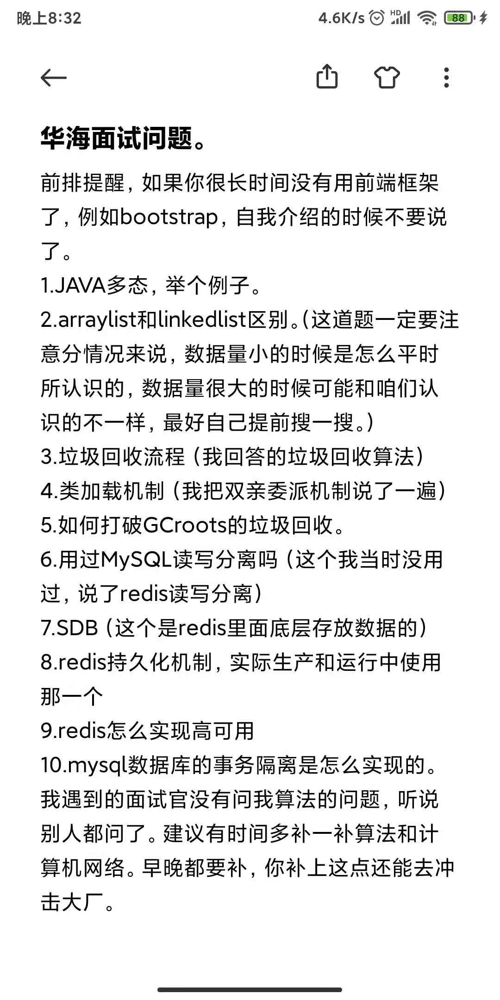

</details>

---

<a id="source-45"></a>

### 未注明公司：Java 与 Web 综合

**来源：** `b55ce6948582a49742cad7ce80aa897.jpg`

1. 面向对象与面向过程的区别。

2. 编写 JDBC 代码。

3. Spring MVC 工作原理。

4. Set、List、Map 的区别。

5. Set 底层实现。

6. Spring Boot 注解。

7. 前端传给后台的 JSON 对象用什么接收？

#### 补充参考答案（逐项对应）

##### 面向对象与面向过程的区别。

**参考答案：** 面向过程围绕步骤组织函数；面向对象围绕对象的状态与行为组织程序。封装隐藏实现、保护状态；继承复用并扩展行为；多态允许父类／接口引用指向不同实现，调用被重写的实例方法时按实际对象分派。例：Animal a = new Dog(); a.speak(); 执行 Dog 的实现。Java 类只能继承一个直接父类，但可实现多个接口；接口可继承多个接口。不能笼统认为某一种编程范式必然性能更高。

##### 编写 JDBC 代码。

**参考答案：** 流程为获取连接 → 创建 PreparedStatement → 参数绑定 → 执行 → 读取结果 → 关闭资源。现代 JDBC 驱动通常通过服务发现自动注册；旧写法用 Class.forName。PreparedStatement 将参数当数据、支持复用，避免把值直接拼成 SQL；Statement 更适合固定无参数 SQL。连接池管理复用连接，不能把连接池与 ORM 当作同一种工具。完整示例见本文件新增编程答案。

[相关代码／实现示例](#program-jdbc)。

##### Spring MVC 工作原理。

**参考答案：** 核心前端控制器为 DispatcherServlet：接收请求 → HandlerMapping 找处理器 → HandlerAdapter 调用 Controller → 返回结果。视图场景解析 ModelAndView 并渲染；@ResponseBody／@RestController 场景由消息转换器序列化为 JSON 等响应。Controller 负责协议与参数，Service 处理业务和事务，DAO／Mapper 访问数据。仅接收 GET 可用 @GetMapping。JSON 请求体用 @RequestBody DTO 接收并校验。

##### Set、List、Map 的区别。

**参考答案：** List 表示有序可重复序列；Set 表示不重复元素集合；Map 表示键值映射，不是 Collection 子接口。ArrayList 是动态数组，LinkedList 是双向链表，HashSet 通常基于 HashMap，TreeSet 基于有序树，ArrayDeque 可实现栈或队列。Collections 是工具类；Stream 是数据处理流水线，不是存储容器。

##### Set 底层实现。

**参考答案：** List 表示有序可重复序列；Set 表示不重复元素集合；Map 表示键值映射，不是 Collection 子接口。ArrayList 是动态数组，LinkedList 是双向链表，HashSet 通常基于 HashMap，TreeSet 基于有序树，ArrayDeque 可实现栈或队列。Collections 是工具类；Stream 是数据处理流水线，不是存储容器。

##### Spring Boot 注解。

**参考答案：** Spring Boot 基于 Spring，提供约定配置、自动配置、Starter 依赖组合、嵌入式服务及运维支持，减少项目装配工作；它不是替代 Spring。@SpringBootApplication 主要组合 @SpringBootConfiguration、@EnableAutoConfiguration、@ComponentScan。常用 @RestController、@RequestMapping、@GetMapping、@RequestBody、@Configuration、@Bean、@Service、@Repository。MyBatis 配置一般在 application.yml／properties 的 mybatis.* 项和 @MapperScan，SQL 映射在 Mapper XML／注解。

##### 前端传给后台的 JSON 对象用什么接收？

**参考答案：** 核心前端控制器为 DispatcherServlet：接收请求 → HandlerMapping 找处理器 → HandlerAdapter 调用 Controller → 返回结果。视图场景解析 ModelAndView 并渲染；@ResponseBody／@RestController 场景由消息转换器序列化为 JSON 等响应。Controller 负责协议与参数，Service 处理业务和事务，DAO／Mapper 访问数据。仅接收 GET 可用 @GetMapping。JSON 请求体用 @RequestBody DTO 接收并校验。

<details>
<summary>查看原图（含原始选项、手写内容或参考图）</summary>

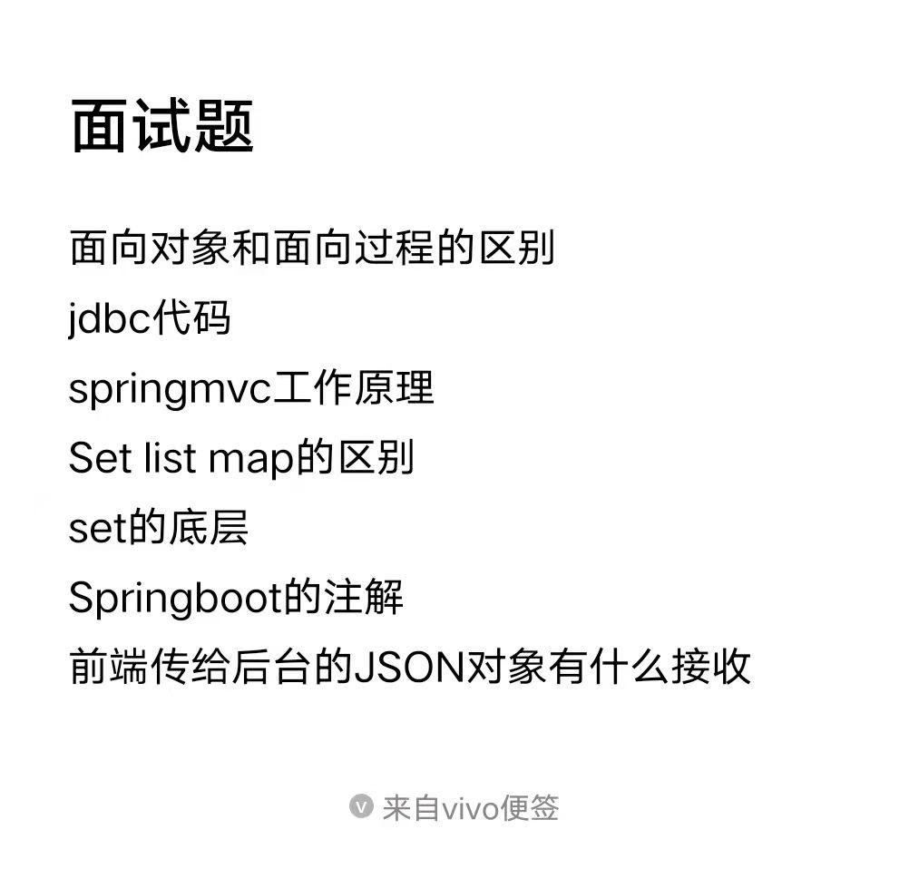

</details>

---

<a id="source-46"></a>

### 学习资料收藏截图

**来源：** `dbdb29caf3394368f468be45a201025.png`

原图为收藏夹，不是完整试卷，仅记录可见资料标题与摘要，不补写未显示的正文。

1. Java Lambda 表达式的使用。

2. String、StringBuffer、StringBuilder 的区别。

3. 原生 JavaScript Ajax 与 jQuery Ajax 代码示例。

4. Spring MVC 常见面试题总结。

5. Java 基本数据类型与包装类型的区别。

6. Docker 常用命令（底部标题部分可见）。

#### 补充参考答案（逐项对应）

##### Java Lambda 表达式的使用。

**参考答案：** String 不可变；StringBuilder 可变且不保证线程安全；StringBuffer 的主要方法有同步保护，多步骤组合仍可能需要外部同步。常见反转：new StringBuilder(s).reverse().toString()；处理用户感知字符如组合字符、表情序列时需额外定义反转规则。Lambda 是函数式接口实例的一种写法，例如 list.forEach(x -> System.out.println(x))；捕获的局部变量必须是 final 或 effectively final。

##### String、StringBuffer、StringBuilder 的区别。

**参考答案：** String 不可变；StringBuilder 可变且不保证线程安全；StringBuffer 的主要方法有同步保护，多步骤组合仍可能需要外部同步。常见反转：new StringBuilder(s).reverse().toString()；处理用户感知字符如组合字符、表情序列时需额外定义反转规则。Lambda 是函数式接口实例的一种写法，例如 list.forEach(x -> System.out.println(x))；捕获的局部变量必须是 final 或 effectively final。

##### 原生 JavaScript Ajax 与 jQuery Ajax 代码示例。

**参考答案：** jQuery 是 JavaScript 库，常用能力包括选择／DOM 操作、事件、Ajax；所谓“三大核心”不是正式固定规范。选择器示例 #id、.class、标签与属性选择器。$("#name").val("张三") 改表单值，.text 改文本，.html 解析 HTML；给不可信内容使用 .text。$(function(){...}) 在 DOM 就绪后执行，不必等图片全部加载。Ajax 是异步网络请求与局部更新模式，同步请求会阻塞；可用 fetch／XMLHttpRequest 或 $.ajax。

[相关代码／实现示例](#program-ajax)。

##### Spring MVC 常见面试题总结。

**参考答案：** 核心前端控制器为 DispatcherServlet：接收请求 → HandlerMapping 找处理器 → HandlerAdapter 调用 Controller → 返回结果。视图场景解析 ModelAndView 并渲染；@ResponseBody／@RestController 场景由消息转换器序列化为 JSON 等响应。Controller 负责协议与参数，Service 处理业务和事务，DAO／Mapper 访问数据。仅接收 GET 可用 @GetMapping。JSON 请求体用 @RequestBody DTO 接收并校验。

##### Java 基本数据类型与包装类型的区别。

**参考答案：** Java 是面向对象、具有静态类型检查的语言，代码编译成字节码，由目标平台的 JVM 执行；支持垃圾回收、异常处理、多线程和丰富类库。跨平台依赖对应平台的 JVM，并不代表本机代码或所有外部依赖都自动跨平台。基本类型为 byte、short、int、long、float、double、char、boolean；前七种大小依次为 1、2、4、8、4、8、2 字节，boolean 的具体存储布局由 JVM 实现决定。包装类可为 null，可用于泛型；基本类型不能为 null，拆箱 null 会抛 NullPointerException。

##### Docker 常用命令（底部标题部分可见）。

**参考答案：** docker build 构建镜像，docker pull 拉取，docker run 创建并启动容器，docker ps 查看运行容器，docker logs 查看日志，docker exec 执行容器内命令，docker stop 停止。镜像是只读模板，容器是其实例；数据需用卷／挂载持久化，不能默认容器重建后本地可写层数据还存在。

<details>
<summary>查看原图（含原始选项、手写内容或参考图）</summary>

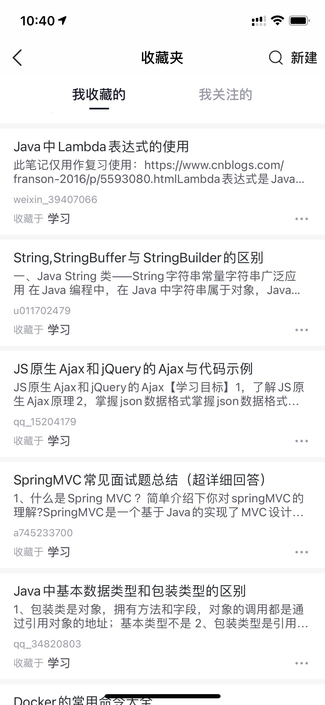

</details>

---

<a id="source-49"></a>

### meta面试题

**来源：** `meta面试题.txt`

线性表；

二叉树，b-tree，二叉平衡树，红黑树；

hashmap结构；hash冲突；

底层方法如何调用；

多态的理解；

数据库索引；

宏定义；

#### 补充参考答案（逐项对应）

##### 线性表；

**参考答案：** 线性表是一对一的逻辑序列，可用顺序表或链表存储。栈后进先出，用于调用、括号匹配、撤销；队列先进先出，用于缓冲、任务调度、BFS。二叉树每节点最多两个孩子；BST 有键序；AVL 约束高度平衡；红黑树用颜色约束保持近似平衡；B-tree 是多路平衡搜索树，B+tree 的数据记录在叶层、叶子相连，适合磁盘索引与范围扫描。哈希冲突可用链地址或开放寻址处理。

##### 二叉树，b-tree，二叉平衡树，红黑树；

**参考答案：** 线性表是一对一的逻辑序列，可用顺序表或链表存储。栈后进先出，用于调用、括号匹配、撤销；队列先进先出，用于缓冲、任务调度、BFS。二叉树每节点最多两个孩子；BST 有键序；AVL 约束高度平衡；红黑树用颜色约束保持近似平衡；B-tree 是多路平衡搜索树，B+tree 的数据记录在叶层、叶子相连，适合磁盘索引与范围扫描。哈希冲突可用链地址或开放寻址处理。

##### hashmap结构；hash冲突；

**参考答案：** HashMap 不保证遍历顺序，也不是线程安全的。以 Java 8 常见实现为例，它由桶数组、链表及红黑树组织冲突节点；树化涉及链长阈值与数组容量条件，扩容会重新分配桶。哈希相同仍需 equals 区分键。LinkedHashMap 可保持插入／访问顺序，TreeMap 按键排序。并发共享优先 ConcurrentHashMap；它不接受 null 键和值。Hashtable 与 Vector 对主要方法同步，组合操作不因此自动原子。

##### 底层方法如何调用；

**参考答案：** 先确认是 JVM 字节码调用、JNI 还是操作系统调用。JVM 常见 invoke 指令：invokestatic 调静态，invokevirtual 调一般实例，invokeinterface 调接口，invokespecial 用于构造器／特定调用，invokedynamic 用于动态链接等。Stream 用 map／filter 等中间操作构建惰性流水线，再用 collect／reduce／forEach 等终止操作执行；一个 Stream 通常只能消费一次。

##### 多态的理解；

**参考答案：** 面向过程围绕步骤组织函数；面向对象围绕对象的状态与行为组织程序。封装隐藏实现、保护状态；继承复用并扩展行为；多态允许父类／接口引用指向不同实现，调用被重写的实例方法时按实际对象分派。例：Animal a = new Dog(); a.speak(); 执行 Dog 的实现。Java 类只能继承一个直接父类，但可实现多个接口；接口可继承多个接口。不能笼统认为某一种编程范式必然性能更高。

##### 数据库索引；

**参考答案：** 索引用空间与写入维护成本换取查询效率，常用于高选择性过滤、关联和排序字段。InnoDB 聚簇索引叶子存行，二级索引叶子通常存主键，必要时回表。组合索引关注左前缀、范围与排序条件；函数、隐式类型转换、前置通配符、选择性过低等可能使优化器不选该索引，但不能绝对说某个 SQL 写法必然“失效”。用 EXPLAIN／实际耗时定位，减少无用列、批量处理、避免 N+1。

##### 宏定义；

**参考答案：** 通常通过 new、反射构造器、clone（有相关契约）或反序列化取得对象；不同方式是否运行构造器不同。反射读取运行时类型元数据并调用成员，框架据此装配对象，需考虑访问限制与性能。泛型提供编译期类型约束和复用，通常经类型擦除；List<Integer> 不是 List<Number> 的子类，读取协变常用 ? extends，写入逆变常用 ? super。宏定义属于 C/C++ 等预处理能力，Java 没有同类文本宏。

若问题指 C/C++：对象宏例 `#define MAX_SIZE 100`，函数宏例 `#define SQUARE(x) ((x)*(x))`，是预处理文本替换，不具有普通函数的参数求值规则；`SQUARE(i++)` 有副作用风险。Java 常量常用 static final，不支持该文本宏。


---

<a id="source-53"></a>

### 天深科技：手写面经

**来源：** `天深科技\3aed287d4dba32c2d56459cb5c22e54.jpg`

1. 蚁群算法。

2. 了解公司情况。（手写原文为“阿尔法公司怎么样”，具体公司称呼按原图核对）

3. 南开成果管理系统的流程。

4. Linux 命令。

5. Spring MVC 相关知识。

#### 补充参考答案（逐项对应）

##### 蚁群算法。

**参考答案：** 蚁群算法是受觅食信息素启发的随机优化方法：按信息素和启发值概率选择下一步，完成路径后更新信息素，同时蒸发旧信息素，迭代趋向优质解。可用于旅行商／路径优化，参数含蚂蚁数、信息素权重、启发权重、蒸发率；它是启发式方法，不保证每次得到全局最优。

##### 了解公司情况。（手写原文为“阿尔法公司怎么样”，具体公司称呼按原图核对）

**参考答案／个人回答模板：** 公司了解使用已经核实的业务、产品、岗位职责，不按照片中的名字臆造事实。薪资表达“期望［税前区间］，结合职责、城市及总包沟通”，金额由本人确定。反问可问团队职责、试用期目标、技术栈、培养／反馈和后续流程。籍贯、校园人物、地点、遗憾和特殊经历用本人真实故事，不提供虚构标准答案。

##### 南开成果管理系统的流程。

**参考答案／个人回答模板：** 按背景—目标—职责—行动—结果组织：项目解决［业务问题］，我负责［模块］；困难是［具体故障／约束］，先通过［日志／复现／测量］定位，再采用［方案］，以［测试／指标］验证。明确个人贡献与团队协作，别编造用户量、性能数字或独立完成经历。未做过的技术可回答了解原理及准备如何验证。

当前没有该系统的需求与个人项目事实。可作为**假设性成果管理流程**说明：成果填报／附件上传 → 格式校验 → 提交审核 → 审核通过或退回 → 修订 → 归档／查询统计；角色、状态、审计日志和访问控制需按真实系统核对。

##### Linux 命令。

**参考答案：** pwd 看目录，ls 列文件，cd 切换，cp／mv 复制移动，mkdir 建目录，rm 删除，chmod 改权限，chown／chgrp 改所属。tar -xzf a.tar.gz 解压，ps aux 看进程，ss -lntp 看监听端口，systemctl status mysql／mysqld 看服务（名称依安装），tail -f app.log 跟踪日志。跨机器复制用 scp file user@host:/path/，更大数据可用 rsync；操作前核对路径与权限。

##### Spring MVC 相关知识。

**参考答案：** 核心前端控制器为 DispatcherServlet：接收请求 → HandlerMapping 找处理器 → HandlerAdapter 调用 Controller → 返回结果。视图场景解析 ModelAndView 并渲染；@ResponseBody／@RestController 场景由消息转换器序列化为 JSON 等响应。Controller 负责协议与参数，Service 处理业务和事务，DAO／Mapper 访问数据。仅接收 GET 可用 @GetMapping。JSON 请求体用 @RequestBody DTO 接收并校验。

<details>
<summary>查看原图（含原始选项、手写内容或参考图）</summary>

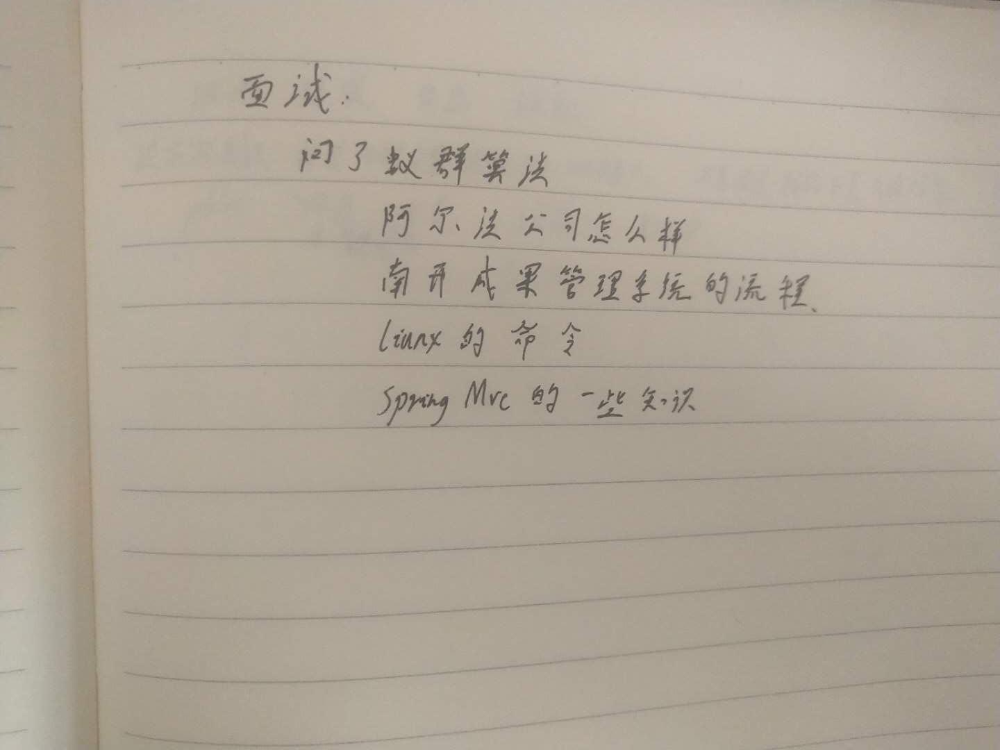

</details>

---

<a id="source-54"></a>

### 新建文本文档

**来源：** `灵创智恒\新建文本文档.txt`

集合

springmvc的理解

springcloud

多表联查

arraylist和linklist

redis八种数据类型

#### 补充参考答案（逐项对应）

##### 集合

**参考答案：** List 表示有序可重复序列；Set 表示不重复元素集合；Map 表示键值映射，不是 Collection 子接口。ArrayList 是动态数组，LinkedList 是双向链表，HashSet 通常基于 HashMap，TreeSet 基于有序树，ArrayDeque 可实现栈或队列。Collections 是工具类；Stream 是数据处理流水线，不是存储容器。

##### springmvc的理解

**参考答案：** 核心前端控制器为 DispatcherServlet：接收请求 → HandlerMapping 找处理器 → HandlerAdapter 调用 Controller → 返回结果。视图场景解析 ModelAndView 并渲染；@ResponseBody／@RestController 场景由消息转换器序列化为 JSON 等响应。Controller 负责协议与参数，Service 处理业务和事务，DAO／Mapper 访问数据。仅接收 GET 可用 @GetMapping。JSON 请求体用 @RequestBody DTO 接收并校验。

##### springcloud

**参考答案：** 微服务按业务能力拆成可独立部署的服务，通过 API／消息协作；收益是独立演进与扩展，代价是网络故障、分布式一致性、可观测性和运维复杂度。Spring Boot 构建应用，Spring Cloud 提供服务协作相关集成；常见能力为注册发现、配置、网关、声明式调用、负载均衡和容错。组件与版本演进很快，不把早期 Netflix 套件当当前固定清单。

##### 多表联查

**参考答案：** INNER JOIN 返回匹配行；LEFT JOIN 与 LEFT OUTER JOIN 等价，保留左表所有行；RIGHT JOIN 保留右表。保留未匹配行时，右表过滤通常放 ON，放 WHERE 可能把外连接变成内连接。例：SELECT e.name,d.name FROM employee e LEFT JOIN department d ON e.dept_id=d.id; 三种连接根据是否需要保留未匹配记录选择。

##### arraylist和linklist

**参考答案：** ArrayList 随机访问 O(1)，中间插入／删除需要移动后续引用 O(n)，尾部追加均摊 O(1)；LinkedList 定位第 i 个节点 O(n)，已持有节点／迭代器位置后的插入删除 O(1)。从索引定位再在 5000 万位置插入时，两者都可能 O(n)，不能直接断言链表更快；数组局部性通常更好。链表每元素还保存节点及前后引用，通常更占内存；数组也有闲置容量。数据规模改变常数、缓存和 GC 成本，不改变这些渐近复杂度。

##### redis八种数据类型

**参考答案：** Redis 是内存数据结构服务，常用于缓存、计数、限流、会话等。常见基础类型：String、Hash、List、Set、ZSet；还可谈 Bitmap、HyperLogLog、Geo、Stream 等能力，不能说固定只有“八种”。String 可用整数编码或动态字符串表示；小集合与大集合可能使用不同编码。ZSet 常见大规模表示为字典加跳表，小数据可能用紧凑结构。具体底层编码与阈值需按版本说明。


---

<a id="written-tests"></a>

## 三、完整笔试与实操题

<a id="source-2"></a>

### 2021中软实习笔试题目

**来源：** `2021中软实习笔试题目.doc`

中软国际校园招聘笔试试题

一、选择题（每题4分，共 20分）

#### 1.给定以下代码，程序将输出 （）（选择一项）

```java
class A {
public A(){
System.out.println("A");
}
}
class B extends A{
public B(){
System.out.println("B");
}
public static void main(String[] args) {
```

B b=new B();

```java
}
}
```

- A.不能通过编译

- B.通过编译，输出AB

- C.通过编译，输出B

- D.通过编译，输出A

#### 2.下面程序的运行结果（）（选择一项）

```java
public static void main(String[] args) {
Thread t=new Thread(){
public void run(){
pong();
}
};
t.run();
System.out.println("ping");
}
static void pong(){
System.out.println("pong");
}
```

- A. pingpong

- B. pongping

- C. pingpong和pongping都有可能

- D. 都不输出

以下结构中，插入性能最高的是（）

- A. ArrayList

- B. Linkedlist

- C. tor

- D. Collection

#### 4.设有关系R(A,B,C,D)及其上的函数相关性集合F={B→A,BC→D},那么关系R最高是（）

- A.第一范式的

- B.第二范式的

- C.第三范式的

- D.BCNF范式的

#### 5.关于 Vue 组件间的参数传递，下列哪项是不正确的？()

- A. 若子组件给父组件传值，可使用 $emit 方法

- B. 祖孙组件之间可以使用 provide 和 inject 方式跨层级相互传值

- C. 若子组件使用 $emit('say') 派发事件,父组件可使用 @say 监听

- D. 若父组件给子组件传值，子组件可通过 props 接受数据

二、简答题（每题10分，共 80分）

#### 1.写一个用jdbc连接并访问oracle数据的程序代码（5分）

#### 2.求出小于45岁的各个老师所带的大于12岁的学生人数

数据库中有3个表 teacher 表，student表，tea_stu关系表。

teacher 表 teaID name age

student 表 stuID name age

teacher_student表 teaID stuID

要求用一条sql查询出这样的结果

#### 1.显示的字段要有老师name, age 每个老师所带的学生人数

2 只列出老师age为40以下，学生age为12以上的记录（5分）

使用js怎么弹出一个新窗口，使用哪个函数方法，参数有哪些？（5分）

VUE中导航钩子函数有哪些？它们有哪些参数？（5分）

sprinmvc工作原理？（5分）

什么是maven本地仓库？Maven到底有哪些仓库？他们什么关系？（5分）

mybatis中#和$的区别？（5分）

#### 9.现有学生表STUDENT、课程表COURSE、得分表SCORE、教师表TEACHER，其建表语句如下：

```sql
CREATE TABLE STUDENT
```

(

SNO VARCHAR(3) NOT NULL,

SNAME VARCHAR(4) NOT NULL,

SSEX VARCHAR(2) NOT NULL,

SBIRTHDAY DATETIME,

```java
    CLASS VARCHAR(5));
```

```sql
CREATE TABLE COURSE
```

(

CNO VARCHAR(5) NOT NULL,

CNAME VARCHAR(10) NOT NULL,

TNO VARCHAR(10) NOT NULL) ;

```sql
CREATE TABLE SCORE 
```

(

SNO VARCHAR(3) NOT NULL,

CNO VARCHAR(5) NOT NULL,

DEGREE NUMERIC(10, 1) NOT NULL);

```sql
CREATE TABLE TEACHER 
```

(

TNO VARCHAR(3) NOT NULL,

TNAME VARCHAR(4) NOT NULL, TSEX VARCHAR(2) NOT NULL,

TBIRTHDAY DATETIME NOT NULL, PROF VARCHAR(6),

DEPART VARCHAR(10) NOT NULL) ;

初始化数据

```sql
INSERT INTO STUDENT (SNO,SNAME,SSEX,SBIRTHDAY,CLASS) VALUES (108 ,'曾华','男' ,1987-09-01,95033);
INSERT INTO STUDENT (SNO,SNAME,SSEX,SBIRTHDAY,CLASS) VALUES (105 ,'匡明','男' ,1985-10-02,95031);
INSERT INTO STUDENT (SNO,SNAME,SSEX,SBIRTHDAY,CLASS) VALUES (107 ,'王丽','女' ,1986-01-23,95033);
INSERT INTO STUDENT (SNO,SNAME,SSEX,SBIRTHDAY,CLASS) VALUES (101 ,'李军','男' ,1986-02-20,95033);
INSERT INTO STUDENT (SNO,SNAME,SSEX,SBIRTHDAY,CLASS) VALUES (109 ,'王芳','女' ,1985-02-10,95031);
INSERT INTO STUDENT (SNO,SNAME,SSEX,SBIRTHDAY,CLASS) VALUES (103 ,'陆君','男' ,1984-06-03,95031);
```

```sql
INSERT INTO COURSE(CNO,CNAME,TNO)VALUES ('3-105','计算机导论',825);
INSERT INTO COURSE(CNO,CNAME,TNO)VALUES ('3-245','操作系统' ,804);
INSERT INTO COURSE(CNO,CNAME,TNO)VALUES ('6-166','数据电路' ,856);
INSERT INTO COURSE(CNO,CNAME,TNO)VALUES ('9-888','高等数学' ,100);
```

```sql
INSERT INTO SCORE(SNO,CNO,DEGREE)VALUES (103,'3-245',86);
INSERT INTO SCORE(SNO,CNO,DEGREE)VALUES (105,'3-245',75);
INSERT INTO SCORE(SNO,CNO,DEGREE)VALUES (109,'3-245',68);
INSERT INTO SCORE(SNO,CNO,DEGREE)VALUES (103,'3-105',92);
INSERT INTO SCORE(SNO,CNO,DEGREE)VALUES (105,'3-105',88);
INSERT INTO SCORE(SNO,CNO,DEGREE)VALUES (109,'3-105',76);
INSERT INTO SCORE(SNO,CNO,DEGREE)VALUES (101,'3-105',64);
INSERT INTO SCORE(SNO,CNO,DEGREE)VALUES (107,'3-105',91);
INSERT INTO SCORE(SNO,CNO,DEGREE)VALUES (108,'3-105',78);
INSERT INTO SCORE(SNO,CNO,DEGREE)VALUES (101,'6-166',85);
INSERT INTO SCORE(SNO,CNO,DEGREE)VALUES (107,'6-106',79);
INSERT INTO SCORE(SNO,CNO,DEGREE)VALUES (108,'6-166',81);
```

```sql
INSERT INTO TEACHER(TNO,TNAME,TSEX,TBIRTHDAY,PROF,DEPART)
VALUES (804,'李诚','男','1958-12-02','副教授','计算机系');
INSERT INTO TEACHER(TNO,TNAME,TSEX,TBIRTHDAY,PROF,DEPART)
VALUES (856,'张旭','男','1969-03-12','讲师','电子工程系');
INSERT INTO TEACHER(TNO,TNAME,TSEX,TBIRTHDAY,PROF,DEPART)
VALUES (825,'王萍','女','1972-05-05','助教','计算机系');
INSERT INTO TEACHER(TNO,TNAME,TSEX,TBIRTHDAY,PROF,DEPART) 
VALUES (831,'刘冰','女','1977-08-14','助教','电子工程系');
```

题目：

（1）查询Score表中至少有5名学生选修的并以3开头的课程的平均分数。（5分）

（2）查询选修某课程的同学人数多于5人的教师姓名。（5分）

（3）查询存在有85分以上成绩的课程信息。（5分）

（4）查询成绩比该课程平均成绩低的同学的成绩表（5分）。

（5）假设使用如下命令建立了一个grade表：

```sql
create table grade(low number(3,0),upp number(3),rank char(1));
insert into grade values(90,100,’A’);
insert into grade values(80,89,’B’);
insert into grade values(70,79,’C’);
insert into grade values(60,69,’D’);
insert into grade values(0,59,’E’);
```

现查询所有同学的Sno、Cno和rank列。（5分）

（6）查询score中选学一门以上课程的同学中分数为非最高分成绩的学生号。（5分）

（7）查询和学号为108的同学同年出生的所有学生的Sno、Sname和Sbirthday列。（5分）

（8）查询各科成绩前3的学生的Sno、Sname及课程的CNAME和得分DEGREE，若存在同课程相同得分的情况，则并列处理。（5分）

#### 补充参考答案：中软笔试

**选择题**

| 题号 | 答案 | 解析 |
| :--- | :--- | :--- |
| 1 | B，先 A 后 B | 创建 B 前先调用父类 A 的构造器，原程序分别 println，因此实际分两行输出。 |
| 2 | B，pong 后 ping | 调用的是 t.run()，不是 t.start()，因此在当前线程顺序执行。 |
| 3 | 需限定场景；原题常期待 B | 已定位到链表节点时插入 O(1)；按索引先定位则 O(n)。Collection 是接口，选项 “tor” 不完整，不能给无条件性能排名。 |
| 4 | A，第一范式 | BC 是候选键，B→A 是非主属性对候选键部分的函数依赖，违反第二范式。这里按题目属性原子性成立的常见前提。 |
| 5 | B 的表述不准确 | provide/inject 是祖先向后代提供依赖，不是自动双向传值；共享响应式对象可形成交互，但需明确谁负责修改。 |

**简答题**

1. JDBC 程序见 [Oracle 查询完整示例](#program-jdbc)。
2. 教师与学生统计：原题分别写“老师小于 45”和“老师小于 40”，不一致；以下按后面的明确查询要求 `<40`，如按题首则把 40 改为 45。关系表名称统一采用 `teacher_student`，真实表若为 `tea_stu` 则替换。

```sql
SELECT t.teaID, t.name, t.age, COUNT(DISTINCT s.stuID) AS student_count
FROM teacher t
JOIN teacher_student ts ON ts.teaID = t.teaID
JOIN student s ON s.stuID = ts.stuID
WHERE t.age < 40 AND s.age > 12
GROUP BY t.teaID, t.name, t.age;
```

该写法只返回有符合条件学生的老师；若要保留人数为 0 的老师，使用 LEFT JOIN，把学生年龄过滤放在学生连接的 ON 中，并保留 `COUNT(s.stuID)`。

3. 新窗口用 `window.open(url,target,features)`，完整示例见 [前端实现](#program-ajax)。
4. Vue Router 导航守卫：全局 `beforeEach`、`beforeResolve`、`afterEach`；路由 `beforeEnter`；组件 `beforeRouteEnter`、`beforeRouteUpdate`、`beforeRouteLeave`。常见参数为 to、from，旧版／可选 next 要按版本使用；`afterEach` 不用于阻止导航。Vue 3 的组合式 API 另有对应钩子。
5. Spring MVC：DispatcherServlet → HandlerMapping → HandlerAdapter → Controller → 视图或消息转换器返回响应。
6. Maven 本地仓库存缓存与本机 install 的构件，远程仓库含中央仓库和私服，按配置解析依赖并缓存；详见 [Maven 仓库说明](https://maven.apache.org/guides/introduction/introduction-to-repositories.html)。
7. MyBatis `#{}` 是参数绑定，`${}` 是字符串替换；动态列名用白名单，不把用户输入直接替换成 SQL。

**第 9 题：八条 SQL**

以下使用 MySQL 8+ 语法，前六条基础查询也可按 Oracle 语法使用；第 7 条 YEAR 在 Oracle 中改为 `EXTRACT(YEAR FROM ...)`。按一学生一课程一条成绩记录设计，应给 `(SNO,CNO)` 唯一约束。原初始化数据的日期未加引号、课程号 `6-106` 与课程表不一致，执行前需核对。

```sql
-- (1) 以 3 开头且至少 5 人选修的课程平均分
SELECT CNO, AVG(DEGREE) AS avg_degree
FROM SCORE
WHERE CNO LIKE '3%'
GROUP BY CNO
HAVING COUNT(DISTINCT SNO) >= 5;

-- (2) 某课程选修人数多于 5 的教师
SELECT DISTINCT t.TNO, t.TNAME
FROM TEACHER t
JOIN COURSE c ON c.TNO = t.TNO
JOIN (SELECT CNO FROM SCORE GROUP BY CNO
      HAVING COUNT(DISTINCT SNO) > 5) x ON x.CNO = c.CNO;

-- (3) 存在 85 分以上成绩的课程
SELECT c.* FROM COURSE c
WHERE EXISTS (SELECT 1 FROM SCORE s
              WHERE s.CNO = c.CNO AND s.DEGREE > 85);

-- (4) 低于该课程平均分的成绩记录
SELECT s.* FROM SCORE s
JOIN (SELECT CNO, AVG(DEGREE) AS avg_degree FROM SCORE GROUP BY CNO) a
  ON a.CNO = s.CNO
WHERE s.DEGREE < a.avg_degree;

-- (5) 根据原 grade 表的区间匹配等级
SELECT s.SNO, s.CNO, g.rank
FROM SCORE s JOIN grade g ON s.DEGREE BETWEEN g.low AND g.upp;

-- (6) 选修多于一门课，且该条成绩不是该学生自己的最高分
SELECT DISTINCT s.SNO
FROM SCORE s
JOIN (SELECT SNO, MAX(DEGREE) AS max_degree FROM SCORE
      GROUP BY SNO HAVING COUNT(DISTINCT CNO) > 1) a ON a.SNO = s.SNO
WHERE s.DEGREE < a.max_degree;

-- (7) 与 108 号学生同年出生（包含本人，若排除加 AND s.SNO <> '108'）
SELECT s.SNO, s.SNAME, s.SBIRTHDAY
FROM STUDENT s
WHERE YEAR(s.SBIRTHDAY) =
      (SELECT YEAR(SBIRTHDAY) FROM STUDENT WHERE SNO = '108');

-- (8) 各课程前三名，分数并列采用竞赛排名：1、1、3
WITH ranked AS (
  SELECT SNO, CNO, DEGREE,
         RANK() OVER (PARTITION BY CNO ORDER BY DEGREE DESC) AS rn
  FROM SCORE
)
SELECT s.SNO, s.SNAME, c.CNAME, r.DEGREE
FROM ranked r JOIN STUDENT s ON s.SNO = r.SNO
JOIN COURSE c ON c.CNO = r.CNO
WHERE r.rn <= 3
ORDER BY r.CNO, r.DEGREE DESC, r.SNO;
```

第 5 条按原表匹配；若成绩可出现 89.5 之类小数，原 grade 的 80～89／90～100 会留空档，应统一为半开区间等连续规则。第 6 条“非最高分”也可能指某课程最高分，需要先澄清；若按课程最高分，则把聚合键改为 CNO，另单独筛选多门选课学生。第 8 条若要求“前三种不同分数”，使用 DENSE_RANK，区别于前三个竞赛名次。


---

<a id="source-6"></a>

### 算法步骤二：数字展开并重复

**来源：** `74be891414592b569d4491f7206dee4.png`

对一个整数取绝对值，将各位数字按从高位到低位顺序取出，复制 6 次，按复制顺序拼成数组，不包括被复制的原数组。将结果传给下一步骤。
```text
输入：1241
输出：[1,2,4,1, 1,2,4,1, 1,2,4,1, 1,2,4,1, 1,2,4,1, 1,2,4,1]
```

#### 补充参考答案

用 `repeatDigits` 取绝对值并展开 6 次，见 [6.3 完整代码](#program-algorithms)。先转 long 再取绝对值，避免 int 最小值溢出；输入 0 输出六个 0。

<details>
<summary>查看原图（含原始选项、手写内容或参考图）</summary>

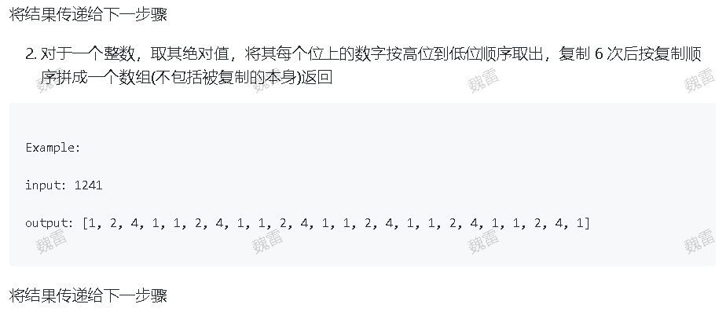

</details>

---

<a id="source-7"></a>

### 8d6f3025cfdbca35dd5c23f3789261e

**来源：** `8d6f3025cfdbca35dd5c23f3789261e.png`

21. 图的广度优先搜索类似于树的哪种遍历？A. 先根；B. 中根；C. 后根；D. 层次。
22. 事件节点网络中的关键路径是什么？A. 从源点到汇点的…；B. 从源点到汇点的…；C. 最长回路；D. 最短回路。A/B 后半文字在原截图中被截断。
23. 衡量查找算法效率的主要标准是什么？A. 元素个数；B. 所需存储量；C. 平均查找长度；D. 算法难易程度。
24. 适合动态查找表进行高效查找的组织结构是什么？A. 有序表；B. 分块有序表；C. 二叉排序树；D. 快速排序。
25. 关键字序列 `{35,84,21,47,15,27,68,25,20}` 的排序变化如下，使用了什么排序方法？A. 直接选择排序；B. 希尔排序；C. 快速排序；D. 堆排序。

```text
20,15,21,25,47,27,68,35,84
15,20,21,25,35,27,47,68,84
15,20,21,25,27,35,47,68,84
```

26. 从未排序序列依次取元素，与已排序序列比较并放入正确位置，这是什么排序？A. 希尔；B. 冒泡；C. 插入；D. 选择。
27. 从未排序序列挑选元素，依次插入已排序序列的一端，这是什么排序？A. 希尔；B. 归并；C. 插入；D. 选择。
28. 对 n 个不同排序码进行冒泡排序，元素无序时需比较多少次？A. n+1；B. n；C. n-1；D. n(n-1)/2。
29. 在有序表 `(12,24,36,48,60,72,84)` 中二分查找 72，需比较几次？A. 1；B. 2；C. 3；D. 4。
30. 数据表 A 中每个元素距最终位置不远，为节省排序时间选什么排序？A. 堆；B. 插入；C. 快速；D. 直接选择。
31. 合格率为 85%，合格品被判次品概率 10%，次品被判合格品概率 5%。被判为合格品的产品确实合格的概率是多少？A. 75%；B. 99%；C. 91.5%；D. 85%。

截图保留原答题者选择与平台“正确／错误”标记，本文没有把个人所选答案直接当作标准答案。

#### 补充参考答案：上海策良第 21～31 题

| 题号 | 答案 | 解析 |
| :--- | :--- | :--- |
| 21 | D | BFS 用队列按层扩展，对应层次遍历。 |
| 22 | 从源到汇的最长路径 | A/B 原文字被截断，按关键路径的定义回答，不补猜完整选项。最长路径决定项目最短完工时间。 |
| 23 | C | 常用平均查找长度衡量关键字比较次数。 |
| 24 | C | 二叉排序树支持动态插入、删除、查找；普通树可能退化，平衡树才有稳定对数级保证。 |
| 25 | C | 分区后 84 等枢轴已到位，后续递归处理子区间，体现快速排序。 |
| 26 | C | 逐个插入已排序区间的正确位置。 |
| 27 | D | 每次挑选未排序区间的最小／最大元素放到边界。 |
| 28 | D（通常教材的固定趟数实现） | n(n−1)/2；若实现带“未交换提前结束”，实际比较数与输入相关。 |
| 29 | B，2 次 | 先比 48，再比 72。 |
| 30 | B | 插入排序在几乎有序数据上移动次数少。 |
| 31 | B 为近似值 | P(合格\|判合格)=0.85×0.9/(0.85×0.9+0.15×0.05)=102/103≈99.03%。 |

<details>
<summary>查看原图（含原始选项、手写内容或参考图）</summary>


</details>

---

<a id="source-8"></a>

### 众齐软件开发工程师笔试

**来源：** `971add10dcacfb2c06632129e78e0e6.jpg`

考试时间：60 分钟。

1. 十六进制数 1506H 转成十进制的结果是什么？

2. 主机与打印机速度不匹配时，设置打印数据缓冲区。主机一次写入数据，打印机依次读取，该缓冲区应使用什么数据结构？递归算法一般需要利用什么实现？

3. 用生活中的例子说明对 Java 继承和接口的理解。

4. 数组相较链表、链表相较数组分别有什么优势？为什么？

5. 项目中最难攻克的技术或功能是什么？如何解决？现在如何理解？

6. 只含质因子 2、3、5 的数称为丑数，1 为第一个特殊丑数。前十个为 1、2、3、4、5、6、8、9、10、12。编程求第 i 个丑数并输出。

7. 100 匹马驮 100 块石头：大马每匹驮 3 块，中马每匹驮 2 块，小马每 2 匹驮 1 块。求三种马各多少匹，并写计算过程。

8. 5～10 年后的职业规划更适合专业技术人员还是管理人员？依据是什么？

#### 补充参考答案：众齐软件

1. `1506H = 1×16³ + 5×16² + 0×16 + 6 = 5382`。
2. 打印缓冲适合 FIFO 队列；递归调用通常利用调用栈保存状态。
3. 继承示例：猫是动物；接口示例：能游泳是一种能力，鱼和游泳机器人都可实现，但不必继承同一具体父类。
4. 数组支持 O(1) 下标访问且局部性好；链表已定位节点后的插入／删除方便，但定位仍需遍历、节点也更占空间。
5. 按［业务背景］—［难点］—［定位证据］—［方案］—［验证结果］描述自己的真实经历，不虚构项目。
6. 三指针动态规划计算第 i 个丑数，完整代码见 [6.3](#program-algorithms)；i 从 1 开始，首项为 1。
7. 设大、中、小马为 x、y、z：x+y+z=100，3x+2y+z/2=100，消去 z 得 5x+3y=100。非负整数解为 `(2,30,68)、(5,25,70)、(8,20,72)、(11,15,74)、(14,10,76)、(17,5,78)、(20,0,80)`；若要求三种都至少一匹，删除最后一组，**题目没有唯一解**。
8. 模板：“近期先形成独立交付能力，长期根据技术深度、协作能力与兴趣决定技术或管理方向。”应以自己的真实规划替换。

<details>
<summary>查看原图（含原始选项、手写内容或参考图）</summary>

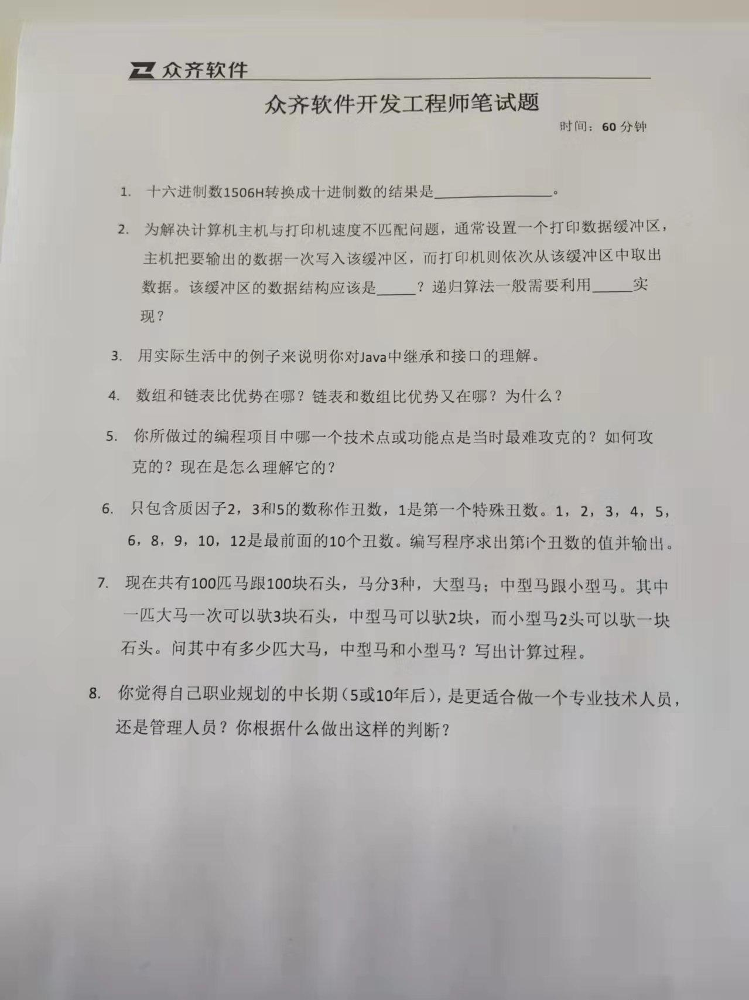

</details>

---

<a id="source-14"></a>

### 北京智慧云：逻辑推理笔试

**来源：** `北京智慧云.jpg`、`智慧云\a6cc8828c1b9b3ea47378ddf27400e6.jpg`

1. 三种桌子的单价：三个条件包括单价各不相同、单价总和为 4000 元、某种单价比另一种便宜 400 元、某种单价是另一种的 2 倍。求三种桌子的单价。**具体类型名称与部分条件被笔遮挡，详见原图，不补猜。**

2. 赵女士买了水果与零食探望朋友，物品被四个儿子之一偷吃。四人分别说：老大“是老二吃的”；老二“是老四偷吃的”；老三“我没有偷吃”；老四“老二在说谎”。四人中只有一个在说谎，问谁偷吃？

3. 张三、李四、王五来自天津、北京、上海，比赛获一、二、三等奖。条件：张三不是天津选手；李四不是北京选手；天津选手不是一等奖；北京选手得二等奖；李四不是三等奖。判断三人来自哪里，各获几等奖。

4. 四对夫妻共八人：刘、王、孙、周、李、吴、张、郑。刘结婚时王来送礼；王和孙在同一排球队；李是孙与周的爱人的表哥；周夫妇与邻居吵架，吴、王、张来助阵；李、吴、王婚前住同一宿舍。判断各人的性别及夫妻配对。

#### 补充参考答案：智慧云逻辑题

1. **当前题干不能确定类型与价格的唯一对应**。需要补全“哪种比哪种便宜 400”“哪种是另一种两倍”。例：若设 A=B−400、C=2A、A+B+C=4000，则为 A=900、B=1300、C=1800；这是明确假设下的示例，不是原题确定答案。
2. **老二偷吃**：老二与老四的发言互相否定，二者恰有一个说谎；因此老大和老三都必须说真话，老大指向老二，符合条件。
3. **张三：北京、二等奖；李四：上海、一等奖；王五：天津、三等奖**。北京第二、天津非第一，故上海第一；李四既非北京又非第三，只能上海第一，剩余按条件确定。
4. **按当前录入条件不能唯一配对**。同队、同宿舍并未明示性别；“李是孙与周的爱人的表哥”也有语义歧义。不能偷偷假设排球队／宿舍一定同性，再给唯一答案。可通过枚举性别与四组配对、逐条排除“结婚时来送礼的人不是配偶”等限制求候选；补全原题隐藏假设后才能确定。

<details>
<summary>查看原图（含原始选项、手写内容或参考图）</summary>


</details>

---

<a id="source-15"></a>

### 北京智慧云：手写编程与建模

**来源：** `北京智慧云a.jpg`、`智慧云\3970d6bbe29de79d8a92627a9f38f4b.jpg`

1. 读取文档，将文档中的内容放入 Map 集合，再放入另一个文档，统计出现的次数。（手写原记录中部分连接文字不清晰）

2. 设计数据库：涉及库存管理员、入库员、出库员、员工、商品。

#### 补充参考答案：智慧云手写题

1. 若题意是“文档词频统计并写入另一个文档”，使用 Map<词,次数>，逐行读取、分词计数、按词或次数排序输出，见 [6.5](#program-files)。中文统计先明确按字还是按词。
2. 假设是库存系统：不要把库存管理员、入库员、出库员分别建成三个员工表；建 employee、role、employee_role 表分配角色，product 表存商品，warehouse 表存仓库，inventory 表存商品—仓库库存；入库／出库单分 header 与 item 表，关联经办人和商品。库存变化与单据写入置于事务，校验数量非负、防重复提交和并发超卖；需要追踪时记录库存流水。题目未给字段／业务细节，不补造实际项目规则。

<details>
<summary>查看原图（含原始选项、手写内容或参考图）</summary>

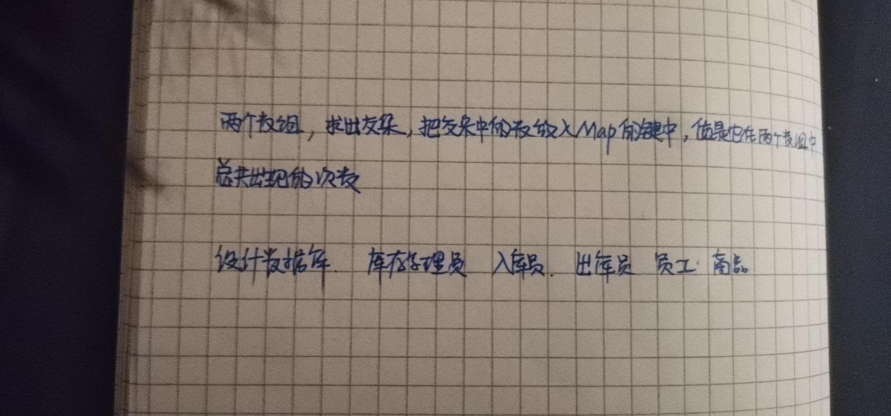

</details>

---

<a id="source-23"></a>

### 联想云：选择题后半与简答题

**来源：** `联想云1.jpg`、`联想云\0261d0f50af004f0b236eb6564a1acc.jpg`、`联想协同\e1967f7e54ffb627313f52bb8c81aa7.jpg`

**图片从第 5 题部分选项开始，第 5 题题干在另一张图中。原图有手写作答，未作为标准答案。**

5. 下列说法正确的是：A. LinkedList 继承自 List；B. AbstractSet 继承自 Set；C. HashSet 继承自 AbstractSet；D. WeakMap 继承自 HashMap（选项 D 按原图拼写保留）。

6. 0.6332 的数据类型是：A. float；B. double；C. Float；D. Double。

7. 哪个流属于面向字符的输入流：A. BufferedWriter；B. FileInputStream；C. ObjectInputStream；D. InputStreamReader。

8. Java 接口的修饰符可以为：A. private；B. protected；C. final；D. abstract。

9. ArrayList list = new ArrayList(20); 中 list 扩充几次：A. 0；B. 1；C. 2；D. 3。

10. 哪些是对称加密算法：A. DES；B. AES；C. DSA；D. RSA。

11. 新建流对象，哪个代码错误？
```java
// A
new BufferedWriter(new FileWriter("a.txt"));
// B
new BufferedReader(new FileInputStream("a.dat"));
// C
new GZIPOutputStream(new FileOutputStream("a.zip"));
// D
new ObjectInputStream(new FileInputStream("a.dat"));
```

#### 简答题

1. hashCode 相等，两个对象一定相等吗？equals 呢？反过来呢？（原图写“两个类”）

2. ArrayList、LinkedList、Vector 的区别。

3. synchronized 与 Lock 的区别；什么时候锁对象，什么时候锁类？

4. Spring 用到了哪些 Java 设计模式？AOP 底层如何实现？

5. MySQL 隔离级别有几种？举例说明。

6. 阐述 TCP 通信过程。

7. 进程、线程的定义及区别。

8. HTTP 响应码有哪些，代表什么含义？

#### 补充参考答案：联想云选择题与简答

**选择题（第 5～11 题）**

| 题号 | 答案 | 解析 |
| :--- | :--- | :--- |
| 5 | 按严格 extends 含义选 C | LinkedList implements List；AbstractSet implements Set；HashSet extends AbstractSet；JDK 没有题面所写的 WeakMap，WeakHashMap 也不 extends HashMap。若把“继承”泛称为实现接口，题目措辞存在歧义。 |
| 6 | B | 无 f／F 后缀的浮点字面量为 double。 |
| 7 | D | InputStreamReader 是字符读取桥接；FileInputStream／ObjectInputStream 为字节流，BufferedWriter 是输出。 |
| 8 | 顶层接口语境下 D | 顶层接口可 public／abstract 或包访问；声明在类中的成员接口可用 private／protected，因此未限定顶层时 A/B 也可能合法。 |
| 9 | A，0 次 | 容量 20 是初始容量，构造不导致扩容，size 仍为 0。 |
| 10 | A、B | DES、AES 为对称密码算法；RSA 非对称，DSA 为签名算法。DES 属于历史考点，不能据此推荐新系统使用。 |
| 11 | B | BufferedReader 要 Reader，不能直接接 FileInputStream；应包 InputStreamReader。 |

**简答**

1. equals 为 true 则 hashCode 必须相同；反向不成立；Object 默认 equals 为引用相等。
2. ArrayList 动态数组，LinkedList 双向链表，Vector 对主要方法同步；索引访问与插入定位成本应分别讨论。
3. synchronized 自动释放锁；Lock 需 finally unlock，支持更丰富获取方式。锁实例与锁 Class 区别见对应正文。
4. Spring 使用工厂、代理、模板、观察者、策略等；AOP 常用 JDK 接口代理或类代理，内部自调用可能绕过代理。
5. 四级隔离：读未提交、读已提交、可重复读、可串行化；如读已提交两次读取间另一事务提交更新，可出现不可重复读。
6. TCP SYN → SYN/ACK → ACK 建立连接；数据经序号、确认、重传等保证流传输，关闭使用 FIN／ACK，实际可合并报文。
7. 进程隔离资源与地址空间，线程共享进程资源、各自有栈等执行上下文。
8. 常见 HTTP 码：200 成功、201 创建、204 无体、301/302 跳转、304 缓存、400 参数错误、401 未认证、403 无权、404 不存在、409 冲突、429 限流、500/502/503/504 服务或网关错误。

<details>
<summary>查看原图（含原始选项、手写内容或参考图）</summary>

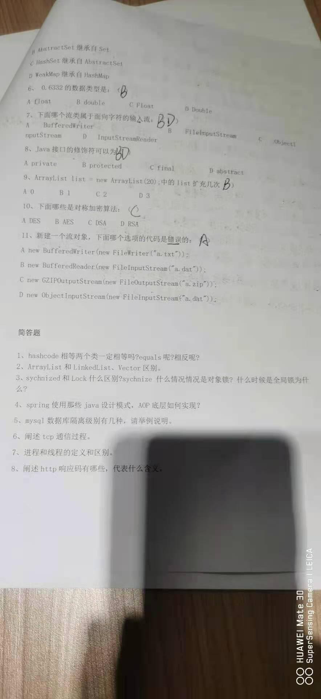

</details>

---

<a id="source-24"></a>

### 联想云：选择题前半

**来源：** `联想云2.jpg`、`联想云\bf49f3677837b7c1e8617ff55357a58.jpg`、`联想协同\c025947ef2fc6125f716de65b53e012.jpg`

联想云 2021 届校招 Java 笔试，选择题标注为多选。

1. 以下哪些是 Thread 类的方法？A. start()；B. run()；C. exit()；D. getPriority()。

2. 关于 java.lang.Exception 的说法正确的是哪些？A. 继承自 Throwable；B. Serializable；C. RuntimeException；D. IOException（按原图简略选项保留）。

3. 以下程序的运行结果：A. true；B. false；C. error；D. null。
```java
String str1 = "hello";
String str2 = "he" + new String("llo");
System.err.println(str1 == str2);
```

4. 以下程序的运行结果：A. pingpong；B. pongping；C. 两者都有可能；D. 都不输出。
```java
public static void main(String args[]) {
    Thread t = new Thread() {
        public void run() { pong(); }
    };
    t.run();
    System.out.print("ping");
}
static void pong() { System.out.print("pong"); }
```
第 5 题选项接下一张图片。

#### 补充参考答案：联想云第 1～4 题

1. **A、B、D**：Thread 有 start、run、getPriority，没有 exit。
2. **现有选项不足以唯一判断意图**：Exception extends Throwable，并通过父类实现 Serializable；RuntimeException 和 IOException 都是其子类，二者并不是父类。若选项意在问“哪种类属于 Exception”，应选择对应子类；按现有四个短语，不能照抄原手写 ACD。
3. **B，false**：str2 含运行时 new String，拼接结果不等于 str1 的引用；内容相等可用 equals。
4. **B，pongping**：run 在当前线程执行，先打印 pong 再打印 ping。

<details>
<summary>查看原图（含原始选项、手写内容或参考图）</summary>

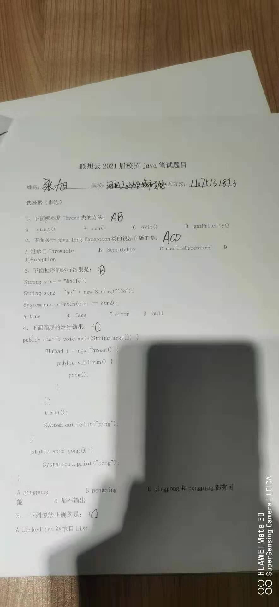

</details>

---

<a id="source-25"></a>

### 联想云：编程与 SQL

**来源：** `联想云3.jpg`、`联想云\05af2a5adadfa34dbf9a005e57e68d8.jpg`、`联想协同\de364ab470d5d20d2804de749a73eef.jpg`

#### 代码编写

1. 至少用四种写法实现单例模式。

2. 编写多线程程序，实现生产者与消费者。

3. 在上亿条日志的文本文件中查找有异常的日志，并确定行号；每行一条日志。

#### SQL 编写
```text
Student(SID, Sname, Sage, Ssex)
Course(CID, Cname, TID)
Teacher(TID, Tname)
SC(SID, CID, score)
```
SID 为学生编号；Sname 为姓名；Sage 为出生年月；Ssex 为性别；CID 为课程编号；Cname 为课程名；TID 为教师编号；Tname 为教师姓名；score 为分数。

1. 查询“01”课程比“02”课程成绩高的学生信息及课程分数，要求同时有两门课成绩。

2. 查询学过“张三”老师授课的学生信息。

3. 查询同时学过编号“01”和“02”课程的学生信息。

4. 查询有两门及以上不及格课程的学生学号、姓名及平均成绩。

#### 补充参考答案：联想云编程与 SQL

**代码题**：四种单例见 [6.1](#program-singleton)；生产者与消费者见 [6.4](#program-producer)；亿级日志按行读取、输出行号，见 [6.5](#program-files)。

**SQL**：以下假设 SC 的 (SID,CID) 唯一，不及格线为 60 分。

```sql
-- 1. 同时选 01/02，且 01 成绩更高
SELECT s.*, a.score AS score_01, b.score AS score_02
FROM Student s
JOIN SC a ON a.SID=s.SID AND a.CID='01'
JOIN SC b ON b.SID=s.SID AND b.CID='02'
WHERE a.score > b.score;

-- 2. 学过张三老师课程的学生，去掉多门课造成的重复
SELECT s.* FROM Student s
WHERE EXISTS (
  SELECT 1 FROM SC sc JOIN Course c ON c.CID=sc.CID
  JOIN Teacher t ON t.TID=c.TID
  WHERE sc.SID=s.SID AND t.Tname='张三'
);

-- 3. 同时选修 01 和 02
SELECT s.* FROM Student s
WHERE EXISTS (SELECT 1 FROM SC WHERE SID=s.SID AND CID='01')
  AND EXISTS (SELECT 1 FROM SC WHERE SID=s.SID AND CID='02');

-- 4. 至少两门不及格，平均分按全部已记录课程计算
SELECT s.SID, s.Sname, AVG(sc.score) AS avg_score
FROM Student s JOIN SC sc ON sc.SID=s.SID
GROUP BY s.SID,s.Sname
HAVING COUNT(DISTINCT CASE WHEN sc.score<60 THEN sc.CID END) >= 2;
```

<details>
<summary>查看原图（含原始选项、手写内容或参考图）</summary>

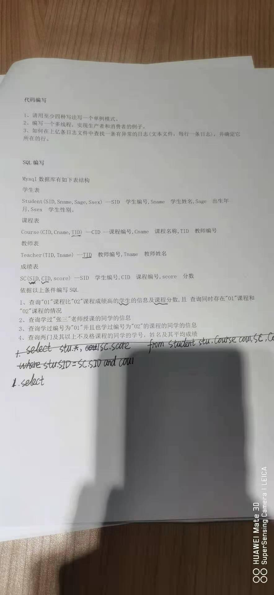

</details>

---

<a id="source-33"></a>

### 上海策良

**来源：** `上海策良.png`

#### 上海策良：计算机笔试（第 2～20 题）

原截图第 1 题为姓名填写。以下保留题目和可辨认选项；原界面用省略号截断的选项仍保留省略号，不推测缺失文字。完整可见画面见附图。

2. 设 `int x=1, float y=2`，表达式 `x/y` 的值。A. 0；B. 1；C. 2；D. 以上都不是。
3. 对下面的递归算法，计算 `m=fact(n)` 要调用多少次函数？可见选项包括 `n-1`、`n+2`、`n+1`；其他选项见原图。

```c
int fact(int n) {
    /* n 大于等于 0 */
    if (n <= 0) return 1;
    else return n * fact(n - 1);
}
```

4. 线性表最常见操作为尾部插入、删除首元素，最节省时间的存储方式是什么？A. 单链表；B. 仅有头指针的单…；C. 双链表；D. 仅有尾指针的单…。
5. 在循环链表中求当前节点的后继、前驱，时间复杂度分别是多少？A. O(n)、O(1)；B. O(1)、O(1)；C. O(1)、O(n)；D. O(n)、O(n)。
6. 非空单循环链表头指针为 head，尾指针为 rear，哪个条件成立？可见选项含 `rear->next==head`、`rear->next->next=…`、`head->next==rear`、`head->next->next=…`。
7. 长度 n 的顺序表删除第 i 个元素（1<i<n），向前移动多少元素？可见选项 `n-i`、`n-i+1`、`n-i-1`；其他见原图。
8. 有序表 `(13,18,24,35,47,50,62,83,90,115,134)` 中二分查找 90，需比较几次？A. 1；B. 2；C. 3；D. 4。（数字按截图核对，原图局部模糊）
9. 链表不具有的特点是什么？A. 插入、删除不需…；B. 可随机访问任一…；C. 不必事先估计存…；D. 所需空间与线性…。
10. 长度 n 的顺序表删除第 i 个元素（1<i<n），元素移动次数是多少？可见选项含 `n-i+1`、`i+1`、`n-i`；其他见原图。
11. 顺序查找长度 n 的顺序表，成功查找的平均查找长度是多少？可见选项含 `n/2`、`(n-1)/2`、`(n+1)/2`；其他见原图。
12. 检查混合嵌套括号是否正确配对，通常选什么辅助结构？A. 栈；B. 线性表；C. 队列；D. 空白。
13. 链式栈相较顺序栈的明显优点是什么？A. 插入操作更加方便；B. 通常不会出现栈…；C. 不会出现栈空的…；D. 删除操作更加方便。
14. 一个递归定义也可用非递归过程求解，仅从运行时间看，通常递归过程如何？A. 较快；B. 较慢；C. 相同；D. 不定。
15. 入栈序列 a、b、c、d、e，哪个出栈序列不可能？A. edcba；B. decba；C. dceab；D. abcde。
16. 栈和队列的共同点是什么？A. 都是先进先出；B. 都是先进后出；C. 只允许在端点处…；D. 没有共同点。
17. 稀疏矩阵压缩存储的目的是什么？A. 便于矩阵运算；B. 便于输入输出；C. 节省存储空间；D. 降低运算的时间…。
18. 100 个节点的完全二叉树，自上而下、自左而右编号，根为 1。编号 49 的节点的左子节点编号是多少？A. 98；B. 89；C. 50；D. 没有子节点。
19. 树最适合表示什么？A. 有序数据元素；其他可见选项含“元素之间具有分…”与“元素之间无联系…”，详见原图。
20. 有 n 个叶节点的哈夫曼树，节点总数是多少？A. 不确定；B. 2n；C. 2n+1；D. 2n-1。

#### 补充参考答案：上海策良第 2～20 题

| 题号 | 答案 | 解析 |
| :--- | :--- | :--- |
| 2 | D，0.5 | 浮点参与运算，结果不是整数 0。题面混合写在一句中，应分别声明 int x=1、float y=2。 |
| 3 | n+1 | n≥0 时，参数 n、n−1、…、0，共调用 n+1 次。 |
| 4 | D，在“仅有尾指针的单循环链表”解释下 | 尾插与删除首节点都可 O(1)；原选项文字截断，普通单链表只有尾指针不等价。 |
| 5 | C，单向循环链表前提 | 后继 O(1)，寻找前驱 O(n)；若题指双向循环链表，则应为 B。 |
| 6 | A | 非空单循环链表尾节点 next 指向头节点。 |
| 7 | n−i | 后面共有 n−i 个元素，题目位置从 1 计。 |
| 8 | B，2 次 | 按当前录入序列与目标 90，先比较位置 6 的 50，再比较位置 9 的 90；若原数字不同需重新计算。 |
| 9 | B | 普通链表不支持按下标 O(1) 随机访问；其余选项截断，不扩写。 |
| 10 | n−i | 与第 7 题同理。 |
| 11 | (n+1)/2 | 每个位置成功概率相同时，比较次数平均为 (1+…+n)/n。 |
| 12 | A | 栈记录尚未匹配的左括号。 |
| 13 | B 的通常完整含义 | 链式栈可动态扩展，通常不会因预设数组容量耗尽而栈满；仍会受实际内存限制。原文字截断，不断言它绝对不会溢出。 |
| 14 | 教材通常选 B | 递归常有函数调用及栈开销；不能脱离算法、优化与输入说它始终更慢。 |
| 15 | C | 弹 d、c 后栈顶为 b，不能先弹 a 再弹 b。 |
| 16 | C 的通常完整含义 | 都限制在端点进行相应插入／删除，具体端点规则不同。 |
| 17 | C | 仅保存非零元素及位置等信息。 |
| 18 | A，98 | 从 1 编号时左孩子为 2i，且 98≤100。 |
| 19 | C 对应“分层／层次关系”的含义 | 树表达层级关系，原选项截断。 |
| 20 | D，2n−1 | 常规二叉哈夫曼树有 n 个叶节点、n−1 个内部节点。 |

<details>
<summary>查看原图（含原始选项、手写内容或参考图）</summary>


</details>

---

<a id="source-35"></a>

### 天津易商互动-面试题

**来源：** `天津易商互动-面试题.docx`、`天津易商互动-面试题2.docx`

JAVA笔试试题

注意：以下试题限时30分钟，基础分为0分，每答对一空加4分(+4)，答错一空减2分(-2)，不答不计分。

#### 1. 关于以下程序代码的说明正确的是：

```java
public class HasStatic{
    private static int x=100;
    public static void main(String args[]){
```

HasStatic hs1=new HasStatic();

hs1.x++;

HasStatic  hs2=new HasStatic();

hs2.x++;

hs1=new HasStatic();

hs1.x++;

HasStatic.x--;

```java
        System.out.println("x="+x);
     }
   }
```

程序通过编译，输出结果为：x=103

程序通过编译，输出结果为：x=102

- C. 10行不能通过编译，因为x是私有静态变量

- D. 5行不能通过编译，因为引用了私有静态变量

#### 2. 以下创建了几个对象

```java
String A,B,C
A="a";
B="b":
C=A+B;
```

StringBuffer D=new StringBuffer("abc");

D=D.append("567");

- A. 3

- B. 4

- C. 5

- D. 6

#### 3. 定义字符串：String s1="hello"；对下面程序描述正确的是：

```java
if(s1=="hello"){
  System.out.println("s1 = \"hello\"");
```

}else{

```java
 System.out.println("s1 !=hello");
}    
```

输出 s1 !=hello

输出 s1="hello"

- C. 编译正确,运行错误

- D. 产生编译错误

#### 4. 下面哪个对类的声明是错误的：

- A. class MyClass extends MySuperClass1, MySupperClass2 {}

- B. public class MyClass{}

- C. abstract class MyClass implements YourInterface1, Youriterface2 {}

- D. private class MyClass {}

- E. class MyClass extends MySuperClass implements YourInterface {}

#### 5. 类Teacher和Student是类Person的子类：

Person p;

Teacher t;

Student s;

```java
//p,t and s are all non-null.
if(t instanceof Person)  {s=(Student)t;}
```

最后一句语句的结果是：

- A. 编译时正确，但运行时错误

- B. 将构造一个Student对象

- C. 表达式是错误的

- D. 表达式是合法的

#### 6. 如果你被要求写一段代码读取一个文本文件，那么一般使用哪种Stream：

- A. DataInputStream

- B. ObjectInputStream

- C. FileReader

- D. FileInputStream

#### 7. 下面关于float数的定义正确的是(多选)：

- A. float f=-5;

- B. float f=0x0687;

- C. float f=1.0;

- D. float f=7.8f;

#### 8. 对于下列代码:哪些表达式返回值为true：

```java
public class Sample{
   long length;
   public Sample(long l){ length=l;}
   public static void main(String arg[])
  {
```

Sample s1,s2,s3;

s1=new Sample(21L);

s2=new Sample(21L);

s3=s2;

```java
   }
}
```

- A. s1==s2;

- B. s2.equals(s3)

- C. s1.equals(s2)

- D. s2!=s3;

#### 9. 下列二维数组声明正确的是 （多选）：

- A. int [][]a = new int[10][10];

- B. int a[][] = new int[10][10];

- C. int a[][] = new int[][];

- D. int a[10][10] = new int[][];

#### 10.下面哪项语句执行完成后返回 0 （多选）：

```java
int i= 0xFFFFFFFF;
int j= 0x0;    
```

- A. i<<2

- B. i & j

- C. ~i

- D. i ^ j

- E. i | j

#### 11. 一个栈的输入序列为1 2 3 4 5，则下列序列中不可能是栈得输出序列的是：

- A. 5 4 1 3 2

- B. 2 3 4 1 5

- C. 1 5 4 3 2

- D. 2 3 1 4 5

#### 12. 已知二叉树后序遍历序列是dabec，中序遍历序列是debac，它的前序遍历序列是：

- A. acbed

- B. decab

- C. deabc

- D. cedba

#### 13. 在深度为6的满二叉树中，结点的个数为:

- A. 64

- B. 63

- C. 32

- D. 31

#### 14. 若有18个元素的有序表存放在一维数组A[19]中，第一个元素放A[1]中，现进行二分查找，则查找A［3］的比较序列的下标依次为:

- A. 1，2，3

- B. 9，5，2，3

- C. 9，5，3

- D. 9，4，2

#### 15. 用某种排序方法对关键字序列（25，84，21，47，15，27，68，35，20）进行排序时，序列的变化情况如下：

20，15，21，25，47，27，68，35，84

15，20，21，25，35，27，47，68，84

15，20，21，25，27，35，47，68，84

则所采用的排序方法是:

- A．选择排序

- B．希尔排序

- C．归并排序

- D．快速排序

#### 16. Spring 是一个功能丰富而易用的集成框架,它的核心是(多选)：

- A. 依赖注入DI

- B. 面向方面编程AOP

- C. 分层架构

- D. 丰富的标签库

#### 17. 下列关于Spring 特性中IoC 描述错误的是:

- A.IoC就是指程序之间的关系由程序代码直接操控

- B.所谓“控制反转”是指控制权由应用代码转到外部容器􀅹即控制权的转移

- C.IoC 将控制创建的职责搬进了框架中􀅹从应用代码脱离开来

- D.使用Spring 的IoC 容器时只需指出组件需要的对象􀅹在运行时Spring 的IoC 容器

会根据XML 配置数据提供给它

#### 18.下面关于Spring 中的bean 的作用域􀅹描述错误的是:

- A.Spring 中的bean 的作用域可以通过scope 属性进行配置

- B.Spring 中的bean 的作用域默认是prototype

- C.当一个bean 的scope 设为“singleton”时可以被多个线程同时访问

- D.一个bean 的scope 只对它自己起作用与其它bean 无关

#### 19.在Spring 的配置文件中包含如下所示的配置代码则下面说法正确的是（多选）:

```xml
<bean id="testBean" class="test.TestBean">
<property name="dp" value="10" />
<property name="sp" value="mm" />
</bean> (选择二项)
```

- A. 可以通过下列代码获取对象实例

ApplicationContext context = new ClassPathXmlApplicationContext("di.xml");

TestBean t = (TestBean)context.getBean("test.TestBean");

- B. TestBean 中一定有如下语句

```java
private String dp = "";
```

- C. TestBean 中可能有方法public void setSp(String value)

- D. 属性dp 的类型可能是int 也可能是String

#### 20． Spring 配置文件中关于事务的配置代码如下：

```xml
<tx:advice id="txAdvice" transaction-manager="txManager">
<tx:attributes>
<tx:method name="get*" propagation="REQUIRED"
```

read-only="true" />

```xml
<tx:method name="add*" propagation="REQUIRED" />
<tx:method name="*" propagation="REQUIRED" read-only="true" />
</tx:attributes>
</tx:advice>
<aop:config>
<aop:pointcut id="serviceMethod"
expression="execution(* cn.jbit.ch09.service.*.*(..))" />
<aop:advisor advice-ref="①________" pointcut-ref="②_________" />
</aop:config>
```

在横线处应填入：

- A. ① txAdvice② txManager

- B. ① serviceMethod② txManager

- C. ① txAdvice② serviceMethod

- D. ① serviceMethod② txAdvice

#### 21. SQL语句中修改表结构的命令是：

- A.MODIFY TABLE

- B.SET TABLE

- C.ALTER TABLE

- D.UPDATE TABLE

#### 22.当你执行以下查询语句:

```sql
SELECT empno,ename
```

FROM emp

WHERE empno =7782 OR empno =7876;

在WHERE语句中，以下哪个操作符可以取代OR

- A. IN

- B. BETWEEN ……

- C. LIKE

- D. <=

#### 23. 以下哪行有错:

1 SELECT deptno

2 FROM emp

3 GROUP BY deptno

4 HAVING COUNT(deptno)=

5 (SELECT max(count(deptno))

6 FROM emp

7 GROUP BY deptno);

- A. Line 3

- B. Line 4

- C. Line 5

- D. Line 7

- E. 都没错.

#### 24. 对数据库事务特性的描述，有误的是:

- A.多元性、一致性、隔离性和持久性

- B.原子性、一致性、隔离性和独立性

- C.多元性、一致性、隔离性和独立性

- D.原子性、一致性、隔离性和持久性

#### 25. 数据库结构如下:

部门表（1）：部门ID，部门名称

员工表（2）：员工ID，员工姓名

部门员工关系表（3）：部门ID，员工ID

员工部门清单表（4）：部门ID，部门名称，员工ID，员工姓名

上述的（1）、（2）、（3）这三张表都有数据，且数据量在千万级别，现在需要用这三张表的数据生成表（4）的数据，使用哪种方法最合适:

A .FUNCTION

- B. CURSOR

- C. PROCEDURE

- D. VIEW

#### 26.某医院数据库的部分关系关系模式为：科室（科室号，科室名，负责人，电话）、病患（病历号，姓名，住址，联系电话）和职工（职工号，职工姓名，科室号，住址，联系电话）。假设每个科室有一位负责人和一部电话，每个科室有若干名职工，一名职工只属于一个科室；一个医生可以为多个病患看病；一个病患可以由多个医生多次诊治。科室与职工的所属联系类型为（1），病患与医生的就诊联系类型为（2），对于就诊联系最合理的设计是（3），就诊关系的关键是（4）。

(1)

- A.1:1

- B.1:n

- C.n:1

- D.n:m

(2)

- A.1:1

- B.1:n

- C.n:1

- D.n:m

(3)

- A.就诊（病历号，职工号，就诊情况）

- B.就诊（病历号，职工姓名，就诊情况）

- C.就诊（病历号，职工号，就诊时间，就诊情况）

- D.就诊（病历号，职工姓名，就诊时间，就诊情况）

(4)

- A.病历号，职工号

- B.病历号，职工号，就诊时间

- C.病历号，职工姓名

- D.病历号，职工姓名，就诊时间

#### 数据库题

一、数据库表Student，含有八个字段ID、NAME、PASSWORD、REAL_NAME、SEX、AGE、MOBILE、TELEPHONE、ADDRESS ，其中ID为序列生成的主键。

#### 1、如何插入一条数据，数据包含NAME（张三）、SEX（男）？

#### 2、如何查询表中以ID倒序排列的第11-20条数据？

二、数据库表Code，含有字段ID（主键）、CODE（编码）、CODE_LABEL（名称）、CODE_TYPE（类型）、PARENT_CODE（父节点编码），其中编码表示全国的省份及所属城市的编码，CODE_TYPE有两种类型，分别表示省份（province）还是城市（city）。如何查询河北省的所有城市信息？

三、数据库表Employee，含有字段ID（主键）、JOB（工作名称）、EMPNO（员工编号）、SAL（月工资）。列出最低薪金大于1500的各种工作及此从事此工作的全部雇员人数？

四、查询销售部('SALES')员工的姓名

数据库表Employee（员工表）和Department（部门表），其中，Employee表的字段包含ID（主键）、NAME（姓名）、EMPNO（员工编号）、DEPTNO（部门编号）；Department表的字段包含DEPTNO（部门编号）、DEPTNAME（部门名称）

#### 补充参考答案：天津易商互动笔试

**选择题**

| 题号 | 答案 | 解析与条件 |
| :--- | :--- | :--- |
| 1 | B，x=102 | 同一 static x 从 100 三次加一再减一，实例重新赋值不重置 x。 |
| 2 | 题面不能给唯一可靠选项 | `String A,B,C` 缺分号，`B="b":` 为语法错误；先修正。还应说明是否计字符串池中新建字面量、隐式拼接对象和内部数组，及 JDK 版本。显式 new StringBuffer 只有 1 次，不能将某个“总数”当跨版本语言保证。 |
| 3 | B，进入 s1=="hello" 分支 | 同一个字面量引用字符串池对象；实际输出内容取决于引号转义，比较判断为 true。 |
| 4 | A、D（顶层类语境） | Java 类不支持多个直接父类；顶层类不能 private，成员类可 private。接口可多实现。 |
| 5 | C，编译错误 | Teacher 与 Student 为互不继承的同级类型，不能把 Teacher 引用直接强转为 Student。即使通过 Person 中间引用绕过编译检查，也不能改变实际对象类型。 |
| 6 | C | 读取文本通常使用字符 Reader 并明确编码；FileInputStream 读取字节。 |
| 7 | A、B、D | int 常量可扩大为 float；无 f 的 1.0 为 double，赋给 float 要显式转换或后缀。 |
| 8 | B | s3=s2；Sample 未覆盖 equals，默认按引用，s1、s2 不同。 |
| 9 | A、B | 两种合法二维数组声明；仅 new int[][] 缺维度和初始化器，int a[10][10] 不是 Java 声明写法。 |
| 10 | B、C | i 是全 1，j 全 0：i&j=0，~i=0；其余不是 0。 |
| 11 | A | 弹 5、4 后栈顶为 3，不能先弹 1。 |
| 12 | D，cedba | 后序根为 c；左子树根 e，其左 d、右 b，b 的右孩子 a。 |
| 13 | B，63 | 以根所在层为第 1 层，满二叉树节点数 2⁶−1。 |
| 14 | 完整序列为 9、4、2、3 | 下取中点时如此；原 D 只有 9、4、2，少最后一次命中比较，**没有完全匹配的选项**。上取中点会有不同序列，要说明约定。 |
| 15 | D | 分区后递归处理子区间，体现快排。 |
| 16 | A、B | 常见核心是 IoC／DI 与 AOP。 |
| 17 | A | IoC 是控制权交给容器，不是关系仍直接由程序代码操控。 |
| 18 | B | 默认 scope 为 singleton，不是 prototype；可被多线程访问不代表自动线程安全。 |
| 19 | C、D | Bean id 是 testBean，getBean("test.TestBean") 不是按这个 id 获取；property 名对应 Setter，dp 值可转换为不同目标类型。 |
| 20 | C | advice-ref=txAdvice，pointcut-ref=serviceMethod。 |
| 21 | C | ALTER TABLE 改表结构。 |
| 22 | A | `empno IN (7782,7876)` 等价于原 OR 条件。 |
| 23 | 依数据库：Oracle 可选 E；MySQL 第 5 行不合法 | Oracle 支持分组后嵌套聚合 MAX(COUNT(...))，MySQL 不直接支持该写法，应再包一层子查询。原题未标数据库，不给通用单一选项。 |
| 24 | 有误为 A、B、C；正确特性为 D | ACID 不是“多元性”或“独立性”。若题目要求单选“有误”，本身不成立。 |
| 25 | 原选项倾向 C | 可由存储过程组织批量生成，但大量数据优先集合式 INSERT ... SELECT，而非逐行游标；VIEW 是查询视图，不自动生成物理清单表。 |
| 26(1) | B，1:n | 一个科室多名职工，每个职工只属一个科室。 |
| 26(2) | D，n:m | 一个医生多个病人，一个病人多个医生。 |
| 26(3) | C | 就诊需病历号、职工号、就诊时间、情况。 |
| 26(4) | B（题目假设） | 同一病人与医生多次就诊需时间区分；实际系统用独立 visit_id 更稳妥，不能保证时间永不冲突。 |

**数据库题**

原 Student 实际列出 9 个字段，与“八个字段”不一致；ID 使用序列时，先确认序列名称和数据库。以下用 Oracle 示例序列 `student_seq`，其余通用查询按所用数据库调整。

```sql
-- 一(1)：其他未提供字段须允许 NULL 或有默认值
INSERT INTO Student(ID,NAME,SEX)
VALUES(student_seq.NEXTVAL,'张三','男');

-- 一(2)：Oracle 12c+，ID 降序第 11～20 条
SELECT * FROM Student
ORDER BY ID DESC OFFSET 10 ROWS FETCH NEXT 10 ROWS ONLY;
-- MySQL 写法：ORDER BY ID DESC LIMIT 10 OFFSET 10

-- 二：河北省直属城市，假设父编码关联省 CODE
SELECT city.* FROM Code city
JOIN Code province ON city.PARENT_CODE=province.CODE
WHERE province.CODE_LABEL='河北省'
  AND province.CODE_TYPE='province' AND city.CODE_TYPE='city';

-- 三：各工作最低薪金大于 1500，并统计人数
SELECT JOB, COUNT(*) AS employee_count, MIN(SAL) AS min_sal
FROM Employee GROUP BY JOB HAVING MIN(SAL)>1500;

-- 四：销售部员工姓名
SELECT e.NAME FROM Employee e
JOIN Department d ON d.DEPTNO=e.DEPTNO
WHERE d.DEPTNAME='SALES';
```


---

<a id="source-39"></a>

### 信时通

**来源：** `信时通.docx`

考试题

（共计5道题，100分）

在某系统中，新增船舶管理模块，包括出船需求、出船计划、出船记录等子模块，如果将出船计划子模块交给你来实现，请按照下面的要求提供解决方案：

1、出船计划业务数据项包括船舶名称、船号、出船时间、返回时间、路线、人数，请设计数据表，数据库为MySQL。（20分）

表名（请填写）：

序号

字段名

数据类型

主键

备注

2、请根据设计好的表，写出增删改SQL。（15分）

该功能查询需支持分页，请写出分页查询的SQL。（10分）

3、该系统采用Spring MVC开发，请说明出船计划功能的实现思路。（20分）

提示：按照UI层、Controller、Service层、DAO层的维度进行说明。

4、出船计划UI，采用HTML5+jQuery的技术，要动态创建Table的行，并写入数据，请写出代码。（15分）

提示：使用jQuery或js操作Element，为table组件增加行

5、出船计划与出船记录存在关联关系，现有计划，出船后再更新记录，如果将出船记录交给你来实现，你如何统筹设计数据表，使用1或2张表满足出船计划与出船记录两个功能的数据存储需要。（20分）

提示：出船记录数据项：船舶名称、船号、出船时间、返回时间、船舶油耗、船舶水耗、船舶油耗费用、船舶水耗费用

#### 补充参考答案：信时通船舶管理

**1. 计划表设计。** 以下使用 MySQL 8，假设一条计划对应一次船舶出航，人数为正，业务时区统一；名称／船号保存当时快照，生产中可另关联船舶主表。

```sql
CREATE TABLE ship_plan (
  id BIGINT PRIMARY KEY AUTO_INCREMENT,
  ship_name VARCHAR(100) NOT NULL,
  ship_no VARCHAR(50) NOT NULL,
  depart_at DATETIME NOT NULL,
  return_at DATETIME NOT NULL,
  route VARCHAR(500) NOT NULL,
  people INT NOT NULL,
  status VARCHAR(20) NOT NULL DEFAULT 'DRAFT',
  created_at DATETIME NOT NULL DEFAULT CURRENT_TIMESTAMP,
  CHECK (return_at >= depart_at),
  CHECK (people > 0),
  INDEX idx_depart_id(depart_at,id)
);
```

更早的 MySQL 版本可能不执行 CHECK，应用层也要校验；避免把接口校验当数据库约束的替代。

**2. CRUD 与分页。** `?` 为 PreparedStatement 参数，WHERE id 限定修改目标。

```sql
INSERT INTO ship_plan(ship_name,ship_no,depart_at,return_at,route,people)
VALUES(?,?,?,?,?,?);
UPDATE ship_plan SET depart_at=?,return_at=?,route=?,people=? WHERE id=?;
DELETE FROM ship_plan WHERE id=? AND status='DRAFT';
SELECT id,ship_name,ship_no,depart_at,return_at,route,people,status
FROM ship_plan ORDER BY depart_at DESC,id DESC LIMIT ? OFFSET ?;
SELECT COUNT(*) FROM ship_plan;
```

offset=(page−1)×size，限制 page≥1、1≤size≤100；分页条件与计数条件要一致。已有出船记录的计划不宜直接删，通常取消／归档。

**3. 分层实现。** UI 负责输入、列表、分页和错误提示；Controller 接收 DTO、做参数校验与认证信息传递；Service 校验出船时间、船舶状态、人数与权限，管理事务及计划状态转换；DAO／Mapper 执行 SQL。响应返回统一错误码，不把数据库实体直接暴露为任意可写对象。

**4. 动态创建行。** 使用 `insertRow／insertCell` 或 jQuery 创建 `<tr>/<td>` 并 `.text()` 写值，见 [6.8](#program-ajax)；不要把用户输入直接拼接进 HTML。

**5. 计划与记录设计。** 推荐两张表区分预计与实际，一条计划至多一个记录，因此 plan_id 唯一；如业务允许一计划多次执行则去掉唯一约束，改一对多。

```sql
CREATE TABLE ship_record (
  id BIGINT PRIMARY KEY AUTO_INCREMENT,
  plan_id BIGINT NOT NULL UNIQUE,
  ship_name VARCHAR(100) NOT NULL,
  ship_no VARCHAR(50) NOT NULL,
  actual_depart_at DATETIME NOT NULL,
  actual_return_at DATETIME NULL,
  oil_used DECIMAL(14,3) NULL,
  water_used DECIMAL(14,3) NULL,
  oil_cost DECIMAL(14,2) NULL,
  water_cost DECIMAL(14,2) NULL,
  FOREIGN KEY(plan_id) REFERENCES ship_plan(id),
  CHECK(actual_return_at IS NULL OR actual_return_at>=actual_depart_at),
  CHECK(oil_used IS NULL OR oil_used>=0),
  CHECK(water_used IS NULL OR water_used>=0),
  CHECK(oil_cost IS NULL OR oil_cost>=0),
  CHECK(water_cost IS NULL OR water_cost>=0)
);
```

耗用数量的单位在业务中统一，金额使用 DECIMAL／BigDecimal。出船时创建记录并更新计划状态，返航时更新实际时间和费用；同一业务动作在事务内完成，plan_id 唯一约束防止并发重复创建。若选一张表，则明确 planned_* 与 actual_* 两组字段及状态，避免把预计时间直接覆盖后失去计划历史。


---

<a id="source-43"></a>

### 算法步骤一：按数组长度取元素

**来源：** `abeb1809f3f6b242a71a1816199b5a0.png`

整数数组为空时返回 0，长度为 1 时返回首元素。长度 ≥21 时返回第 21 个元素；否则，若长度 ≥floor(21/2)，返回第 floor(21/2) 个元素；否则继续判断 floor(21/4)、floor(21/8)，依此类推。将结果传给下一步骤。
```text
输入：[1,2,3,...,25]
输出：21
```

#### 补充参考答案

从 k=21 开始，当 k 大于数组长度时令 k=floor(k/2)，最终返回 a[k−1]；空数组返回 0。见 [6.3 的 pick](#program-algorithms)。第 k 个元素使用下标 k−1，不能直接 a[k]。

<details>
<summary>查看原图（含原始选项、手写内容或参考图）</summary>

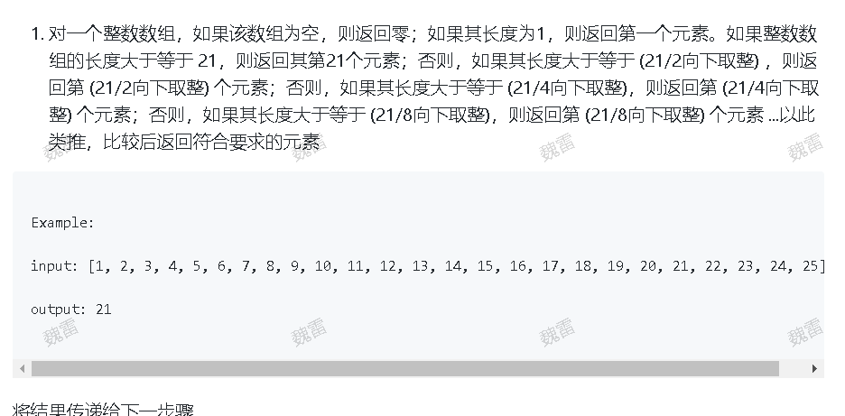

</details>

---

<a id="source-47"></a>

### uni-app 前端实操题

**来源：** `e8e2333262613e42ae4877827f7a013.jpg`

1. 使用 uni-app 完成下列功能，最终打包成 APK。

2. 首页任选其一：直播首页或阿里巴巴 App 首页，另实现列表页与个人中心。

- 直播首页：参考设计图；底图自选；图标字体使用阿里图标库；风格不要求完全一致；实现“说点什么吧”的交互；点击按钮弹爱心为可选项。

- 阿里巴巴首页：参考各模块的左右滑动、DIV、Banner 等效果；可使用其他产品素材，但首页布局、模块布局与特效须符合参考。

3. 列表页调用第三方接口，原题举例 Git、CNode 或豆瓣电影接口，展示标题和缩略图；无设计图，保证美观。

4. 个人中心放两个富文本内容：对 HTTP 的理解；对 ES6 的看法，哪些语法更好用及原因。

参考页面图片见附图。

#### 补充参考答案

完整模块划分、关键交互代码和验收说明见 [6.9 uni-app 实操实现方案](#program-uniapp)。这是项目型题，按所选首页、接口和打包环境落地；现有材料不足以确认真实接口、素材与账号配置。

<details>
<summary>查看原图（含原始选项、手写内容或参考图）</summary>


</details>

---

<a id="source-48"></a>

### 算法步骤三：元素替换为排名

**来源：** `e90c308d6d956ce7cf2e90928653d53.jpg`

将整数数组中的元素替换为按从大到小排序后的序号，序号从 5 开始递增，相等元素序号相同，返回数组。原图示例使用连续名次。
```text
输入：[4,2,3,1]
输出：[5,7,6,8]
```

#### 补充参考答案

将不同值降序排列，分别赋 5、6、7…，再映射回原顺序。见 [6.3 的 ranks](#program-algorithms)。输入 [4,2,3,1] 输出 [5,7,6,8]，重复值使用同一密集排名；时间 O(n log n)、额外空间 O(n)。

<details>
<summary>查看原图（含原始选项、手写内容或参考图）</summary>

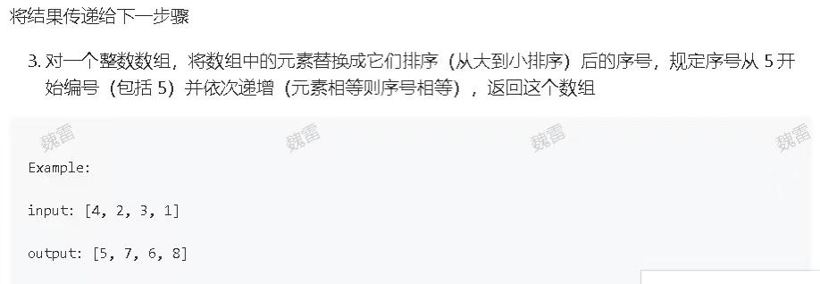

</details>

---

<a id="source-50"></a>

### 合众未来：接口安全与分库分表

**来源：** `合众未来\0f89e95c53ac0b3f388021255b5f0c2.jpg`

1. 前后端交互时，如何保证传输过程中数据不被篡改？列出已知方案，选一种绘制简单流程图。

2. 大数据情况下进行分库分表。有哪些方法？选择一种详细说明。

#### 补充参考答案：接口防篡改与分库分表

1. TLS 保护传输信道；业务报文认证可用双方约定的 HMAC、时间戳和随机 nonce。服务端检查时间窗口、去重 nonce，按相同规范重算并恒时比较签名，再执行业务；仅传一个未加密钥的 MD5 不能证明发送方身份。

```text
客户端规范化参数 → 用密钥计算 HMAC → 通过 TLS 发送
                                               ↓
服务端检查时间/nonce → 重新计算并比对 → 鉴权与业务处理
```

2. 垂直拆分按业务／列拆，水平拆分按行拆。水平可用范围、业务键取模或一致性哈希；例如按 user_id 路由用户订单，查询尽量带分片键。需解决跨片事务／关联、全局唯一 ID、扩容迁移、热点和全局排序分页。范围利于时间查询但可能热点，取模分散但扩容需重分布；不是数据量大就立即分库分表，应先验证索引、归档与容量。

<details>
<summary>查看原图（含原始选项、手写内容或参考图）</summary>

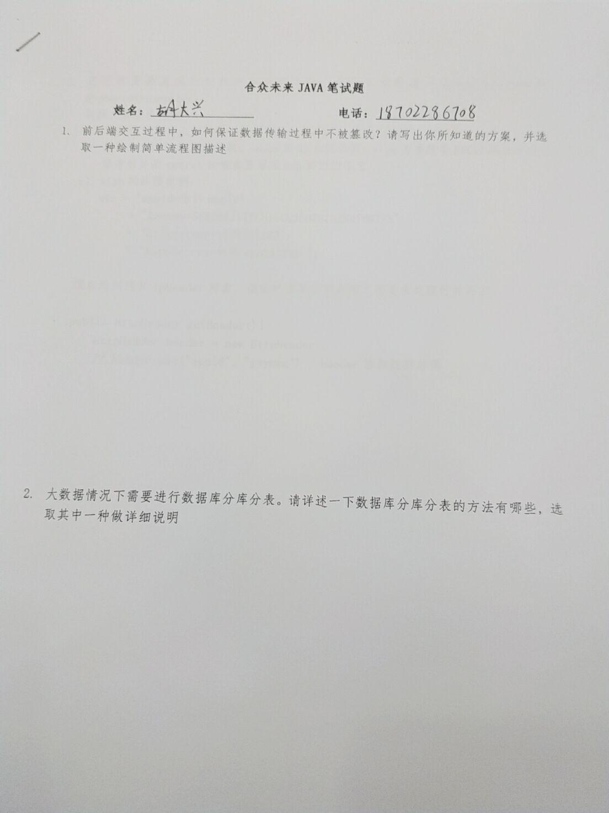

</details>

---

<a id="source-51"></a>

### 合众未来：接口请求签名

**来源：** `合众未来\6385bff59ea931dba63fae190ddbc85.jpg`

对接外部系统，给定 appid=yyymmm、appSecret=aaabbbccc（题目示例值）。要求请求头上传 appid、timestamp、nonce、sign。
- timestamp 为时间戳。
- nonce 为 32 位随机数。
- sign：参数名按 ASCII 从小到大排序，拼接参数后将 appSecret 放到最后，再按题目要求计算 MD5 签名。
```text
appid=你的appid&nonce=随机数&timestamp=时间戳&appSecret=你的appSecret
```
给定 HttpHeader 对象，按要求生成参数并返回。原题方法框架（补齐构造函数括号以便阅读）：
```java
public HttpHeader getHeader() {
    HttpHeader header = new HttpHeader();
    // header.put("appid", "yyymmm");
    // 补充实现
}
```

#### 补充参考答案

按参数名排序，拼 appSecret 后计算 MD5，32 位随机 nonce，返回 appid、timestamp、nonce、sign。完整实现与编码／大小写假设见 [6.7](#program-sign)。不要把 appSecret 发给对方，也不要称 MD5 为加密。

<details>
<summary>查看原图（含原始选项、手写内容或参考图）</summary>

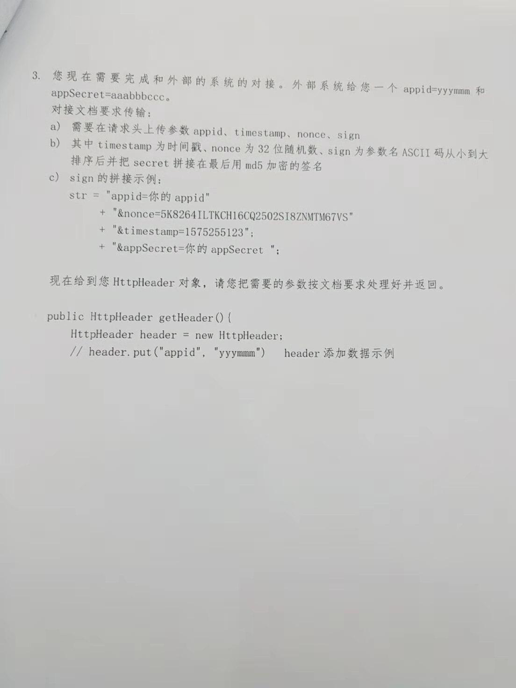

</details>

---

<a id="source-52"></a>

### 合众未来：500 条分批处理

**来源：** `合众未来\f0e488af49c823513204cee0914ee95.jpg`

实现 handler 方法，接收 List<T> narr。已有 C(List<T> arr) 方法，但每次最多处理 500 条。编写分批调用逻辑处理全部数据。
```java
public void handler(List<T> narr) {
    // 补充实现；每批最多 500 条
}
```

#### 补充参考答案

按最多 500 条截取子区间，每次调用 C，空列表不调用，最后一批处理剩余条数。完整实现见 [6.6](#program-batch)。是否允许失败后重试、是否需要事务必须另外约定。

<details>
<summary>查看原图（含原始选项、手写内容或参考图）</summary>

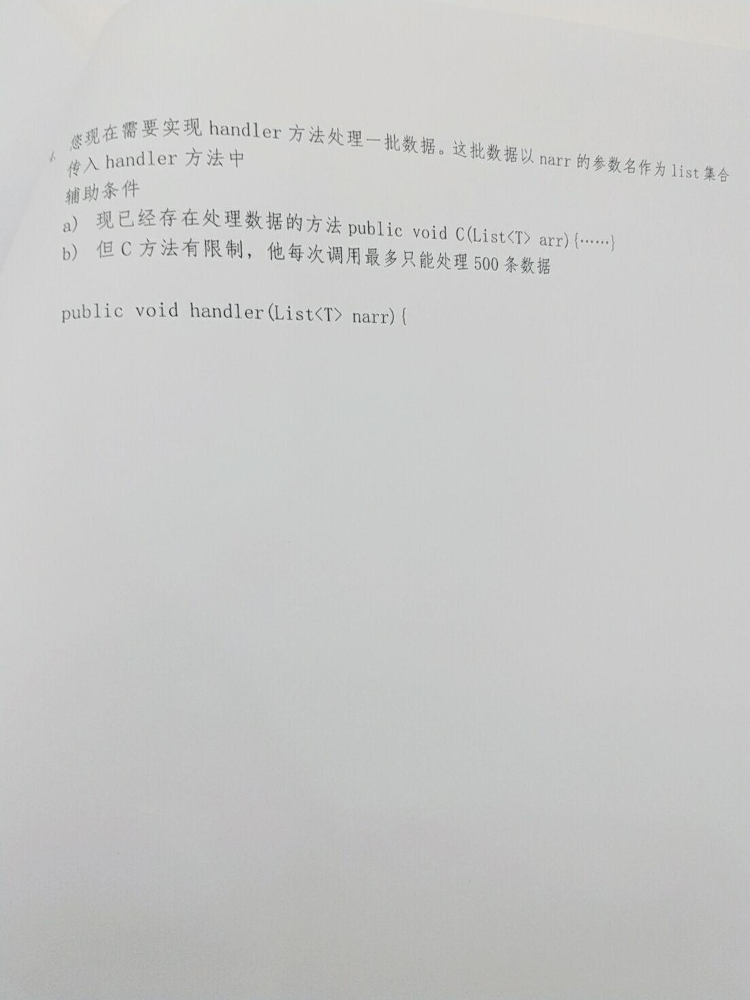

</details>

---

<a id="pdf-bank"></a>

## 四、软通动力专题题库与原有答案

**来源：** `软通动力面试题 (2).pdf`、`软通动力面试题.pdf`

共 97 页。以下按原文专题和题目标题整理，保留原有解答；图表跟随对应原页。原答案包含历史版本表述，本文仅做归档排版。

<a id="pdf-page-1"></a>

<!-- 原 PDF 第 1 页 -->

基本类型 大小（字节） 默认值 封装类

byte 1 (byte)0 Byte

short 2 (short)0 Short

```java
int 4 0 Integer
long 8 0L Long
```

float 4 0.0f Float

double 8 0.0d Double

boolean - false Boolean

char 2 \u0000(null) Character

### 基础篇

#### 1、Java语言有哪些特点

1、简单易学、有丰富的类库

2、面向对象（Java最重要的特性，让程序耦合度更低，内聚性更高）

3、与平台无关性（JVM是Java跨平台使用的根本）

4、可靠安全

5、支持多线程

#### 2、面向对象和面向过程的区别

面向过程：是分析解决问题的步骤，然后用函数把这些步骤一步一步地实现，然后在使用的时候一一调

用则可。性能较高，所以单片机、嵌入式开发等一般采用面向过程开发

面向对象：是把构成问题的事务分解成各个对象，而建立对象的目的也不是为了完成一个个步骤，而是

为了描述某个事物在解决整个问题的过程中所发生的行为。面向对象有封装、继承、多态的特性，所以

易维护、易复用、易扩展。可以设计出低耦合的系统。 但是性能上来说，比面向过程要低。

#### 3、八种基本数据类型的大小，以及他们的封装类

注：

1.int是基本数据类型，Integer是int的封装类，是引用类型。int默认值是0，而Integer默认值是

null，所以Integer能区分出0和null的情况。一旦java看到null，就知道这个引用还没有指向某个对象，

再任何引用使用前，必须为其指定一个对象，否则会报错。

<a id="pdf-page-2"></a>

<!-- 原 PDF 第 2 页 -->

2.基本数据类型在声明时系统会自动给它分配空间，而引用类型声明时只是分配了引用空间，必须

通过实例化开辟数据空间之后才可以赋值。数组对象也是一个引用对象，将一个数组赋值给另一个数组

时只是复制了一个引用，所以通过某一个数组所做的修改在另一个数组中也看的见。

虽然定义了boolean这种数据类型，但是只对它提供了非常有限的支持。在Java虚拟机中没有任何

供boolean值专用的字节码指令，Java语言表达式所操作的boolean值，在编译之后都使用Java虚拟机

中的int数据类型来代替，而boolean数组将会被编码成Java虚拟机的byte数组，每个元素boolean元素

占8位。这样我们可以得出boolean类型占了单独使用是4个字节，在数组中又是1个字节。使用int的原

因是，对于当下32位的处理器（CPU）来说，一次处理数据是32位（这里不是指的是32/64位系统，而

是指CPU硬件层面），具有高效存取的特点。

#### 4、标识符的命名规则。

标识符的含义：

是指在程序中，我们自己定义的内容，譬如，类的名字，方法名称以及变量名称等等，都是标识符。

命名规则：（硬性要求）

标识符可以包含英文字母，0-9的数字，$以及_

标识符不能以数字开头

标识符不是关键字

命名规范：（非硬性要求）

类名规范：首字符大写，后面每个单词首字母大写（大驼峰式）。

变量名规范：首字母小写，后面每个单词首字母大写（小驼峰式）。

方法名规范：同变量名。

#### 5、instanceof关键字的作用

instanceof 严格来说是Java中的一个双目运算符，用来测试一个对象是否为一个类的实例，用法为：

其中 obj 为一个对象，Class 表示一个类或者一个接口，当 obj 为 Class 的对象，或者是其直接或

间接子类，或者是其接口的实现类，结果result 都返回 true，否则返回false。

注意：编译器会检查 obj 是否能转换成右边的class类型，如果不能转换则直接报错，如果不能确定

类型，则通过编译，具体看运行时定。

boolean result = obj instanceof Class

```java
int i = 0;
System.out.println(i instanceof Integer);//编译不通过  i必须是引用类型，不能是基本类型
System.out.println(i instanceof Object);//编译不通过
```

Integer integer = new Integer(1);

```java
System.out.println(integer instanceof  Integer);//true
//false   ,在 JavaSE规范 中对 instanceof 运算符的规定就是：如果 obj 为 null，那么将返回 
```

false。

```java
System.out.println(null instanceof Object);
```

<a id="pdf-page-3"></a>

<!-- 原 PDF 第 3 页 -->

#### 6、Java自动装箱与拆箱

装箱就是自动将基本数据类型转换为包装器类型（int-->Integer）；调用方法：Integer的

valueOf(int) 方法

拆箱就是自动将包装器类型转换为基本数据类型（Integer-->int）。调用方法：Integer的intValue方

法

在Java SE5之前，如果要生成一个数值为10的Integer对象，必须这样进行：

而在从Java SE5开始就提供了自动装箱的特性，如果要生成一个数值为10的Integer对象，只需要这

样就可以了：

面试题1： 以下代码会输出什么？

运行结果：

为什么会出现这样的结果？输出结果表明i1和i2指向的是同一个对象，而i3和i4指向的是不同的对象。此

时只需一看源码便知究竟，下面这段代码是Integer的valueOf方法的具体实现：

Integer i = new Integer(10);

Integer i = 10;

```java
public class Main {
    public static void main(String[] args) {
```

Integer i1 = 100;

Integer i2 = 100;

Integer i3 = 200;

Integer i4 = 200;

```java
        System.out.println(i1==i2);
        System.out.println(i3==i4);
    }
}
```

true

false

```java
public static Integer valueOf(int i) {
        if(i >= -128 && i <= IntegerCache.high)
            return IntegerCache.cache[i + 128];
        else
            return new Integer(i);
    }
```

<a id="pdf-page-4"></a>

<!-- 原 PDF 第 4 页 -->

其中IntegerCache类的实现为：

从这2段代码可以看出，在通过valueOf方法创建Integer对象的时候，如果数值在[-128,127]之间，便返

回指向IntegerCache.cache中已经存在的对象的引用；否则创建一个新的Integer对象。

上面的代码中i1和i2的数值为100，因此会直接从cache中取已经存在的对象，所以i1和i2指向的是同一

个对象，而i3和i4则是分别指向不同的对象。

面试题2：以下代码输出什么？

运行结果：

```java
private static class IntegerCache {
        static final int high;
        static final Integer cache[];
        static {
```

final int low = -128;

```java
            // high value may be configured by property
            int h = 127;
            if (integerCacheHighPropValue != null) {
                // Use Long.decode here to avoid invoking methods that
                // require Integer's autoboxing cache to be initialized
                int i = Long.decode(integerCacheHighPropValue).intValue();
                i = Math.max(i, 127);
                // Maximum array size is Integer.MAX_VALUE
                h = Math.min(i, Integer.MAX_VALUE - -low);
            }
            high = h;
            cache = new Integer[(high - low) + 1];
            int j = low;
            for(int k = 0; k < cache.length; k++)
```

cache[k] = new Integer(j++);

```java
        }
        private IntegerCache() {}
    }
public class Main {
    public static void main(String[] args) {
```

Double i1 = 100.0;

Double i2 = 100.0;

Double i3 = 200.0;

Double i4 = 200.0;

```java
        System.out.println(i1==i2);
        System.out.println(i3==i4);
    }
}
```

<a id="pdf-page-5"></a>

<!-- 原 PDF 第 5 页 -->

原因： 在某个范围内的整型数值的个数是有限的，而浮点数却不是。

#### 7、

#### 重载和重写的区别

重写(Override)

从字面上看，重写就是 重新写一遍的意思。其实就是在子类中把父类本身有的方法重新写一遍。子类继

承了父类原有的方法，但有时子类并不想原封不动的继承父类中的某个方法，所以在方法名，参数列

表，返回类型(除过子类中方法的返回值是父类中方法返回值的子类时)都相同的情况下， 对方法体进行

修改或重写，这就是重写。但要注意子类函数的访问修饰权限不能少于父类的。

重写 总结：

1.发生在父类与子类之间

2.方法名，参数列表，返回类型（除过子类中方法的返回类型是父类中返回类型的子类）必须相同

3.访问修饰符的限制一定要大于被重写方法的访问修饰符（public>protected>default>private)

4.重写方法一定不能抛出新的检查异常或者比被重写方法申明更加宽泛的检查型异常

重载（Overload）

在一个类中，同名的方法如果有不同的参数列表（参数类型不同、参数个数不同甚至是参数顺序不同）

则视为重载。同时，重载对返回类型没有要求，可以相同也可以不同，但不能通过返回类型是否相同来

判断重载。

false

false

```java
public class Father {
    public static void main(String[] args) {
        // TODO Auto-generated method stub
```

Son s = new Son();

s.sayHello();

```java
    }
    public void sayHello() {
        System.out.println("Hello");
    }
}
class Son extends Father{
```

@Override

```java
    public void sayHello() {
        // TODO Auto-generated method stub
        System.out.println("hello by ");
    }
}
public class Father {
```

<a id="pdf-page-6"></a>

<!-- 原 PDF 第 6 页 -->

重载 总结：

1.重载Overload是一个类中多态性的一种表现

2.重载要求同名方法的参数列表不同(参数类型，参数个数甚至是参数顺序)

3.重载的时候，返回值类型可以相同也可以不相同。无法以返回型别作为重载函数的区分标准

#### 8、equals与==的区别

== ：

== 比较的是变量(栈)内存中存放的对象的(堆)内存地址，用来判断两个对象的地址是否相同，即是否是

指相同一个对象。比较的是真正意义上的指针操作。

1、比较的是操作符两端的操作数是否是同一个对象。

2、两边的操作数必须是同一类型的（可以是父子类之间）才能编译通过。

3、比较的是地址，如果是具体的阿拉伯数字的比较，值相等则为true，如：

```java
int a=10 与 long b=10L 与 double c=10.0都是相同的（为true），因为他们都指向地址为10的堆。 
```

equals：

equals用来比较的是两个对象的内容是否相等，由于所有的类都是继承自java.lang.Object类的，所以

适用于所有对象，如果没有对该方法进行覆盖的话，调用的仍然是Object类中的方法，而Object中的

equals方法返回的却是==的判断。

总结：

所有比较是否相等时，都是用equals 并且在对常量相比较时，把常量写在前面，因为使用object的

equals  object可能为null  则空指针

在阿里的代码规范中只使用equals ，阿里插件默认会识别，并可以快速修改，推荐安装阿里插件来排

查老代码使用“==”，替换成equals

#### 9、Hashcode的作用

```java
    public static void main(String[] args) {
        // TODO Auto-generated method stub
```

Father s = new Father();

s.sayHello();

s.sayHello("wintershii");

```java
    }
    public void sayHello() {
        System.out.println("Hello");
    }
    public void sayHello(String name) {
        System.out.println("Hello" + " " + name);
    }
}
```

<a id="pdf-page-7"></a>

<!-- 原 PDF 第 7 页 -->

java的集合有两类，一类是List，还有一类是Set。前者有序可重复，后者无序不重复。当我们在set中

插入的时候怎么判断是否已经存在该元素呢，可以通过equals方法。但是如果元素太多，用这样的方法

就会比较满。

于是有人发明了哈希算法来提高集合中查找元素的效率。 这种方式将集合分成若干个存储区域，每个对

象可以计算出一个哈希码，可以将哈希码分组，每组分别对应某个存储区域，根据一个对象的哈希码就

可以确定该对象应该存储的那个区域。

hashCode方法可以这样理解：它返回的就是根据对象的内存地址换算出的一个值。这样一来，当集合

要添加新的元素时，先调用这个元素的hashCode方法，就一下子能定位到它应该放置的物理位置上。

如果这个位置上没有元素，它就可以直接存储在这个位置上，不用再进行任何比较了；如果这个位置上

已经有元素了，就调用它的equals方法与新元素进行比较，相同的话就不存了，不相同就散列其它的地

址。这样一来实际调用equals方法的次数就大大降低了，几乎只需要一两次。

#### 10、String、StringStringBuffer和StringBuilder的区别是什么?

String是只读字符串，它并不是基本数据类型，而是一个对象。从底层源码来看是一个final类型的字符

数组，所引用的字符串不能被改变，一经定义，无法再增删改。每次对String的操作都会生成新的

String对象。

每次+操作 ： 隐式在堆上new了一个跟原字符串相同的StringBuilder对象，再调用append方法 拼接

+后面的字符。

StringBuffer和StringBuilder他们两都继承了AbstractStringBuilder抽象类，从AbstractStringBuilder

抽象类中我们可以看到

他们的底层都是可变的字符数组，所以在进行频繁的字符串操作时，建议使用StringBuffer和

StringBuilder来进行操作。 另外StringBuffer 对方法加了同步锁或者对调用的方法加了同步锁，所以是

线程安全的。StringBuilder 并没有对方法进行加同步锁，所以是非线程安全的。

#### 11、ArrayList和linkedList的区别

Array（数组）是基于索引(index)的数据结构，它使用索引在数组中搜索和读取数据是很快的。

Array获取数据的时间复杂度是O(1),但是要删除数据却是开销很大，因为这需要重排数组中的所有数据,

(因为删除数据以后, 需要把后面所有的数据前移)

缺点: 数组初始化必须指定初始化的长度, 否则报错

例如:

```java
private final char value[];
```

/**

* The value is used for character storage.

*/

char[] value;

<a id="pdf-page-8"></a>

<!-- 原 PDF 第 8 页 -->

List—是一个有序的集合，可以包含重复的元素，提供了按索引访问的方式，它继承Collection。

List有两个重要的实现类：ArrayList和LinkedList

ArrayList: 可以看作是能够自动增长容量的数组

ArrayList的toArray方法返回一个数组

ArrayList的asList方法返回一个列表

ArrayList底层的实现是Array, 数组扩容实现

LinkList是一个双链表,在添加和删除元素时具有比ArrayList更好的性能.但在get与set方面弱于

ArrayList.当然,这些对比都是指数据量很大或者操作很频繁。

#### 12、HashMap和HashTable的区别

1、两者父类不同

HashMap是继承自AbstractMap类，而Hashtable是继承自Dictionary类。不过它们都实现了同时实现

了map、Cloneable（可复制）、Serializable（可序列化）这三个接口。

2、对外提供的接口不同

Hashtable比HashMap多提供了elments() 和contains() 两个方法。

elments() 方法继承自Hashtable的父类Dictionnary。elements() 方法用于返回此Hashtable中的

value的枚举。

contains()方法判断该Hashtable是否包含传入的value。它的作用与containsValue()一致。事实上，

contansValue() 就只是调用了一下contains() 方法。

3、对null的支持不同

Hashtable：key和value都不能为null。

HashMap：key可以为null，但是这样的key只能有一个，因为必须保证key的唯一性；可以有多个key

值对应的value为null。

4、安全性不同

HashMap是线程不安全的，在多线程并发的环境下，可能会产生死锁等问题，因此需要开发人员自己

处理多线程的安全问题。

Hashtable是线程安全的，它的每个方法上都有synchronized 关键字，因此可直接用于多线程中。

虽然HashMap是线程不安全的，但是它的效率远远高于Hashtable，这样设计是合理的，因为大部分的

使用场景都是单线程。当需要多线程操作的时候可以使用线程安全的ConcurrentHashMap。

ConcurrentHashMap虽然也是线程安全的，但是它的效率比Hashtable要高好多倍。因为

ConcurrentHashMap使用了分段锁，并不对整个数据进行锁定。

5、初始容量大小和每次扩充容量大小不同

int[] a = new int[4];//推介使用int[] 这种方式初始化

```java
int c[] = {23,43,56,78};//长度：4，索引范围：[0,3]
```

<a id="pdf-page-9"></a>

<!-- 原 PDF 第 9 页 -->

6、计算hash值的方法不同

#### 13、Collection包结构，与Collections的区别

Collection是集合类的上级接口，子接口有 Set、List、LinkedList、ArrayList、Vector、Stack、Set；

Collections是集合类的一个帮助类， 它包含有各种有关集合操作的静态多态方法，用于实现对各种集

合的搜索、排序、线程安全化等操作。此类不能实例化，就像一个工具类，服务于Java的Collection框

架。

#### 14、Java的四种引用，强弱软虚

强引用

强引用是平常中使用最多的引用，强引用在程序内存不足（OOM）的时候也不会被回收，使用方

式：

软引用

软引用在程序内存不足时，会被回收，使用方式：

可用场景： 创建缓存的时候，创建的对象放进缓存中，当内存不足时，JVM就会回收早先创建的

对象。

弱引用

弱引用就是只要JVM垃圾回收器发现了它，就会将之回收，使用方式：

可用场景： Java源码中的java.util.WeakHashMap中的key就是使用弱引用，我的理解就是，

一旦我不需要某个引用，JVM会自动帮我处理它，这样我就不需要做其它操作。

虚引用

虚引用的回收机制跟弱引用差不多，但是它被回收之前，会被放入ReferenceQueue中。注意

哦，其它引用是被JVM回收后才被传入ReferenceQueue中的。由于这个机制，所以虚引用大多被

用于引用销毁前的处理工作。还有就是，虚引用创建的时候，必须带有ReferenceQueue，使用

例子：

可用场景： 对象销毁前的一些操作，比如说资源释放等。**Object.finalize()虽然也可以做

这类动作，但是这个方式即不安全又低效

上诉所说的几类引用，都是指对象本身的引用，而不是指Reference的四个子类的引用

(SoftReference等)。

```java
String str = new String("str");
// 注意：wrf这个引用也是强引用，它是指向SoftReference这个对象的，
// 这里的软引用指的是指向new String("str")的引用，也就是SoftReference类中T
```

SoftReference<String> wrf = new SoftReference<String>(new String("str"));

WeakReference<String> wrf = new WeakReference<String>(str);

PhantomReference<String> prf = new PhantomReference<String>(new

String("str"), new ReferenceQueue<>());

<a id="pdf-page-10"></a>

<!-- 原 PDF 第 10 页 -->

#### 15、

#### 泛型常用特点

#### （待补充）

泛型是Java SE 1.5之后的特性， 《Java 核心技术》中对泛型的定义是：

“泛型” 意味着编写的代码可以被不同类型的对象所重用。

“泛型”，顾名思义，“泛指的类型”。我们提供了泛指的概念，但具体执行的时候却可以有具体的规则来

约束，比如我们用的非常多的ArrayList就是个泛型类，ArrayList作为集合可以存放各种元素，如

Integer, String，自定义的各种类型等，但在我们使用的时候通过具体的规则来约束，如我们可以约束

集合中只存放Integer类型的元素，如

使用泛型的好处？

以集合来举例，使用泛型的好处是我们不必因为添加元素类型的不同而定义不同类型的集合，如整型集

合类，浮点型集合类，字符串集合类，我们可以定义一个集合来存放整型、浮点型，字符串型数据，而

这并不是最重要的，因为我们只要把底层存储设置了Object即可，添加的数据全部都可向上转型为

Object。 更重要的是我们可以通过规则按照自己的想法控制存储的数据类型。

#### 16、Java创建对象有几种方式？

java中提供了以下四种创建对象的方式:

new创建新对象

通过反射机制

采用clone机制

通过序列化机制

#### 17、有没有可能两个不相等的对象有相同的hashcode

有可能.在产生hash冲突时,两个不相等的对象就会有相同的 hashcode 值.当hash冲突产生时,一般有以

下几种方式来处理:

拉链法:每个哈希表节点都有一个next指针,多个哈希表节点可以用next指针构成一个单向链表，被

分配到同一个索引上的多个节点可以用这个单向链表进行存储.

开放定址法:一旦发生了冲突,就去寻找下一个空的散列地址,只要散列表足够大,空的散列地址总能找

到,并将记录存入

再哈希:又叫双哈希法,有多个不同的Hash函数.当发生冲突时,使用第二个,第三个….等哈希函数计算

地址,直到无冲突.

#### 18、深拷贝和浅拷贝的区别是什么?

浅拷贝:被复制对象的所有变量都含有与原来的对象相同的值,而所有的对其他对象的引用仍然指向

原来的对象.换言之,浅拷贝仅仅复制所考虑的对象,而不复制它所引用的对象.

深拷贝:被复制对象的所有变量都含有与原来的对象相同的值.而那些引用其他对象的变量将指向被

复制过的新对象.而不再是原有的那些被引用的对象.换言之.深拷贝把要复制的对象所引用的对象都

复制了一遍.

List<Integer> iniData = new ArrayList<>()

<a id="pdf-page-11"></a>

<!-- 原 PDF 第 11 页 -->

#### 19、final有哪些用法?

final也是很多面试喜欢问的地方,但我觉得这个问题很无聊,通常能回答下以下5点就不错了:

被final修饰的类不可以被继承

被final修饰的方法不可以被重写

被final修饰的变量不可以被改变.如果修饰引用,那么表示引用不可变,引用指向的内容可变.

被final修饰的方法,JVM会尝试将其内联,以提高运行效率

被final修饰的常量,在编译阶段会存入常量池中.

除此之外,编译器对final域要遵守的两个重排序规则更好:

在构造函数内对一个final域的写入,与随后把这个被构造对象的引用赋值给一个引用变量,这两个操作之

间不能重排序

初次读一个包含final域的对象的引用,与随后初次读这个final域,这两个操作之间不能重排序.

#### 20、static都有哪些用法?

所有的人都知道static关键字这两个基本的用法:静态变量和静态方法.也就是被static所修饰的变量/方法

都属于类的静态资源,类实例所共享.

除了静态变量和静态方法之外,static也用于静态块,多用于初始化操作:

此外static也多用于修饰内部类,此时称之为静态内部类.

最后一种用法就是静态导包,即import static.import static是在JDK 1.5之后引入的新特性,可以用来

指定导入某个类中的静态资源,并且不需要使用类名,可以直接使用资源名,比如:

#### 21、3*0.1

#### ==0.3返回值是什么

false,因为有些浮点数不能完全精确的表示出来.

#### 22、a=a+b与a+=b有什么区别吗?

+=操作符会进行隐式自动类型转换,此处a+=b隐式的将加操作的结果类型强制转换为持有结果的类型,

而a=a+b则不会自动进行类型转换.如：

```java
public calss PreCache{
```

static{

```java
        //执行相关操作
    }
}
```

import static java.lang.Math.*;

```java
public class Test{
```

```java
    public static void main(String[] args){
        //System.out.println(Math.sin(20));传统做法
        System.out.println(sin(20));
    }
}
```

<a id="pdf-page-12"></a>

<!-- 原 PDF 第 12 页 -->

以下代码是否有错,有的话怎么改？

有错误.short类型在进行运算时会自动提升为int类型,也就是说s1+1的运算结果是int类型,而s1是short

类型,此时编译器会报错.

正确写法：

+=操作符会对右边的表达式结果强转匹配左边的数据类型,所以没错.

#### 23、trycatchfinally，try里有return，finally还执行么？

执行，并且finally的执行早于try里面的return

结论：

1、不管有木有出现异常，finally块中代码都会执行；

2、当try和catch中有return时，finally仍然会执行；

3、finally是在return后面的表达式运算后执行的（此时并没有返回运算后的值，而是先把要返回的值保

存起来，管finally中的代码怎么样，返回的值都不会改变，任然是之前保存的值），所以函数返回值是

在finally执行前确定的；

4、finally中最好不要包含return，否则程序会提前退出，返回值不是try或catch中保存的返回值。

#### 24、Excption与Error包结构

Java可抛出(Throwable)的结构分为三种类型：被检查的异常(CheckedException)，运行时异常

(RuntimeException)，错误(Error)。

1、运行时异常

定义:RuntimeException及其子类都被称为运行时异常。

特点:Java编译器不会检查它。也就是说，当程序中可能出现这类异常时，倘若既"没有通过throws声明

抛出它"，也"没有用try-catch语句捕获它"，还是会编译通过。例如，除数为零时产生的

ArithmeticException异常，数组越界时产生的IndexOutOfBoundsException异常，fail-fast机制产生

的ConcurrentModificationException异常（java.util包下面的所有的集合类都是快速失败的，“快速失

败”也就是fail-fast，它是Java集合的一种错误检测机制。当多个线程对集合进行结构上的改变的操作

时，有可能会产生fail-fast机制。记住是有可能，而不是一定。例如：假设存在两个线程（线程1、线程

2），线程1通过Iterator在遍历集合A中的元素，在某个时候线程2修改了集合A的结构（是结构上面的

修改，而不是简单的修改集合元素的内容），那么这个时候程序就会抛出

byte a = 127;

byte b = 127;

b = a + b; // 报编译错误:cannot convert from int to byte

b += a;

short s1= 1;

s1 = s1 + 1;

short s1= 1;

s1 += 1;

<a id="pdf-page-13"></a>

<!-- 原 PDF 第 13 页 -->

ConcurrentModificationException 异常，从而产生fail-fast机制，这个错叫并发修改异常。Fail-safe，

java.util.concurrent包下面的所有的类都是安全失败的，在遍历过程中，如果已经遍历的数组上的内容

变化了，迭代器不会抛出ConcurrentModificationException异常。如果未遍历的数组上的内容发生了

变化，则有可能反映到迭代过程中。这就是ConcurrentHashMap迭代器弱一致的表现。

ConcurrentHashMap的弱一致性主要是为了提升效率，是一致性与效率之间的一种权衡。要成为强一

致性，就得到处使用锁，甚至是全局锁，这就与Hashtable和同步的HashMap一样了。）等，都属于运

行时异常。

常见的五种运行时异常：

ClassCastException（类转换异常）

IndexOutOfBoundsException（数组越界）

NullPointerException（空指针异常）

ArrayStoreException（数据存储异常，操作数组是类型不一致）

BufferOverflowException

2、被检查异常

定义:Exception类本身，以及Exception的子类中除了"运行时异常"之外的其它子类都属于被检查异常。

特点 : Java编译器会检查它。 此类异常，要么通过throws进行声明抛出，要么通过try-catch进行捕获处

理，否则不能通过编译。例如，CloneNotSupportedException就属于被检查异常。当通过clone()接口

去克隆一个对象，而该对象对应的类没有实现Cloneable接口，就会抛出

CloneNotSupportedException异常。被检查异常通常都是可以恢复的。

如：

IOException

FileNotFoundException

SQLException

被检查的异常适用于那些不是因程序引起的错误情况，比如：读取文件时文件不存在引发的

FileNotFoundException。然而，不被检查的异常通常都是由于糟糕的编程引起的，比如：在对象引

用时没有确保对象非空而引起的NullPointerException。

3、错误

定义 : Error类及其子类。

特点 : 和运行时异常一样，编译器也不会对错误进行检查。

当资源不足、约束失败、或是其它程序无法继续运行的条件发生时，就产生错误。程序本身无法修复这

些错误的。例如，VirtualMachineError就属于错误。出现这种错误会导致程序终止运行。

OutOfMemoryError、ThreadDeath。

Java虚拟机规范规定JVM的内存分为了好几块，比如堆，栈，程序计数器，方法区等

#### 25、OOM你遇到过哪些情况，SOF你遇到过哪些情况

OOM：

1，OutOfMemoryError异常

除了程序计数器外，虚拟机内存的其他几个运行时区域都有发生OutOfMemoryError(OOM)异常的可

能。

<a id="pdf-page-14"></a>

<!-- 原 PDF 第 14 页 -->

Java Heap 溢出：

一般的异常信息：java.lang.OutOfMemoryError:Java heap spacess。

java堆用于存储对象实例，我们只要不断的创建对象，并且保证GC Roots到对象之间有可达路径来避免

垃圾回收机制清除这些对象，就会在对象数量达到最大堆容量限制后产生内存溢出异常。

出现这种异常，一般手段是先通过内存映像分析工具(如Eclipse Memory Analyzer)对dump出来的堆转

存快照进行分析，重点是确认内存中的对象是否是必要的，先分清是因为内存泄漏(Memory Leak)还是

内存溢出(Memory Overflow)。

如果是内存泄漏，可进一步通过工具查看泄漏对象到GCRoots的引用链。于是就能找到泄漏对象是通过

怎样的路径与GC Roots相关联并导致垃圾收集器无法自动回收。

如果不存在泄漏，那就应该检查虚拟机的参数(-Xmx与-Xms)的设置是否适当。

2，虚拟机栈和本地方法栈溢出

如果线程请求的栈深度大于虚拟机所允许的最大深度，将抛出StackOverflowError异常。

如果虚拟机在扩展栈时无法申请到足够的内存空间，则抛出OutOfMemoryError异常

这里需要注意当栈的大小越大可分配的线程数就越少。

3，运行时常量池溢出

异常信息：java.lang.OutOfMemoryError:PermGenspace

如果要向运行时常量池中添加内容，最简单的做法就是使用String.intern()这个Native方法。该方法的

作用是：如果池中已经包含一个等于此String的字符串，则返回代表池中这个字符串的String对象；否

则，将此String对象包含的字符串添加到常量池中，并且返回此String对象的引用。由于常量池分配在

方法区内，我们可以通过-XX:PermSize和-XX:MaxPermSize限制方法区的大小，从而间接限制其中常量

池的容量。

4，方法区溢出

方法区用于存放Class的相关信息，如类名、访问修饰符、常量池、字段描述、方法描述等。也有可能

是方法区中保存的class对象没有被及时回收掉或者class信息占用的内存超过了我们配置。

异常信息：java.lang.OutOfMemoryError:PermGenspace

方法区溢出也是一种常见的内存溢出异常，一个类如果要被垃圾收集器回收，判定条件是很苛刻的。在

经常动态生成大量Class的应用中，要特别注意这点。

SOF（堆栈溢出StackOverflow）：

StackOverflowError 的定义：当应用程序递归太深而发生堆栈溢出时，抛出该错误。

因为栈一般默认为1-2m，一旦出现死循环或者是大量的递归调用，在不断的压栈过程中，造成栈容量

超过1m而导致溢出。

栈溢出的原因：递归调用，大量循环或死循环，全局变量是否过多，数组、List、map数据过大。

#### 26、

#### 简述线程、程序、进程的基本概念。以及他们之间关系是什么?

线程与进程相似，但线程是一个比进程更小的执行单位。一个进程在其执行的过程中可以产生多个线

程。与进程不同的是同类的多个线程共享同一块内存空间和一组系统资源，所以系统在产生一个线程，

或是在各个线程之间作切换工作时，负担要比进程小得多，也正因为如此，线程也被称为轻量级进程。

程序是含有指令和数据的文件，被存储在磁盘或其他的数据存储设备中，也就是说程序是静态的代码。

<a id="pdf-page-15"></a>

<!-- 原 PDF 第 15 页 -->

进程是程序的一次执行过程，是系统运行程序的基本单位，因此进程是动态的。系统运行一个程序即是

一个进程从创建，运行到消亡的过程。简单来说，一个进程就是一个执行中的程序，它在计算机中一个

指令接着一个指令地执行着，同时，每个进程还占有某些系统资源如 CPU 时间，内存空间，文件，输

入输出设备的使用权等等。换句话说，当程序在执行时，将会被操作系统载入内存中。 线程是进程划分

成的更小的运行单位。线程和进程最大的不同在于基本上各进程是独立的，而各线程则不一定，因为同

一进程中的线程极有可能会相互影响。从另一角度来说，进程属于操作系统的范畴，主要是同一段时间

内，可以同时执行一个以上的程序，而线程则是在同一程序内几乎同时执行一个以上的程序段。

#### 27、线程有哪些基本状态?（补充）

Java 线程在运行的生命周期中的指定时刻只可能处于下面 6 种不同状态的其中一个状态（图源《Java

并发编程艺术》4.1.4 节）。

#### 28、Java序列化中如果有些字段不想进行序列化，怎么办？

对于不想进行序列化的变量，使用 transient 关键字修饰。

transient 关键字的作用是：阻止实例中那些用此关键字修饰的的变量序列化；当对象被反序列化时，

被 transient 修饰的变量值不会被持久化和恢复。transient 只能修饰变量，不能修饰类和方法。

#### 29、Java中IO流

Java 中 IO 流分为几种?

按照流的流向分，可以分为输入流和输出流；

按照操作单元划分，可以划分为字节流和字符流；

按照流的角色划分为节点流和处理流。

Java Io 流共涉及 40 多个类，这些类看上去很杂乱，但实际上很有规则，而且彼此之间存在非常紧密的

联系， Java I0 流的 40 多个类都是从如下 4 个抽象类基类中派生出来的。

InputStream/Reader: 所有的输入流的基类，前者是字节输入流，后者是字符输入流。

OutputStream/Writer: 所有输出流的基类，前者是字节输出流，后者是字符输出流。

按操作方式分类结构图：

<a id="pdf-page-16"></a>

<!-- 原 PDF 第 16 页 -->

按操作对象分类结构图：

**本页原图与图表：**

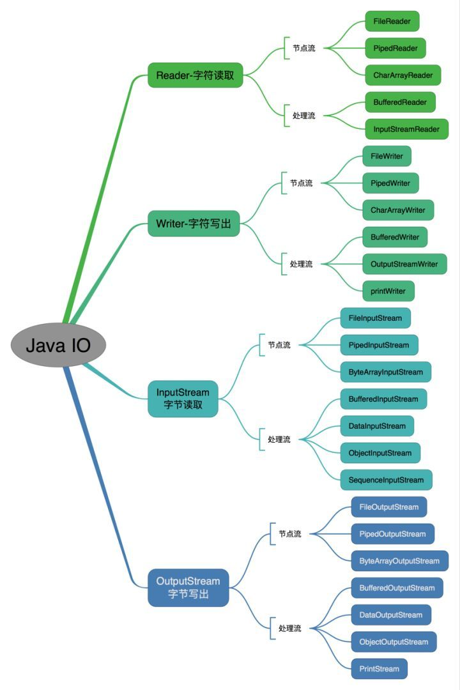

<a id="pdf-page-17"></a>

<!-- 原 PDF 第 17 页 -->

#### 30、JavaIO与NIO的区别（补充）

NIO即New IO，这个库是在JDK1.4中才引入的。NIO和IO有相同的作用和目的，但实现方式不同，NIO

主要用到的是块，所以NIO的效率要比IO高很多。在Java API中提供了两套NIO，一套是针对标准输入

输出NIO，另一套就是网络编程NIO。

#### 31、java反射的作用于原理

1、定义：

反射机制是在运行时，对于任意一个类，都能够知道这个类的所有属性和方法；对于任意个对象，都能

够调用它的任意一个方法。在java中，只要给定类的名字，就可以通过反射机制来获得类的所有信息。

这种动态获取的信息以及动态调用对象的方法的功能称为Java语言的反射机制。

2、哪里会用到反射机制？

jdbc就是典型的反射

这就是反射。如hibernate，struts等框架使用反射实现的。

3、反射的实现方式：

Class.forName('com.mysql.jdbc.Driver.class');//加载MySQL的驱动类

**本页原图与图表：**

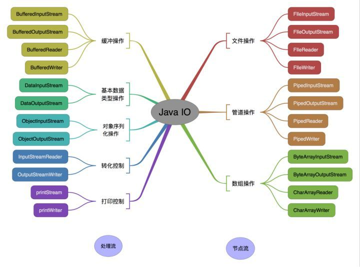

<a id="pdf-page-18"></a>

<!-- 原 PDF 第 18 页 -->

第一步：获取Class对象，有4中方法：

1）Class.forName(“类的路径”)；

2）类名.class

3）对象名.getClass()

4）基本类型的包装类，可以调用包装类的Type属性来获得该包装类的Class对象

4、实现Java反射的类：

1）Class：表示正在运行的Java应用程序中的类和接口

注意： 所有获取对象的信息都需要Class类来实现。

2）Field：提供有关类和接口的属性信息，以及对它的动态访问权限。

3）Constructor：提供关于类的单个构造方法的信息以及它的访问权限

4）Method：提供类或接口中某个方法的信息

5、反射机制的优缺点：

优点：

1）能够运行时动态获取类的实例，提高灵活性；

2）与动态编译结合

缺点：

1）使用反射性能较低，需要解析字节码，将内存中的对象进行解析。

解决方案：

1、通过setAccessible(true)关闭JDK的安全检查来提升反射速度；

2、多次创建一个类的实例时，有缓存会快很多

3、ReflectASM工具类，通过字节码生成的方式加快反射速度

2）相对不安全，破坏了封装性（因为通过反射可以获得私有方法和属性）

#### 32、说说List,Set,Map三者的区别？

List(对付顺序的好帮手)： List接口存储一组不唯一（可以有多个元素引用相同的对象），有序的

对象

Set(注重独一无二的性质): 不允许重复的集合。不会有多个元素引用相同的对象。

Map(用Key来搜索的专家): 使用键值对存储。Map会维护与Key有关联的值。两个Key可以引用相

同的对象，但Key不能重复，典型的Key是String类型，但也可以是任何对象。

### JVM篇

#### 1、知识点汇总

JVM是Java运行基础,面试时一定会遇到JVM的有关问题,内容相对集中,但对只是深度要求较高.

<a id="pdf-page-19"></a>

<!-- 原 PDF 第 19 页 -->

其中内存模型,类加载机制,GC是重点方面.性能调优部分更偏向应用,重点突出实践能力.编译器优化和执

行模式部分偏向于理论基础,重点掌握知识点.

需了解

内存模型各部分作用,保存哪些数据.

类加载双亲委派加载机制,常用加载器分别加载哪种类型的类.

GC分代回收的思想和依据以及不同垃圾回收算法的回收思路和适合场景.

性能调优常有JVM优化参数作用,参数调优的依据,常用的JVM分析工具能分析哪些问题以及使用方法.

执行模式解释/编译/混合模式的优缺点,Java7提供的分层编译技术,JIT即时编译技术,OSR栈上替换,C1/C2

编译器针对的场景,C2针对的是server模式,优化更激进.新技术方面Java10的graal编译器

编译器优化javac的编译过程,ast抽象语法树,编译器优化和运行器优化.

#### 2、知识点详解：

1、JVM内存模型：

线程独占:栈,本地方法栈,程序计数器

线程共享:堆,方法区

2、栈：

又称方法栈,线程私有的,线程执行方法是都会创建一个栈阵,用来存储局部变量表,操作栈,动态链接,方法

出口等信息.调用方法时执行入栈,方法返回式执行出栈.

**本页原图与图表：**

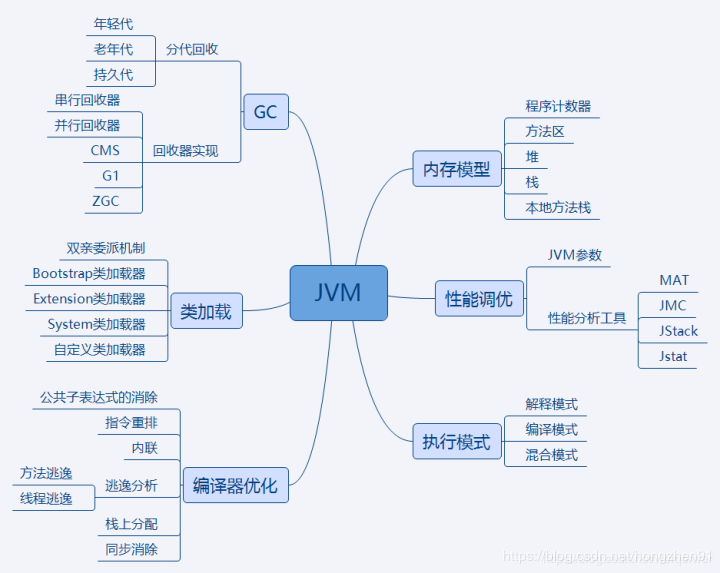

<a id="pdf-page-20"></a>

<!-- 原 PDF 第 20 页 -->

3、本地方法栈

与栈类似,也是用来保存执行方法的信息.执行Java方法是使用栈,执行Native方法时使用本地方法栈.

4、程序计数器

保存着当前线程执行的字节码位置,每个线程工作时都有独立的计数器,只为执行Java方法服务,执行

Native方法时,程序计数器为空.

5、堆

JVM内存管理最大的一块,对被线程共享,目的是存放对象的实例,几乎所欲的对象实例都会放在这里,当堆

没有可用空间时,会抛出OOM异常.根据对象的存活周期不同,JVM把对象进行分代管理,由垃圾回收器进行

垃圾的回收管理

6、方法区：

又称非堆区,用于存储已被虚拟机加载的类信息,常量,静态变量,即时编译器优化后的代码等数据.1.7的永

久代和1.8的元空间都是方法区的一种实现

7、JVM 内存可见性

JMM是定义程序中变量的访问规则,线程对于变量的操作只能在自己的工作内存中进行,而不能直接对主

内存操作.由于指令重排序,读写的顺序会被打乱,因此JMM需要提供原子性,可见性,有序性保证.

#### 3、类加载与卸载

**本页原图与图表：**

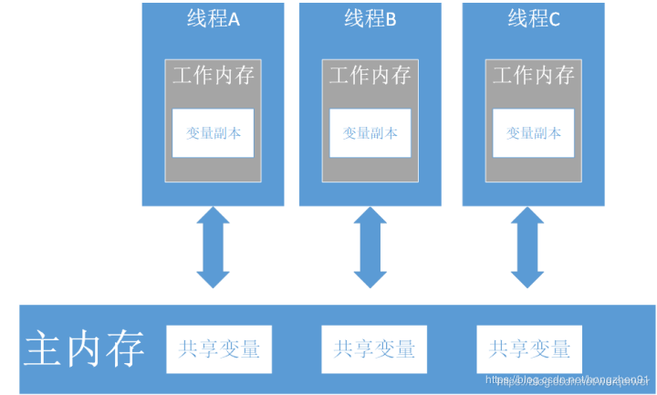

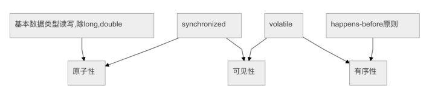

<a id="pdf-page-21"></a>

<!-- 原 PDF 第 21 页 -->

加载过程

其中验证,准备,解析合称链接

加载通过类的完全限定名,查找此类字节码文件,利用字节码文件创建Class对象.

验证确保Class文件符合当前虚拟机的要求,不会危害到虚拟机自身安全.

准备进行内存分配,为static修饰的类变量分配内存,并设置初始值(0或null).不包含final修饰的静态变量,

因为final变量在编译时分配.

解析将常量池中的符号引用替换为直接引用的过程.直接引用为直接指向目标的指针或者相对偏移量等.

初始化主要完成静态块执行以及静态变量的赋值.先初始化父类,再初始化当前类.只有对类主动使用时才

会初始化.

触发条件包括,创建类的实例时,访问类的静态方法或静态变量的时候,使用Class.forName反射类的时候,

或者某个子类初始化的时候.

Java自带的加载器加载的类,在虚拟机的生命周期中是不会被卸载的,只有用户自定义的加载器加载的类

才可以被卸.

1、加载机制-双亲委派模式

**本页原图与图表：**

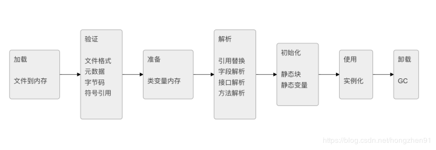

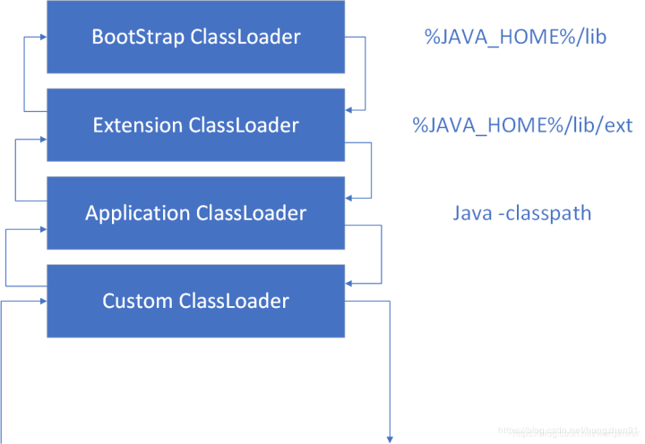

<a id="pdf-page-22"></a>

<!-- 原 PDF 第 22 页 -->

双亲委派模式,即加载器加载类时先把请求委托给自己的父类加载器执行,直到顶层的启动类加载器.父类

加载器能够完成加载则成功返回,不能则子类加载器才自己尝试加载.*

优点:

1. 避免类的重复加载

2. 避免Java的核心API被篡改

2、分代回收

分代回收基于两个事实:大部分对象很快就不使用了,还有一部分不会立即无用,但也不会持续很长时间.

年轻代->标记-复制

老年代->标记-清除

3、回收算法

a、G1算法

1.9后默认的垃圾回收算法,特点保持高回收率的同时减少停顿.采用每次只清理一部分,而不是清理全部的

增量式清理,以保证停顿时间不会过长

其取消了年轻代与老年代的物理划分,但仍属于分代收集器,算法将堆分为若干个逻辑区域(region),一部分

用作年轻代,一部分用作老年代,还有用来存储巨型对象的分区.

同CMS相同,会遍历所有对象,标记引用情况,清除对象后会对区域进行复制移动,以整合碎片空间.

年轻代回收:

并行复制采用复制算法,并行收集,会StopTheWorld.

老年代回收:

会对年轻代一并回收

初始标记完成堆root对象的标记,会StopTheWorld.

并发标记 GC线程和应用线程并发执行.

最终标记完成三色标记周期,会StopTheWorld.

复制/清楚会优先对可回收空间加大的区域进行回收

b、ZGC算法

前面提供的高效垃圾回收算法,针对大堆内存设计,可以处理TB级别的堆,可以做到10ms以下的回收停顿

时间.

**本页原图与图表：**

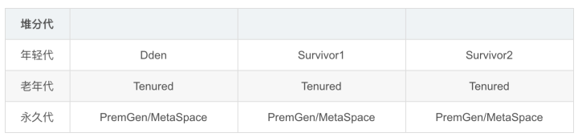

<a id="pdf-page-23"></a>

<!-- 原 PDF 第 23 页 -->

着色指针

读屏障

并发处理

基于region

内存压缩(整理)

roots标记：标记root对象,会StopTheWorld.

并发标记：利用读屏障与应用线程一起运行标记,可能会发生StopTheWorld.

清除会清理标记为不可用的对象.

roots重定位：是对存活的对象进行移动,以腾出大块内存空间,减少碎片产生.重定位最开始会

StopTheWorld,却决于重定位集与对象总活动集的比例.

并发重定位与并发标记类似.

#### 4、简述一下JVM的内存模型

1.JVM内存模型简介

JVM定义了不同运行时数据区，他们是用来执行应用程序的。某些区域随着JVM启动及销毁，另外一些

区域的数据是线程性独立的，随着线程创建和销毁。jvm内存模型总体架构图如下：（摘自oracle官方

网站）

**本页原图与图表：**

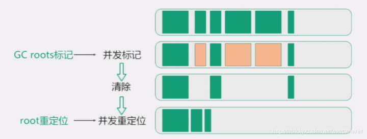

<a id="pdf-page-24"></a>

<!-- 原 PDF 第 24 页 -->

JVM在执行Java程序时，会把它管理的内存划分为若干个的区域，每个区域都有自己的用途和创建销毁

时间。如下图所示，可以分为两大部分，线程私有区和共享区。下图是根据自己理解画的一个JVM内存

模型架构图：

JVM内存分为线程私有区和线程共享区

线程私有区

1、程序计数器

**本页原图与图表：**

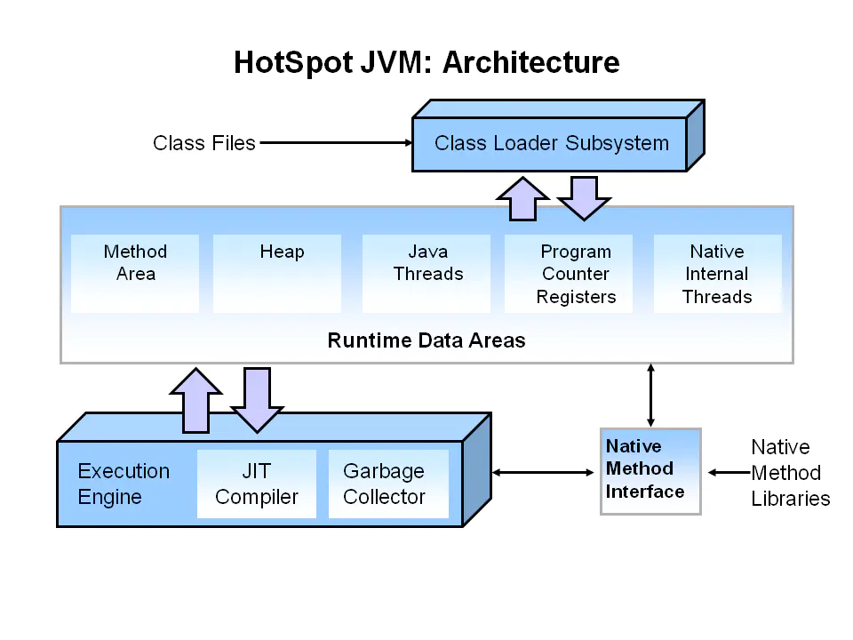

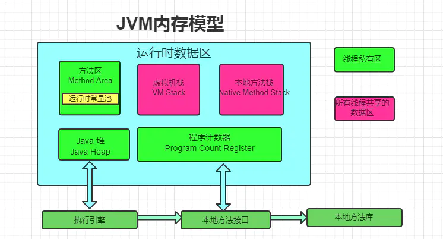

<a id="pdf-page-25"></a>

<!-- 原 PDF 第 25 页 -->

当同时进行的线程数超过CPU数或其内核数时，就要通过时间片轮询分派CPU的时间资源，不免发生线

程切换。这时，每个线程就需要一个属于自己的计数器来记录下一条要运行的指令。如果执行的是JAVA

方法，计数器记录正在执行的java字节码地址，如果执行的是native方法，则计数器为空。

2、虚拟机栈

线程私有的，与线程在同一时间创建。管理JAVA方法执行的内存模型。每个方法执行时都会创建一个桢

栈来存储方法的的变量表、操作数栈、动态链接方法、返回值、返回地址等信息。栈的大小决定了方法

调用的可达深度（递归多少层次，或嵌套调用多少层其他方法，-Xss参数可以设置虚拟机栈大小）。栈

的大小可以是固定的，或者是动态扩展的。如果请求的栈深度大于最大可用深度，则抛出

stackOverflowError；如果栈是可动态扩展的，但没有内存空间支持扩展，则抛出

OutofMemoryError。

使用jclasslib工具可以查看class类文件的结构。下图为栈帧结构图：

3、本地方法栈

与虚拟机栈作用相似。但它不是为Java方法服务的，而是本地方法（C语言）。由于规范对这块没有强

制要求，不同虚拟机实现方法不同。

线程共享区

1、方法区

线程共享的，用于存放被虚拟机加载的类的元数据信息，如常量、静态变量和即时编译器编译后的代

码。若要分代，算是永久代（老年代），以前类大多“static”的，很少被卸载或收集，现回收废弃常量和

无用的类。其中运行时常量池存放编译生成的各种常量。（如果hotspot虚拟机确定一个类的定义信息

不会被使用，也会将其回收。回收的基本条件至少有：所有该类的实例被回收，而且装载该类的

ClassLoader被回收）

2、堆

存放对象实例和数组，是垃圾回收的主要区域，分为新生代和老年代。刚创建的对象在新生代的Eden

区中，经过GC后进入新生代的S0区中，再经过GC进入新生代的S1区中，15次GC后仍存在就进入老年

代。这是按照一种回收机制进行划分的，不是固定的。若堆的空间不够实例分配，则

OutOfMemoryError。

**本页原图与图表：**

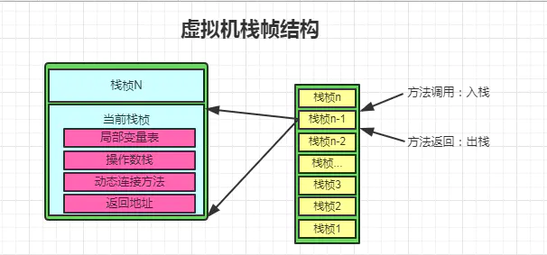

<a id="pdf-page-26"></a>

<!-- 原 PDF 第 26 页 -->

#### 5、堆和栈的区别

栈是运行时单位，代表着逻辑，内含基本数据类型和堆中对象引用，所在区域连续，没有碎片；堆是存

储单位，代表着数据，可被多个栈共享（包括成员中基本数据类型、引用和引用对象），所在区域不连

续，会有碎片。

1、功能不同

栈内存用来存储局部变量和方法调用，而堆内存用来存储Java中的对象。无论是成员变量，局部变量，

还是类变量，它们指向的对象都存储在堆内存中。

2、共享性不同

栈内存是线程私有的。

堆内存是所有线程共有的。

3、异常错误不同

如果栈内存或者堆内存不足都会抛出异常。

栈空间不足：java.lang.StackOverFlowError。

堆空间不足：java.lang.OutOfMemoryError。

4、空间大小

栈的空间大小远远小于堆的。

#### 6、

#### 什么时候会触发FullGC

除直接调用System.gc外，触发Full GC执行的情况有如下四种。

1. 旧生代空间不足

旧生代空间只有在新生代对象转入及创建为大对象、大数组时才会出现不足的现象，当执行Full GC后空

间仍然不足，则抛出如下错误：

java.lang.OutOfMemoryError: Java heap space

为避免以上两种状况引起的FullGC，调优时应尽量做到让对象在Minor GC阶段被回收、让对象在新生

代多存活一段时间及不要创建过大的对象及数组。

Young Generation      即图中的Eden + From Space（s0） + To Space(s1)

Eden                        存放新生的对象

Survivor Space          有两个，存放每次垃圾回收后存活的对象(s0+s1)

Old Generation          Tenured Generation 即图中的Old Space

主要存放应用程序中生命周期长的存活对象

**本页原图与图表：**

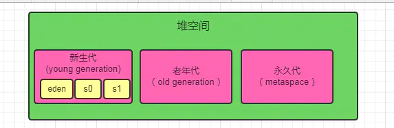

<a id="pdf-page-27"></a>

<!-- 原 PDF 第 27 页 -->

2. Permanet Generation空间满

PermanetGeneration中存放的为一些class的信息等，当系统中要加载的类、反射的类和调用的方法较

多时，Permanet Generation可能会被占满，在未配置为采用CMS GC的情况下会执行Full GC。如果经

过Full GC仍然回收不了，那么JVM会抛出如下错误信息：

java.lang.OutOfMemoryError: PermGen space

为避免Perm Gen占满造成Full GC现象，可采用的方法为增大Perm Gen空间或转为使用CMS GC。

3. CMS GC时出现promotion failed和concurrent mode failure

对于采用CMS进行旧生代GC的程序而言，尤其要注意GC日志中是否有promotion failed和concurrent

mode failure两种状况，当这两种状况出现时可能会触发Full GC。

promotionfailed是在进行Minor GC时，survivor space放不下、对象只能放入旧生代，而此时旧生代

也放不下造成的；concurrent mode failure是在执行CMS GC的过程中同时有对象要放入旧生代，而此

时旧生代空间不足造成的。

应对措施为：增大survivorspace、旧生代空间或调低触发并发GC的比率，但在JDK 5.0+、6.0+的版本

中有可能会由于JDK的bug29导致CMS在remark完毕后很久才触发sweeping动作。对于这种状况，可

通过设置-XX:CMSMaxAbortablePrecleanTime=5（单位为ms）来避免。

4. 统计得到的Minor GC晋升到旧生代的平均大小大于旧生代的剩余空间

这是一个较为复杂的触发情况，Hotspot为了避免由于新生代对象晋升到旧生代导致旧生代空间不足的

现象，在进行Minor GC时，做了一个判断，如果之前统计所得到的Minor GC晋升到旧生代的平均大小

大于旧生代的剩余空间，那么就直接触发Full GC。

例如程序第一次触发MinorGC后，有6MB的对象晋升到旧生代，那么当下一次Minor GC发生时，首先

检查旧生代的剩余空间是否大于6MB，如果小于6MB，则执行Full GC。

当新生代采用PSGC时，方式稍有不同，PS GC是在Minor GC后也会检查，例如上面的例子中第一次

Minor GC后，PS GC会检查此时旧生代的剩余空间是否大于6MB，如小于，则触发对旧生代的回收。

除了以上4种状况外，对于使用RMI来进行RPC或管理的Sun JDK应用而言，默认情况下会一小时执行一

次Full GC。可通过在启动时通过- java-Dsun.rmi.dgc.client.gcInterval=3600000来设置Full GC执行的

间隔时间或通过-XX:+ DisableExplicitGC来禁止RMI调用System.gc。

#### 7、什么是Java虚拟机？为什么Java被称作是“平台无关的编程语言”？

Java虚拟机是一个可以执行Java字节码的虚拟机进程。Java源文件被编译成能被Java虚拟机执行的字节

码文件。 Java被设计成允许应用程序可以运行在任意的平台，而不需要程序员为每一个平台单独重写或

者是重新编译。Java虚拟机让这个变为可能，因为它知道底层硬件平台的指令长度和其他特性。

#### 8、Java内存结构

<a id="pdf-page-28"></a>

<!-- 原 PDF 第 28 页 -->

方法区和对是所有线程共享的内存区域；而java栈、本地方法栈和程序员计数器是运行是线程私有的内

存区域。

Java堆（Heap）,是Java虚拟机所管理的内存中最大的一块。Java堆是被所有线程共享的一块内存

区域，在虚拟机启动时创建。此内存区域的唯一目的就是存放对象实例，几乎所有的对象实例都在

这里分配内存。

方法区（Method Area）,方法区（Method Area）与Java堆一样，是各个线程共享的内存区域，

它用于存储已被虚拟机加载的类信息、常量、静态变量、即时编译器编译后的代码等数据。

程序计数器（Program Counter Register）,程序计数器（Program Counter Register）是一块较

小的内存空间，它的作用可以看做是当前线程所执行的字节码的行号指示器。

JVM栈（JVM Stacks）,与程序计数器一样，Java虚拟机栈（Java Virtual Machine Stacks）也是线

程私有的，它的生命周期与线程相同。虚拟机栈描述的是Java方法执行的内存模型：每个方法被执

行的时候都会同时创建一个栈帧（Stack Frame）用于存储局部变量表、操作栈、动态链接、方法

出口等信息。每一个方法被调用直至执行完成的过程，就对应着一个栈帧在虚拟机栈中从入栈到出

栈的过程。

本地方法栈（Native Method Stacks）,本地方法栈（Native Method Stacks）与虚拟机栈所发挥

的作用是非常相似的，其区别不过是虚拟机栈为虚拟机执行Java方法（也就是字节码）服务，而本

地方法栈则是为虚拟机使用到的Native方法服务。

#### 9、对象分配规则

**本页原图与图表：**

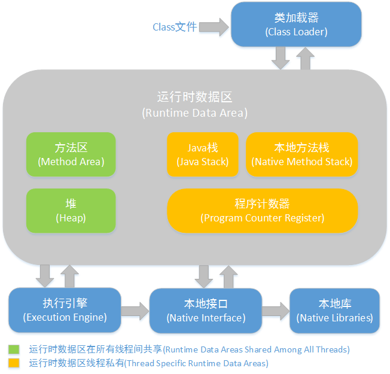

<a id="pdf-page-29"></a>

<!-- 原 PDF 第 29 页 -->

对象优先分配在Eden区，如果Eden区没有足够的空间时，虚拟机执行一次Minor GC。

大对象直接进入老年代（大对象是指需要大量连续内存空间的对象）。这样做的目的是避免在

Eden区和两个Survivor区之间发生大量的内存拷贝（新生代采用复制算法收集内存）。

长期存活的对象进入老年代。虚拟机为每个对象定义了一个年龄计数器，如果对象经过了1次

Minor GC那么对象会进入Survivor区，之后每经过一次Minor GC那么对象的年龄加1，知道达到

阀值对象进入老年区。

动态判断对象的年龄。如果Survivor区中相同年龄的所有对象大小的总和大于Survivor空间的一

半，年龄大于或等于该年龄的对象可以直接进入老年代。

空间分配担保。每次进行Minor GC时，JVM会计算Survivor区移至老年区的对象的平均大小，如

果这个值大于老年区的剩余值大小则进行一次Full GC，如果小于检查HandlePromotionFailure设

置，如果true则只进行Monitor GC,如果false则进行Full GC。

#### 10、描述一下JVM加载class文件的原理机制？

JVM中类的装载是由类加载器（ClassLoader）和它的子类来实现的，Java中的类加载器是一个重要的

Java运行时系统组件，它负责在运行时查找和装入类文件中的类。 由于Java的跨平台性，经过编译的

Java源程序并不是一个可执行程序，而是一个或多个类文件。当Java程序需要使用某个类时，JVM会确

保这个类已经被加载、连接（验证、准备和解析）和初始化。类的加载是指把类的.class文件中的数据

读入到内存中，通常是创建一个字节数组读入.class文件，然后产生与所加载类对应的Class对象。加载

完成后，Class对象还不完整，所以此时的类还不可用。当类被加载后就进入连接阶段，这一阶段包括

验证、准备（为静态变量分配内存并设置默认的初始值）和解析（将符号引用替换为直接引用）三个步

骤。最后JVM对类进行初始化，包括：1)如果类存在直接的父类并且这个类还没有被初始化，那么就先

初始化父类；2)如果类中存在初始化语句，就依次执行这些初始化语句。 类的加载是由类加载器完成

的，类加载器包括：根加载器（BootStrap）、扩展加载器（Extension）、系统加载器（System）和

用户自定义类加载器（java.lang.ClassLoader的子类）。从Java 2（JDK 1.2）开始，类加载过程采取了

父亲委托机制（PDM）。PDM更好的保证了Java平台的安全性，在该机制中，JVM自带的Bootstrap是

根加载器，其他的加载器都有且仅有一个父类加载器。类的加载首先请求父类加载器加载，父类加载器

无能为力时才由其子类加载器自行加载。JVM不会向Java程序提供对Bootstrap的引用。下面是关于几个

类加载器的说明：

Bootstrap：一般用本地代码实现，负责加载JVM基础核心类库（rt.jar）；

Extension：从java.ext.dirs系统属性所指定的目录中加载类库，它的父加载器是Bootstrap；

System：又叫应用类加载器，其父类是Extension。它是应用最广泛的类加载器。它从环境变量

classpath或者系统属性java.class.path所指定的目录中记载类，是用户自定义加载器的默认父加

载器。

#### 11、Java对象创建过程

1.JVM遇到一条新建对象的指令时首先去检查这个指令的参数是否能在常量池中定义到一个类的符号引

用。然后加载这个类（类加载过程在后边讲）

2.为对象分配内存。一种办法“指针碰撞”、一种办法“空闲列表”，最终常用的办法“本地线程缓冲分配

(TLAB)”

3.将除对象头外的对象内存空间初始化为0

4.对对象头进行必要设置

#### 12、类的生命周期

<a id="pdf-page-30"></a>

<!-- 原 PDF 第 30 页 -->

类的生命周期包括这几个部分，加载、连接、初始化、使用和卸载，其中前三部是类的加载的过程,如

下图；

加载，查找并加载类的二进制数据，在Java堆中也创建一个java.lang.Class类的对象

连接，连接又包含三块内容：验证、准备、初始化。 1）验证，文件格式、元数据、字节码、符号

引用验证； 2）准备，为类的静态变量分配内存，并将其初始化为默认值； 3）解析，把类中的符

号引用转换为直接引用

初始化，为类的静态变量赋予正确的初始值

使用，new出对象程序中使用

卸载，执行垃圾回收

#### 13、简述Java的对象结构

Java对象由三个部分组成：对象头、实例数据、对齐填充。

对象头由两部分组成，第一部分存储对象自身的运行时数据：哈希码、GC分代年龄、锁标识状态、线

程持有的锁、偏向线程ID（一般占32/64 bit）。第二部分是指针类型，指向对象的类元数据类型（即对

象代表哪个类）。如果是数组对象，则对象头中还有一部分用来记录数组长度。

实例数据用来存储对象真正的有效信息（包括父类继承下来的和自己定义的）

对齐填充：JVM要求对象起始地址必须是8字节的整数倍（8字节对齐）

#### 14、如何判断对象可以被回收？

判断对象是否存活一般有两种方式：

引用计数：每个对象有一个引用计数属性，新增一个引用时计数加1，引用释放时计数减1，计数

为0时可以回收。此方法简单，无法解决对象相互循环引用的问题。

可达性分析（Reachability Analysis）：从GC Roots开始向下搜索，搜索所走过的路径称为引用

链。当一个对象到GC Roots没有任何引用链相连时，则证明此对象是不可用的，不可达对象。

#### 15、JVM的永久代中会发生垃圾回收么？

垃圾回收不会发生在永久代，如果永久代满了或者是超过了临界值，会触发完全垃圾回收(Full GC)。如

果你仔细查看垃圾收集器的输出信息，就会发现永久代也是被回收的。这就是为什么正确的永久代大小

对避免Full GC是非常重要的原因。请参考下Java8：从永久代到元数据区 (注：Java8中已经移除了永久

代，新加了一个叫做元数据区的native内存区)

#### 16、垃圾收集算法

**本页原图与图表：**

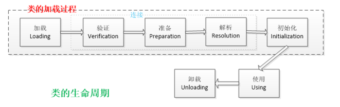

<a id="pdf-page-31"></a>

<!-- 原 PDF 第 31 页 -->

GC最基础的算法有三种： 标记 -清除算法、复制算法、标记-压缩算法，我们常用的垃圾回收器一般都

采用分代收集算法。

标记 -清除算法，“标记-清除”（Mark-Sweep）算法，如它的名字一样，算法分为“标记”和“清除”两

个阶段：首先标记出所有需要回收的对象，在标记完成后统一回收掉所有被标记的对象。

复制算法，“复制”（Copying）的收集算法，它将可用内存按容量划分为大小相等的两块，每次只

使用其中的一块。当这一块的内存用完了，就将还存活着的对象复制到另外一块上面，然后再把已

使用过的内存空间一次清理掉。

标记-压缩算法，标记过程仍然与“标记-清除”算法一样，但后续步骤不是直接对可回收对象进行清

理，而是让所有存活的对象都向一端移动，然后直接清理掉端边界以外的内存

分代收集算法，“分代收集”（Generational Collection）算法，把Java堆分为新生代和老年代，这

样就可以根据各个年代的特点采用最适当的收集算法。

#### 17、调优命令有哪些？

Sun JDK监控和故障处理命令有jps jstat jmap jhat jstack jinfo

jps，JVM Process Status Tool,显示指定系统内所有的HotSpot虚拟机进程。

jstat，JVM statistics Monitoring是用于监视虚拟机运行时状态信息的命令，它可以显示出虚拟机

进程中的类装载、内存、垃圾收集、JIT编译等运行数据。

jmap，JVM Memory Map命令用于生成heap dump文件

jhat，JVM Heap Analysis Tool命令是与jmap搭配使用，用来分析jmap生成的dump，jhat内置了

一个微型的HTTP/HTML服务器，生成dump的分析结果后，可以在浏览器中查看

jstack，用于生成java虚拟机当前时刻的线程快照。

jinfo，JVM Configuration info 这个命令作用是实时查看和调整虚拟机运行参数。

#### 18、调优工具

常用调优工具分为两类,jdk自带监控工具：jconsole和jvisualvm，第三方有：MAT(Memory Analyzer

Tool)、GChisto。

jconsole，Java Monitoring and Management Console是从java5开始，在JDK中自带的java监控

和管理控制台，用于对JVM中内存，线程和类等的监控

jvisualvm，jdk自带全能工具，可以分析内存快照、线程快照；监控内存变化、GC变化等。

MAT，Memory Analyzer Tool，一个基于Eclipse的内存分析工具，是一个快速、功能丰富的Java

heap分析工具，它可以帮助我们查找内存泄漏和减少内存消耗

GChisto，一款专业分析gc日志的工具

#### 19、MinorGC与FullGC分别在什么时候发生？

新生代内存不够用时候发生MGC也叫YGC，JVM内存不够的时候发生FGC

#### 20、你知道哪些JVM性能调优

设定堆内存大小

-Xmx：堆内存最大限制。

设定新生代大小。 新生代不宜太小，否则会有大量对象涌入老年代

<a id="pdf-page-32"></a>

<!-- 原 PDF 第 32 页 -->

-XX:NewSize：新生代大小

-XX:NewRatio 新生代和老生代占比

-XX:SurvivorRatio：伊甸园空间和幸存者空间的占比

设定垃圾回收器 年轻代用 -XX:+UseParNewGC 年老代用-XX:+UseConcMarkSweepGC

### 多线程&并发篇

#### 1、Java中实现多线程有几种方法

继承Thread类；

实现Runnable接口；

实现Callable接口通过FutureTask包装器来创建Thread线程；

使用ExecutorService、Callable、Future实现有返回结果的多线程（也就是使用了ExecutorService来

管理前面的三种方式）。

#### 2、如何停止一个正在运行的线程

1、使用退出标志，使线程正常退出，也就是当run方法完成后线程终止。

2、使用stop方法强行终止，但是不推荐这个方法，因为stop和suspend及resume一样都是过期作废的

方法。

3、使用interrupt方法中断线程。

```java
class MyThread extends Thread {
```

volatile boolean stop = false;

```java
    public void run() {
        while (!stop) {
            System.out.println(getName() + " is running");
```

try {

sleep(1000);

} catch (InterruptedException e) {

```java
                System.out.println("week up from blcok...");
                stop = true; // 在异常处理代码中修改共享变量的状态
            }
        }
        System.out.println(getName() + " is exiting...");
    }
}
class InterruptThreadDemo3 {
    public static void main(String[] args) throws InterruptedException {
```

MyThread m1 = new MyThread();

```java
        System.out.println("Starting thread...");
        m1.start();
        Thread.sleep(3000);
        System.out.println("Interrupt thread...: " + m1.getName());
        m1.stop = true; // 设置共享变量为true
```

<a id="pdf-page-33"></a>

<!-- 原 PDF 第 33 页 -->

#### 3、notify()和notifyAll()有什么区别？

notify可能会导致死锁，而notifyAll则不会

任何时候只有一个线程可以获得锁，也就是说只有一个线程可以运行synchronized 中的代码

使用notifyall,可以唤醒

所有处于wait状态的线程，使其重新进入锁的争夺队列中，而notify只能唤醒一个。

wait() 应配合while循环使用，不应使用if，务必在wait()调用前后都检查条件，如果不满足，必须调用

notify()唤醒另外的线程来处理，自己继续wait()直至条件满足再往下执行。

notify() 是对notifyAll()的一个优化，但它有很精确的应用场景，并且要求正确使用。不然可能导致死

锁。正确的场景应该是 WaitSet中等待的是相同的条件，唤醒任一个都能正确处理接下来的事项，如果

唤醒的线程无法正确处理，务必确保继续notify()下一个线程，并且自身需要重新回到WaitSet中.

#### 4、sleep()和wait()有什么区别？

对于sleep()方法，我们首先要知道该方法是属于Thread类中的。而wait()方法，则是属于Object类中

的。

sleep()方法导致了程序暂停执行指定的时间，让出cpu该其他线程，但是他的监控状态依然保持者，当

指定的时间到了又会自动恢复运行状态。在调用sleep()方法的过程中，线程不会释放对象锁。

当调用wait()方法的时候，线程会放弃对象锁，进入等待此对象的等待锁定池，只有针对此对象调用

notify()方法后本线程才进入对象锁定池准备，获取对象锁进入运行状态。

#### 5、volatile是什么?可以保证有序性吗?

一旦一个共享变量（类的成员变量、类的静态成员变量）被volatile修饰之后，那么就具备了两层语

义：

1）保证了不同线程对这个变量进行操作时的可见性，即一个线程修改了某个变量的值，这新值对其他

线程来说是立即可见的,volatile关键字会强制将修改的值立即写入主存。

2）禁止进行指令重排序。

volatile 不是原子性操作

什么叫保证部分有序性?

当程序执行到volatile变量的读操作或者写操作时，在其前面的操作的更改肯定全部已经进行，且结果

已经对后面的操作可见；在其后面的操作肯定还没有进行；

m1.interrupt(); // 阻塞时退出阻塞状态

Thread.sleep(3000); // 主线程休眠3秒以便观察线程m1的中断情况

```java
        System.out.println("Stopping application...");
    }
}
```

<a id="pdf-page-34"></a>

<!-- 原 PDF 第 34 页 -->

由于flag变量为volatile变量，那么在进行指令重排序的过程的时候，不会将语句3放到语句1、语句2前

面，也不会讲语句3放到语句4、语句5后面。但是要注意语句1和语句2的顺序、语句4和语句5的顺序是

不作任何保证的。

使用 Volatile 一般用于 状态标记量 和 单例模式的双检锁

#### 6、Thread类中的start()和run()方法有什么区别？

start()方法被用来启动新创建的线程，而且start()内部调用了run()方法，这和直接调用run()方法的效果

不一样。当你调用run()方法的时候，只会是在原来的线程中调用，没有新的线程启动，start()方法才会

启动新线程。

#### 7、为什么wait,notify和notifyAll这些方法不在thread类里面？

明显的原因是JAVA提供的锁是对象级的而不是线程级的，每个对象都有锁，通过线程获得。如果线程需

要等待某些锁那么调用对象中的wait()方法就有意义了。如果wait()方法定义在Thread类中，线程正在

等待的是哪个锁就不明显了。简单的说，由于wait，notify和notifyAll都是锁级别的操作，所以把他们

定义在Object类中因为锁属于对象。

#### 8、为什么wait和notify方法要在同步块中调用？

1. 只有在调用线程拥有某个对象的独占锁时，才能够调用该对象的wait(),notify()和notifyAll()方法。

2. 如果你不这么做，你的代码会抛出IllegalMonitorStateException异常。

3. 还有一个原因是为了避免wait和notify之间产生竞态条件。

wait()方法强制当前线程释放对象锁。这意味着在调用某对象的wait()方法之前，当前线程必须已经获得

该对象的锁。因此，线程必须在某个对象的同步方法或同步代码块中才能调用该对象的wait()方法。

在调用对象的notify()和notifyAll()方法之前，调用线程必须已经得到该对象的锁。因此，必须在某个对

象的同步方法或同步代码块中才能调用该对象的notify()或notifyAll()方法。

调用wait()方法的原因通常是，调用线程希望某个特殊的状态(或变量)被设置之后再继续执行。调用

notify()或notifyAll()方法的原因通常是，调用线程希望告诉其他等待中的线程:"特殊状态已经被设置"。

这个状态作为线程间通信的通道，它必须是一个可变的共享状态(或变量)。

#### 9、Java中interrupted和isInterruptedd方法的区别？

interrupted() 和 isInterrupted()的主要区别是前者会将中断状态清除而后者不会。Java多线程的中断机

制是用内部标识来实现的，调用Thread.interrupt()来中断一个线程就会设置中断标识为true。当中断线

程调用静态方法Thread.interrupted()来检查中断状态时，中断状态会被清零。而非静态方法

isInterrupted()用来查询其它线程的中断状态且不会改变中断状态标识。简单的说就是任何抛出

InterruptedException异常的方法都会将中断状态清零。无论如何，一个线程的中断状态有有可能被其

它线程调用中断来改变。

x = 2;        //语句1

y = 0;        //语句2

flag = true;  //语句3

x = 4;         //语句4

y = -1;       //语句5

<a id="pdf-page-35"></a>

<!-- 原 PDF 第 35 页 -->

#### 10、Java中synchronized和ReentrantLock有什么不同？

相似点：

这两种同步方式有很多相似之处，它们都是加锁方式同步，而且都是阻塞式的同步，也就是说当如果一

个线程获得了对象锁，进入了同步块，其他访问该同步块的线程都必须阻塞在同步块外面等待，而进行

线程阻塞和唤醒的代价是比较高的.

区别：

这两种方式最大区别就是对于Synchronized来说，它是java语言的关键字，是原生语法层面的互斥，需

要jvm实现。而ReentrantLock它是JDK 1.5之后提供的API层面的互斥锁，需要lock()和unlock()方法配

合try/finally语句块来完成。

Synchronized进过编译，会在同步块的前后分别形成monitorenter和monitorexit这个两个字节码指

令。在执行monitorenter指令时，首先要尝试获取对象锁。如果这个对象没被锁定，或者当前线程已经

拥有了那个对象锁，把锁的计算器加1，相应的，在执行monitorexit指令时会将锁计算器就减1，当计

算器为0时，锁就被释放了。如果获取对象锁失败，那当前线程就要阻塞，直到对象锁被另一个线程释

放为止。

由于ReentrantLock是java.util.concurrent包下提供的一套互斥锁，相比Synchronized，

ReentrantLock类提供了一些高级功能，主要有以下3项：

1.等待可中断，持有锁的线程长期不释放的时候，正在等待的线程可以选择放弃等待，这相当于

Synchronized来说可以避免出现死锁的情况。

2.公平锁，多个线程等待同一个锁时，必须按照申请锁的时间顺序获得锁，Synchronized锁非公平锁，

ReentrantLock默认的构造函数是创建的非公平锁，可以通过参数true设为公平锁，但公平锁表现的性

能不是很好。

3.锁绑定多个条件，一个ReentrantLock对象可以同时绑定对个对象。

#### 11、有三个线程T1,T2,T3,如何保证顺序执行？

在多线程中有多种方法让线程按特定顺序执行，你可以用线程类的join()方法在一个线程中启动另一个

线程，另外一个线程完成该线程继续执行。为了确保三个线程的顺序你应该先启动最后一个(T3调用

T2，T2调用T1)，这样T1就会先完成而T3最后完成。

实际上先启动三个线程中哪一个都行，

因为在每个线程的run方法中用join方法限定了三个线程的执行顺序。

```java
public class JoinTest2 {
```

```java
    // 1.现在有T1、T2、T3三个线程，你怎样保证T2在T1执行完后执行，T3在T2执行完后执行
```

```java
    public static void main(String[] args) {
```

final Thread t1 = new Thread(new Runnable() {

@Override

```java
            public void run() {
                System.out.println("t1");
            }
```

});

final Thread t2 = new Thread(new Runnable() {

<a id="pdf-page-36"></a>

<!-- 原 PDF 第 36 页 -->

#### 12、SynchronizedMap和ConcurrentHashMap有什么区别？

SynchronizedMap()和Hashtable一样，实现上在调用map所有方法时，都对整个map进行同步。而

ConcurrentHashMap的实现却更加精细，它对map中的所有桶加了锁。所以，只要有一个线程访问

map，其他线程就无法进入map，而如果一个线程在访问ConcurrentHashMap某个桶时，其他线程，

仍然可以对map执行某些操作。

所以，ConcurrentHashMap在性能以及安全性方面，明显比Collections.synchronizedMap()更加有优

势。同时，同步操作精确控制到桶，这样，即使在遍历map时，如果其他线程试图对map进行数据修

改，也不会抛出ConcurrentModificationException。

#### 13、什么是线程安全

线程安全就是说多线程访问同一代码，不会产生不确定的结果。

在多线程环境中，当各线程不共享数据的时候，即都是私有（private）成员，那么一定是线程安全的。

但这种情况并不多见，在多数情况下需要共享数据，这时就需要进行适当的同步控制了。

线程安全一般都涉及到synchronized， 就是一段代码同时只能有一个线程来操作 不然中间过程可能会

产生不可预制的结果。

如果你的代码所在的进程中有多个线程在同时运行，而这些线程可能会同时运行这段代码。如果每次运

行结果和单线程运行的结果是一样的，而且其他的变量的值也和预期的是一样的，就是线程安全的。

@Override

```java
            public void run() {
```

try {

```java
                    // 引用t1线程，等待t1线程执行完
                    t1.join();
```

} catch (InterruptedException e) {

e.printStackTrace();

```java
                }
                System.out.println("t2");
            }
```

});

```java
        Thread t3 = new Thread(new Runnable() {
```

@Override

```java
            public void run() {
```

try {

```java
                    // 引用t2线程，等待t2线程执行完
                    t2.join();
```

} catch (InterruptedException e) {

e.printStackTrace();

```java
                }
                System.out.println("t3");
            }
```

});

t3.start();//这里三个线程的启动顺序可以任意，大家可以试下！

t2.start();

t1.start();

```java
    }
}
```

<a id="pdf-page-37"></a>

<!-- 原 PDF 第 37 页 -->

#### 14、Thread类中的yield方法有什么作用？

Yield方法可以暂停当前正在执行的线程对象，让其它有相同优先级的线程执行。它是一个静态方法而且

只保证当前线程放弃CPU占用而不能保证使其它线程一定能占用CPU，执行yield()的线程有可能在进入

到暂停状态后马上又被执行。

#### 15、Java线程池中submit()和execute()方法有什么区别？

两个方法都可以向线程池提交任务，execute()方法的返回类型是void，它定义在Executor接口中, 而

submit()方法可以返回持有计算结果的Future对象，它定义在ExecutorService接口中，它扩展了

Executor接口，其它线程池类像ThreadPoolExecutor和ScheduledThreadPoolExecutor都有这些方

法。

#### 16、说一说自己对于synchronized关键字的了解

synchronized关键字解决的是多个线程之间访问资源的同步性，synchronized关键字可以保证被它修

饰的方法或者代码块在任意时刻只能有一个线程执行。

另外，在 Java 早期版本中，synchronized属于重量级锁，效率低下，因为监视器锁（monitor）是依

赖于底层的操作系统的 Mutex Lock 来实现的，Java 的线程是映射到操作系统的原生线程之上的。如果

要挂起或者唤醒一个线程，都需要操作系统帮忙完成，而操作系统实现线程之间的切换时需要从用户态

转换到内核态，这个状态之间的转换需要相对比较长的时间，时间成本相对较高，这也是为什么早期的

synchronized 效率低的原因。庆幸的是在 Java 6 之后 Java 官方对从 JVM 层面对synchronized 较大优

化，所以现在的 synchronized 锁效率也优化得很不错了。JDK1.6对锁的实现引入了大量的优化，如自

旋锁、适应性自旋锁、锁消除、锁粗化、偏向锁、轻量级锁等技术来减少锁操作的开销。

#### 17、说说自己是怎么使用synchronized关键字，在项目中用到了吗synchronized关键字最主要的三种使用方式：

修饰实例方法: 作用于当前对象实例加锁，进入同步代码前要获得当前对象实例的锁

修饰静态方法: 也就是给当前类加锁，会作用于类的所有对象实例，因为静态成员不属于任何一个实例

对象，是类成员（ static 表明这是该类的一个静态资源，不管new了多少个对象，只有一份）。所以如

果一个线程A调用一个实例对象的非静态 synchronized 方法，而线程B需要调用这个实例对象所属类的

静态 synchronized 方法，是允许的，不会发生互斥现象，因为访问静态 synchronized 方法占用的锁

是当前类的锁，而访问非静态 synchronized 方法占用的锁是当前实例对象锁。

修饰代码块: 指定加锁对象，对给定对象加锁，进入同步代码库前要获得给定对象的锁。

总结： synchronized 关键字加到 static 静态方法和 synchronized(class)代码块上都是是给 Class 类上

锁。synchronized 关键字加到实例方法上是给对象实例上锁。尽量不要使用 synchronized(String a) 因

为JVM中，字符串常量池具有缓存功能！

#### 18、什么是线程安全？Vector是一个线程安全类吗？

如果你的代码所在的进程中有多个线程在同时运行，而这些线程可能会同时运行这段代码。如果每次运

行结果和单线程运行的结果是一样的，而且其他的变量 的值也和预期的是一样的，就是线程安全的。一

个线程安全的计数器类的同一个实例对象在被多个线程使用的情况下也不会出现计算失误。很显然你可

以将集合类分 成两组，线程安全和非线程安全的。Vector 是用同步方法来实现线程安全的, 而和它相似

<a id="pdf-page-38"></a>

<!-- 原 PDF 第 38 页 -->

的ArrayList不是线程安全的。

#### 19、volatile关键字的作用？

一旦一个共享变量（类的成员变量、类的静态成员变量）被volatile修饰之后，那么就具备了两层语

义：

保证了不同线程对这个变量进行操作时的可见性，即一个线程修改了某个变量的值，这新值对其他

线程来说是立即可见的。

禁止进行指令重排序。

volatile本质是在告诉jvm当前变量在寄存器（工作内存）中的值是不确定的，需要从主存中读

取；synchronized则是锁定当前变量，只有当前线程可以访问该变量，其他线程被阻塞住。

volatile仅能使用在变量级别；synchronized则可以使用在变量、方法、和类级别的。

volatile仅能实现变量的修改可见性，并不能保证原子性；synchronized则可以保证变量的修改可

见性和原子性。

volatile不会造成线程的阻塞；synchronized可能会造成线程的阻塞。

volatile标记的变量不会被编译器优化；synchronized标记的变量可以被编译器优化。

#### 20、常用的线程池有哪些？

newSingleThreadExecutor：创建一个单线程的线程池，此线程池保证所有任务的执行顺序按照

任务的提交顺序执行。

newFixedThreadPool：创建固定大小的线程池，每次提交一个任务就创建一个线程，直到线程达

到线程池的最大大小。

newCachedThreadPool：创建一个可缓存的线程池，此线程池不会对线程池大小做限制，线程池

大小完全依赖于操作系统（或者说JVM）能够创建的最大线程大小。

newScheduledThreadPool：创建一个大小无限的线程池，此线程池支持定时以及周期性执行任

务的需求。

newSingleThreadExecutor：创建一个单线程的线程池。此线程池支持定时以及周期性执行任务

的需求。

#### 21、简述一下你对线程池的理解

（如果问到了这样的问题，可以展开的说一下线程池如何用、线程池的好处、线程池的启动策略）合理

利用线程池能够带来三个好处。

第一：降低资源消耗。通过重复利用已创建的线程降低线程创建和销毁造成的消耗。

第二：提高响应速度。当任务到达时，任务可以不需要等到线程创建就能立即执行。

第三：提高线程的可管理性。线程是稀缺资源，如果无限制的创建，不仅会消耗系统资源，还会降低系

统的稳定性，使用线程池可以进行统一的分配，调优和监控。

#### 22、Java程序是如何执行的

我们日常的工作中都使用开发工具（IntelliJ IDEA 或 Eclipse 等）可以很方便的调试程序，或者是通过打

包工具把项目打包成 jar 包或者 war 包，放入 Tomcat 等 Web 容器中就可以正常运行了，但你有没有

想过 Java 程序内部是如何执行的？其实不论是在开发工具中运行还是在 Tomcat 中运行，Java 程序的

执行流程基本都是相同的，它的执行流程如下：

<a id="pdf-page-39"></a>

<!-- 原 PDF 第 39 页 -->

先把 Java 代码编译成字节码，也就是把 .java 类型的文件编译成 .class 类型的文件。这个过程的

大致执行流程：Java 源代码 -> 词法分析器 -> 语法分析器 -> 语义分析器 -> 字符码生成器 -> 最终

生成字节码，其中任何一个节点执行失败就会造成编译失败；

把 class 文件放置到 Java 虚拟机，这个虚拟机通常指的是 Oracle 官方自带的 Hotspot JVM；

Java 虚拟机使用类加载器（Class Loader）装载 class 文件；

类加载完成之后，会进行字节码效验，字节码效验通过之后 JVM 解释器会把字节码翻译成机器码

交由操作系统执行。但不是所有代码都是解释执行的，JVM 对此做了优化，比如，以 Hotspot 虚

拟机来说，它本身提供了 JIT（Just In Time）也就是我们通常所说的动态编译器，它能够在运行时

将热点代码编译为机器码，这个时候字节码就变成了编译执行。Java 程序执行流程图如下：

### Spring篇

推荐阅读： 极客学院Spring Wiki

#### 1、Spring的IOC和AOP机制？

我们是在使用Spring框架的过程中，其实就是为了使用IOC，依赖注入，和AOP，面向切面编程，这两

个是Spring的灵魂。

主要用到的设计模式有工厂模式和代理模式。

IOC就是典型的工厂模式，通过sessionfactory去注入实例。

AOP就是典型的代理模式的体现。

代理模式是常用的java设计模式，他的特征是代理类与委托类有同样的接口，代理类主要负责为委托类

预处理消息、过滤消息、把消息转发给委托类，以及事后处理消息等。代理类与委托类之间通常会存在

关联关系，一个代理类的对象与一个委托类的对象关联，代理类的对象本身并不真正实现服务，而是通

过调用委托类的对象的相关方法，来提供特定的服务。

**本页原图与图表：**

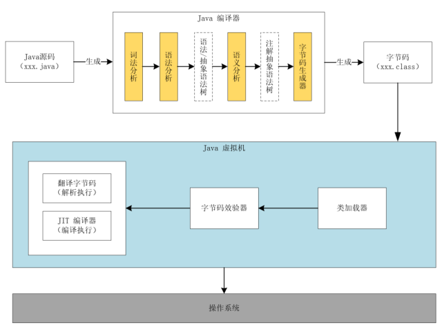

<a id="pdf-page-40"></a>

<!-- 原 PDF 第 40 页 -->

spring的IoC容器是spring的核心，spring AOP是spring框架的重要组成部分。

在传统的程序设计中，当调用者需要被调用者的协助时，通常由调用者来创建被调用者的实例。但在

spring里创建被调用者的工作不再由调用者来完成，因此控制反转（IoC）；创建被调用者实例的工作通

常由spring容器来完成，然后注入调用者，因此也被称为依赖注入（DI），依赖注入和控制反转是同一

个概念。

面向方面编程（AOP)是以另一个角度来考虑程序结构，通过分析程序结构的关注点来完善面向对象编程

（OOP）。OOP将应用程序分解成各个层次的对象，而AOP将程序分解成多个切面。spring AOP 只实

现了方法级别的连接点，在J2EE应用中，AOP拦截到方法级别的操作就已经足够。在spring中，未来使

IoC方便地使用健壮、灵活的企业服务，需要利用spring AOP实现为IoC和企业服务之间建立联系。

IOC:控制反转也叫依赖注入。利用了工厂模式

将对象交给容器管理，你只需要在spring配置文件总配置相应的bean，以及设置相关的属性，让

spring容器来生成类的实例对象以及管理对象。在spring容器启动的时候，spring会把你在配置文件

中配置的bean都初始化好，然后在你需要调用的时候，就把它已经初始化好的那些bean分配给你需要

调用这些bean的类（假设这个类名是A），分配的方法就是调用A的setter方法来注入，而不需要你在

A里面new这些bean了。

注意：面试的时候，如果有条件，画图，这样更加显得你懂了.

spring ioc初始化流程

AOP:面向切面编程。（Aspect-Oriented Programming）

AOP可以说是对OOP的补充和完善。OOP引入封装、继承和多态性等概念来建立一种对象层次结构，

用以模拟公共行为的一个集合。当我们需要为分散的对象引入公共行为的时候，OOP则显得无能为力。

也就是说，OOP允许你定义从上到下的关系，但并不适合定义从左到右的关系。例如日志功能。日志代

码往往水平地散布在所有对象层次中，而与它所散布到的对象的核心功能毫无关系。在OOP设计中，它

导致了大量代码的重复，而不利于各个模块的重用。

将程序中的交叉业务逻辑（比如安全，日志，事务等），封装成一个切面，然后注入到目标对象（具体

业务逻辑）中去。

实现AOP的技术，主要分为两大类：一是采用动态代理技术，利用截取消息的方式，对该消息进行装

饰，以取代原有对象行为的执行；二是采用静态织入的方式，引入特定的语法创建“方面”，从而使得编

译器可以在编译期间织入有关“方面”的代码.

简单点解释，比方说你想在你的biz层所有类中都加上一个打印‘你好’的功能,这时就可以用aop思想来做.

你先写个类写个类方法，方法经实现打印‘你好’,然后Ioc这个类 ref＝“biz.*”让每个类都注入即可实现。

#### 2、Spring中Autowired和Resource关键字的区别？

```java
@Resource和@Autowired都是做bean的注入时使用，其实@Resource并不是Spring的注解，它的包
```

是javax.annotation.Resource，需要导入，但是Spring支持该注解的注入。

1、共同点

两者都可以写在字段和setter方法上。两者如果都写在字段上，那么就不需要再写setter方法。

2、不同点

（1）@Autowired

**本页原图与图表：**


<a id="pdf-page-41"></a>

<!-- 原 PDF 第 41 页 -->

```java
@Autowired为Spring提供的注解，需要导入包
org.springframework.beans.factory.annotation.Autowired;只按照byType注入。
 @Autowired注解是按照类型（byType）装配依赖对象，默认情况下它要求依赖对象必须存在，如果允
```

许null值，可以设置它的required属性为false。如果我们想使用按照名称（byName）来装配，可以结

合@Qualifier注解一起使用。如下：

（2）@Resource

```java
@Resource默认按照ByName自动注入，由J2EE提供，需要导入包javax.annotation.Resource。
@Resource有两个重要的属性：name和type，而Spring将@Resource注解的name属性解析为bean的
```

名字，而type属性则解析为bean的类型。所以，如果使用name属性，则使用byName的自动注入策

略，而使用type属性时则使用byType自动注入策略。如果既不制定name也不制定type属性，这时将通

过反射机制使用byName自动注入策略。

注：最好是将@Resource放在setter方法上，因为这样更符合面向对象的思想，通过set、get去操作属

性，而不是直接去操作属性。

```java
@Resource装配顺序：
```

①如果同时指定了name和type，则从Spring上下文中找到唯一匹配的bean进行装配，找不到则抛出异

常。

②如果指定了name，则从上下文中查找名称（id）匹配的bean进行装配，找不到则抛出异常。

③如果指定了type，则从上下文中找到类似匹配的唯一bean进行装配，找不到或是找到多个，都会抛

出异常。

```java
public class TestServiceImpl {
    // 下面两种@Autowired只要使用一种即可
    @Autowired
    private UserDao userDao; // 用于字段上
```

```java
    @Autowired
    public void setUserDao(UserDao userDao) { // 用于属性的方法上
        this.userDao = userDao;
    }
}
public class TestServiceImpl {
    @Autowired
```

@Qualifier("userDao")

```java
    private UserDao userDao; 
}
public class TestServiceImpl {
    // 下面两种@Resource只要使用一种即可
    @Resource(name="userDao")
    private UserDao userDao; // 用于字段上
```

```java
    @Resource(name="userDao")
    public void setUserDao(UserDao userDao) { // 用于属性的setter方法上
        this.userDao = userDao;
    }
}
```

<a id="pdf-page-42"></a>

<!-- 原 PDF 第 42 页 -->

④如果既没有指定name，又没有指定type，则自动按照byName方式进行装配；如果没有匹配，则回

退为一个原始类型进行匹配，如果匹配则自动装配。

```java
@Resource的作用相当于@Autowired，只不过@Autowired按照byType自动注入。
```

#### 3、依赖注入的方式有几种，各是什么?

一、构造器注入

将被依赖对象通过构造函数的参数注入给依赖对象，并且在初始化对象的时候注入。

优点：

对象初始化完成后便可获得可使用的对象。

缺点：

当需要注入的对象很多时，构造器参数列表将会很长；

不够灵活。若有多种注入方式，每种方式只需注入指定几个依赖，那么就需要提供多个重载的构造函

数，麻烦。

二、setter方法注入

IoC Service Provider通过调用成员变量提供的setter函数将被依赖对象注入给依赖类。

优点：

灵活。可以选择性地注入需要的对象。

缺点：

依赖对象初始化完成后由于尚未注入被依赖对象，因此还不能使用。

三、接口注入

依赖类必须要实现指定的接口，然后实现该接口中的一个函数，该函数就是用于依赖注入。该函数的参

数就是要注入的对象。

优点

接口注入中，接口的名字、函数的名字都不重要，只要保证函数的参数是要注入的对象类型即可。

缺点：

侵入行太强，不建议使用。

PS：什么是侵入行？

如果类A要使用别人提供的一个功能，若为了使用这功能，需要在自己的类中增加额外的代码，这就是

侵入性。

#### 4、讲一下什么是Spring

Spring是一个轻量级的IoC和AOP容器框架。是为Java应用程序提供基础性服务的一套框架，目的是用

于简化企业应用程序的开发，它使得开发者只需要关心业务需求。常见的配置方式有三种：基于XML的

配置、基于注解的配置、基于Java的配置。

主要由以下几个模块组成：

Spring Core：核心类库，提供IOC服务；

Spring Context：提供框架式的Bean访问方式，以及企业级功能（JNDI、定时任务等）；

Spring AOP：AOP服务；

Spring DAO：对JDBC的抽象，简化了数据访问异常的处理；

<a id="pdf-page-43"></a>

<!-- 原 PDF 第 43 页 -->

Spring ORM：对现有的ORM框架的支持；

Spring Web：提供了基本的面向Web的综合特性，例如多方文件上传；

Spring MVC：提供面向Web应用的Model-View-Controller实现。

#### 5、SpringMVC流程

工作原理：

1、 用户发送请求至前端控制器DispatcherServlet。

2、 DispatcherServlet收到请求调用HandlerMapping处理器映射器。

3、 处理器映射器找到具体的处理器(可以根据xml配置、注解进行查找)，生成处理器对象及处理器拦截

器(如果有则生成)一并返回给DispatcherServlet。

4、 DispatcherServlet调用HandlerAdapter处理器适配器。

5、 HandlerAdapter经过适配调用具体的处理器(Controller，也叫后端控制器)。

6、 Controller执行完成返回ModelAndView。

7、 HandlerAdapter将controller执行结果ModelAndView返回给DispatcherServlet。

8、 DispatcherServlet将ModelAndView传给ViewReslover视图解析器。

9、 ViewReslover解析后返回具体View。

10、DispatcherServlet根据View进行渲染视图（即将模型数据填充至视图中）。

11、 DispatcherServlet响应用户。

组件说明：

以下组件通常使用框架提供实现：

DispatcherServlet：作为前端控制器，整个流程控制的中心，控制其它组件执行，统一调度，降低组件

之间的耦合性，提高每个组件的扩展性。

**本页原图与图表：**

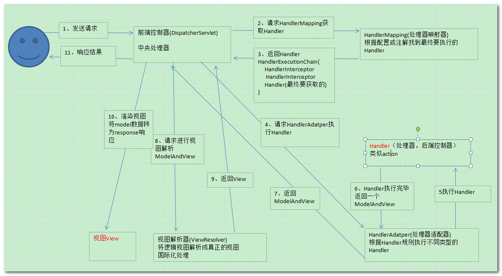

<a id="pdf-page-44"></a>

<!-- 原 PDF 第 44 页 -->

HandlerMapping：通过扩展处理器映射器实现不同的映射方式，例如：配置文件方式，实现接口方

式，注解方式等。

HandlAdapter：通过扩展处理器适配器，支持更多类型的处理器。

ViewResolver：通过扩展视图解析器，支持更多类型的视图解析，例如：jsp、freemarker、pdf、

excel等。

组件：

1、前端控制器DispatcherServlet（不需要工程师开发）,由框架提供

作用：接收请求，响应结果，相当于转发器，中央处理器。有了dispatcherServlet减少了其它组件之间

的耦合度。

用户请求到达前端控制器，它就相当于mvc模式中的c，dispatcherServlet是整个流程控制的中心，由

它调用其它组件处理用户的请求，dispatcherServlet的存在降低了组件之间的耦合性。

2、处理器映射器HandlerMapping(不需要工程师开发),由框架提供

作用：根据请求的url查找Handler

HandlerMapping负责根据用户请求找到Handler即处理器，springmvc提供了不同的映射器实现不同

的映射方式，例如：配置文件方式，实现接口方式，注解方式等。

3、处理器适配器HandlerAdapter

作用：按照特定规则（HandlerAdapter要求的规则）去执行Handler

通过HandlerAdapter对处理器进行执行，这是适配器模式的应用，通过扩展适配器可以对更多类型的

处理器进行执行。

4、处理器Handler(需要工程师开发)

注意：编写Handler时按照HandlerAdapter的要求去做，这样适配器才可以去正确执行Handler

Handler 是继DispatcherServlet前端控制器的后端控制器，在DispatcherServlet的控制下Handler对具

体的用户请求进行处理。

由于Handler涉及到具体的用户业务请求，所以一般情况需要工程师根据业务需求开发Handler。

5、视图解析器View resolver(不需要工程师开发),由框架提供

作用：进行视图解析，根据逻辑视图名解析成真正的视图（view）

View Resolver负责将处理结果生成View视图，View Resolver首先根据逻辑视图名解析成物理视图名即

具体的页面地址，再生成View视图对象，最后对View进行渲染将处理结果通过页面展示给用户。

springmvc框架提供了很多的View视图类型，包括：jstlView、freemarkerView、pdfView等。

一般情况下需要通过页面标签或页面模版技术将模型数据通过页面展示给用户，需要由工程师根据业务

需求开发具体的页面。

6、视图View(需要工程师开发jsp...)

View是一个接口，实现类支持不同的View类型（jsp、freemarker、pdf...）

核心架构的具体流程步骤如下：

1、首先用户发送请求——>DispatcherServlet，前端控制器收到请求后自己不进行处理，而是委托给

其他的解析器进行处理，作为统一访问点，进行全局的流程控制；

2、DispatcherServlet——>HandlerMapping， HandlerMapping 将会把请求映射为

HandlerExecutionChain 对象（包含一个Handler 处理器（页面控制器）对象、多个

HandlerInterceptor 拦截器）对象，通过这种策略模式，很容易添加新的映射策略；

3、DispatcherServlet——>HandlerAdapter，HandlerAdapter 将会把处理器包装为适配器，从而支

持多种类型的处理器，即适配器设计模式的应用，从而很容易支持很多类型的处理器；

4、HandlerAdapter——>处理器功能处理方法的调用，HandlerAdapter 将会根据适配的结果调用真

正的处理器的功能处理方法，完成功能处理；并返回一个ModelAndView 对象（包含模型数据、逻辑视

图名）；

5、ModelAndView的逻辑视图名——> ViewResolver， ViewResolver 将把逻辑视图名解析为具体的

View，通过这种策略模式，很容易更换其他视图技术；

6、View——>渲染，View会根据传进来的Model模型数据进行渲染，此处的Model实际是一个Map数

<a id="pdf-page-45"></a>

<!-- 原 PDF 第 45 页 -->

据结构，因此很容易支持其他视图技术；

7、返回控制权给DispatcherServlet，由DispatcherServlet返回响应给用户，到此一个流程结束。

下边两个组件通常情况下需要开发：

Handler：处理器，即后端控制器用controller表示。

View：视图，即展示给用户的界面，视图中通常需要标签语言展示模型数据。

在讲SpringMVC之前我们先来看一下什么是MVC模式

MVC：MVC是一种设计模式

MVC的原理图：

分析：

M-Model 模型（完成业务逻辑：有javaBean构成，service+dao+entity）

V-View 视图（做界面的展示  jsp，html……）

C-Controller 控制器（接收请求—>调用模型—>根据结果派发页面）

springMVC是什么：

springMVC是一个MVC的开源框架，springMVC=struts2+spring，springMVC就相当于是Struts2

加上sring的整合，但是这里有一个疑惑就是，springMVC和spring是什么样的关系呢？这个在百度百科

上有一个很好的解释：意思是说，springMVC是spring的一个后续产品，其实就是spring在原有基础

上，又提供了web应用的MVC模块，可以简单的把springMVC理解为是spring的一个模块（类似AOP，

IOC这样的模块），网络上经常会说springMVC和spring无缝集成，其实springMVC就是spring的一个

子模块，所以根本不需要同spring进行整合。

SpringMVC的原理图：

**本页原图与图表：**

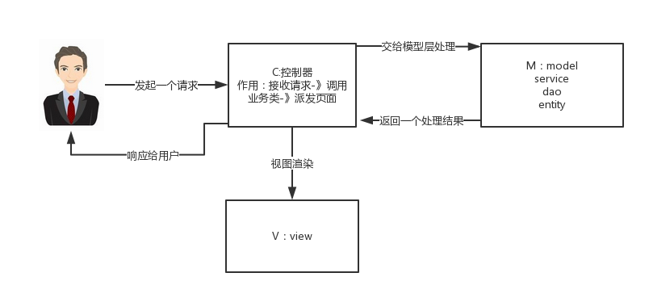

<a id="pdf-page-46"></a>

<!-- 原 PDF 第 46 页 -->

看到这个图大家可能会有很多的疑惑，现在我们来看一下这个图的步骤：（可以对比MVC的原理图进行

理解）

第一步:用户发起请求到前端控制器（DispatcherServlet）

第二步：前端控制器请求处理器映射器（HandlerMappering）去查找处理器（Handle）：通过xml配

置或者注解进行查找

第三步：找到以后处理器映射器（HandlerMappering）像前端控制器返回执行链

（HandlerExecutionChain）

第四步：前端控制器（DispatcherServlet）调用处理器适配器（HandlerAdapter）去执行处理器

（Handler）

第五步：处理器适配器去执行Handler

第六步：Handler执行完给处理器适配器返回ModelAndView

第七步：处理器适配器向前端控制器返回ModelAndView

第八步：前端控制器请求视图解析器（ViewResolver）去进行视图解析

第九步：视图解析器像前端控制器返回View

第十步：前端控制器对视图进行渲染

第十一步：前端控制器向用户响应结果

看到这些步骤我相信大家很感觉非常的乱，这是正常的，但是这里主要是要大家理解springMVC中的

几个组件：

前端控制器（DispatcherServlet）：接收请求，响应结果，相当于电脑的CPU。

处理器映射器（HandlerMapping）：根据URL去查找处理器

处理器（Handler）：（需要程序员去写代码处理逻辑的）

**本页原图与图表：**

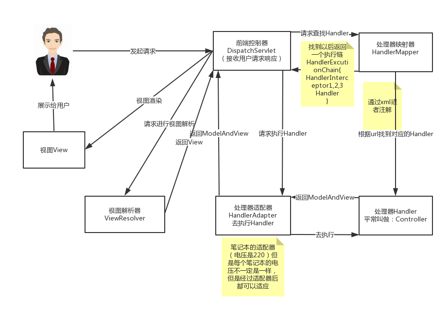

<a id="pdf-page-47"></a>

<!-- 原 PDF 第 47 页 -->

处理器适配器（HandlerAdapter）：会把处理器包装成适配器，这样就可以支持多种类型的处理器，

类比笔记本的适配器（适配器模式的应用）

视图解析器（ViewResovler）：进行视图解析，多返回的字符串，进行处理，可以解析成对应的页面

#### 6、SpringMVC怎么样设定重定向和转发的？

（1）转发：在返回值前面加"forward:"，譬如"forward:user.do?name=method4"

（2）重定向：在返回值前面加"redirect:"，譬如"redirect:http://www.baidu.com"

#### 7、SpringMVC常用的注解有哪些？

@RequestMapping：用于处理请求 url 映射的注解，可用于类或方法上。用于类上，则表示类中的所

有响应请求的方法都是以该地址作为父路径。

@RequestBody：注解实现接收http请求的json数据，将json转换为java对象。

@ResponseBody：注解实现将conreoller方法返回对象转化为json对象响应给客户。

#### 8、Spring的AOP理解：

OOP面向对象，允许开发者定义纵向的关系，但并适用于定义横向的关系，导致了大量代码的重复，而

不利于各个模块的重用。

AOP，一般称为面向切面，作为面向对象的一种补充，用于将那些与业务无关，但却对多个对象产生影

响的公共行为和逻辑，抽取并封装为一个可重用的模块，这个模块被命名为“切面”（Aspect），减少系

统中的重复代码，降低了模块间的耦合度，同时提高了系统的可维护性。可用于权限认证、日志、事务

处理。

AOP实现的关键在于 代理模式，AOP代理主要分为静态代理和动态代理。静态代理的代表为AspectJ；

动态代理则以Spring AOP为代表。

（1）AspectJ是静态代理的增强，所谓静态代理，就是AOP框架会在编译阶段生成AOP代理类，因此也

称为编译时增强，他会在编译阶段将AspectJ(切面)织入到Java字节码中，运行的时候就是增强之后的

AOP对象。

（2）Spring AOP使用的动态代理，所谓的动态代理就是说AOP框架不会去修改字节码，而是每次运行

时在内存中临时为方法生成一个AOP对象，这个AOP对象包含了目标对象的全部方法，并且在特定的切

点做了增强处理，并回调原对象的方法。

Spring AOP中的动态代理主要有两种方式，JDK动态代理和CGLIB动态代理：

①JDK动态代理只提供接口的代理，不支持类的代理。核心InvocationHandler接口和Proxy类，

InvocationHandler 通过invoke()方法反射来调用目标类中的代码，动态地将横切逻辑和业务编织在一

起；接着，Proxy利用 InvocationHandler动态创建一个符合某一接口的的实例,  生成目标类的代理对

象。

②如果代理类没有实现 InvocationHandler 接口，那么Spring AOP会选择使用CGLIB来动态代理目

标类。CGLIB（Code Generation Library），是一个代码生成的类库，可以在运行时动态的生成指定类

的一个子类对象，并覆盖其中特定方法并添加增强代码，从而实现AOP。CGLIB是通过继承的方式做的动态代

理，因此如果某个类被标记为final，那么它是无法使用CGLIB做动态代理的。

<a id="pdf-page-48"></a>

<!-- 原 PDF 第 48 页 -->

（3）静态代理与动态代理区别在于生成AOP代理对象的时机不同，相对来说AspectJ的静态代理方式具

有更好的性能，但是AspectJ需要特定的编译器进行处理，而Spring AOP则无需特定的编译器处理。

#### 9、Spring的IOC理解

（1）IOC就是控制反转，是指创建对象的控制权的转移，以前创建对象的主动权和时机是由自己把控

的，而现在这种权力转移到Spring容器中，并由容器根据配置文件去创建实例和管理各个实例之间的依

赖关系，对象与对象之间松散耦合，也利于功能的复用。DI依赖注入，和控制反转是同一个概念的不同

角度的描述，即 应用程序在运行时依赖IoC容器来动态注入对象需要的外部资源。

（2）最直观的表达就是，IOC让对象的创建不用去new了，可以由spring自动生产，使用java的反射机

制，根据配置文件在运行时动态的去创建对象以及管理对象，并调用对象的方法的。

（3）Spring的IOC有三种注入方式 ：构造器注入、setter方法注入、根据注解注入。

IoC让相互协作的组件保持松散的耦合，而AOP编程允许你把遍布于应用各层的功能分离出来形成

可重用的功能组件。

#### 10、解释一下springbean的生命周期

首先说一下Servlet的生命周期：实例化，初始init，接收请求service，销毁destroy；

Spring上下文中的Bean生命周期也类似，如下：

（1）实例化Bean：

对于BeanFactory容器，当客户向容器请求一个尚未初始化的bean时，或初始化bean的时候需要注入

另一个尚未初始化的依赖时，容器就会调用createBean进行实例化。对于ApplicationContext容器，当

容器启动结束后，通过获取BeanDefinition对象中的信息，实例化所有的bean。

（2）设置对象属性（依赖注入）：

实例化后的对象被封装在BeanWrapper对象中，紧接着，Spring根据BeanDefinition中的信息 以及 通

过BeanWrapper提供的设置属性的接口完成依赖注入。

（3）处理Aware接口：

接着，Spring会检测该对象是否实现了xxxAware接口，并将相关的xxxAware实例注入给Bean：

①如果这个Bean已经实现了BeanNameAware接口，会调用它实现的setBeanName(String beanId)方

法，此处传递的就是Spring配置文件中Bean的id值；

②如果这个Bean已经实现了BeanFactoryAware接口，会调用它实现的setBeanFactory()方法，传递的

是Spring工厂自身。

③如果这个Bean已经实现了ApplicationContextAware接口，会调用

setApplicationContext(ApplicationContext)方法，传入Spring上下文；

（4）BeanPostProcessor：

如果想对Bean进行一些自定义的处理，那么可以让Bean实现了BeanPostProcessor接口，那将会调用

postProcessBeforeInitialization(Object obj, String s)方法。

（5）InitializingBean 与 init-method：

如果Bean在Spring配置文件中配置了 init-method 属性，则会自动调用其配置的初始化方法。

（6）如果这个Bean实现了BeanPostProcessor接口，将会调用postProcessAfterInitialization(Object

obj, String s)方法；由于这个方法是在Bean初始化结束时调用的，所以可以被应用于内存或缓存技术；

<a id="pdf-page-49"></a>

<!-- 原 PDF 第 49 页 -->

以上几个步骤完成后，Bean就已经被正确创建了，之后就可以使用这个Bean了。

（7）DisposableBean：

当Bean不再需要时，会经过清理阶段，如果Bean实现了DisposableBean这个接口，会调用其实现的

destroy()方法；

（8）destroy-method：

最后，如果这个Bean的Spring配置中配置了destroy-method属性，会自动调用其配置的销毁方法。

#### 11、

#### 解释Spring支持的几种bean的作用域。

Spring容器中的bean可以分为5个范围：

（1）singleton：默认，每个容器中只有一个bean的实例，单例的模式由BeanFactory自身来维护。

（2）prototype：为每一个bean请求提供一个实例。

（3）request：为每一个网络请求创建一个实例，在请求完成以后，bean会失效并被垃圾回收器回

收。

（4）session：与request范围类似，确保每个session中有一个bean的实例，在session过期后，bean

会随之失效。

（5）global-session：全局作用域，global-session和Portlet应用相关。当你的应用部署在Portlet容器

中工作时，它包含很多portlet。如果你想要声明让所有的portlet共用全局的存储变量的话，那么这全局

变量需要存储在global-session中。全局作用域与Servlet中的session作用域效果相同。

#### 12、Spring基于xml注入bean的几种方式：

（1）Set方法注入；

（2）构造器注入：①通过index设置参数的位置；②通过type设置参数类型；

（3）静态工厂注入；

（4）实例工厂；

详细内容可以阅读：https://blog.csdn.net/a745233700/article/details/89307518

#### 13、Spring框架中都用到了哪些设计模式？

（1）工厂模式：BeanFactory就是简单工厂模式的体现，用来创建对象的实例；

（2）单例模式：Bean默认为单例模式。

（3）代理模式：Spring的AOP功能用到了JDK的动态代理和CGLIB字节码生成技术；

（4）模板方法：用来解决代码重复的问题。比如. RestTemplate, JmsTemplate, JpaTemplate。

（5）观察者模式：定义对象键一种一对多的依赖关系，当一个对象的状态发生改变时，所有依赖于它

的对象都会得到通知被制动更新，如Spring中listener的实现--ApplicationListener。

### MyBatis篇

#### 1、什么是MyBatis

<a id="pdf-page-50"></a>

<!-- 原 PDF 第 50 页 -->

（1）Mybatis是一个半ORM（对象关系映射）框架，它内部封装了JDBC，开发时只需要关注SQL语句

本身，不需要花费精力去处理加载驱动、创建连接、创建statement等繁杂的过程。程序员直接编写原

生态sql，可以严格控制sql执行性能，灵活度高。

（2）MyBatis 可以使用 XML 或注解来配置和映射原生信息，将 POJO映射成数据库中的记录，避免了

几乎所有的 JDBC 代码和手动设置参数以及获取结果集。

（3）通过xml 文件或注解的方式将要执行的各种 statement 配置起来，并通过java对象和 statement

中sql的动态参数进行映射生成最终执行的sql语句，最后由mybatis框架执行sql并将结果映射为java对

象并返回。（从执行sql到返回result的过程）。

#### 2、MyBatis的优点和缺点

优点：

（1）基于SQL语句编程，相当灵活，不会对应用程序或者数据库的现有设计造成任何影响，SQL写在

XML里，解除sql与程序代码的耦合，便于统一管理；提供XML标签，支持编写动态SQL语句，并可重

用。

（2）与JDBC相比，减少了50%以上的代码量，消除了JDBC大量冗余的代码，不需要手动开关连接；

（3）很好的与各种数据库兼容（因为MyBatis使用JDBC来连接数据库，所以只要JDBC支持的数据库

MyBatis都支持）。

（4）能够与Spring很好的集成；

（5）提供映射标签，支持对象与数据库的ORM字段关系映射；提供对象关系映射标签，支持对象关系

组件维护。

缺点

（1）SQL语句的编写工作量较大，尤其当字段多、关联表多时，对开发人员编写SQL语句的功底有一定

要求。

（2）SQL语句依赖于数据库，导致数据库移植性差，不能随意更换数据库。

#### 3、#{}和${}的区别是什么

#### ？

#{}是预编译处理，${}是字符串替换。

Mybatis在处理#{}时，会将sql中的#{}替换为?号，调用PreparedStatement的set方法来赋值；

Mybatis在处理${}时，就是把${}替换成变量的值。

使用#{}可以有效的防止SQL注入，提高系统安全性。

#### 4、当实体类中的属性名和表中的字段名不一样

#### ，怎么办

？

第1种： 通过在查询的sql语句中定义字段名的别名，让字段名的别名和实体类的属性名一致。

<select id=”selectorder” parametertype=”int”

resultetype=”me.gacl.domain.order”>

```sql
       select order_id id, order_no orderno ,order_price price form orders where 
order_id=#{id};
    </select>
```

<a id="pdf-page-51"></a>

<!-- 原 PDF 第 51 页 -->

第2种： 通过来映射字段名和实体类属性名的一一对应的关系。

#### 5、Mybatis是如何进行分页的？分页插件的原理是什么？

Mybatis使用RowBounds对象进行分页，它是针对ResultSet结果集执行的内存分页，而非物理分页。

可以在sql内直接书写带有物理分页的参数来完成物理分页功能，也可以使用分页插件来完成物理分

页。

分页插件的基本原理是使用Mybatis提供的插件接口，实现自定义插件，在插件的拦截方法内拦截待执

行的sql，然后重写sql，根据dialect方言，添加对应的物理分页语句和物理分页参数。

#### 6、Mybatis是如何将sql执行结果封装为目标对象并返回的？都有哪些映射形式？

第一种是使用标签，逐一定义数据库列名和对象属性名之间的映射关系。

第二种是使用sql列的别名功能，将列的别名书写为对象属性名。

有了列名与属性名的映射关系后，Mybatis通过反射创建对象，同时使用反射给对象的属性逐一赋值并

返回，那些找不到映射关系的属性，是无法完成赋值的。

#### 7、

#### 如何执行批量插入？

首先,创建一个简单的insert语句:

然后在java代码中像下面这样执行批处理插入:

<select id="getOrder" parameterType="int" resultMap="orderresultmap">

```sql
        select * from orders where order_id=#{id}
    </select>
```

<resultMap type=”me.gacl.domain.order” id=”orderresultmap”>

<!–用id属性来映射主键字段–>

<id property=”id” column=”order_id”>

<!–用result属性来映射非主键字段，property为实体类属性名，column为数据表中的属性–>

<result property = “orderno” column =”order_no”/>

<result property=”price” column=”order_price” />

```xml
    </reslutMap>
```

<insert id=”insertname”>

```sql
         insert into names (name) values (#{value})
    </insert>
```

list<string> names = new arraylist();

names.add(“fred”);

names.add(“barney”);

names.add(“betty”);

names.add(“wilma”);

<a id="pdf-page-52"></a>

<!-- 原 PDF 第 52 页 -->

#### 8、Xml映射文件中，除了常见的select|insert|updae|delete标签之外，还有哪些标签？

、、、、，加上动态sql的9个标签，其中为sql片段标签，通过标签引入sql片段，为不支持自增的主键

生成策略标签。

#### 9、MyBatis实现一对一有几种方式?具体怎么操作的？

有联合查询和嵌套查询,联合查询是几个表联合查询,只查询一次, 通过在resultMap里面配置association

节点配置一对一的类就可以完成；

嵌套查询是先查一个表，根据这个表里面的结果的 外键id，去再另外一个表里面查询数据,也是通过

association配置，但另外一个表的查询通过select属性配置。

#### 10、Mybatis是否支持延迟加载？如果支持，它的实现原理是什么？

Mybatis仅支持association关联对象和collection关联集合对象的延迟加载，association指的就是一对

一，collection指的就是一对多查询。在Mybatis配置文件中，可以配置是否启用延迟加载

lazyLoadingEnabled=true|false。

它的原理是，使用CGLIB创建目标对象的代理对象，当调用目标方法时，进入拦截器方法，比如调用

a.getB().getName()，拦截器invoke()方法发现a.getB()是null值，那么就会单独发送事先保存好的查询

关联B对象的sql，把B查询上来，然后调用a.setB(b)，于是a的对象b属性就有值了，接着完成

a.getB().getName()方法的调用。这就是延迟加载的基本原理。

当然了，不光是Mybatis，几乎所有的包括Hibernate，支持延迟加载的原理都是一样的。

#### 11、Mybatis的一级、二级缓存:

1）一级缓存: 基于 PerpetualCache 的 HashMap 本地缓存，其存储作用域为 Session，当 Session

flush 或 close 之后，该 Session 中的所有 Cache 就将清空，默认打开一级缓存。

2）二级缓存与一级缓存其机制相同，默认也是采用 PerpetualCache，HashMap 存储，不同在于其存

储作用域为 Mapper(Namespace)，并且可自定义存储源，如 Ehcache。默认不打开二级缓存，要开启

二级缓存，使用二级缓存属性类需要实现Serializable序列化接口(可用来保存对象的状态),可在它的映射

文件中配置 ；

```java
    // 注意这里 executortype.batch
```

sqlsession sqlsession = sqlsessionfactory.opensession(executortype.batch);

try {

namemapper mapper = sqlsession.getmapper(namemapper.class);

for (string name : names) {

mapper.insertname(name);

```java
     }
     sqlsession.commit();
```

}catch(Exception e){

e.printStackTrace();

sqlSession.rollback();

throw e;

```java
    }
```

finally {

sqlsession.close();

```java
    }
```

<a id="pdf-page-53"></a>

<!-- 原 PDF 第 53 页 -->

3）对于缓存数据更新机制，当某一个作用域(一级缓存 Session/二级缓存Namespaces)的进行了C/U/D

操作后，默认该作用域下所有 select 中的缓存将被 clear 掉并重新更新，如果开启了二级缓存，则只根

据配置判断是否刷新。

### SpringBoot篇

#### 1、为什么要用SpringBoot

Spring Boot 优点非常多，如：

一、独立运行

Spring Boot而且内嵌了各种servlet容器，Tomcat、Jetty等，现在不再需要打成war包部署到容器中，

Spring Boot只要打成一个可执行的jar包就能独立运行，所有的依赖包都在一个jar包内。

二、简化配置

spring-boot-starter-web启动器自动依赖其他组件，简少了maven的配置。

三、自动配置

Spring Boot能根据当前类路径下的类、jar包来自动配置bean，如添加一个spring-boot-starter-web启

动器就能拥有web的功能，无需其他配置。

四、无代码生成和XML配置

Spring Boot配置过程中无代码生成，也无需XML配置文件就能完成所有配置工作，这一切都是借助于

条件注解完成的，这也是Spring4.x的核心功能之一。

五、应用监控

Spring Boot提供一系列端点可以监控服务及应用，做健康检测。

#### 2、SpringBoot的核心注解是哪个？它主要由哪几个注解组成的？

启动类上面的注解是@SpringBootApplication，它也是 Spring Boot 的核心注解，主要组合包含了以下

3 个注解：

@SpringBootConfiguration：组合了 @Configuration 注解，实现配置文件的功能。

@EnableAutoConfiguration：打开自动配置的功能，也可以关闭某个自动配置的选项，如关闭数据源

自动配置功能： @SpringBootApplication(exclude = { DataSourceAutoConfiguration.class })。

@ComponentScan：Spring组件扫描。

#### 3、运行SpringBoot有哪几种方式？

1）打包用命令或者放到容器中运行

2）用 Maven/Gradle 插件运行

3）直接执行 main 方法运行

#### 4、如何理解SpringBoot中的Starters？

<a id="pdf-page-54"></a>

<!-- 原 PDF 第 54 页 -->

Starters是什么：

Starters可以理解为启动器，它包含了一系列可以集成到应用里面的依赖包，你可以一站式集成Spring

及其他技术，而不需要到处找示例代码和依赖包。如你想使用Spring JPA访问数据库，只要加入spring-

boot-starter-data-jpa启动器依赖就能使用了。Starters包含了许多项目中需要用到的依赖，它们能快

速持续的运行，都是一系列得到支持的管理传递性依赖。

Starters命名：

Spring Boot官方的启动器都是以spring-boot-starter-命名的，代表了一个特定的应用类型。第三方的

启动器不能以spring-boot开头命名，它们都被Spring Boot官方保留。一般一个第三方的应该这样命

名，像mybatis的mybatis-spring-boot-starter。

Starters分类：

1. Spring Boot应用类启动器

2. Spring Boot生产启动器

3. Spring Boot技术类启动器

4. 其他第三方启动器

#### 5、

#### 如何在SpringBoot启动的时候运行一些特定的代码？

如果你想在Spring Boot启动的时候运行一些特定的代码，你可以实现接口ApplicationRunner或者

CommandLineRunner，这两个接口实现方式一样，它们都只提供了一个run方法。

CommandLineRunner：启动获取命令行参数

#### 6、SpringBoot需要独立的容器运行吗？

**本页原图与图表：**


<a id="pdf-page-55"></a>

<!-- 原 PDF 第 55 页 -->

可以不需要，内置了 Tomcat/ Jetty 等容器。

#### 7、SpringBoot中的监视器是什么？

Spring boot actuator是spring启动框架中的重要功能之一。Spring boot监视器可帮助您访问生产环境

中正在运行的应用程序的当前状态。有几个指标必须在生产环境中进行检查和监控。即使一些外部应用

程序可能正在使用这些服务来向相关人员触发警报消息。监视器模块公开了一组可直接作为HTTP URL

访问的REST端点来检查状态。

#### 8、

#### 如何使用SpringBoot实现异常处理？

Spring提供了一种使用ControllerAdvice处理异常的非常有用的方法。 我们通过实现一个

ControlerAdvice类，来处理控制器类抛出的所有异常。

#### 9、

#### 你如何理解SpringBoot中的Starters？

Starters可以理解为启动器，它包含了一系列可以集成到应用里面的依赖包，你可以一站式集成 Spring

及其他技术，而不需要到处找示例代码和依赖包。如你想使用 Spring JPA 访问数据库，只要加入

spring-boot-starter-data-jpa 启动器依赖就能使用了。

#### 10、springboot常用的starter有哪些

spring-boot-starter-web 嵌入tomcat和web开发需要servlet与jsp支持

spring-boot-starter-data-jpa 数据库支持

spring-boot-starter-data-redis redis数据库支持

spring-boot-starter-data-solr solr支持

mybatis-spring-boot-starter 第三方的mybatis集成starter

#### 11、SpringBoot实现热部署有哪几种方式？

主要有两种方式：

Spring Loaded

Spring-boot-devtools

#### 12、

#### 如何理解SpringBoot配置加载顺序？

在 Spring Boot 里面，可以使用以下几种方式来加载配置。

1）properties文件；

2）YAML文件；

3）系统环境变量；

<a id="pdf-page-56"></a>

<!-- 原 PDF 第 56 页 -->

4）命令行参数；

等等……

#### 13、SpringBoot的核心配置文件有哪几个？它们的区别是什么？

pring Boot 的核心配置文件是 application 和 bootstrap 配置文件。

application 配置文件这个容易理解，主要用于 Spring Boot 项目的自动化配置。

bootstrap 配置文件有以下几个应用场景。

使用 Spring Cloud Config 配置中心时，这时需要在 bootstrap 配置文件中添加连接到配置中心的

配置属性来加载外部配置中心的配置信息；

一些固定的不能被覆盖的属性；

一些加密/解密的场景；

#### 14、如何集成SpringBoot和ActiveMQ？

对于集成 Spring Boot 和 ActiveMQ，我们使用

spring-boot-starter-activemq

依赖关系。 它只需要很少的配置，并且不需要样板代码。

### MySQL篇

#### 1、数据库的三范式是什么

第一范式：列不可再分

第二范式：行可以唯一区分，主键约束

第三范式：表的非主属性不能依赖与其他表的非主属性 外键约束

且三大范式是一级一级依赖的，第二范式建立在第一范式上，第三范式建立第一第二范式上。

#### 2、数据库引擎有哪些

如何查看mysql提供的所有存储引擎

mysql常用引擎包括：MYISAM、Innodb、Memory、MERGE

mysql> show engines;

**本页原图与图表：**


<a id="pdf-page-57"></a>

<!-- 原 PDF 第 57 页 -->

MYISAM：全表锁，拥有较高的执行速度，不支持事务，不支持外键，并发性能差，占用空间相对

较小，对事务完整性没有要求，以select、insert为主的应用基本上可以使用这引擎

Innodb:行级锁，提供了具有提交、回滚和崩溃回复能力的事务安全，支持自动增长列，支持外键

约束，并发能力强，占用空间是MYISAM的2.5倍，处理效率相对会差一些

Memory:全表锁，存储在内容中，速度快，但会占用和数据量成正比的内存空间且数据在mysql重

启时会丢失，默认使用HASH索引，检索效率非常高，但不适用于精确查找，主要用于那些内容变

化不频繁的代码表

MERGE：是一组MYISAM表的组合

#### 3、InnoDB与MyISAM的区别

1. InnoDB支持事务，MyISAM不支持，对于InnoDB每一条SQL语言都默认封装成事务，自动提交，

这样会影响速度，所以最好把多条SQL语言放在begin和commit之间，组成一个事务；

2. InnoDB支持外键，而MyISAM不支持。对一个包含外键的InnoDB表转为MYISAM会失败；

3. InnoDB是聚集索引，数据文件是和索引绑在一起的，必须要有主键，通过主键索引效率很高。但

是辅助索引需要两次查询，先查询到主键，然后再通过主键查询到数据。因此，主键不应该过大，

因为主键太大，其他索引也都会很大。而MyISAM是非聚集索引，数据文件是分离的，索引保存的

是数据文件的指针。主键索引和辅助索引是独立的。

4. InnoDB不保存表的具体行数，执行select count(*) from table时需要全表扫描。而MyISAM用一

个变量保存了整个表的行数，执行上述语句时只需要读出该变量即可，速度很快；

5. Innodb不支持全文索引，而MyISAM支持全文索引，查询效率上MyISAM要高；

#### 4、数据库的事务

什么是事务？： 多条sql语句，要么全部成功，要么全部失败。

事务的特性：

数据库事务特性：原子性(Atomic)、一致性(Consistency)、隔离性(Isolation)、持久性(Durabiliy)。

简称ACID。

原子性：组成一个事务的多个数据库操作是一个不可分割的原子单元，只有所有操作都成功，整个

事务才会提交。任何一个操作失败，已经执行的任何操作都必须撤销，让数据库返回初始状态。

一致性：事务操作成功后，数据库所处的状态和它的业务规则是一致的。即数据不会被破坏。如A

转账100元给B，不管操作是否成功，A和B的账户总额是不变的。

隔离性：在并发数据操作时，不同的事务拥有各自的数据空间，它们的操作不会对彼此产生干扰

持久性：一旦事务提交成功，事务中的所有操作都必须持久化到数据库中。

#### 5、索引问题

索引是对数据库表中一个或多个列的值进行排序的结构，建立索引有助于快速获取信息。

你也可以这样理解：索引就是加快检索表中数据的方法。数据库的索引类似于书籍的索引。在书籍中，

索引允许用户不必翻阅完整个书就能迅速地找到所需要的信息。在数据库中，索引也允许数据库程序迅

速地找到表中的数据，而不必扫描整个数据库。

mysql有4种不同的索引：

主键索引（PRIMARY）

唯一索引（UNIQUE）

普通索引（INDEX）

全文索引（FULLTEXT）

<a id="pdf-page-58"></a>

<!-- 原 PDF 第 58 页 -->

索引并非是越多越好，创建索引也需要耗费资源，一是增加了数据库的存储空间，二是在插入和删除时

要花费较多的时间维护索引

索引加快数据库的检索速度

索引降低了插入、删除、修改等维护任务的速度

唯一索引可以确保每一行数据的唯一性

通过使用索引，可以在查询的过程中使用优化隐藏器，提高系统的性能

索引需要占物理和数据空间

#### 6、SQL优化

1、查询语句中不要使用select  *

2、尽量减少子查询，使用关联查询（left join,right join,inner  join）替代

3、减少使用IN或者NOT IN ,使用exists，not exists或者关联查询语句替代

4、or 的查询尽量用 union或者union all 代替(在确认没有重复数据或者不用剔除重复数据时，union

all会更好)

5、应尽量避免在 where 子句中使用!=或<>操作符，否则将引擎放弃使用索引而进行全表扫描。

6、应尽量避免在 where 子句中对字段进行 null 值判断，否则将导致引擎放弃使用索引而进行全表扫

描，如： select id from t where num is null 可以在num上设置默认值0，确保表中num列没有null

值，然后这样查询： select id from t where num=0

#### 7、简单说一说drop、delete与truncate的区别

SQL中的drop、delete、truncate都表示删除，但是三者有一些差别

delete和truncate只删除表的数据不删除表的结构

速度,一般来说: drop> truncate >delete

delete语句是dml,这个操作会放到rollback segement中,事务提交之后才生效;

如果有相应的trigger,执行的时候将被触发. truncate,drop是ddl, 操作立即生效,原数据不放到rollback

segment中,不能回滚. 操作不触发trigger.

#### 8、什么是视图

视图是一种虚拟的表，具有和物理表相同的功能。可以对视图进行增，改，查，操作，试图通常是有一

个表或者多个表的行或列的子集。对视图的修改不影响基本表。它使得我们获取数据更容易，相比多表

查询。

#### 9、

#### 什么是内联接、左外联接、右外联接？

内联接（Inner Join）：匹配2张表中相关联的记录。

左外联接（Left Outer Join）：除了匹配2张表中相关联的记录外，还会匹配左表中剩余的记录，

右表中未匹配到的字段用NULL表示。

右外联接（Right Outer Join）：除了匹配2张表中相关联的记录外，还会匹配右表中剩余的记录，

左表中未匹配到的字段用NULL表示。在判定左表和右表时，要根据表名出现在Outer Join的左右

位置关系。

<a id="pdf-page-59"></a>

<!-- 原 PDF 第 59 页 -->

隔离级别 脏读 不可重复读 幻影读

READ-UNCOMMITTED √ √ √

READ-COMMITTED × √ √

REPEATABLE-READ × × √

SERIALIZABLE × × ×

#### 10、并发事务带来哪些问题?

在典型的应用程序中，多个事务并发运行，经常会操作相同的数据来完成各自的任务（多个用户对同一

数据进行操作）。并发虽然是必须的，但可能会导致以下的问题。

脏读（Dirty read）: 当一个事务正在访问数据并且对数据进行了修改，而这种修改还没有提交到

数据库中，这时另外一个事务也访问了这个数据，然后使用了这个数据。因为这个数据是还没有提

交的数据，那么另外一个事务读到的这个数据是“脏数据”，依据“脏数据”所做的操作可能是不正确

的。

丢失修改（Lost to modify）: 指在一个事务读取一个数据时，另外一个事务也访问了该数据，那

么在第一个事务中修改了这个数据后，第二个事务也修改了这个数据。这样第一个事务内的修改结

果就被丢失，因此称为丢失修改。 例如：事务1读取某表中的数据A=20，事务2也读取A=20，事

务1修改A=A-1，事务2也修改A=A-1，最终结果A=19，事务1的修改被丢失。

不可重复读（Unrepeatableread）: 指在一个事务内多次读同一数据。在这个事务还没有结束

时，另一个事务也访问该数据。那么，在第一个事务中的两次读数据之间，由于第二个事务的修改

导致第一个事务两次读取的数据可能不太一样。这就发生了在一个事务内两次读到的数据是不一样

的情况，因此称为不可重复读。

幻读（Phantom read）: 幻读与不可重复读类似。它发生在一个事务（T1）读取了几行数据，接

着另一个并发事务（T2）插入了一些数据时。在随后的查询中，第一个事务（T1）就会发现多了

一些原本不存在的记录，就好像发生了幻觉一样，所以称为幻读。

不可重复读和幻读区别：

不可重复读的重点是修改比如多次读取一条记录发现其中某些列的值被修改，幻读的重点在于新增或者

删除比如多次读取一条记录发现记录增多或减少了。

#### 事务隔离级别有哪些?MySQL的默认隔离级别是?

SQL 标准定义了四个隔离级别：

READ-UNCOMMITTED(读取未提交)： 最低的隔离级别，允许读取尚未提交的数据变更，可能会

导致脏读、幻读或不可重复读。

READ-COMMITTED(读取已提交)： 允许读取并发事务已经提交的数据，可以阻止脏读，但是幻

读或不可重复读仍有可能发生。

REPEATABLE-READ(可重复读)： 对同一字段的多次读取结果都是一致的，除非数据是被本身事务

自己所修改，可以阻止脏读和不可重复读，但幻读仍有可能发生。

SERIALIZABLE(可串行化)： 最高的隔离级别，完全服从ACID的隔离级别。所有的事务依次逐个执

行，这样事务之间就完全不可能产生干扰，也就是说，该级别可以防止脏读、不可重复读以及幻

读。

MySQL InnoDB 存储引擎的默认支持的隔离级别是 REPEATABLE-READ（可重读）。我们可以通过

```sql
SELECT @@tx_isolation; 命令来查看
```

<a id="pdf-page-60"></a>

<!-- 原 PDF 第 60 页 -->

这里需要注意的是：与 SQL 标准不同的地方在于 InnoDB 存储引擎在 REPEATABLE-READ（可重读）

事务隔离级别下使用的是Next-Key Lock 锁算法，因此可以避免幻读的产生，这与其他数据库系统(如

SQL Server) 是不同的。所以说InnoDB 存储引擎的默认支持的隔离级别是 REPEATABLE-READ（可重

读） 已经可以完全保证事务的隔离性要求，即达到了 SQL标准的 SERIALIZABLE(可串行化) 隔离级

别。因为隔离级别越低，事务请求的锁越少，所以大部分数据库系统的隔离级别都是 READ-

COMMITTED(读取提交内容) ，但是你要知道的是InnoDB 存储引擎默认使用 REPEAaTABLE-

READ（可重读） 并不会有任何性能损失。

InnoDB 存储引擎在 分布式事务 的情况下一般会用到 SERIALIZABLE(可串行化) 隔离级别。

#### 大表如何优化？

当MySQL单表记录数过大时，数据库的CRUD性能会明显下降，一些常见的优化措施如下：

1. 限定数据的范围

务必禁止不带任何限制数据范围条件的查询语句。比如：我们当用户在查询订单历史的时候，我们可以

控制在一个月的范围内；

2. 读/写分离

经典的数据库拆分方案，主库负责写，从库负责读；

3. 垂直分区

根据数据库里面数据表的相关性进行拆分。 例如，用户表中既有用户的登录信息又有用户的基本信息，

可以将用户表拆分成两个单独的表，甚至放到单独的库做分库。

简单来说垂直拆分是指数据表列的拆分，把一张列比较多的表拆分为多张表。 如下图所示，这样来说大

家应该就更容易理解了。

垂直拆分的优点： 可以使得列数据变小，在查询时减少读取的Block数，减少I/O次数。此外，垂

直分区可以简化表的结构，易于维护。

垂直拆分的缺点： 主键会出现冗余，需要管理冗余列，并会引起Join操作，可以通过在应用层进行

Join来解决。此外，垂直分区会让事务变得更加复杂；

4. 水平分区

mysql> SELECT @@tx_isolation;

+-----------------+

| @@tx_isolation  |

+-----------------+

| REPEATABLE-READ |

+-----------------+

**本页原图与图表：**


<a id="pdf-page-61"></a>

<!-- 原 PDF 第 61 页 -->

保持数据表结构不变，通过某种策略存储数据分片。这样每一片数据分散到不同的表或者库中，达到了

分布式的目的。 水平拆分可以支撑非常大的数据量。

水平拆分是指数据表行的拆分，表的行数超过200万行时，就会变慢，这时可以把一张的表的数据拆成

多张表来存放。举个例子：我们可以将用户信息表拆分成多个用户信息表，这样就可以避免单一表数据

量过大对性能造成影响。

水平拆分可以支持非常大的数据量。需要注意的一点是：分表仅仅是解决了单一表数据过大的问题，但

由于表的数据还是在同一台机器上，其实对于提升MySQL并发能力没有什么意义，所以 水平拆分最好

分库 。

水平拆分能够 支持非常大的数据量存储，应用端改造也少，但 分片事务难以解决 ，跨节点Join性能较

差，逻辑复杂。《Java工程师修炼之道》的作者推荐 尽量不要对数据进行分片，因为拆分会带来逻辑、

部署、运维的各种复杂度 ，一般的数据表在优化得当的情况下支撑千万以下的数据量是没有太大问题

的。如果实在要分片，尽量选择客户端分片架构，这样可以减少一次和中间件的网络I/O。

下面补充一下数据库分片的两种常见方案：

客户端代理： 分片逻辑在应用端，封装在jar包中，通过修改或者封装JDBC层来实现。 当当网的

Sharding-JDBC 、阿里的TDDL是两种比较常用的实现。

中间件代理： 在应用和数据中间加了一个代理层。分片逻辑统一维护在中间件服务中。 我们现在

谈的 Mycat 、360的Atlas、网易的DDB等等都是这种架构的实现。

详细内容可以参考： MySQL大表优化方案: https://segmentfault.com/a/1190000006158186

#### 5、分库分表之后,id主键如何处理？

因为要是分成多个表之后，每个表都是从 1 开始累加，这样是不对的，我们需要一个全局唯一的 id 来

支持。

生成全局 id 有下面这几种方式：

UUID：不适合作为主键，因为太长了，并且无序不可读，查询效率低。比较适合用于生成唯一的

名字的标示比如文件的名字。

数据库自增 id : 两台数据库分别设置不同步长，生成不重复ID的策略来实现高可用。这种方式生成

的 id 有序，但是需要独立部署数据库实例，成本高，还会有性能瓶颈。

利用 redis 生成 id : 性能比较好，灵活方便，不依赖于数据库。但是，引入了新的组件造成系统更

加复杂，可用性降低，编码更加复杂，增加了系统成本。

Twitter的snowflake算法 ：Github 地址：https://github.com/twitter-archive/snowflake。

美团的Leaf分布式ID生成系统 ：Leaf 是美团开源的分布式ID生成器，能保证全局唯一性、趋势递

增、单调递增、信息安全，里面也提到了几种分布式方案的对比，但也需要依赖关系数据库、

Zookeeper等中间件。感觉还不错。美团技术团队的一篇文章：https://tech.meituan.com/2017/

04/21/mt-leaf.html 。

**本页原图与图表：**


<a id="pdf-page-62"></a>

<!-- 原 PDF 第 62 页 -->

### Redis篇

#### 1、Redis持久化机制

Redis是一个支持持久化的内存数据库，通过持久化机制把内存中的数据同步到硬盘文件来保证数据持

久化。当Redis重启后通过把硬盘文件重新加载到内存，就能达到恢复数据的目的。

实现：单独创建fork()一个子进程，将当前父进程的数据库数据复制到子进程的内存中，然后由子进程

写入到临时文件中，持久化的过程结束了，再用这个临时文件替换上次的快照文件，然后子进程退出，

内存释放。

RDB是Redis默认的持久化方式。按照一定的时间周期策略把内存的数据以快照的形式保存到硬盘的二

进制文件。即Snapshot快照存储，对应产生的数据文件为dump.rdb，通过配置文件中的save参数来定

义快照的周期。（ 快照可以是其所表示的数据的一个副本，也可以是数据的一个复制品。）

AOF：Redis会将每一个收到的写命令都通过Write函数追加到文件最后，类似于MySQL的binlog。当

Redis重启是会通过重新执行文件中保存的写命令来在内存中重建整个数据库的内容。

当两种方式同时开启时，数据恢复Redis会优先选择AOF恢复。

#### 2、缓存雪崩、缓存穿透、缓存预热、缓存更新、缓存降级等问题

一、缓存雪崩

我们可以简单的理解为：由于原有缓存失效，新缓存未到期间

(例如：我们设置缓存时采用了相同的过期时间，在同一时刻出现大面积的缓存过期)，所有原本应该访

问缓存的请求都去查询数据库了，而对数据库CPU和内存造成巨大压力，严重的会造成数据库宕机。从

而形成一系列连锁反应，造成整个系统崩溃。

解决办法：

大多数系统设计者考虑用加锁（ 最多的解决方案）或者队列的方式保证来保证不会有大量的线程对数据

库一次性进行读写，从而避免失效时大量的并发请求落到底层存储系统上。还有一个简单方案就时讲缓

存失效时间分散开。

二、缓存穿透

缓存穿透是指用户查询数据，在数据库没有，自然在缓存中也不会有。这样就导致用户查询的时候，在

缓存中找不到，每次都要去数据库再查询一遍，然后返回空（相当于进行了两次无用的查询）。这样请

求就绕过缓存直接查数据库，这也是经常提的缓存命中率问题。

解决办法;

最常见的则是采用布隆过滤器，将所有可能存在的数据哈希到一个足够大的bitmap中，一个一定不存

在的数据会被这个bitmap拦截掉，从而避免了对底层存储系统的查询压力。

另外也有一个更为简单粗暴的方法，如果一个查询返回的数据为空（不管是数据不存在，还是系统故

障），我们仍然把这个空结果进行缓存，但它的过期时间会很短，最长不超过五分钟。通过这个直接设

置的默认值存放到缓存，这样第二次到缓冲中获取就有值了，而不会继续访问数据库，这种办法最简单

粗暴。

5TB的硬盘上放满了数据，请写一个算法将这些数据进行排重。如果这些数据是一些32bit大小的数据该

如何解决？如果是64bit的呢？

对于空间的利用到达了一种极致，那就是Bitmap和布隆过滤器(Bloom Filter)。

Bitmap： 典型的就是哈希表

缺点是，Bitmap对于每个元素只能记录1bit信息，如果还想完成额外的功能，恐怕只能靠牺牲更多的空

间、时间来完成了。

<a id="pdf-page-63"></a>

<!-- 原 PDF 第 63 页 -->

布隆过滤器（推荐）

就是引入了k(k>1)k(k>1)个相互独立的哈希函数，保证在给定的空间、误判率下，完成元素判重的过

程。

它的优点是空间效率和查询时间都远远超过一般的算法，缺点是有一定的误识别率和删除困难。

Bloom-Filter算法的核心思想就是利用多个不同的Hash函数来解决“冲突”。

Hash存在一个冲突（碰撞）的问题，用同一个Hash得到的两个URL的值有可能相同。为了减少冲突，

我们可以多引入几个Hash，如果通过其中的一个Hash值我们得出某元素不在集合中，那么该元素肯定

不在集合中。只有在所有的Hash函数告诉我们该元素在集合中时，才能确定该元素存在于集合中。这

便是Bloom-Filter的基本思想。

Bloom-Filter一般用于在大数据量的集合中判定某元素是否存在。

三、缓存预热

缓存预热这个应该是一个比较常见的概念，相信很多小伙伴都应该可以很容易的理解，缓存预热就是系

统上线后，将相关的缓存数据直接加载到缓存系统。这样就可以避免在用户请求的时候，先查询数据

库，然后再将数据缓存的问题！用户直接查询事先被预热的缓存数据！

解决思路：

1、直接写个缓存刷新页面，上线时手工操作下；

2、数据量不大，可以在项目启动的时候自动进行加载；

3、定时刷新缓存；

四、缓存更新

除了缓存服务器自带的缓存失效策略之外（Redis默认的有6中策略可供选择），我们还可以根据具体的

业务需求进行自定义的缓存淘汰，常见的策略有两种：

（1）定时去清理过期的缓存；

（2）当有用户请求过来时，再判断这个请求所用到的缓存是否过期，过期的话就去底层系统得到新数

据并更新缓存。

两者各有优劣，第一种的缺点是维护大量缓存的key是比较麻烦的，第二种的缺点就是每次用户请求过

来都要判断缓存失效，逻辑相对比较复杂！具体用哪种方案，大家可以根据自己的应用场景来权衡。

五、缓存降级

当访问量剧增、服务出现问题（如响应时间慢或不响应）或非核心服务影响到核心流程的性能时，仍然

需要保证服务还是可用的，即使是有损服务。系统可以根据一些关键数据进行自动降级，也可以配置开

关实现人工降级。

降级的最终目的是保证核心服务可用，即使是有损的。而且有些服务是无法降级的（如加入购物车、结

算）。

以参考日志级别设置预案：

（1）一般：比如有些服务偶尔因为网络抖动或者服务正在上线而超时，可以自动降级；

（2）警告：有些服务在一段时间内成功率有波动（如在95~100%之间），可以自动降级或人工降级，

并发送告警；

（3）错误：比如可用率低于90%，或者数据库连接池被打爆了，或者访问量突然猛增到系统能承受的

最大阀值，此时可以根据情况自动降级或者人工降级；

（4）严重错误：比如因为特殊原因数据错误了，此时需要紧急人工降级。

服务降级的目的，是为了防止Redis服务故障，导致数据库跟着一起发生雪崩问题。因此，对于不重要

的缓存数据，可以采取服务降级策略，例如一个比较常见的做法就是，Redis出现问题，不去数据库查

询，而是直接返回默认值给用户。

#### 3、热点数据和冷数据是什么

热点数据，缓存才有价值

对于冷数据而言，大部分数据可能还没有再次访问到就已经被挤出内存，不仅占用内存，而且价值不

大。频繁修改的数据，看情况考虑使用缓存

对于上面两个例子，寿星列表、导航信息都存在一个特点，就是信息修改频率不高，读取通常非常高的

<a id="pdf-page-64"></a>

<!-- 原 PDF 第 64 页 -->

场景。

对于热点数据，比如我们的某IM产品，生日祝福模块，当天的寿星列表，缓存以后可能读取数十万次。

再举个例子，某导航产品，我们将导航信息，缓存以后可能读取数百万次。

数据更新前至少读取两次，缓存才有意义。这个是最基本的策略，如果缓存还没有起作用就失效了，那

就没有太大价值了。

那存不存在，修改频率很高，但是又不得不考虑缓存的场景呢？有！比如，这个读取接口对数据库的压

力很大，但是又是热点数据，这个时候就需要考虑通过缓存手段，减少数据库的压力，比如我们的某助

手产品的，点赞数，收藏数，分享数等是非常典型的热点数据，但是又不断变化，此时就需要将数据同

步保存到Redis缓存，减少数据库压力。

#### 4、Memcache与Redis的区别都有哪些？

1)、存储方式 Memecache把数据全部存在内存之中，断电后会挂掉，数据不能超过内存大小。 Redis

有部份存在硬盘上，redis可以持久化其数据

2)、数据支持类型 memcached所有的值均是简单的字符串，redis作为其替代者，支持更为丰富的数据

类型 ，提供list，set，zset，hash等数据结构的存储

3)、使用底层模型不同 它们之间底层实现方式 以及与客户端之间通信的应用协议不一样。 Redis直接自

己构建了VM 机制 ，因为一般的系统调用系统函数的话，会浪费一定的时间去移动和请求。

4). value 值大小不同：Redis 最大可以达到 1gb；memcache 只有 1mb。

5）redis的速度比memcached快很多

6）Redis支持数据的备份，即master-slave模式的数据备份。

#### 5、单线程的redis为什么这么快

(一)纯内存操作

(二)单线程操作，避免了频繁的上下文切换

(三)采用了非阻塞I/O多路复用机制

#### 6、redis的数据类型，以及每种数据类型的使用场景

回答：一共五种

(一)String

这个其实没啥好说的，最常规的set/get操作，value可以是String也可以是数字。一般做一些复杂的计

数功能的缓存。

(二)hash

这里value存放的是结构化的对象，比较方便的就是操作其中的某个字段。博主在做单点登录的时候，

就是用这种数据结构存储用户信息，以cookieId作为key，设置30分钟为缓存过期时间，能很好的模拟

出类似session的效果。

(三)list

使用List的数据结构，可以做简单的消息队列的功能。另外还有一个就是，可以利用lrange命令，做基

于redis的分页功能，性能极佳，用户体验好。本人还用一个场景，很合适—取行情信息。就也是个生产

者和消费者的场景。LIST可以很好的完成排队，先进先出的原则。

(四)set

因为set堆放的是一堆不重复值的集合。所以可以做全局去重的功能。为什么不用JVM自带的Set进行去

重？因为我们的系统一般都是集群部署，使用JVM自带的Set，比较麻烦，难道为了一个做一个全局去

重，再起一个公共服务，太麻烦了。

另外，就是利用交集、并集、差集等操作，可以计算共同喜好，全部的喜好，自己独有的喜好等功能。

(五)sorted set

sorted set多了一个权重参数score,集合中的元素能够按score进行排列。可以做排行榜应用，取TOP N

操作。

<a id="pdf-page-65"></a>

<!-- 原 PDF 第 65 页 -->

#### 7、redis的过期策略以及内存淘汰机制

redis采用的是定期删除+惰性删除策略。

为什么不用定时删除策略?

定时删除,用一个定时器来负责监视key,过期则自动删除。虽然内存及时释放，但是十分消耗CPU资源。

在大并发请求下，CPU要将时间应用在处理请求，而不是删除key,因此没有采用这一策略.

定期删除+惰性删除是如何工作的呢?

定期删除，redis默认每个100ms检查，是否有过期的key,有过期key则删除。需要说明的是，redis不是

每个100ms将所有的key检查一次，而是随机抽取进行检查(如果每隔100ms,全部key进行检查，redis岂

不是卡死)。因此，如果只采用定期删除策略，会导致很多key到时间没有删除。

于是，惰性删除派上用场。也就是说在你获取某个key的时候，redis会检查一下，这个key如果设置了

过期时间那么是否过期了？如果过期了此时就会删除。

采用定期删除+惰性删除就没其他问题了么?

不是的，如果定期删除没删除key。然后你也没即时去请求key，也就是说惰性删除也没生效。这样，

redis的内存会越来越高。那么就应该采用内存淘汰机制。

在redis.conf中有一行配置

该配置就是配内存淘汰策略的(什么，你没配过？好好反省一下自己)

volatile-lru：从已设置过期时间的数据集（server.db[i].expires）中挑选最近最少使用的数据淘汰

volatile-ttl：从已设置过期时间的数据集（server.db[i].expires）中挑选将要过期的数据淘汰

volatile-random：从已设置过期时间的数据集（server.db[i].expires）中任意选择数据淘汰

allkeys-lru：从数据集（server.db[i].dict）中挑选最近最少使用的数据淘汰

allkeys-random：从数据集（server.db[i].dict）中任意选择数据淘汰

no-enviction（驱逐）：禁止驱逐数据，新写入操作会报错

ps：如果没有设置 expire 的key, 不满足先决条件(prerequisites); 那么 volatile-lru, volatile-random 和

volatile-ttl 策略的行为, 和 noeviction(不删除) 基本上一致。

#### 8、Redis为什么是单线程的

官方FAQ表示，因为Redis是基于内存的操作，CPU不是Redis的瓶颈，Redis的瓶颈最有可能是机器内

存的大小或者网络带宽。既然单线程容易实现，而且CPU不会成为瓶颈，那就顺理成章地采用单线程的

方案了（毕竟采用多线程会有很多麻烦！）Redis利用队列技术将并发访问变为串行访问

1）绝大部分请求是纯粹的内存操作（非常快速）2）采用单线程,避免了不必要的上下文切换和竞争条

件

3）非阻塞IO优点：

速度快，因为数据存在内存中，类似于HashMap，HashMap的优势就是查找和操作的时间复杂度

都是O(1)

支持丰富数据类型，支持string，list，set，sorted set，hash

支持事务，操作都是原子性，所谓的原子性就是对数据的更改要么全部执行，要么全部不执行

丰富的特性：可用于缓存，消息，按key设置过期时间，过期后将会自动删除如何解决redis的并发

竞争key问题

同时有多个子系统去set一个key。这个时候要注意什么呢？ 不推荐使用redis的事务机制。因为我们的

生产环境，基本都是redis集群环境，做了数据分片操作。你一个事务中有涉及到多个key操作的时候，

这多个key不一定都存储在同一个redis-server上。因此，redis的事务机制，十分鸡肋。

(1)如果对这个key操作，不要求顺序： 准备一个分布式锁，大家去抢锁，抢到锁就做set操作即可

(2)如果对这个key操作，要求顺序： 分布式锁+时间戳。 假设这会系统B先抢到锁，将key1设置为

{valueB 3:05}。接下来系统A抢到锁，发现自己的valueA的时间戳早于缓存中的时间戳，那就不做set操

maxmemory-policy volatile-lru

<a id="pdf-page-66"></a>

<!-- 原 PDF 第 66 页 -->

作了。以此类推。

(3) 利用队列，将set方法变成串行访问也可以redis遇到高并发，如果保证读写key的一致性

对redis的操作都是具有原子性的,是线程安全的操作,你不用考虑并发问题,redis内部已经帮你处理好并

发的问题了。

#### 9、Redis常见性能问题和解决方案？

(1) Master 最好不要做任何持久化工作，如 RDB 内存快照和 AOF 日志文件

(2) 如果数据比较重要，某个 Slave 开启 AOF 备份数据，策略设置为每秒同步一次

(3) 为了主从复制的速度和连接的稳定性， Master 和 Slave 最好在同一个局域网内

(4) 尽量避免在压力很大的主库上增加从库

(5) 主从复制不要用图状结构，用单向链表结构更为稳定，即： Master <- Slave1 <- Slave2 <-Slave3…

#### 10、为什么Redis的操作是原子性的，怎么保证原子性的？

对于Redis而言，命令的原子性指的是：一个操作的不可以再分，操作要么执行，要么不执行。

Redis的操作之所以是原子性的，是因为Redis是单线程的。

Redis本身提供的所有API都是原子操作，Redis中的事务其实是要保证批量操作的原子性。

多个命令在并发中也是原子性的吗？

不一定， 将get和set改成单命令操作，incr 。使用Redis的事务，或者使用Redis+Lua==的方式实现.

#### 11、Redis事务

Redis事务功能是通过MULTI、EXEC、DISCARD和WATCH 四个原语实现的

Redis会将一个事务中的所有命令序列化，然后按顺序执行。

1.redis 不支持回滚“Redis 在事务失败时不进行回滚，而是继续执行余下的命令”， 所以 Redis 的内部可

以保持简单且快速。

2.如果在一个事务中的命令出现错误，那么所有的命令都不会执行；

3.如果在一个事务中出现运行错误，那么正确的命令会被执行。

1）MULTI命令用于开启一个事务，它总是返回OK。 MULTI执行之后，客户端可以继续向服务器发送任

意多条命令，这些命令不会立即被执行，而是被放到一个队列中，当EXEC命令被调用时，所有队列中

的命令才会被执行。

2）EXEC：执行所有事务块内的命令。返回事务块内所有命令的返回值，按命令执行的先后顺序排列。

当操作被打断时，返回空值 nil 。

3）通过调用DISCARD，客户端可以清空事务队列，并放弃执行事务， 并且客户端会从事务状态中退

出。

4）WATCH 命令可以为 Redis 事务提供 check-and-set （CAS）行为。 可以监控一个或多个键，一旦其

中有一个键被修改（或删除），之后的事务就不会执行，监控一直持续到EXEC命令。

### SpringCloud篇

#### 1、什么是SpringCloud

Spring cloud 流应用程序启动器是基于 Spring Boot 的 Spring 集成应用程序，提供与外部系统的集

成。Spring cloud Task，一个生命周期短暂的微服务框架，用于快速构建执行有限数据处理的应用程

序。

#### 2、什么是微服务

<a id="pdf-page-67"></a>

<!-- 原 PDF 第 67 页 -->

微服务架构是一种架构模式或者说是一种架构风格，它提倡将单一应用程序划分为一组小的服务，每个

服务运行在其独立的自己的进程中，服务之间相互协调、互相配合，为用户提供最终价值。服务之间采

用轻量级的通信机制互相沟通（通常是基于HTTP的RESTful API）,每个服务都围绕着具体的业务进行构

建，并且能够被独立的构建在生产环境、类生产环境等。另外，应避免统一的、集中式的服务管理机

制，对具体的一个服务而言，应根据业务上下文，选择合适的语言、工具对其进行构建，可以有一个非

常轻量级的集中式管理来协调这些服务，可以使用不同的语言来编写服务，也可以使用不同的数据存

储。

#### 3、SpringCloud有什么优势

使用 Spring Boot 开发分布式微服务时，我们面临以下问题

（1）与分布式系统相关的复杂性-这种开销包括网络问题，延迟开销，带宽问题，安全问题。

（2）服务发现-服务发现工具管理群集中的流程和服务如何查找和互相交谈。它涉及一个服务目录，在

该目录中注册服务，然后能够查找并连接到该目录中的服务。

（3）冗余-分布式系统中的冗余问题。

（4）负载平衡 --负载平衡改善跨多个计算资源的工作负荷，诸如计算机，计算机集群，网络链路，中

央处理单元，或磁盘驱动器的分布。

（5）性能-问题 由于各种运营开销导致的性能问题。

（6）部署复杂性-Devops 技能的要求。

#### 4、

#### 什么是服务熔断？什么是服务降级？

熔断机制是应对雪崩效应的一种微服务链路保护机制。当某个微服务不可用或者响应时间太长时，会进

行服务降级，进而熔断该节点微服务的调用，快速返回“错误”的响应信息。当检测到该节点微服务调用

响应正常后恢复调用链路。在SpringCloud框架里熔断机制通过Hystrix实现，Hystrix会监控微服务间调

用的状况，当失败的调用到一定阈值，缺省是5秒内调用20次，如果失败，就会启动熔断机制。

服务降级，一般是从整体负荷考虑。就是当某个服务熔断之后，服务器将不再被调用，此时客户端可以

自己准备一个本地的fallback回调，返回一个缺省值。这样做，虽然水平下降，但好歹可用，比直接挂

掉强。

Hystrix相关注解

@EnableHystrix：开启熔断

@HystrixCommand(fallbackMethod=”XXX”)：声明一个失败回滚处理函数XXX，当被注解的方法执行

超时（默认是1000毫秒），就会执行fallback函数，返回错误提示。

<a id="pdf-page-68"></a>

<!-- 原 PDF 第 68 页 -->

#### 5、Eureka和zookeeper都可以提供服务注册与发现的功能，请说说两个的区别？

Zookeeper保证了CP（C：一致性，P：分区容错性），Eureka保证了AP（A：高可用）

1.当向注册中心查询服务列表时，我们可以容忍注册中心返回的是几分钟以前的信息，但不能容忍直

接down掉不可用。也就是说，服务注册功能对高可用性要求比较高，但zk会出现这样一种情况，当

master节点因为网络故障与其他节点失去联系时，剩余节点会重新选leader。问题在于，选取leader时

间过长，30 ~ 120s，且选取期间zk集群都不可用，这样就会导致选取期间注册服务瘫痪。在云部署的

环境下，因网络问题使得zk集群失去master节点是较大概率会发生的事，虽然服务能够恢复，但是漫长

的选取时间导致的注册长期不可用是不能容忍的。

2.Eureka保证了可用性，Eureka各个节点是平等的，几个节点挂掉不会影响正常节点的工作，剩余的

节点仍然可以提供注册和查询服务。而Eureka的客户端向某个Eureka注册或发现时发生连接失败，则

会自动切换到其他节点，只要有一台Eureka还在，就能保证注册服务可用，只是查到的信息可能不是最

新的。除此之外，Eureka还有自我保护机制，如果在15分钟内超过85%的节点没有正常的心跳，那么

Eureka就认为客户端与注册中心发生了网络故障，此时会出现以下几种情况：

①、Eureka不在从注册列表中移除因为长时间没有收到心跳而应该过期的服务。

②、Eureka仍然能够接受新服务的注册和查询请求，但是不会被同步到其他节点上（即保证当前节点

仍然可用）

③、当网络稳定时，当前实例新的注册信息会被同步到其他节点。

因此，Eureka可以很好的应对因网络故障导致部分节点失去联系的情况，而不会像Zookeeper那样使

整个微服务瘫痪

#### 6、SpringBoot和SpringCloud的区别？

SpringBoot专注于快速方便的开发单个个体微服务。

**本页原图与图表：**


<a id="pdf-page-69"></a>

<!-- 原 PDF 第 69 页 -->

SpringCloud是关注全局的微服务协调整理治理框架，它将SpringBoot开发的一个个单体微服务整合并

管理起来，

为各个微服务之间提供，配置管理、服务发现、断路器、路由、微代理、事件总线、全局锁、决策竞

选、分布式会话等等集成服务

SpringBoot可以离开SpringCloud独立使用开发项目， 但是SpringCloud离不开SpringBoot ，属于依赖

的关系.

SpringBoot专注于快速、方便的开发单个微服务个体，SpringCloud关注全局的服务治理框架。

#### 7、负载平衡的意义什么？

在计算中，负载平衡可以改善跨计算机，计算机集群，网络链接，中央处理单元或磁盘驱动器等多种计

算资源的工作负载分布。负载平衡旨在优化资源使用，最大化吞吐量，最小化响应时间并避免任何单一

资源

的过载。使用多个组件进行负载平衡而不是单个组件可能会通过冗余来提高可靠性和可用性。负载平衡

通常涉及专用软件或硬件，例如多层交换机或域名系统服务器进程。

#### 8、什么是Hystrix？它如何实现容错？

Hystrix是一个延迟和容错库，旨在隔离远程系统，服务和第三方库的访问点，当出现故障是不可避免的

故障时，停止级联故障并在复杂的分布式系统中实现弹性。

通常对于使用微服务架构开发的系统，涉及到许多微服务。这些微服务彼此协作。

思考以下微服务

假设如果上图中的微服务9失败了，那么使用传统方法我们将传播一个异常。但这仍然会导致整个系统

崩溃。

随着微服务数量的增加，这个问题变得更加复杂。微服务的数量可以高达1000.这是hystrix出现的地方

我们将使用Hystrix在这种情况下的Fallback方法功能。我们有两个服务employee-consumer使用由

employee-consumer公开的服务。

简化图如下所示

**本页原图与图表：**


<a id="pdf-page-70"></a>

<!-- 原 PDF 第 70 页 -->

现在假设由于某种原因，employee-producer公开的服务会抛出异常。我们在这种情况下使用Hystrix

定义了一个回退方法。这种后备方法应该具有与公开服务相同的返回类型。如果暴露服务中出现异常，

则回退方法将返回一些值。

#### 9、什么是Hystrix断路器？我们需要它吗？

由于某些原因，employee-consumer公开服务会引发异常。在这种情况下使用Hystrix我们定义了一个

回退方法。如果在公开服务中发生异常，则回退方法返回一些默认值。

如果firstPage method() 中的异常继续发生，则Hystrix电路将中断，并且员工使用者将一起跳过

firtsPage方法，并直接调用回退方法。 断路器的目的是给第一页方法或第一页方法可能调用的其他方

法留出时间，并导致异常恢复。可能发生的情况是，在负载较小的情况下，导致异常的问题有更好的恢

复机会 。

#### 10、说说RPC的实现原理

**本页原图与图表：**


<a id="pdf-page-71"></a>

<!-- 原 PDF 第 71 页 -->

首先需要有处理网络连接通讯的模块，负责连接建立、管理和消息的传输。其次需要有编

解码的模块，因为网络通讯都是传输的字节码，需要将我们使用的对象序列化和反序列

化。剩下的就是客户端和服务器端的部分，服务器端暴露要开放的服务接口，客户调用服

务接口的一个代理实现，这个代理实现负责收集数据、编码并传输给服务器然后等待结果

返回。

### Nginx篇

#### 1、简述一下什么是Nginx，它有什么优势和功能？

Nginx是一个web服务器和方向代理服务器，用于HTTP、HTTPS、SMTP、POP3和IMAP协议。因它的

稳定性、丰富的功能集、示例配置文件和低系统资源的消耗而闻名。

Nginx---Ngine X，是一款免费的、自由的、开源的、高性能HTTP服务器和反向代理服务器；也是

一个IMAP、POP3、SMTP代理服务器；Nginx以其高性能、稳定性、丰富的功能、简单的配置和

低资源消耗而闻名。

也就是说Nginx本身就可以托管网站（类似于Tomcat一样），进行Http服务处理，也可以作为反

向代理服务器 、负载均衡器和HTTP缓存。

Nginx 解决了服务器的C10K（就是在一秒之内连接客户端的数目为10k即1万）问题。它的设计不

像传统的服务器那样使用线程处理请求，而是一个更加高级的机制—事件驱动机制，是一种异步

事件驱动结构。

优点：

（1）更快

这表现在两个方面：一方面，在正常情况下，单次请求会得到更快的响应；另一方面，在高峰期（如有

数以万计的并发请求），Nginx可以比其他Web服务器更快地响应请求。

（2）高扩展性，跨平台

Nginx的设计极具扩展性，它完全是由多个不同功能、不同层次、不同类型且耦合度极低的模块组成。

因此，当对某一个模块修复Bug或进行升级时，可以专注于模块自身，无须在意其他。而且在HTTP模块

中，还设计了HTTP过滤器模块：一个正常的HTTP模块在处理完请求后，会有一串HTTP过滤器模块对

请求的结果进行再处理。这样，当我们开发一个新的HTTP模块时，不但可以使用诸如HTTP核心模块、

events模块、log模块等不同层次或者不同类型的模块，还可以原封不动地复用大量已有的HTTP过滤器

模块。这种低耦合度的优秀设计，造就了Nginx庞大的第三方模块，当然，公开的第三方模块也如官方

发布的模块一样容易使用。

Nginx的模块都是嵌入到二进制文件中执行的，无论官方发布的模块还是第三方模块都是如此。这使得

第三方模块一样具备极其优秀的性能，充分利用Nginx的高并发特性，因此，许多高流量的网站都倾向

于开发符合自己业务特性的定制模块。

（3）高可靠性：用于反向代理，宕机的概率微乎其微

高可靠性是我们选择Nginx的最基本条件，因为Nginx的可靠性是大家有目共睹的，很多家高流量网站

都在核心服务器上大规模使用Nginx。Nginx的高可靠性来自于其核心框架代码的优秀设计、模块设计

的简单性；另外，官方提供的常用模块都非常稳定，每个worker进程相对独立，master进程在1个

worker进程出错时可以快速“拉起”新的worker子进程提供服务。

（4）低内存消耗

一般情况下，10 000个非活跃的HTTP Keep-Alive连接在Nginx中仅消耗2.5MB的内存，这是Nginx支持

高并发连接的基础。

（5）单机支持10万以上的并发连接

这是一个非常重要的特性！随着互联网的迅猛发展和互联网用户数量的成倍增长，各大公司、网站都需

要应付海量并发请求，一个能够在峰值期顶住10万以上并发请求的Server，无疑会得到大家的青睐。理

论上，Nginx支持的并发连接上限取决于内存，10万远未封顶。当然，能够及时地处理更多的并发请

求，是与业务特点紧密相关的。

<a id="pdf-page-72"></a>

<!-- 原 PDF 第 72 页 -->

（6）热部署

master管理进程与worker工作进程的分离设计，使得Nginx能够提供热部署功能，即可以在7×24小时

不间断服务的前提下，升级Nginx的可执行文件。当然，它也支持不停止服务就更新配置项、更换日志

文件等功能。

（7）最自由的BSD许可协议

这是Nginx可以快速发展的强大动力。BSD许可协议不只是允许用户免费使用Nginx，它还允许用户在

自己的项目中直接使用或修改Nginx源码，然后发布。这吸引了无数开发者继续为Nginx贡献自己的智

慧。

以上7个特点当然不是Nginx的全部，拥有无数个官方功能模块、第三方功能模块使得Nginx能够满足绝

大部分应用场景，这些功能模块间可以叠加以实现更加强大、复杂的功能，有些模块还支持Nginx与

Perl、Lua等脚本语言集成工作，大大提高了开发效率。这些特点促使用户在寻找一个Web服务器时更

多考虑Nginx。

选择Nginx的核心理由还是它能在支持高并发请求的同时保持高效的服务

#### 2、Nginx是如何处理一个HTTP请求的呢？

Nginx 是一个高性能的 Web 服务器，能够同时处理大量的并发请求。它结合多进程机制和异步机制 ，

异步机制使用的是异步非阻塞方式 ，接下来就给大家介绍一下 Nginx 的多线程机制和异步非阻塞机制

。

1、多进程机制

服务器每当收到一个客户端时，就有 服务器主进程 （ master process ）生成一个 子进程（ worker

process ）出来和客户端建立连接进行交互，直到连接断开，该子进程就结束了。

使用进程的好处是各个进程之间相互独立，不需要加锁，减少了使用锁对性能造成影响，同时降低编程

的复杂度，降低开发成本。其次，采用独立的进程，可以让进程互相之间不会影响 ，如果一个进程发生

异常退出时，其它进程正常工作， master 进程则很快启动新的 worker 进程，确保服务不会中断，从

而将风险降到最低。

缺点是操作系统生成一个子进程需要进行 内存复制等操作，在资源和时间上会产生一定的开销。当有大

量请求时，会导致系统性能下降 。

2、异步非阻塞机制

每个工作进程 使用 异步非阻塞方式 ，可以处理 多个客户端请求 。

当某个 工作进程 接收到客户端的请求以后，调用 IO 进行处理，如果不能立即得到结果，就去 处理其

他请求 （即为 非阻塞 ）；而 客户端 在此期间也 无需等待响应 ，可以去处理其他事情（即为 异步

）。

当 IO 返回时，就会通知此 工作进程 ；该进程得到通知，暂时 挂起 当前处理的事务去 响应客户端请求

。

#### 3、列举一些Nginx的特性

1. Nginx服务器的特性包括：

2. 反向代理/L7负载均衡器

3. 嵌入式Perl解释器

4. 动态二进制升级

5. 可用于重新编写URL，具有非常好的PCRE支持

#### 4、请列举Nginx和Apache之间的不同点

<a id="pdf-page-73"></a>

<!-- 原 PDF 第 73 页 -->

#### 5、在Nginx中，如何使用未定义的服务器名称来阻止处理请求？

只需将请求删除的服务器就可以定义为：

这里，服务器名被保留为一个空字符串，它将在没有“主机”头字段的情况下匹配请求，而一个特殊的

Nginx的非标准代码444被返回，从而终止连接。

一般推荐 worker 进程数与CPU内核数一致，这样一来不存在大量的子进程生成和管理任务，避免了进

程之间竞争CPU 资源和进程切换的开销。而且 Nginx 为了更好的利用 多核特性 ，提供了 CPU 亲缘性

的绑定选项，我们可以将某一个进程绑定在某一个核上，这样就不会因为进程的切换带来 Cache 的失

效。

对于每个请求，有且只有一个工作进程 对其处理。首先，每个 worker 进程都是从 master进程 fork 过

来。在 master 进程里面，先建立好需要 listen 的 socket（listenfd） 之后，然后再 fork 出多个

worker 进程。

所有 worker 进程的 listenfd 会在新连接到来时变得可读 ，为保证只有一个进程处理该连接，所有

worker 进程在注册 listenfd 读事件前抢占 accept_mutex ，抢到互斥锁的那个进程注册 listenfd 读事

件 ，在读事件里调用 accept 接受该连接。

当一个 worker 进程在 accept 这个连接之后，就开始读取请求、解析请求、处理请求，产生数据后，

再返回给客户端 ，最后才断开连接。这样一个完整的请求就是这样的了。我们可以看到，一个请求，完

全由 worker 进程来处理，而且只在一个 worker 进程中处理。

Server{

listen 80;

server_name "";

```java
    return 444;
}
```

**本页原图与图表：**


<a id="pdf-page-74"></a>

<!-- 原 PDF 第 74 页 -->

在 Nginx 服务器的运行过程中， 主进程和工作进程 需要进程交互。交互依赖于 Socket 实现的管道来实

现。

#### 6、请解释Nginx服务器上的Master和Worker进程分别是什么?

主程序 Master process 启动后，通过一个 for 循环来 接收 和 处理外部信号 ；

主进程通过 fork() 函数产生 worker 子进程 ，每个子进程执行一个 for循环来实现Nginx服务器对

事件的接收和处理 。

#### 7、请解释代理中的正向代理和反向代理

**本页原图与图表：**


<a id="pdf-page-75"></a>

<!-- 原 PDF 第 75 页 -->

首先，代理服务器一般指局域网内部的机器通过代理服务器发送请求到互联网上的服务器，代理服务器

一般作用在客户端。例如：GoAgent翻墙软件。我们的客户端在进行翻墙操作的时候，我们使用的正是

正向代理，通过正向代理的方式，在我们的客户端运行一个软件，将我们的HTTP请求转发到其他不同

的服务器端，实现请求的分发。

反向代理服务器作用在服务器端，它在服务器端接收客户端的请求，然后将请求分发给具体的服务器进

行处理，然后再将服务器的相应结果反馈给客户端。Nginx就是一个反向代理服务器软件。

从上图可以看出：客户端必须设置正向代理服务器，当然前提是要知道正向代理服务器的IP地址，还有

代理程序的端口。

反向代理正好与正向代理相反，对于客户端而言代理服务器就像是原始服务器，并且客户端不需要进行

任何特别的设置。客户端向反向代理的命名空间（name-space）中的内容发送普通请求，接着反向代

理将判断向何处（原始服务器）转交请求，并将获得的内容返回给客户端。

**本页原图与图表：**


<a id="pdf-page-76"></a>

<!-- 原 PDF 第 76 页 -->

#### 8、解释Nginx用途

Nginx服务器的最佳用法是在网络上部署动态HTTP内容，使用SCGI、WSGI应用程序服务器、用于脚本

的FastCGI处理程序。它还可以作为负载均衡器。

### MQ篇

#### 1、为什么使用MQ

核心：解耦,异步,削峰

1）解耦：A 系统发送数据到 BCD 三个系统，通过接口调用发送。如果 E 系统也要这个数据呢？那如果

C 系统现在不需要了呢？A 系统负责人几乎崩溃......A 系统跟其它各种乱七八糟的系统严重耦合，A 系统

产生一条比较关键的数据，很多系统都需要 A 系统将这个数据发送过来。如果使用 MQ，A 系统产生一

条数据，发送到 MQ 里面去，哪个系统需要数据自己去 MQ 里面消费。如果新系统需要数据，直接从

MQ 里消费即可；如果某个系统不需要这条数据了，就取消对 MQ 消息的消费即可。这样下来，A 系统

压根儿不需要去考虑要给谁发送数据，不需要维护这个代码，也不需要考虑人家是否调用成功、失败超

时等情况。

就是一个系统或者一个模块，调用了多个系统或者模块，互相之间的调用很复杂，维护起来很麻烦。但

是其实这个调用是不需要直接同步调用接口的，如果用 MQ 给它异步化解耦。

（2）异步：A 系统接收一个请求，需要在自己本地写库，还需要在 BCD 三个系统写库，自己本地写库

要 3ms，BCD 三个系统分别写库要 300ms、450ms、200ms。最终请求总延时是 3 + 300 + 450 +

200 = 953ms，接近 1s，用户感觉搞个什么东西，慢死了慢死了。用户通过浏览器发起请求。如果使用

MQ，那么 A 系统连续发送 3 条消息到 MQ 队列中，假如耗时 5ms，A 系统从接受一个请求到返回响应

给用户，总时长是 3 + 5 = 8ms。

（3）削峰：减少高峰时期对服务器压力。

#### 2、MQ优缺点

优点上面已经说了，就是在特殊场景下有其对应的好处，解耦、异步、削峰。

缺点有以下几个：

系统可用性降低

系统引入的外部依赖越多，越容易挂掉。万一 MQ 挂了，MQ 一挂，整套系统崩溃，你不就完了？

系统复杂度提高

硬生生加个 MQ 进来，你怎么保证消息没有重复消费？怎么处理消息丢失的情况？怎么保证消息传递的

顺序性？问题一大堆。

一致性问题

A 系统处理完了直接返回成功了，人都以为你这个请求就成功了；但是问题是，要是 BCD 三个系统那

里，BD 两个系统写库成功了，结果 C 系统写库失败了，咋整？你这数据就不一致了。

#### 3、Kafka、ActiveMQ、RabbitMQ、RocketMQ都有什么区别？

对于吞吐量来说kafka和RocketMQ支撑高吞吐，ActiveMQ和RabbitMQ比他们低一个数量级。对于延

迟量来说RabbitMQ是最低的。

<a id="pdf-page-77"></a>

<!-- 原 PDF 第 77 页 -->

1.从社区活跃度

按照目前网络上的资料，RabbitMQ 、activeM 、ZeroMQ 三者中，综合来看，RabbitMQ 是首选。

2.持久化消息比较

ActiveMq 和RabbitMq 都支持。持久化消息主要是指我们机器在不可抗力因素等情况下挂掉了，消息

不会丢失的机制。

3.综合技术实现

可靠性、灵活的路由、集群、事务、高可用的队列、消息排序、问题追踪、可视化管理工具、插件系统

等等。

RabbitMq / Kafka 最好，ActiveMq 次之，ZeroMq 最差。当然ZeroMq 也可以做到，不过自己必须手

动写代码实现，代码量不小。尤其是可靠性中的：持久性、投递确认、发布者证实和高可用性。

4.高并发

毋庸置疑，RabbitMQ 最高，原因是它的实现语言是天生具备高并发高可用的erlang 语言。

5.比较关注的比较， RabbitMQ 和 Kafka

RabbitMq 比Kafka 成熟，在可用性上，稳定性上，可靠性上，  RabbitMq  胜于  Kafka  （理论上）。

另外，Kafka 的定位主要在日志等方面， 因为Kafka 设计的初衷就是处理日志的，可以看做是一个日志

（消息）系统一个重要组件，针对性很强，所以 如果业务方面还是建议选择 RabbitMq 。

还有就是，Kafka 的性能（吞吐量、TPS ）比RabbitMq 要高出来很多。

#### 4、如何保证高可用的？

RabbitMQ 是比较有代表性的，因为是基于主从（非分布式）做高可用性的，我们就以 RabbitMQ 为例

子讲解第一种 MQ 的高可用性怎么实现。RabbitMQ 有三种模式：单机模式、普通集群模式、镜像集群

模式。

单机模式，就是 Demo 级别的，一般就是你本地启动了玩玩儿的?，没人生产用单机模式

**本页原图与图表：**


<a id="pdf-page-78"></a>

<!-- 原 PDF 第 78 页 -->

普通集群模式，意思就是在多台机器上启动多个 RabbitMQ 实例，每个机器启动一个。你创建的

queue，只会放在一个 RabbitMQ 实例上，但是每个实例都同步 queue 的元数据（元数据可以认为是

queue 的一些配置信息，通过元数据，可以找到 queue 所在实例）。你消费的时候，实际上如果连接

到了另外一个实例，那么那个实例会从 queue 所在实例上拉取数据过来。这方案主要是提高吞吐量

的，就是说让集群中多个节点来服务某个 queue 的读写操作。

镜像集群模式：这种模式，才是所谓的 RabbitMQ 的高可用模式。跟普通集群模式不一样的是，在镜像

集群模式下，你创建的 queue，无论元数据还是 queue 里的消息都会存在于多个实例上，就是说，每

个 RabbitMQ 节点都有这个 queue 的一个完整镜像，包含 queue 的全部数据的意思。然后每次你写消

息到 queue 的时候，都会自动把消息同步到多个实例的 queue 上。RabbitMQ 有很好的管理控制台，

就是在后台新增一个策略，这个策略是镜像集群模式的策略，指定的时候是可以要求数据同步到所有节

点的，也可以要求同步到指定数量的节点，再次创建 queue 的时候，应用这个策略，就会自动将数据

同步到其他的节点上去了。这样的话，好处在于，你任何一个机器宕机了，没事儿，其它机器（节点）

还包含了这个 queue 的完整数据，别的 consumer 都可以到其它节点上去消费数据。坏处在于，第

一，这个性能开销也太大了吧，消息需要同步到所有机器上，导致网络带宽压力和消耗很重！

RabbitMQ 一个 queue 的数据都是放在一个节点里的，镜像集群下，也是每个节点都放这个 queue 的

完整数据。

Kafka 一个最基本的架构认识：由多个 broker 组成，每个 broker 是一个节点；你创建一个 topic，这

个 topic 可以划分为多个 partition，每个 partition 可以存在于不同的 broker 上，每个 partition 就放

一部分数据。这就是天然的分布式消息队列，就是说一个 topic 的数据，是分散放在多个机器上的，每

个机器就放一部分数据。Kafka 0.8 以后，提供了 HA 机制，就是 replica（复制品） 副本机制。每个

partition 的数据都会同步到其它机器上，形成自己的多个 replica 副本。所有 replica 会选举一个

leader 出来，那么生产和消费都跟这个 leader 打交道，然后其他 replica 就是 follower。写的时候，

leader 会负责把数据同步到所有 follower 上去，读的时候就直接读 leader 上的数据即可。只能读写

leader？很简单，要是你可以随意读写每个 follower，那么就要 care 数据一致性的问题，系统复杂度

太高，很容易出问题。Kafka 会均匀地将一个 partition 的所有 replica 分布在不同的机器上，这样才可

以提高容错性。因为如果某个 broker 宕机了，没事儿，那个 broker上面的 partition 在其他机器上都

有副本的，如果这上面有某个 partition 的 leader，那么此时会从 follower 中重新选举一个新的 leader

出来，大家继续读写那个新的 leader 即可。这就有所谓的高可用性了。写数据的时候，生产者就写

leader，然后 leader 将数据落地写本地磁盘，接着其他 follower 自己主动从 leader 来 pull 数据。一

旦所有 follower 同步好数据了，就会发送 ack 给 leader，leader 收到所有 follower 的 ack 之后，就会

返回写成功的消息给生产者。（当然，这只是其中一种模式，还可以适当调整这个行为）消费的时候，

只会从 leader 去读，但是只有当一个消息已经被所有 follower 都同步成功返回 ack 的时候，这个消息

才会被消费者读到。

#### 5、如何保证消息的可靠传输？如果消息丢了怎么办

数据的丢失问题，可能出现在生产者、MQ、消费者中

生产者丢失：生产者将数据发送到 RabbitMQ 的时候，可能数据就在半路给搞丢了，因为网络问题啥

的，都有可能。此时可以选择用 RabbitMQ 提供的事务功能，就是生产者发送数据之前开启 RabbitMQ

事务channel.txSelect，然后发送消息，如果消息没有成功被 RabbitMQ 接收到，那么生产者会收到异

常报错，此时就可以回滚事务channel.txRollback，然后重试发送消息；如果收到了消息，那么可以提

交事务channel.txCommit。吞吐量会下来，因为太耗性能。所以一般来说，如果你要确保说写

RabbitMQ 的消息别丢，可以开启confirm模式，在生产者那里设置开启confirm模式之后，你每次写的

消息都会分配一个唯一的 id，然后如果写入了 RabbitMQ 中，RabbitMQ 会给你回传一个ack消息，告

诉你说这个消息 ok 了。如果 RabbitMQ 没能处理这个消息，会回调你一个nack接口，告诉你这个消息

接收失败，你可以重试。而且你可以结合这个机制自己在内存里维护每个消息 id 的状态，如果超过一

定时间还没接收到这个消息的回调，那么你可以重发。事务机制和cnofirm机制最大的不同在于，事务

机制是同步的，你提交一个事务之后会阻塞在那儿，但是confirm机制是异步的，你发送个消息之后就

可以发送下一个消息，然后那个消息RabbitMQ 接收了之后会异步回调你一个接口通知你这个消息接收

到了。所以一般在生产者这块避免数据丢失，都是用confirm机制的。

<a id="pdf-page-79"></a>

<!-- 原 PDF 第 79 页 -->

MQ中丢失：就是 RabbitMQ 自己弄丢了数据，这个你必须开启 RabbitMQ 的持久化，就是消息写入之

后会持久化到磁盘，哪怕是 RabbitMQ 自己挂了，恢复之后会自动读取之前存储的数据，一般数据不会

丢。设置持久化有两个步骤：创建 queue 的时候将其设置为持久化，这样就可以保证 RabbitMQ 持久

化 queue 的元数据，但是不会持久化 queue 里的数据。第二个是发送消息的时候将消息的

deliveryMode 设置为 2，就是将消息设置为持久化的，此时 RabbitMQ 就会将消息持久化到磁盘上

去。必须要同时设置这两个持久化才行，RabbitMQ 哪怕是挂了，再次重启，也会从磁盘上重启恢复

queue，恢复这个 queue 里的数据。持久化可以跟生产者那边的confirm机制配合起来，只有消息被持

久化到磁盘之后，才会通知生产者ack了，所以哪怕是在持久化到磁盘之前，RabbitMQ 挂了，数据丢

了，生产者收不到ack，你也是可以自己重发的。注意，哪怕是你给 RabbitMQ 开启了持久化机制，也

有一种可能，就是这个消息写到了 RabbitMQ 中，但是还没来得及持久化到磁盘上，结果不巧，此时

RabbitMQ 挂了，就会导致内存里的一点点数据丢失。

消费端丢失：你消费的时候，刚消费到，还没处理，结果进程挂了，比如重启了，那么就尴尬了，

RabbitMQ 认为你都消费了，这数据就丢了。这个时候得用 RabbitMQ 提供的ack机制，简单来说，就

是你关闭 RabbitMQ 的自动ack，可以通过一个 api 来调用就行，然后每次你自己代码里确保处理完的

时候，再在程序里ack一把。这样的话，如果你还没处理完，不就没有ack？那 RabbitMQ 就认为你还

没处理完，这个时候 RabbitMQ 会把这个消费分配给别的 consumer 去处理，消息是不会丢的。

#### 6、如何保证消息的顺序性

先看看顺序会错乱的场景：RabbitMQ：一个 queue，多个 consumer，这不明显乱了；

解决：

**本页原图与图表：**


<a id="pdf-page-80"></a>

<!-- 原 PDF 第 80 页 -->

#### 7、

#### 如何解决消息队列的延时以及过期失效问题？消息队列满了以后该怎么处理？有几百万消息持续积压几小时，说说怎么解决？

消息积压处理办法：临时紧急扩容：

先修复 consumer 的问题，确保其恢复消费速度，然后将现有 cnosumer 都停掉。

新建一个 topic，partition 是原来的 10 倍，临时建立好原先 10 倍的 queue 数量。

然后写一个临时的分发数据的 consumer 程序，这个程序部署上去消费积压的数据，消费之后不做耗时

的处理，直接均匀轮询写入临时建立好的 10 倍数量的 queue。

接着临时征用 10 倍的机器来部署 consumer，每一批 consumer 消费一个临时 queue 的数据。这种做

法相当于是临时将 queue 资源和 consumer 资源扩大 10 倍，以正常的 10 倍速度来消费数据。

等快速消费完积压数据之后，得恢复原先部署的架构，重新用原先的 consumer 机器来消费消息。

MQ中消息失效：假设你用的是 RabbitMQ，RabbtiMQ 是可以设置过期时间的，也就是 TTL。如果消

息在 queue 中积压超过一定的时间就会被 RabbitMQ 给清理掉，这个数据就没了。那这就是第二个坑

了。这就不是说数据会大量积压在 mq 里，而是大量的数据会直接搞丢。我们可以采取一个方案，就是

批量重导，这个我们之前线上也有类似的场景干过。就是大量积压的时候，我们当时就直接丢弃数据

了，然后等过了高峰期以后，比如大家一起喝咖啡熬夜到晚上12点以后，用户都睡觉了。这个时候我们

就开始写程序，将丢失的那批数据，写个临时程序，一点一点的查出来，然后重新灌入 mq 里面去，把

白天丢的数据给他补回来。也只能是这样了。假设 1 万个订单积压在 mq 里面，没有处理，其中 1000

个订单都丢了，你只能手动写程序把那 1000 个订单给查出来，手动发到 mq 里去再补一次。

mq消息队列块满了：如果消息积压在 mq 里，你很长时间都没有处理掉，此时导致 mq 都快写满了，

咋办？这个还有别的办法吗？没有，谁让你第一个方案执行的太慢了，你临时写程序，接入数据来消

费，消费一个丢弃一个，都不要了，快速消费掉所有的消息。然后走第二个方案，到了晚上再补数据

吧。

#### 8、设计MQ的思路

比如说这个消息队列系统，我们从以下几个角度来考虑一下：

首先这个 mq 得支持可伸缩性吧，就是需要的时候快速扩容，就可以增加吞吐量和容量，那怎么搞？设

计个分布式的系统呗，参照一下 kafka 的设计理念，broker -> topic -> partition，每个 partition 放一

个机器，就存一部分数据。如果现在资源不够了，简单啊，给 topic 增加 partition，然后做数据迁移，

增加机器，不就可以存放更多数据，提供更高的吞吐量了？

**本页原图与图表：**


<a id="pdf-page-81"></a>

<!-- 原 PDF 第 81 页 -->

其次你得考虑一下这个 mq 的数据要不要落地磁盘吧？那肯定要了，落磁盘才能保证别进程挂了数据就

丢了。那落磁盘的时候怎么落啊？顺序写，这样就没有磁盘随机读写的寻址开销，磁盘顺序读写的性能

是很高的，这就是 kafka 的思路。

其次你考虑一下你的 mq 的可用性啊？这个事儿，具体参考之前可用性那个环节讲解的 kafka 的高可用

保障机制。多副本 -> leader & follower -> broker 挂了重新选举 leader 即可对外服务。

能不能支持数据 0 丢失啊？可以的，参考我们之前说的那个 kafka 数据零丢失方案。

### 数据结构与算法篇

#### 1、常用的数据结构

原文：The top data structures you should know for your next coding interview

译者：Fundebug

我们首先列出最常用的数据结构

数组

堆栈

队列

链表

树

图

字典树

哈希表

1. 数组

数组(Array)大概是最简单，也是最常用的数据结构了。其他数据结构，比如栈和队列都是由数组衍生

出来的。

下图展示了 1 个数组，它有 4 个元素：

每一个数组元素的位置由数字编号，称为下标或者索引(index)。大多数编程语言的数组第一个元素的下

标是 0。

根据维度区分，有 2 种不同的数组：

一维数组(如上图所示)

多维数组(数组的元素为数组)

数组的基本操作

Insert - 在某个索引处插入元素

Get - 读取某个索引处的元素

Delete - 删除某个索引处的元素

Size - 获取数组的长度

常见数组代码面试题

**本页原图与图表：**


<a id="pdf-page-82"></a>

<!-- 原 PDF 第 82 页 -->

查找数组中第二小的元素：https://www.geeksforgeeks.org/to-find-smallest-and-second-small

est-element-in-an-array/

查找第一个没有重复的数组元素： https://www.geeksforgeeks.org/non-repeating-element/

合并 2 个排序好的数组：https://www.geeksforgeeks.org/merge-two-sorted-arrays/

重新排列数组中的正数和负数: https://www.geeksforgeeks.org/rearrange-positive-and-negativ

e-numbers-publish/

2. 栈

撤回，即 Ctrl+Z，是我们最常见的操作之一，大多数应用都会支持这个功能。你知道它是怎么实现的

吗？答案是这样的：把之前的应用状态(限制个数)保存到内存中，最近的状态放到第一个。这时，我们

需要栈(stack)来实现这个功能。

栈中的元素采用 LIFO (Last In First Out)，即后进先出。

下图的栈有 3 个元素，3 在最上面，因此它会被第一个移除：

栈的基本操作

Push —  在栈的最上方插入元素

Pop — 返回栈最上方的元素，并将其删除

isEmpty —  查询栈是否为空

Top —  返回栈最上方的元素，并不删除

常见的栈代码面试题

使用栈计算后缀表达式：https://www.geeksforgeeks.org/stack-set-4-evaluation-postfix-expres

sion/

使用栈为栈中的元素排序：https://www.geeksforgeeks.org/sort-stack-using-temporary-stack/

检查字符串中的括号是否匹配正确：https://www.geeksforgeeks.org/check-for-balanced-paren

theses-in-an-expression/

3. 队列

队列(Queue)与栈类似，都是采用线性结构存储数据。它们的区别在于，栈采用 LIFO 方式，而队列采

用先进先出，即FIFO(First in First Out)。

下图展示了一个队列，1 是最上面的元素，它会被第一个移除：

**本页原图与图表：**


<a id="pdf-page-83"></a>

<!-- 原 PDF 第 83 页 -->

队列的基本操作

Enqueue —  在队列末尾插入元素

Dequeue —  将队列第一个元素删除

isEmpty —  查询队列是否为空

Top —  返回队列的第一个元素

常见的队列代码面试题

使用队列实现栈：https://www.geeksforgeeks.org/implement-stack-using-queue/

倒转队列的前 K 个元素：https://www.geeksforgeeks.org/reversing-first-k-elements-queue/

使用队列将 1 到 n 转换为二进制:  https://www.geeksforgeeks.org/interesting-method-generat

e-binary-numbers-1-n/

4. 链表

链表(Linked List)也是线性结构，它与数组看起来非常像，但是它们的内存分配方式、内部结构和插入

删除操作方式都不一样。

链表是一系列节点组成的链，每一个节点保存了数据以及指向下一个节点的指针。链表头指针指向第一

个节点，如果链表为空，则头指针为空或者为 null。

链表可以用来实现文件系统、哈希表和邻接表。

下图展示了一个链表，它有 3 个节点：

链表分为 2 种：

单向链表

双向链表

**本页原图与图表：**


<a id="pdf-page-84"></a>

<!-- 原 PDF 第 84 页 -->

链表的基本操作

InsertAtEnd —  在链表结尾插入元素

InsertAtHead —  在链表开头插入元素

Delete —  删除链表的指定元素

DeleteAtHead —  删除链表第一个元素

Search —  在链表中查询指定元素

isEmpty —  查询链表是否为空

常见的队列代码面试题

倒转 1 个链表：https://www.geeksforgeeks.org/reverse-a-linked-list/

检查链表中是否存在循环：https://www.geeksforgeeks.org/detect-loop-in-a-linked-list/

返回链表倒数第 N 个元素：https://www.geeksforgeeks.org/nth-node-from-the-end-of-a-linke

d-list/

移除链表中的重复元素：https://www.geeksforgeeks.org/remove-duplicates-from-an-unsorte

d-linked-list/

5. 图

图(graph)由多个节点(vertex)构成，节点之间阔以互相连接组成一个网络。(x, y)表示一条边(edge)，

它表示节点 x 与 y 相连。边可能会有权值(weight/cost)。

图分为两种:

无向图

有向图

在编程语言中，图有可能有以下两种形式表示：

邻接矩阵(Adjacency Matrix)

邻接表(Adjacency List)

遍历图有两周算法

广度优先搜索(Breadth First Search)

深度优先搜索(Depth First Search)

常见的图代码面试题

实现广度优先搜索： https://www.geeksforgeeks.org/breadth-first-search-or-bfs-for-a-graph/

实现深度优先搜索： https://www.geeksforgeeks.org/depth-first-search-or-dfs-for-a-graph/

检查图是否为树： https://www.geeksforgeeks.org/check-given-graph-tree/

统计图中边的个数：https://www.geeksforgeeks.org/count-number-edges-undirected-graph/

**本页原图与图表：**


<a id="pdf-page-85"></a>

<!-- 原 PDF 第 85 页 -->

使用 Dijkstra 算法查找两个节点之间的最短距离： https://www.geeksforgeeks.org/dijkstras-sh

ortest-path-algorithm-greedy-algo-7/

6. 树

树(Tree)是一个分层的数据结构，由节点和连接节点的边组成。树是一种特殊的图，它与图最大的区别

是没有循环。

树被广泛应用在人工智能和一些复杂算法中，用来提供高效的存储结构。

下图是一个简单的树以及与树相关的术语：

树有很多分类：

N 叉树(N-ary Tree)

平衡树(Balanced Tree)

二叉树(Binary Tree)

二叉查找树(Binary Search Tree)

平衡二叉树(AVL Tree)

红黑树(Red Black Tree)

2-3 树(2–3 Tree)

其中，二叉树和二叉查找树是最常用的树。

常见的树代码面试题

计算树的高度：https://www.geeksforgeeks.org/write-a-c-program-to-find-the-maximum-dep

th-or-height-of-a-tree/

查找二叉平衡树中第 K 大的元素：https://www.geeksforgeeks.org/kth-largest-element-in-bst-

when-modification-to-bst-is-not-allowed/

查找树中与根节点距离为 k 的节点：https://www.geeksforgeeks.org/print-nodes-at-k-distance-

from-root/

查找二叉树中某个节点所有祖先节点：https://www.geeksforgeeks.org/print-ancestors-of-a-giv

en-node-in-binary-tree/

7. 前缀树

前缀树(Prefix Trees 或者 Trie)与树类似，用于处理字符串相关的问题时非常高效。它可以实现快速检

索，常用于字典中的单词查询，搜索引擎的自动补全甚至 IP 路由。

下图展示了“top”, “thus”和“their”三个单词在前缀树中如何存储的：

**本页原图与图表：**


<a id="pdf-page-86"></a>

<!-- 原 PDF 第 86 页 -->

单词是按照字母从上往下存储，“p”, “s”和“r”节点分别表示“top”, “thus”和“their”的单词结尾。

常见的树代码面试题

统计前缀树表示的单词个数：https://www.geeksforgeeks.org/counting-number-words-trie/

使用前缀树为字符串数组排序： https://www.geeksforgeeks.org/sorting-array-strings-words-u

sing-trie/

8. 哈希表

哈希(Hash)将某个对象变换为唯一标识符，该标识符通常用一个短的随机字母和数字组成的字符串来代

表。哈希可以用来实现各种数据结构，其中最常用的就是哈希表(hash table)。

哈希表通常由数组实现。

哈希表的性能取决于 3 个指标：

哈希函数

哈希表的大小

哈希冲突处理方式

下图展示了有数组实现的哈希表，数组的下标即为哈希值，由哈希函数计算，作为哈希表的键(key)，

而数组中保存的数据即为值(value)：

**本页原图与图表：**


<a id="pdf-page-87"></a>

<!-- 原 PDF 第 87 页 -->

常见的哈希表代码面试题

查找数组中对称的组合： https://www.geeksforgeseks.org/given-an-array-of-pairs-find-all-sym

metric-pairs-in-it/

确认某个数组的元素是否为另一个数组元素的子集： https://www.geeksforgeeks.org/find-whet

her-an-array-is-subset-of-another-array-set-1/

确认给定的数组是否互斥： https://www.geeksforgeeks.org/check-two-given-sets-disjoint/

#### 2、

#### 数据里有{1,2,3,4,5,6,7,8,9}，请随机打乱顺序，生成一个新的数组（请以代码实现）

import java.util.Arrays;

```java
//打乱数组
public class Demo1 {
```

```java
    //随机打乱
    public static int[] srand(int[] a) {
```

int[] b = new int[a.length];

for(int i = 0; i < a.length;i++) {

```java
            //随机获取下标
            int tmp = (int)(Math.random()*(a.length - i)); //随机数:[ 0 ，
```

a.length - i )

b[i] = a[tmp];

```java
            //将此时a[tmp]的下标移动到靠后的位置
            int change = a[a.length - i - 1];
```

a[a.length - i - 1] = a[tmp];

a[tmp] = change;

```java
        }
```

```java
        return b;
    }
```

**本页原图与图表：**


<a id="pdf-page-88"></a>

<!-- 原 PDF 第 88 页 -->

#### 3、

#### 写出代码判断一个整数是不是2的阶次方（请代码实现，谢绝调用API方法）

#### 4、

#### 假设今日是2015年3月1日，星期日，请算出13个月零6天后是星期几，距离现在多少天（请用代码实现，谢绝调用API方法）

```java
    public static void main(String[] args) {
```

int[] a = {1,2,3,4,5,6,7,8,9};

```java
        System.out.println(Arrays.toString(srand(a)));
    }
}
```

import java.util.Scanner;

```java
//判断整数是不是2的阶次方
public class Demo2 {
```

```java
    public static boolean check(int sum) {
```

boolean flag = true; //判断标志

while(sum > 1) {

```java
            if (sum % 2 == 0) {
                sum = sum/2;
```

} else {

flag = false;

break;

```java
            }
        }
        return flag;
    }
```

```java
    public static void main(String[] args) {
```

Scanner scanner = new Scanner(System.in);

```java
        System.out.println("请输入一个整数:");
        int sum = scanner.nextInt();
        System.out.println(sum + " 是不是2的阶次方：" + check(sum));
    }
}
```

import java.util.Scanner;

```java
//算出星期几
public class Demo4 {
    public static String[] week = {"星期日","星期一","星期二","星期三","星期四","星期
```

五","星期六"};

```java
    public static int i = 0;
    public static int[] monthday1 = {0,31,28,31,30,31,30,31,31,30,31,30,31};
    public static int[] monthday2 = {0,31,29,31,30,31,30,31,31,30,31,30,31};
```

```java
    //查看距离当前天数的差值
```

<a id="pdf-page-89"></a>

<!-- 原 PDF 第 89 页 -->

#### 5、

#### 有两个篮子，分别为A和B，篮子A里装有鸡蛋，篮子B里装有苹果，请用面向对象的思想实现两个篮子里的物品交换（请用代码实现）

```java
    public static String distance(int year,int month,int day,int newMonth,int 
```

newDay) {

```java
        int sum = 0; //设定初始距离天数
        if (month + newMonth >= 12) {
            if (((year + 1) % 4 == 0 && (year + 1) % 100 != 0)||(year + 1) % 400 
```

== 0) {

sum += 366 + newDay;

for(int i = 0;i < newMonth - 12;i++) {

sum += monthday1[month + i];

```java
                }
```

} else {

sum += 365 + newDay;

for(int i = 0;i < newMonth - 12;i++) {

sum += monthday1[month + i];

```java
                }
            }
```

} else {

for(int i = 0;i < newMonth;i++) {

sum += monthday1[month + i];

```java
            }
```

sum += newDay;

```java
        }
        return week[sum%7];
    }
    public static void main(String[] args) {
```

Scanner scanner = new Scanner(System.in);

```java
        System.out.println("请输入当前年份");
        int year = scanner.nextInt();
        System.out.println("请输入当前月份");
        int month = scanner.nextInt();
        System.out.println("请输入当前天数");
        int day = scanner.nextInt();
        System.out.println("请输入当前是星期几：以数字表示，如：星期天 为 0");
        int index = scanner.nextInt();
        System.out.println("今天是：" + year + "-" + month + "-" + day + "  " + 
```

week[index]);

```java
        System.err.println("请输入相隔月份");
        int newMonth = scanner.nextInt();
        System.out.println("请输入剩余天数");
        int newDay = scanner.nextInt();
```

```java
        System.out.println("经过" + newMonth + "月" + newDay + "天后，是" + 
distance(year,month,day,newMonth,newDay));
    }
}
//面向对象思想实现篮子物品交换
```

<a id="pdf-page-90"></a>

<!-- 原 PDF 第 90 页 -->

```java
public class Demo5 {
    public static void main(String[] args) {
        //创建篮子
```

Basket A = new Basket("A");

Basket B = new Basket("B");

```java
        //装载物品
        A.load("鸡蛋");
        B.load("苹果");
```

```java
        //交换物品
        A.change(B);
```

- A.show();

- B.show();

```java
    }
}
class Basket{
    public String name; //篮子名称
    private Goods goods; //篮子中所装物品
```

```java
    public Basket(String name) {
        // TODO Auto-generated constructor stub
        this.name = name;
        System.out.println(name + "篮子被创建");
    }
```

```java
    //装物品函数
    public void load(String name) {
        goods = new Goods(name);
        System.out.println(this.name + "装载了" + name + "物品");
    }
```

```java
    public void change(Basket B) {
        System.out.println(this.name + " 和 " + B.name + "中的物品发生了交换");
        String tmp = this.goods.getName();
        this.goods.setName(B.goods.getName());
        B.goods.setName(tmp);
    }
```

```java
    public void show() {
        System.out.println(this.name + "中有" + goods.getName() + "物品");
    }
}
class Goods{
    private String name; //物品名称
```

```java
    public String getName() {
        return name;
    }
    public void setName(String name) {
        this.name = name;
    }
    public Goods(String name) {
```

<a id="pdf-page-91"></a>

<!-- 原 PDF 第 91 页 -->

#### 6、更多算法练习

更多算法练习题，请访问 https://leetcode-cn.com/problemset/algorithms/

### Linux篇

#### 1、

#### 绝对路径用什么符号表示？当前目录、上层目录用什么表示？主目录用什么表示?切换目录用什么命令？

绝对路径： 如/etc/init.d

当前目录和上层目录： ./ ../

主目录： ~/

切换目录： cd

#### 2、

#### 怎么查看当前进程？怎么执行退出？怎么查看当前路径？

查看当前进程： ps

ps -l  列出与本次登录有关的进程信息；

ps -aux  查询内存中进程信息；

ps -aux | grep *  查询*进程的详细信息；

top  查看内存中进程的动态信息；

kill -9 pid  杀死进程。

执行退出： exit

查看当前路径： pwd

#### 3、查看文件有哪些命令

```java
        // TODO Auto-generated constructor stub
        this.name = name;
    }
}
```

vi 文件名 #编辑方式查看，可修改

cat 文件名 #显示全部文件内容

more 文件名 #分页显示文件内容

less 文件名 #与 more 相似，更好的是可以往前翻页

tail 文件名 #仅查看尾部，还可以指定行数

head 文件名 #仅查看头部,还可以指定行数

<a id="pdf-page-92"></a>

<!-- 原 PDF 第 92 页 -->

#### 4、列举几个常用的Linux命令

列出文件列表：ls【参数 -a -l】

创建目录和移除目录：mkdir rmdir

用于显示文件后几行内容：tail，例如：  tail -n 1000：显示最后1000行

打包：tar -xvf

打包并压缩：tar -zcvf

查找字符串：grep

显示当前所在目录：pwd创建空文件：touch

编辑器：vim vi

#### 5、你平时是怎么查看日志的？

Linux查看日志的命令有多种: tail、cat、tac、head、echo等，本文只介绍几种常用的方法。

1、tail

最常用的一种查看方式

命令格式: tail[必要参数][选择参数][文件]

-f 循环读取

-q 不显示处理信息

-v 显示详细的处理信息

-c<数目> 显示的字节数

-n<行数> 显示行数

-q, --quiet, --silent 从不输出给出文件名的首部

-s, --sleep-interval=S 与-f合用,表示在每次反复的间隔休眠S秒

例如：

一般还会配合着grep搜索用，例如 :

如果一次性查询的数据量太大,可以进行翻页查看，例如:

2、head

跟tail是相反的head是看前多少行日志

tail -n 10 test.log 查询日志尾部最后10行的日志;

tail -n +10 test.log 查询10行之后的所有日志;

tail -fn 10 test.log 循环实时查看最后1000行记录(最常用的)

tail -fn 1000 test.log | grep '关键字'

tail -n 4700 aa.log |more -1000 可以进行多屏显示(ctrl + f 或者 空格键可以快捷键)

head -n 10 test.log 查询日志文件中的头10行日志;

head -n -10 test.log 查询日志文件除了最后10行的其他所有日志;

<a id="pdf-page-93"></a>

<!-- 原 PDF 第 93 页 -->

head其他参数参考tail

3、cat

cat 是由第一行到最后一行连续显示在屏幕上

一次显示整个文件 :

从键盘创建一个文件 :

将几个文件合并为一个文件：

将一个日志文件的内容追加到另外一个 :

清空一个日志文件:

注意：> 意思是创建，>>是追加。千万不要弄混了。

cat其他参数参考tail

4、more

more命令是一个基于vi编辑器文本过滤器，它以全屏幕的方式按页显示文本文件的内容，支持vi中的关

键字定位操作。more名单中内置了若干快捷键，常用的有H（获得帮助信息），Enter（向下翻滚一

行），空格（向下滚动一屏），Q（退出命令）。more命令从前向后读取文件，因此在启动时就加载整

个文件。

该命令一次显示一屏文本，满屏后停下来，并且在屏幕的底部出现一个提示信息，给出至今己显示的该

文件的百分比：–More–（XX%）

more的语法：more 文件名

Enter 向下n行，需要定义，默认为1行

Ctrl f 向下滚动一屏

空格键 向下滚动一屏

Ctrl b 返回上一屏

= 输出当前行的行号

:f 输出文件名和当前行的行号

v 调用vi编辑器

!命令 调用Shell，并执行命令

q退出more

$ cat filename

$cat > filename

$cat file1 file2 > file 只能创建新文件,不能编辑已有文件

$cat -n textfile1 > textfile2

$cat : >textfile2

<a id="pdf-page-94"></a>

<!-- 原 PDF 第 94 页 -->

5、sed

这个命令可以查找日志文件特定的一段 , 根据时间的一个范围查询，可以按照行号和时间范围查询

按照行号

按照时间段

6、less

less命令在查询日志时，一般流程是这样的

常用命令参数：

sed -n '5,10p' filename 这样你就可以只查看文件的第5行到第10行。

sed -n '/2014-12-17 16:17:20/,/2014-12-17 16:17:36/p' test.log

less log.log

shift + G 命令到文件尾部 然后输入 ？加上你要搜索的关键字例如 ？1213

按 n 向上查找关键字

shift+n 反向查找关键字

less与more类似，使用less可以随意浏览文件，而more仅能向前移动，不能向后移动，而且 less 在查看

之前不会加载整个文件。

less log2013.log 查看文件

ps -ef | less ps查看进程信息并通过less分页显示

history | less 查看命令历史使用记录并通过less分页显示

less log2013.log log2014.log 浏览多个文件

less与more类似，使用less可以随意浏览文件，而more仅能向前移动，不能向后移动，而且 less 在查看

之前不会加载整个文件。

less log2013.log 查看文件

ps -ef | less ps查看进程信息并通过less分页显示

history | less 查看命令历史使用记录并通过less分页显示

less log2013.log log2014.log 浏览多个文件

常用命令参数：

-b <缓冲区大小> 设置缓冲区的大小

-g 只标志最后搜索的关键词

-i 忽略搜索时的大小写

-m 显示类似more命令的百分比

-N 显示每行的行号

-o <文件名> 将less 输出的内容在指定文件中保存起来

-Q 不使用警告音

-s 显示连续空行为一行

/字符串：向下搜索"字符串"的功能

?字符串：向上搜索"字符串"的功能

n：重复前一个搜索（与 / 或 ? 有关）

N：反向重复前一个搜索（与 / 或 ? 有关）

b 向后翻一页

h 显示帮助界面

q 退出less 命令

<a id="pdf-page-95"></a>

<!-- 原 PDF 第 95 页 -->

一般本人查日志配合应用的其他命令

### 简历篇

原文： https://www.cnblogs.com/QQ12538552/p/12332620.html

本篇文章除了教大家用Markdown如何写一份程序员专属的简历，后面还会给大家推荐一些不错的用来

写Markdown简历的软件或者网站，以及如何优雅的将Markdown格式转变为PDF格式或者其他格式。

推荐大家使用Markdown语法写简历，然后再将Markdown格式转换为PDF格式后进行简历投递。

如果你对Markdown语法不太了解的话，可以花半个小时简单看一下Markdown语法说明:

http://www.markdown.cn 。

#### 为什么说简历很重要？

一份好的简历可以在整个申请面试以及面试过程中起到非常好的作用。 在不夸大自己能力的情况下，

写出一份好的简历也是一项很棒的能力。为什么说简历很重要呢?

#### 先从面试来说

假如你是网申，你的简历必然会经过HR的筛选，一张简历HR可能也就花费10秒钟看一下，然后HR就会

决定你这一关是Fail还是Pass。

假如你是内推，如果你的简历没有什么优势的话，就算是内推你的人再用心，也无能为力。

另外，就算你通过了筛选，后面的面试中，面试官也会根据你的简历来判断你究竟是否值得他花费很多

时间去面试。

所以，简历就像是我们的一个门面一样，它在很大程度上决定了你能否进入到下一轮的面试中。

#### 再从面试说起

我发现大家比较喜欢看面经 ，这点无可厚非，但是大部分面经都没告诉你很多问题都是在特定条件下才

问的。举个简单的例子：一般情况下你的简历上注明你会的东西才会被问到（Java、数据结构、网络、

算法这些基础是每个人必问的），比如写了你会 redis,那面试官就很大概率会问你 redis 的一些问题。

比如：redis的常见数据类型及应用场景、redis是单线程为什么还这么快、 redis 和 memcached 的区

别、redis 内存淘汰机制等等。

history // 所有的历史记录

history | grep XXX // 历史记录中包含某些指令的记录

history | more // 分页查看记录

history -c // 清空所有的历史记录

!! 重复执行上一个命令

查询出来记录后选中 : !323

<a id="pdf-page-96"></a>

<!-- 原 PDF 第 96 页 -->

所以，首先，你要明确的一点是：你不会的东西就不要写在简历上。另外，你要考虑你该如何才能让你

的亮点在简历中凸显出来，比如：你在某某项目做了什么事情解决了什么问题（只要有项目就一定有要

解决的问题）、你的某一个项目里使用了什么技术后整体性能和并发量提升了很多等等。

面试和工作是两回事，聪明的人会把面试官往自己擅长的领域领，其他人则被面试官牵着鼻子走。虽说

面试和工作是两回事，但是你要想要获得自己满意的 offer ，你自身的实力必须要强。

#### 必知必会的几点

大部分公司的HR都说我们不看重学历（骗你的！），但是如果你的学校不出众的话，很难在一堆简历

中脱颖而出，除非你的简历上有特别的亮点，比如：某某大厂的实习经历、获得了某某大赛的奖等等。

大部分应届生找工作的硬伤是没有工作经验或实习经历，所以如果你是应届生就不要错过秋招和春招。

一旦错过，你后面就极大可能会面临社招，这个时候没有工作经验的你可能就会面临各种碰壁，导致找

不到一个好的工作

写在简历上的东西一定要慎重，这是面试官大量提问的地方；

将自己的项目经历完美的展示出来非常重要。

#### 必须了解的两大法则

STAR法则（Situation Task Action Result）

Situation： 事情是在什么情况下发生；

Task:： 你是如何明确你的任务的；

Action： 针对这样的情况分析，你采用了什么行动方式；

Result： 结果怎样，在这样的情况下你学习到了什么。

简而言之，STAR法则，就是一种讲述自己故事的方式，或者说，是一个清晰、条理的作文模板。不管是

什么，合理熟练运用此法则，可以轻松的对面试官描述事物的逻辑方式，表现出自己分析阐述问题的清

晰性、条理性和逻辑性。

FAB 法则（Feature Advantage Benefit）

Feature： 是什么；

Advantage： 比别人好在哪些地方；

Benefit： 如果雇佣你，招聘方会得到什么好处。

简单来说，这个法则主要是让你的面试官知道你的优势、招了你之后对公司有什么帮助。

#### 项目经历怎么写

简历上有一两个项目经历很正常，但是真正能把项目经历很好的展示给面试官的非常少。对于项目经历

大家可以考虑从如下几点来写：

1. 对项目整体设计的一个感受

2. 在这个项目中你负责了什么、做了什么、担任了什么角色

3. 从这个项目中你学会了那些东西，使用到了那些技术，学会了那些新技术的使用

4. 另外项目描述中，最好可以体现自己的综合素质，比如你是如何协调项目组成员协同开发的或者在

遇到某一个棘手的问题的时候你是如何解决的又或者说你在这个项目用了什么技术实现了什么功能

比如:用redis做缓存提高访问速度和并发量、使用消息队列削峰和降流等等。

<a id="pdf-page-97"></a>

<!-- 原 PDF 第 97 页 -->

#### 专业技能怎么写

先问一下你自己会什么，然后看看你意向的公司需要什么。一般HR可能并不太懂技术，所以他在筛选

简历的时候可能就盯着你专业技能的关键词来看。对于公司有要求而你不会的技能，你可以花几天时间

学习一下，然后在简历上可以写上自己了解这个技能。比如你可以这样写(下面这部分内容摘自我的简

历，大家可以根据自己的情况做一些修改和完善)：

计算机网络、数据结构、算法、操作系统等课内基础知识：掌握

Java 基础知识：掌握

JVM 虚拟机（Java内存区域、虚拟机垃圾算法、虚拟垃圾收集器、JVM内存管理）：掌握

高并发、高可用、高性能系统开发：掌握

Struts2、Spring、Hibernate、Ajax、Mybatis、JQuery ：掌握

SSH 整合、SSM 整合、 SOA 架构：掌握

Dubbo： 掌握

Zookeeper: 掌握

常见消息队列: 掌握

Linux：掌握

MySQL常见优化手段：掌握

Spring Boot +Spring Cloud +Docker:了解

Hadoop 生态相关技术中的 HDFS、Storm、MapReduce、Hive、Hbase ：了解

Python 基础、一些常见第三方库比如OpenCV、wxpy、wordcloud、matplotlib：熟悉

#### 排版注意事项

1. 尽量简洁，不要太花里胡哨；

2. 一些技术名词不要弄错了大小写比如MySQL不要写成mysql，Java不要写成java。这个在我看来还

是比较忌讳的，所以一定要注意这个细节；

3. 中文和数字英文之间加上空格的话看起来会舒服一点；

#### 其他一些小tips

1. 尽量避免主观表述，少一点语义模糊的形容词，尽量要简洁明了，逻辑结构清晰。

2. 如果自己有博客或者个人技术栈点的话，写上去会为你加分很多。

3. 如果自己的Github比较活跃的话，写上去也会为你加分很多。

4. 注意简历真实性，一定不要写自己不会的东西，或者带有欺骗性的内容

5. 项目经历建议以时间倒序排序，另外项目经历不在于多，而在于有亮点。

6. 如果内容过多的话，不需要非把内容压缩到一页，保持排版干净整洁就可以了。

7. 简历最后最好能加上：“感谢您花时间阅读我的简历，期待能有机会和您共事。”这句话，显的你会

很有礼貌。


<a id="pdf-answer-supplement"></a>

### 软通动力题库补充：图示、标签丢失与只有练习链接的部分

- 泛型：用于编译期类型检查和代码复用，注意擦除、通配符与泛型不协变；原文的“待补充”是原标题，现有解释不是整题空白。
- 线程状态：NEW、RUNNABLE、BLOCKED、WAITING、TIMED_WAITING、TERMINATED；图中状态的文字答案在此补齐。
- MyBatis 标签：`resultMap`、`sql`、`include`、`cache`、`cache-ref`、`selectKey`，动态 SQL 的 `if`、`choose/when/otherwise`、`where`、`set`、`trim`、`foreach` 等；原文本抽取部分尖括号标签丢失。详见 [MyBatis Mapper 文档](https://mybatis.org/mybatis-3/sqlmap-xml.html)。
- MQ 顺序性：按业务键发送到同一有序队列／分区，消费端对应串行处理；多消费者并发或失败重试可能改变业务处理顺序，需序号、幂等或业务端重排，不能仅说单队列必然端到端有序。
- Nginx／Apache：Nginx 常用事件驱动方式处理大量连接；Apache 有不同 MPM，不能一概说它只能一连接一进程。静态服务、反向代理、模块兼容与运维需求决定选型。
- 图中／换页后才出现的 2 的幂、日期与篮子题可参考 [6.10 补充实现](#program-more-algorithms)；原题已有代码，不覆盖原答案。这里修正 0／负数判断及日期边界示例。
- 原文只提供练习链接的数组、栈、队列、链表、图、树、Trie、哈希表题，新增解法与复杂度见 [6.10](#program-more-algorithms)。没有给出题干的“更多练习”不是一个可确定的独立题目。


<a id="source-manifest"></a>

## 五、来源清单与重复文件说明

同一行中的文件为内容完全相同的副本；不同拍摄版本但题目相同的联想资料已合并到对应题目。

| 编号 | 文件来源 | 汇总位置 |
| :--- | :--- | :--- |

| 1 | `13dcd7911f1ee08104c45b25e59c862.jpg`<br>`bba74e3dba5bb27acbdf9835fbd00b9.jpg` | [查看题目](#source-1) |

| 2 | `2021中软实习笔试题目.doc` | [查看题目](#source-2) |

| 3 | `3ecc0a4ac4d18501d17cd4d4ed36714.jpg`<br>`db846e448f149d7ce408de97b92be27.jpg` | [查看题目](#source-3) |

| 4 | `6973178efcd532921f14c30ebbabd37.jpg`<br>`a6285f1510231220381f5adceff607b.jpg` | [查看题目](#source-4) |

| 5 | `6e444753e7635dd2c5715e02672340d.jpg`<br>`炎黄盛海.jpg`<br>`中海油.jpg`<br>`fe0163e1fa368f869f0300550b55c65.jpg` | [查看题目](#source-5) |

| 6 | `74be891414592b569d4491f7206dee4.png` | [查看题目](#source-6) |

| 7 | `8d6f3025cfdbca35dd5c23f3789261e.png` | [查看题目](#source-7) |

| 8 | `971add10dcacfb2c06632129e78e0e6.jpg` | [查看题目](#source-8) |

| 9 | `北京程信云科java面试问题.txt` | [查看题目](#source-9) |

| 10 | `北京宏景世纪.jpg` | [查看题目](#source-10) |

| 11 | `北京软通动力测试岗面试题.docx` | [查看题目](#source-11) |

| 12 | `北京星天地信息科技有限公司-Java开发岗面试 (2).txt`<br>`北京星天地信息科技有限公司-Java开发岗面试.txt` | [查看题目](#source-12) |

| 13 | `北京亚信.jpg`<br>`亚信面试题.jpg` | [查看题目](#source-13) |

| 14 | `北京智慧云.jpg`<br>`智慧云\a6cc8828c1b9b3ea47378ddf27400e6.jpg` | [查看题目](#source-14) |

| 15 | `北京智慧云a.jpg`<br>`智慧云\3970d6bbe29de79d8a92627a9f38f4b.jpg` | [查看题目](#source-15) |

| 16 | `度胜互动.jpg`<br>`灵创智恒.jpg`<br>`度盛互动\b699a800ce1d7e00404a436bc0e84cb.jpg`<br>`灵创智恒\b699a800ce1d7e00404a436bc0e84cb.jpg` | [查看题目](#source-16) |

| 17 | `度胜互动2.png`<br>`中科软面试题.png`<br>`QQ图片20210311101759.png` | [查看题目](#source-17) |

| 18 | `合众唯一.jpg` | [查看题目](#source-18) |

| 19 | `华海面试_2021-8-31.docx` | [查看题目](#source-19) |

| 20 | `华海面试题.jpg` | [查看题目](#source-20) |

| 21 | `嘉嘉康 (2).jpg`<br>`嘉嘉康.jpg` | [查看题目](#source-21) |

| 22 | `金蝶极云.png` | [查看题目](#source-22) |

| 23 | `联想云1.jpg`<br>`联想云\0261d0f50af004f0b236eb6564a1acc.jpg`<br>`联想协同\e1967f7e54ffb627313f52bb8c81aa7.jpg` | [查看题目](#source-23) |

| 24 | `联想云2.jpg`<br>`联想云\bf49f3677837b7c1e8617ff55357a58.jpg`<br>`联想协同\c025947ef2fc6125f716de65b53e012.jpg` | [查看题目](#source-24) |

| 25 | `联想云3.jpg`<br>`联想云\05af2a5adadfa34dbf9a005e57e68d8.jpg`<br>`联想协同\de364ab470d5d20d2804de749a73eef.jpg` | [查看题目](#source-25) |

| 26 | `灵创智恒2.png`<br>`灵创智恒\捕获.PNG` | [查看题目](#source-26) |

| 27 | `面试题汇总.jpg` | [查看题目](#source-27) |

| 28 | `面试问题.txt` | [查看题目](#source-28) |

| 29 | `鹏升科技面试题.jpg` | [查看题目](#source-29) |

| 30 | `普元一面.txt` | [查看题目](#source-30) |

| 31 | `企业面试问题.txt` | [查看题目](#source-31) |

| 32 | `软通动力面试题 (2).pdf`<br>`软通动力面试题.pdf` | [查看题目](#pdf-bank) |

| 33 | `上海策良.png` | [查看题目](#source-33) |

| 34 | `随行付面试题.png` | [查看题目](#source-34) |

| 35 | `天津易商互动-面试题.docx`<br>`天津易商互动-面试题2.docx` | [查看题目](#source-35) |

| 36 | `天津中科软.docx` | [查看题目](#source-36) |

| 37 | `天深科技.png` | [查看题目](#source-37) |

| 38 | `天深科技面试题.jpg`<br>`c1424fb8ba3f189e4be440082c078b1.jpg` | [查看题目](#source-38) |

| 39 | `信时通.docx` | [查看题目](#source-39) |

| 40 | `易普拉格-java岗位面试题.txt` | [查看题目](#source-40) |

| 41 | `用友面试.txt`<br>`用友面试(2).txt` | [查看题目](#source-41) |

| 42 | `泽元软件.txt` | [查看题目](#source-42) |

| 43 | `abeb1809f3f6b242a71a1816199b5a0.png` | [查看题目](#source-43) |

| 44 | `b37914d95f0b3885adae70564b6faf5.jpg`<br>`edfd73f14a96e0836de5de485b05f55.jpg` | [查看题目](#source-44) |

| 45 | `b55ce6948582a49742cad7ce80aa897.jpg` | [查看题目](#source-45) |

| 46 | `dbdb29caf3394368f468be45a201025.png` | [查看题目](#source-46) |

| 47 | `e8e2333262613e42ae4877827f7a013.jpg` | [查看题目](#source-47) |

| 48 | `e90c308d6d956ce7cf2e90928653d53.jpg` | [查看题目](#source-48) |

| 49 | `meta面试题.txt` | [查看题目](#source-49) |

| 50 | `合众未来\0f89e95c53ac0b3f388021255b5f0c2.jpg` | [查看题目](#source-50) |

| 51 | `合众未来\6385bff59ea931dba63fae190ddbc85.jpg` | [查看题目](#source-51) |

| 52 | `合众未来\f0e488af49c823513204cee0914ee95.jpg` | [查看题目](#source-52) |

| 53 | `天深科技\3aed287d4dba32c2d56459cb5c22e54.jpg` | [查看题目](#source-53) |

| 54 | `灵创智恒\新建文本文档.txt` | [查看题目](#source-54) |

| 55 | `联想协同\c025947ef2fc6125f716de65b53e012.jpg` | [查看题目](#source-24) |

| 56 | `联想协同\de364ab470d5d20d2804de749a73eef.jpg` | [查看题目](#source-25) |

| 57 | `联想协同\e1967f7e54ffb627313f52bb8c81aa7.jpg` | [查看题目](#source-23) |


<a id="program-answers"></a>

## 六、补充编程答案与实现说明

以下为新增参考实现。Java 示例以常见 Java 8+ 项目为使用背景，代码按各题分别使用；演示中的字段、接口名和 URL 需要按项目配置。涉及业务设计的部分明确写出假设，不冒充原题未提供的需求。

<a id="program-singleton"></a>

### 6.1 四种单例写法与线程安全

饿汉式、同步懒汉式、双重检查锁、静态内部类都可用于回答“至少四种”。单例通常只在同一个类加载器范围内成立；反射、反序列化等边界需要另外设计。Spring 的 singleton 是容器管理语义，见对应题答案。

```java
// 1. 饿汉式：类初始化时创建
final class EagerSingleton {
    private static final EagerSingleton INSTANCE = new EagerSingleton();
    private EagerSingleton() {}
    public static EagerSingleton getInstance() { return INSTANCE; }
}

// 2. 同步懒汉式：简单，获取方法有同步成本
final class LazySingleton {
    private static LazySingleton instance;
    private LazySingleton() {}
    public static synchronized LazySingleton getInstance() {
        if (instance == null) instance = new LazySingleton();
        return instance;
    }
}

// 3. 双重检查锁：volatile 防止不安全发布
final class DclSingleton {
    private static volatile DclSingleton instance;
    private DclSingleton() {}
    public static DclSingleton getInstance() {
        if (instance == null) {
            synchronized (DclSingleton.class) {
                if (instance == null) instance = new DclSingleton();
            }
        }
        return instance;
    }
}

// 4. 静态内部类：利用类初始化机制延迟创建
final class HolderSingleton {
    private HolderSingleton() {}
    private static class Holder {
        private static final HolderSingleton INSTANCE = new HolderSingleton();
    }
    public static HolderSingleton getInstance() { return Holder.INSTANCE; }
}

// 补充：枚举单例，具有序列化方面的语言支持
enum EnumSingleton { INSTANCE }
```

<a id="program-jdbc"></a>

### 6.2 JDBC 连接 Oracle 并查询

需要项目中已有与 JDK／Oracle 兼容的 JDBC 驱动。URL、用户名和密码从配置读取，示例不硬编码真实凭证。

```java
import java.sql.Connection;
import java.sql.DriverManager;
import java.sql.PreparedStatement;
import java.sql.ResultSet;
import java.sql.SQLException;

public final class JdbcExample {
    public static void queryStudent(String url, String user, String password,
                                    String studentId) throws SQLException {
        String sql = "SELECT SNO, SNAME FROM STUDENT WHERE SNO = ?";
        try (Connection conn = DriverManager.getConnection(url, user, password);
             PreparedStatement ps = conn.prepareStatement(sql)) {
            ps.setString(1, studentId);
            try (ResultSet rs = ps.executeQuery()) {
                while (rs.next()) {
                    System.out.println(rs.getString("SNO") + " "
                            + rs.getString("SNAME"));
                }
            }
        }
    }
}
// Oracle 服务名 URL 示例：jdbc:oracle:thin:@//localhost:1521/service_name
// 旧环境如需显式注册：Class.forName("oracle.jdbc.OracleDriver");
```

<a id="program-algorithms"></a>

### 6.3 排序、丑数、斐波那契、数组处理

下列方法放在同一个 `InterviewAlgorithms` 类中即可使用。斐波那契规定 F(0)=0、F(1)=1，F(1000) 超出 long，使用 BigInteger。丑数用三个指针，遇到同值同时前进，避免重复；也使用 BigInteger 避免大序号溢出。

```java
import java.math.BigInteger;
import java.util.*;

public final class InterviewAlgorithms {
    public static void bubbleSort(int[] a) {
        for (int end = a.length - 1; end > 0; end--) {
            boolean changed = false;
            for (int i = 0; i < end; i++) {
                if (a[i] > a[i + 1]) {
                    int t = a[i]; a[i] = a[i + 1]; a[i + 1] = t;
                    changed = true;
                }
            }
            if (!changed) break;
        }
    }

    public static int[] randomTenAndSort(Random random) {
        int[] a = new int[10];
        for (int i = 0; i < a.length; i++) a[i] = random.nextInt(100);
        bubbleSort(a); // 0～99，可重复；若题目要求 1～100，则加 1
        return a;
    }

    public static BigInteger fibonacci(int n) {
        if (n < 0) throw new IllegalArgumentException("n < 0");
        BigInteger a = BigInteger.ZERO, b = BigInteger.ONE;
        for (int i = 0; i < n; i++) {
            BigInteger next = a.add(b); a = b; b = next;
        }
        return a;
    }

    public static BigInteger ugly(int n) {
        if (n <= 0) throw new IllegalArgumentException("n <= 0");
        BigInteger[] dp = new BigInteger[n]; dp[0] = BigInteger.ONE;
        int p2 = 0, p3 = 0, p5 = 0;
        BigInteger two = BigInteger.valueOf(2), three = BigInteger.valueOf(3);
        BigInteger five = BigInteger.valueOf(5);
        for (int i = 1; i < n; i++) {
            BigInteger a = dp[p2].multiply(two), b = dp[p3].multiply(three);
            BigInteger c = dp[p5].multiply(five);
            BigInteger next = a.min(b).min(c); dp[i] = next;
            if (next.equals(a)) p2++;
            if (next.equals(b)) p3++;
            if (next.equals(c)) p5++;
        }
        return dp[n - 1];
    }

    // 三步骤算法第一步：题目说“第 k 个”时，下标为 k-1
    public static int pick(int[] a) {
        if (a == null || a.length == 0) return 0;
        int k = 21;
        while (k > a.length) k /= 2;
        return a[k - 1];
    }

    // 第二步：取绝对值，按高位到低位重复 6 次
    public static int[] repeatDigits(int value) {
        String s = Long.toString(Math.abs((long) value)); // 防止 MIN_VALUE 溢出
        int[] result = new int[s.length() * 6];
        for (int i = 0; i < result.length; i++)
            result[i] = s.charAt(i % s.length()) - '0';
        return result;
    }

    // 第三步：按不同值降序密集排名，从 5 开始
    public static int[] ranks(int[] a) {
        SortedSet<Integer> values = new TreeSet<Integer>(Collections.reverseOrder());
        for (int v : a) values.add(v);
        Map<Integer, Integer> rank = new HashMap<Integer, Integer>();
        int n = 5;
        for (int v : values) rank.put(v, n++);
        int[] result = new int[a.length];
        for (int i = 0; i < a.length; i++) result[i] = rank.get(a[i]);
        return result;
    }

    public static <T> List<T> concat(List<T> a, List<T> b) {
        List<T> result = new ArrayList<T>(a.size() + b.size());
        result.addAll(a); result.addAll(b); return result;
    }

    public static int[] reverse(int[] a) {
        int[] b = new int[a.length];
        for (int i = 0; i < a.length; i++) b[i] = a[a.length - 1 - i];
        return b;
    }
}
```

快排可单独回答以下方法（原地、平均 O(n log n)，相同值很多或特殊输入仍可能退化；生产代码可选择库实现）：

```java
static void quickSort(int[] a, int left, int right) {
    if (left >= right) return;
    int i = left, j = right, pivot = a[left + (right - left) / 2];
    while (i <= j) {
        while (a[i] < pivot) i++;
        while (a[j] > pivot) j--;
        if (i <= j) {
            int t = a[i]; a[i] = a[j]; a[j] = t; i++; j--;
        }
    }
    if (left < j) quickSort(a, left, j);
    if (i < right) quickSort(a, i, right);
}
```

<a id="program-producer"></a>

### 6.4 生产者与消费者

用容量受限的 BlockingQueue 完成线程间通信，put／take 会等待合适条件；通过结束标记退出。实际项目使用线程池时还需管理停机和错误传播。

```java
import java.util.concurrent.ArrayBlockingQueue;
import java.util.concurrent.BlockingQueue;

public final class ProducerConsumer {
    public static void main(String[] args) throws InterruptedException {
        final BlockingQueue<Integer> queue = new ArrayBlockingQueue<Integer>(10);
        Thread producer = new Thread(new Runnable() {
            public void run() {
                try {
                    for (int i = 0; i < 100; i++) queue.put(i);
                    queue.put(-1); // 约定：合法数据不含 -1
                } catch (InterruptedException e) { Thread.currentThread().interrupt(); }
            }
        });
        Thread consumer = new Thread(new Runnable() {
            public void run() {
                try {
                    while (true) {
                        int n = queue.take();
                        if (n == -1) break;
                        System.out.println(n);
                    }
                } catch (InterruptedException e) { Thread.currentThread().interrupt(); }
            }
        });
        producer.start(); consumer.start();
        producer.join(); consumer.join();
    }
}
```

<a id="program-files"></a>

### 6.5 亿级日志扫描与词频统计

逐行扫描日志，空间不随日志总行数增长；行号用 long。异常关键词要按日志规范定义，多行堆栈可用事件起始行关联，不能只靠任意一次字符串匹配。词频统计以下假设“词”为由空白分隔的片段；中文按词统计需要分词器，按字符统计则应按 Unicode 码点拆分。

```java
import java.io.*;
import java.nio.charset.StandardCharsets;
import java.nio.file.*;
import java.util.*;

static void scanLogs(Path path) throws IOException {
    try (BufferedReader reader = Files.newBufferedReader(path, StandardCharsets.UTF_8)) {
        long lineNumber = 0;
        for (String line; (line = reader.readLine()) != null;) {
            lineNumber++;
            if (line.contains("ERROR") || line.contains("Exception"))
                System.out.println(lineNumber + ": " + line);
        }
    }
}

static void countWords(Path input, Path output) throws IOException {
    Map<String, Long> counts = new TreeMap<String, Long>();
    try (BufferedReader reader = Files.newBufferedReader(input, StandardCharsets.UTF_8)) {
        for (String line; (line = reader.readLine()) != null;) {
            for (String word : line.trim().split("\\s+")) {
                if (word.isEmpty()) continue;
                Long old = counts.get(word);
                counts.put(word, old == null ? 1L : old + 1L);
            }
        }
    }
    try (BufferedWriter writer = Files.newBufferedWriter(output, StandardCharsets.UTF_8)) {
        for (Map.Entry<String, Long> e : counts.entrySet()) {
            writer.write(e.getKey() + "\t" + e.getValue()); writer.newLine();
        }
    }
}
```

<a id="program-batch"></a>

### 6.6 每批最多 500 条

每次取 `[start,end)` 子区间，最后一批可不足 500。复制成独立 ArrayList，避免 C 方法修改原列表视图。该实现假设调用期间输入不被其他线程并发修改；失败重试与幂等需要由业务定义。

```java
public void handler(List<T> narr) {
    if (narr == null) throw new IllegalArgumentException("narr is null");
    for (int start = 0; start < narr.size();) {
        int end = start + Math.min(500, narr.size() - start);
        C(new ArrayList<T>(narr.subList(start, end)));
        start = end;
    }
}
```

<a id="program-sign"></a>

### 6.7 合众未来：按题目协议计算签名

按照题面约定实现，MD5 是摘要，不是加密。题目未规定编码、大小写和时间戳单位，以下假设 UTF-8、小写十六进制和秒级时间戳，真正对接时应确认。生产协议更适合 TLS 加上 HMAC 等消息认证机制；本实现仅匹配历史笔试协议。

```java
import java.nio.charset.StandardCharsets;
import java.security.MessageDigest;
import java.security.NoSuchAlgorithmException;
import java.security.SecureRandom;
import java.util.*;

static Map<String, String> signedHeaders(String appid, String appSecret)
        throws NoSuchAlgorithmException {
    byte[] random = new byte[16]; new SecureRandom().nextBytes(random);
    StringBuilder nonce = new StringBuilder(32);
    for (byte b : random) nonce.append(String.format("%02x", b & 0xff));
    Map<String, String> fields = new TreeMap<String, String>();
    fields.put("appid", appid);
    fields.put("timestamp", Long.toString(System.currentTimeMillis() / 1000));
    fields.put("nonce", nonce.toString());
    StringBuilder text = new StringBuilder();
    for (Map.Entry<String, String> e : fields.entrySet()) {
        if (text.length() > 0) text.append('&');
        text.append(e.getKey()).append('=').append(e.getValue());
    }
    text.append("&appSecret=").append(appSecret);
    byte[] digest = MessageDigest.getInstance("MD5")
            .digest(text.toString().getBytes(StandardCharsets.UTF_8));
    StringBuilder sign = new StringBuilder(32);
    for (byte b : digest) sign.append(String.format("%02x", b & 0xff));
    fields.put("sign", sign.toString());
    return fields; // 逐项 header.put(k,v)，不要把 appSecret 放入请求头
}
```

<a id="program-ajax"></a>

### 6.8 Ajax、分页接口与动态表格

后端约定 `GET /api/plans?page=1&size=20` 返回 `{items:[...],total:123}`，校验页码／页大小后计算 offset；DAO 执行稳定排序的分页查询，Service 校验权限。示例 URL 是接口约定，不代表原项目已有该接口。

```javascript
// 原生：异步获取并渲染，检查 HTTP 状态
async function loadPage(page) {
  const response = await fetch(`/api/plans?page=${page}&size=20`);
  if (!response.ok) throw new Error(`HTTP ${response.status}`);
  const data = await response.json();
  const body = document.querySelector('#plans tbody');
  body.replaceChildren();
  for (const plan of data.items) {
    const row = body.insertRow();
    for (const value of [plan.shipName, plan.shipNo, plan.departAt, plan.people]) {
      row.insertCell().textContent = value ?? '';
    }
  }
}

// jQuery：不要将用户输入拼进 HTML
$.getJSON('/api/plans', { page: 1, size: 20 })
  .done(data => {
    const body = $('#plans tbody').empty();
    data.items.forEach(plan => {
      const row = $('<tr>');
      [plan.shipName, plan.shipNo, plan.departAt, plan.people]
        .forEach(value => row.append($('<td>').text(value ?? '')));
      body.append(row);
    });
  })
  .fail(xhr => console.error('加载失败', xhr.status));
```

`window.open(url, target, features)` 可请求打开新窗口／标签页，例如 `window.open('/help','_blank','noopener')`；通常应由用户点击触发，否则可能被浏览器拦截，实际窗口尺寸等由浏览器策略决定。

<a id="program-uniapp"></a>

### 6.9 uni-app 实操题实现方案

本题是完整项目要求，答案应包含模块、关键实现与验收标准，不能只写“使用 Vue”。可选直播首页，使用页面背景、主播信息、消息列表、输入框、发送按钮和可选爱心动画；列表页调用已取得访问权限的实际接口；个人中心展示 HTTP 与 ES6 说明。

```vue
<template>
  <view>
    <view v-for="(item,index) in messages" :key="index">{{ item }}</view>
    <input v-model="draft" placeholder="说点什么吧" />
    <button @click="send">发送</button>
  </view>
</template>
<script>
export default {
  data() { return { draft: '', messages: [] }; },
  methods: {
    send() {
      const text = this.draft.trim();
      if (!text) return;
      this.messages.push(text);
      this.draft = '';
    }
  }
};
</script>
```

列表用 `uni.request` 获取分页数据，明确响应结构、加载中、空状态、失败重试和重复请求控制；不要假定历史截图列出的公开接口今天仍可直接使用。App 导航配置三页，个人中心富文本仅使用自己控制的内容。ES6 可讲 let／const、箭头函数、解构、模板字符串、Promise；箭头函数的 this 与普通函数不同。最终按所用 uni-app／HBuilderX 版本完成 Android 打包，在真实设备验证输入、页面切换、接口错误和显示效果。

<a id="program-more-algorithms"></a>

### 6.10 PDF 中只给练习链接的算法题

这些是练习题引用，原文没有完整答案。下面按常见定义给出可实现的解法；返回类型、是否允许重复、是否需要稳定排序等细节，实际题目另有约定时应调整。

| 练习题 | 参考解法与复杂度 |
| :--- | :--- |
| 第二小元素 | 一次扫描维护最小和第二个**不同**的最小值；不足两个不同值则无解。O(n) 时间、O(1) 额外空间。若重复值也占名次，规则不同。 |
| 首个不重复元素 | 第一次扫描计数，第二次按原顺序找计数为 1 的元素。期望 O(n)，空间 O(n)。 |
| 合并两个有序数组 | 双指针取较小元素，最后复制剩余段；O(n+m)。 |
| 正负数重新排列 | 若只需分区，用双指针；若要求稳定或交替，分别收集正负后按约定合并。O(n)，稳定实现常用 O(n) 辅助空间。 |
| 后缀表达式 | 扫描数字则入栈，运算符弹右操作数再弹左操作数，计算并入栈；校验除零、缺少操作数及最终栈大小。O(n)。 |
| 使用辅助栈排序 | 弹主栈元素，把辅助栈中过大元素移回主栈再插入；最坏 O(n²)，空间 O(n)。 |
| 括号匹配 | 左括号入栈，右括号必须匹配栈顶，结束时栈为空；O(n)。 |
| 队列实现栈 | push 后旋转此前的元素，使新元素在队头；push O(n)，pop O(1)。 |
| 反转队列前 K 项 | 弹前 K 项入栈再弹回队尾，旋转其余 n-K 项；校验 0≤K≤n，O(n)。 |
| 生成 1～n 的二进制表示 | 队列从 "1" 开始，弹出 s 后输出并入队 s+"0"、s+"1"；输出字符总量 O(n log n)。 |
| 反转链表 | 使用 prev、current、next 保存后继再改 next；O(n)、O(1)。 |
| 链表检测环 | 快指针走两步、慢指针一步，相遇有环；O(n)、O(1)。 |
| 倒数第 N 个节点 | 快指针先走 N 步，两指针同步前进至快指针为空；检查 N 和链长。O(n)、O(1)。 |
| 删除未排序链表重复值 | 哈希集合记已见值，遇重复跳过节点；期望 O(n)、O(n)。 |
| 图 BFS／DFS | BFS 用队列，DFS 用递归或显式栈，维护 visited；邻接表下 O(V+E)。 |
| 无向图是否为树 | 要求连通且无环；简单无向图可用连通检查并确认边数 V-1。空图／自环／重边规则须先说明。 |
| 统计无向图边数 | 对对称邻接表，度数总和除以 2；自环应按一致的存储约定计数。O(V+E)。 |
| Dijkstra 最短路 | 非负边权下用最小堆选择当前最近点并松弛邻边；约 O((V+E)log V)，负权不能直接用。 |
| 树的高度 | 空树高度 0，非空为 1+max(左右子树高度)；O(n)，递归栈与树高相关。 |
| BST 第 K 大 | 反向中序（右—根—左）数到第 K 个；可提前停止，时间 O(h+K)。 |
| 距根 K 的节点 | DFS 深度到 K 输出，或 BFS 按层遍历；O(n) 上界。 |
| 节点的祖先 | DFS 找到目标时回溯收集路径，或保存父引用；O(n) 上界。 |
| Trie 单词数 | 统计终止标记，不把仅有前缀的节点当完整单词。 |
| Trie 排序字符串 | 按字符序 DFS，遇终止标记输出；重复项需额外计数，字符排序规则需定义。 |
| 对称数对 | 哈希集合记录 (a,b)，若已存在 (b,a) 则发现对称对；定义是否输出重复对。期望 O(n)。 |
| 一个数组是否为另一个的子集 | 集合语义用 HashSet；多重集语义用频次表并扣减，不能忽略重复次数。 |
| 两数组是否互斥 | 一方入集合，扫描另一方，任意命中则不互斥；期望 O(n+m)。 |

补充代码：

```java
static boolean isPowerOfTwo(int n) { return n > 0 && (n & (n - 1)) == 0; }

// 不调用日期 API：2015-03-01 到 2016-04-07
static int daysBetweenGivenDates() {
    int days = 0;
    int[] year2015 = {31,28,31,30,31,30,31,31,30,31,30,31};
    int[] year2016 = {31,29,31,30,31,30,31,31,30,31,30,31};
    for (int m = 2; m < 12; m++) days += year2015[m]; // 2015 年 3～12 月
    for (int m = 0; m < 3; m++) days += year2016[m];  // 2016 年 1～3 月
    return days + 6; // 403 天，403%7=4，星期日向后 4 天为星期四
}

// 交换整个物品引用，而不是只交换物品名字
final class Basket {
    private Object goods;
    Basket(Object goods) { this.goods = goods; }
    void exchange(Basket other) {
        Object tmp = this.goods; this.goods = other.goods; other.goods = tmp;
    }
}
```


<a id="answer-sources"></a>

### 6.11 版本说明与核对依据

新增答案按常见 Java 8+ 基础语义、Spring 容器与代理模型、MySQL 8+ 查询示例编写；Vue 2 与 Vue 3 的数组检测、实例入口及生命周期已区分。现有历史答案保留原文，不能把它们自动当成已经重新校验过的当前结论。

| 核对内容 | 官方依据 |
| :--- | :--- |
| start/run、线程行为 | [Java Thread](https://docs.oracle.com/en/java/javase/21/docs/api/java.base/java/lang/Thread.html) |
| equals/hashCode、wait/notify | [Java Object](https://docs.oracle.com/en/java/javase/21/docs/api/java.base/java/lang/Object.html) |
| submit/execute 与 Future | [ExecutorService](https://docs.oracle.com/en/java/javase/21/docs/api/java.base/java/util/concurrent/ExecutorService.html) |
| HashMap 无序与非线程安全 | [HashMap](https://docs.oracle.com/en/java/javase/21/docs/api/java.base/java/util/HashMap.html) |
| 容器单例／其他作用域 | [Spring Bean Scopes](https://docs.spring.io/spring-framework/reference/core/beans/factory-scopes.html) |
| 事务代理与内部自调用 | [Spring @Transactional](https://docs.spring.io/spring-framework/reference/data-access/transaction/declarative/annotations.html) |
| JDK／类代理 | [Spring AOP Proxying](https://docs.spring.io/spring-framework/reference/core/aop/proxying.html) |
| MyBatis 参数与 XML 元素 | [Mapper XML](https://mybatis.org/mybatis-3/sqlmap-xml.html) |
| 事务隔离 | [InnoDB 隔离级别](https://dev.mysql.com/doc/refman/8.4/en/innodb-transaction-isolation-levels.html) |
| 并列排名 | [MySQL 窗口函数](https://dev.mysql.com/doc/refman/8.4/en/window-functions.html) |
| 临时表生命周期 | [MySQL 临时表](https://dev.mysql.com/doc/refman/8.4/en/create-temporary-table.html)、[Oracle CREATE TABLE](https://docs.oracle.com/en/database/oracle/oracle-database/19/sqlrf/CREATE-TABLE.html) |
| Redis 类型与持久化／淘汰 | [数据类型](https://redis.io/docs/latest/develop/data-types/)、[持久化](https://redis.io/docs/latest/management/persistence/)、[淘汰策略](https://redis.io/docs/latest/develop/reference/eviction/) |
| Vue 数组检测 | [Vue 2 响应式限制](https://v2.vuejs.org/v2/guide/reactivity.html)、[Vue 3 响应式](https://vuejs.org/guide/essentials/reactivity-fundamentals.html) |
| 路由守卫与新窗口 | [Vue Router](https://router.vuejs.org/guide/advanced/navigation-guards.html)、[Window.open](https://developer.mozilla.org/en-US/docs/Web/API/Window/open) |
